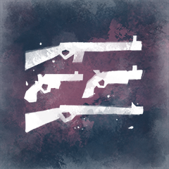

# To the Teeth

**Contents**

- [Guide](#Guide)
- [Hunting Rifle](#Hunting_Rifle)
- [Revolver](#Revolver)
- [Trivia](#Trivia)

<table class="infobox">
<caption>To the Teeth</caption>
<colgroup>
<col style="width: 50%" />
<col style="width: 50%" />
</colgroup>
<tbody>
<tr>
<td colspan="2"><figure>

<figcaption>To_the_Teeth_icon.png</figcaption>
</figure></td>
</tr>
<tr>
<td colspan="2"></td>
</tr>
<tr>
<td>
Description
</td>
<td>
Collect 7 Expansion Firearm variants (single game).
</td>
</tr>
</tbody>
</table>

**To the Teeth** is an <a href="./The%20Long%20Dark%20%E2%80%94%20Achievements.md" class="wikilink" title="achievement">achievement</a> in *<a href="./The%20Long%20Dark.md" class="wikilink" title="The Long Dark">The Long Dark</a>*.

## Guide

This achievement is easiest to unlock when playing on <a href="./Pilgrim.md" class="wikilink" title="Pilgrim">Pilgrim</a>, and cannot be unlocked on <a href="./Interloper.md" class="wikilink" title="Interloper">Interloper</a> or <a href="./Misery.md" class="wikilink" title="Misery">Misery</a>. The player must also have the <a href="./Trader.md" class="wikilink" title="Trader">Trader</a> enabled for one of the Hunting Rifles.

(WARNING : Playing on a survival save started prior of the DLC release can glitch the DLC rifles and replace them with a regular hunting rifle if the region has already been visited on the save.)

The player must find and pick up, at least once, all 7 firearm variants of the <a href="./Hunting%20Rifle.md" class="wikilink" title="Hunting Rifle">Hunting Rifle</a> and <a href="./Revolver.md" class="wikilink" title="Revolver">Revolver</a> in a single game:

### Hunting Rifle

- <a href="./Barb%27s%20Rifle.md" class="wikilink" title="Barb&#39;s Rifle">Barb's Rifle</a> - somewhere in <a href="./Coastal%20Highway.md" class="wikilink" title="Coastal Highway">Coastal Highway</a>
- <a href="./Bunker%20Rifle.md" class="wikilink" title="Bunker Rifle">Bunker Rifle</a> - acquired from the <a href="./Trader.md" class="wikilink" title="Trader">Trader</a>
- <a href="./Curator%27s%20Rifle.md" class="wikilink" title="Curator&#39;s Rifle">Curator's Rifle</a> - somewhere in <a href="./Ash%20Canyon.md" class="wikilink" title="Ash Canyon">Ash Canyon</a>
- <a href="./Vaughn%27s%20Rifle.md" class="wikilink" title="Vaughn&#39;s Rifle">Vaughn's Rifle</a> - somewhere in <a href="./Carter%20Hydro%20Dam.md" class="wikilink" title="Carter Hydro Dam">Carter Hydro Dam</a> or outside the Dam in <a href="./Winding%20River.md" class="wikilink" title="Winding River">Winding River</a>

### Revolver

- <a href="./Warden%27s%20Revolver.md" class="wikilink" title="Warden&#39;s Revolver">Warden's Revolver</a> - somewhere in <a href="./Blackrock%20Prison.md" class="wikilink" title="Blackrock Prison">Blackrock Prison</a>
- <a href="./Forester%27s%20Revolver.md" class="wikilink" title="Forester&#39;s Revolver">Forester's Revolver</a> -somewhere in the mountains in <a href="./Bleak%20Inlet.md" class="wikilink" title="Bleak Inlet">Bleak Inlet</a>
- <a href="./Hunter%27s%20Revolver.md" class="wikilink" title="Hunter&#39;s Revolver">Hunter's Revolver</a> - in the Hunting <a href="./Prepper%20Cache.md" class="wikilink" title="Prepper Cache">Prepper Cache</a>

## Trivia

This achievement's name is a reference to the saying "Armed to the Teeth." **Lua execution error in Module:Navbox function navbox**

