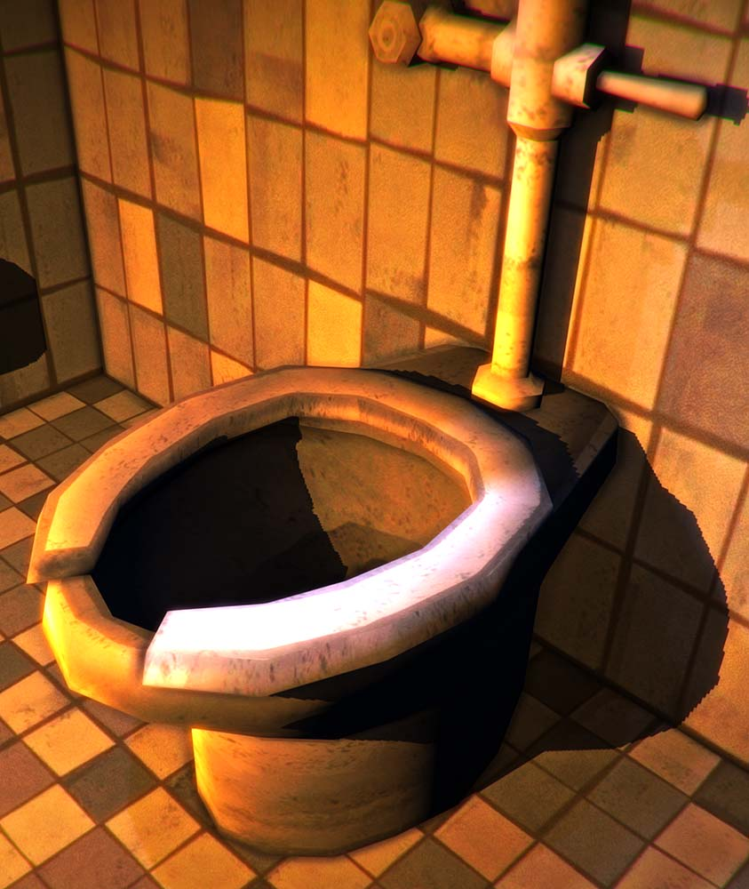
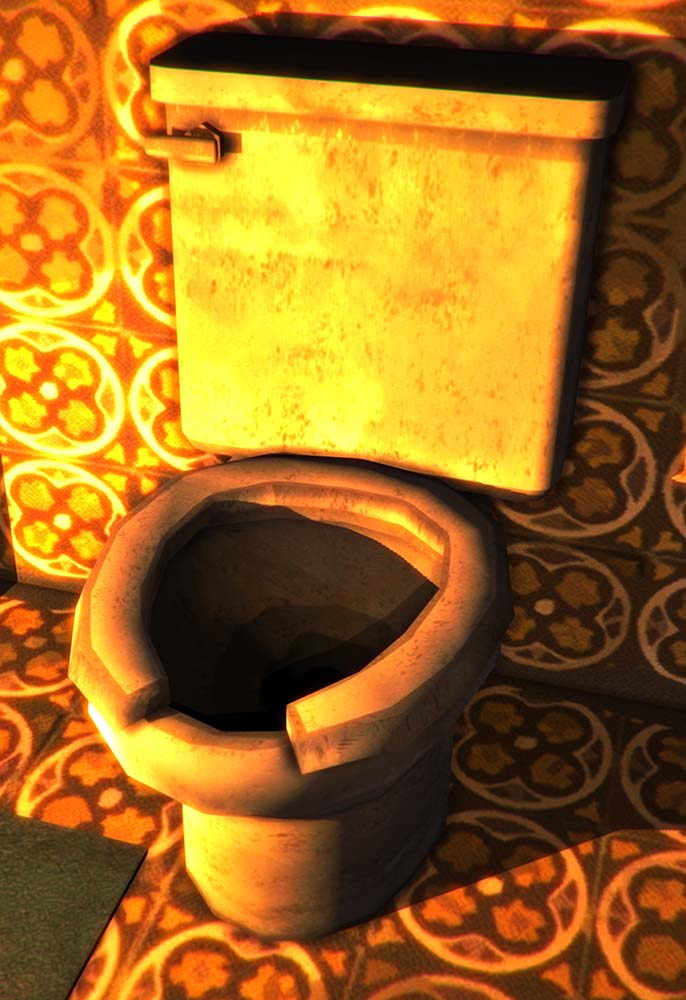

# Toilet

**Categories:** Interactable objects, Interactable Objects · **Source:** [Fandom](https://thelongdark.fandom.com/wiki/Toilet)

**Toilet** belongs to stationary interactable objects in _[The Long Dark](./The%20Long%20Dark.md)_.

## Overview

There are two types of toilets: those with and without a toilet cistern (reservoir tank). Regardless of the type, toilets initially contain 1.5 to 2 liters of [Water (Potable)](./Water%20%28Potable%29.md), (or about 0.39gal to 0.52gal). This water will not replenish, and the tank/bowl cannot be refilled once taken (However it can still be selected despite being empty).

Toilets can be found in houses and other indoors structures such as the [Quonset Gas Station](./Quonset%20Garage.md). Other buildings such as small cabins, trailers, or remote structures (e.g., [Hibernia Processing](./Hibernia%20Processing.md), [Lonely Lighthouse](./Lonely%20Lighthouse.md)) do not have them.

On Interloper game mode where matches are scarce, water from toilets can be lifesaving.

## Trivia

- In real life, drinking water from a toilet's bowl would be dangerous due to harmful pathogens; however, water from a toilet's cistern would be as safe to drink as tap water.
