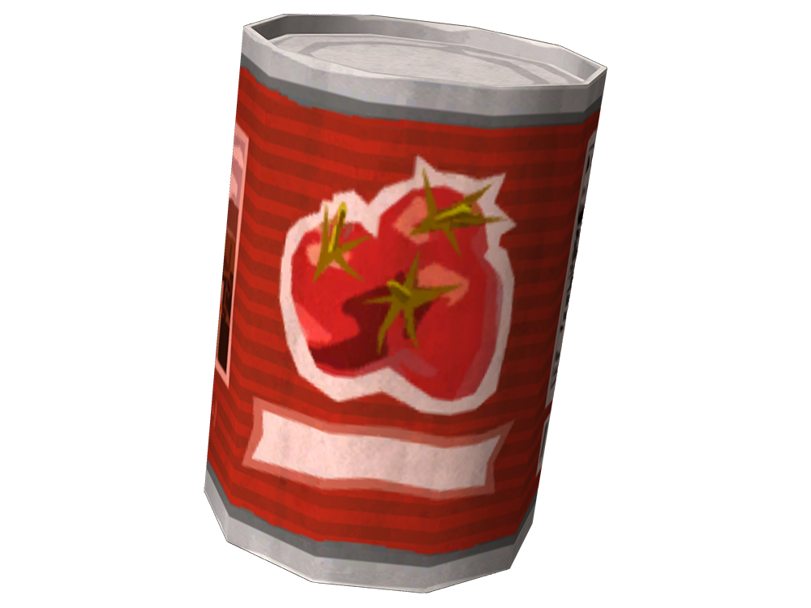

# Tomato Soup

**Contents**

- [Overview](#overview)
- [Trivia](#trivia)
- [Gallery](#gallery)
- [Update history](#update-history)

**Tomato Soup**

| Property | Details |
| --- | --- |
| \[\[File: / \|  / *Sealed* \|  / *Opened* \| / \| --- \| --- \| | 250px\]\] |
|  / *Sealed* |  / *Opened* |
| Release | [17 December 2014](./The%20Long%20Dark%20%E2%80%94%20Changelog.md#0.181) |
| Wintermute | No |
| **Properties** |  |
| Item type | [Food And Drink](./Food%20And%20Drink.md)\|- / Equipable |
| Stackable | No |
| Examine | A rich, sweet-smelling soup. Eat it hot and it'll warm your heart. Might even stave off starvation for a little longer. |
| **Values** |  |
| Calories | 300 kcal |
| Hydration | 10% |
| [Vitamin C](./Scurvy.md) | Moderate (30%) |
| Weight | 0.25 kg (0.55 lbs) |
| **Decay Rate** |  |
| Inside | 0.200% per day |
| Outside | 0.050% per day |
| **Advanced data** |  |
| Item key | GAMEPLAY\_TomatoSoupCan |

**Tomato Soup** is a packaged [food](./Food%20And%20Drink.md) item in *The Long Dark*.

## Overview

Consuming Tomato Soup restores a small amount of calories and hydration, it has relatively low energy density, making it heavy for the calories it provides. It may also be warmed by a [fire](./Fire.md) to grant the benefit [Warming Up](./Warming%20Up.md).

Like other canned foods, Tomato Soup may be opened with a [Can Opener](./Can%20Opener.md) or [bladed tool](./Tools.md), or smashed open (with no tool) but spilling some of it's contents. If opened with a tool a [Recycled Can](./Recycled%20Can.md) is received after consuming the contents.

Tomato Soup is relatively common inside homes: usually in cupboards or on shelfs.

## Trivia

- Tomato Soup is branded as "*Mom's Kitchen*".
- The ingredients on the back list: "Tomatoes, Water, Salt." and that it is a "Product of Canada."

## Gallery

| Column 1 |
| --- |
|  / *Old model* |

## Update history

- HOTFIX **18 December 2014 ([Update](./The%20Long%20Dark%20%E2%80%94%20Early%20Access%20Changelog.md#0.183)):**
  - Fixed typo in Tomato Soup description
  - Updated Tomato Soup drinking sounds

- UPDATE **17 December 2014 ([Update](./The%20Long%20Dark%20%E2%80%94%20Early%20Access%20Changelog.md#0.181)):**
  - Added to game.

**Lua execution error in Module:Navbox function navbox** [ru:Банка томатного супа](ru:%D0%91%D0%B0%D0%BD%D0%BA%D0%B0_%D1%82%D0%BE%D0%BC%D0%B0%D1%82%D0%BD%D0%BE%D0%B3%D0%BE_%D1%81%D1%83%D0%BF%D0%B0)
