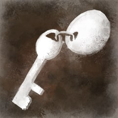

# Too Big to Fail

**Contents**

- [Guide](#Guide)
- [Tasks](#Tasks)
- [Key locations](#Key_locations)
- [Trivia](#Trivia)
- [Game History](#Game_History)

<table class="infobox">
<caption>Too Big to Fail</caption>
<colgroup>
<col style="width: 50%" />
<col style="width: 50%" />
</colgroup>
<tbody>
<tr>
<td colspan="2"><figure>

<figcaption>Too_Big_to_Fail_icon.png</figcaption>
</figure></td>
</tr>
<tr>
<td>
Description
</td>
<td>
Open all Safety Deposit boxes in Milton.
</td>
</tr>
</tbody>
</table>

**Too Big to Fail** is a <a href="./Wintermute.md" class="wikilink" title="Wintermute">Wintermute</a> <a href="./The%20Long%20Dark%20%E2%80%94%20Achievements.md" class="wikilink" title="achievement">achievement</a> in <a href="./Episode%201%20-%20Do%20Not%20Go%20Gentle.md" class="wikilink" title="Episode 1: Do Not Go Gentle">Episode 1: Do Not Go Gentle</a> of *<a href="./The%20Long%20Dark.md" class="wikilink" title="The Long Dark">The Long Dark</a>*.

## Guide

This is a side mission achievement that is acquired after opening every locked <a href="./Deposit%20Box.md" class="wikilink" title="Deposit Box">Deposit Box</a> in the <a href="./Milton%20Credit%20Union.md" class="wikilink" title="Milton Credit Union">Milton Credit Union</a>. The side mission <a href="./Milton%20Safety%20Deposit%20Box%20Keys.md" class="wikilink" title="Milton Safety Deposit Box Keys">Milton Safety Deposit Box Keys</a> keeps track of each key needed.

## Tasks

- Open bank deposit box \#7
- Open bank deposit box \#13
- Open bank deposit box \#20
- Open Bank deposit box \#15

## Key locations

- *<a href="./Bank%20Deposit%20Box%20Key%207.md" class="wikilink" title="Bank Deposit Box Key #7">Bank Deposit Box Key #7</a>* is located inside a house on the main road between the <a href="./Milton%20Post%20Office.md" class="wikilink" title="Post Office">Post Office</a> and the <a href="./Orca%20Gas%20Station.md" class="wikilink" title="Orca Gas Station">Orca Gas Station</a>, in a plastic container underneath the bed. The house is across the main road from the <a href="./Bank%20Manager%27s%20House.md" class="wikilink" title="Bank Manager&#39;s House">Bank Manager's House</a>. Note there is another house in between them. Box contains <a href="./Cash.md" class="wikilink" title="cash">cash</a> and 2 <a href="./Flare%20Shell.md" class="wikilink" title="flare shells">flare shells</a>.
- *<a href="./Bank%20Deposit%20Box%20Key%2013.md" class="wikilink" title="Bank Deposit Box Key #13">Bank Deposit Box Key #13</a>* is located on a corpse near the frozen river between <a href="./Orca%20Gas%20Station.md" class="wikilink" title="Orca Gas Station">Orca Gas Station</a> and <a href="./Paradise%20Meadows%20Farm.md" class="wikilink" title="Paradise Meadows Farm">Paradise Meadows Farm</a>. Follow the stream downhill directly behind the gas station. Right before the slight bend turn left up the slope and The corpse will be directly ahead. The crows circling above the corpse should make locating it easier; If walking downstream, the crows can be seen circling above on the lefthand side of the river. Box contains <a href="./Balaclava.md" class="wikilink" title="balaclava">balaclava</a>, <a href="./Book.md" class="wikilink" title="book">book</a>, <a href="./Ski%20Gloves.md" class="wikilink" title="ski gloves">ski gloves</a> and <a href="./Stack%20of%20Papers.md" class="wikilink" title="stack of papers">stack of papers</a>.
- *<a href="./Bank%20Deposit%20Box%20Key%2020.md" class="wikilink" title="Bank Deposit Box Key #20">Bank Deposit Box Key #20</a>* is located behind <a href="./Orca%20Gas%20Station.md" class="wikilink" title="Orca Gas Station">Orca Gas Station</a> in a blue pickup truck parked on the trail leading to the climbing area. The truck is next to two port-a-potties. Box contains <a href="./Magnifying%20Lens.md" class="wikilink" title="magnifying lens">magnifying lens</a> and 2 <a href="./Cash.md" class="wikilink" title="cash">cash</a>.
- <a href="./Bank%20Deposit%20Box%20Key%2015.md" class="wikilink" title="Bank Deposit Box Key #15">Bank Deposit Box Key #15</a> is located in the farm house. The key can be found next to <a href="./Hobbs.md" class="wikilink" title="Hobbs">Hobbs</a> immediately after the interaction with him, regardless of the outcome chosen. This is the only key that is necessary to progress through the story, as Bank Deposit Box \#15 holds a plot-sensitive item.

## Trivia

- The achievement's name is a reference to the phrase "Too big to fail" in reference to several large banks or corporations that are kept afloat with emergency government bail outs (hence why they are too big to fail naturally).
  - The most notable usage of this phrase was in 2008 during the housing market collapse, an event that caused the Great Recession. The effects of this recession seem to be far worse in the world of *The Long Dark*, as seen with <a href="./The%20Collapse.md" class="wikilink" title="The Collapse">The Collapse</a>.
  - The name is also ironic, seeing how the <a href="./Milton%20Credit%20Union.md" class="wikilink" title="Milton Credit Union">Milton Credit Union</a> closed down long before Will Mackenzie first enters it.

## Game History

- UPDATE **1 August 2017 (<a href="./The%20Long%20Dark%20%E2%80%94%20Changelog.md#1.00" class="wikilink" title="Update">Update</a>):**
  - Added to game.

**Lua execution error in Module:Navbox function navbox**

