# Tools

**Contents**

- [Tool Types](#tool-types)
- [Cooking](#cooking)
- [Lighting](#lighting)
- [Fire Starting](#fire-starting)
- [Fishing](#fishing)
- [Hand Tools](#hand-tools)
- [Hunting](#hunting)
- [Repair](#repair)
- [Sleep](#sleep)
- [Transmitter Parts](#transmitter-parts)
- [Camera](#camera)
- [Other](#other)
- [Sutherland's Tale](#sutherlands-tale)
- [Wintermute Exclusive](#wintermute-exclusive)
- [Cut Tools](#cut-tools)

**Tools** are items with specialized purposes in [The Long Dark](./The%20Long%20Dark.md).

## Tool Types

### Cooking

| 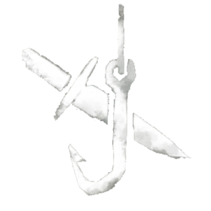 / *Tools.png* | Item | Boiling Water Capacity | Weight | Comment |
| --- | --- | --- | --- | --- |
| 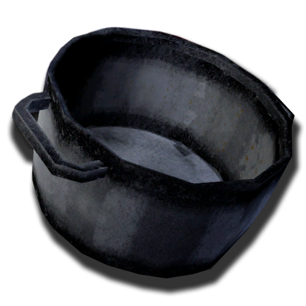 / *Cooking\_Pot\_icon.png* | [Cooking Pot](./Cooking%20Pot.md) | 2 liters | 1.00 kg / *(2.2 lb)* | - Reduces the amount of time required to cook any food or drink on a [fire](./Fire.md). / - Allows the player to melt snow and boil water on a [fire](./Fire.md). / - Allows player to cook Food and Drinks / - Allows the player to create (Pot) Cooking Recipes |
| 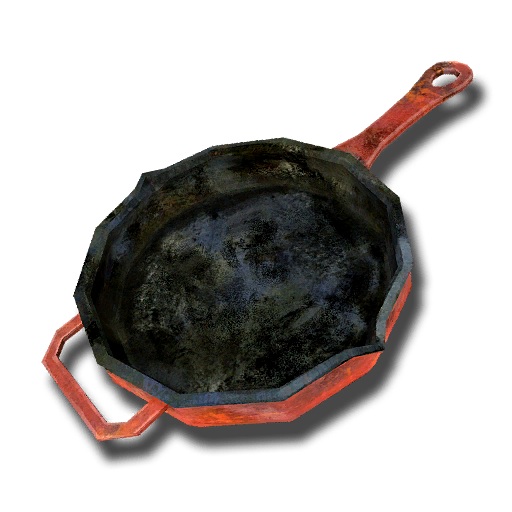 / *Cooking\_Skillet\_icon.png* | [Cooking Skillet](./Cooking%20Skillet.md) | 1 liter | 1.00 kg / *(2.2 lb)* | - Allows the player to create (Skillet) Cooking Recipes / - Allows player to cook Food and Drinks |
|  / *Recycled\_Can\_icon.png* | [Recycled Can](./Recycled%20Can.md) | 0.5 liters | 0.15 kg / *(0.33 lb)* | - Allows the player to melt snow and boil water on a [fire](./Fire.md). / - Allows player to cook Drinks |
| 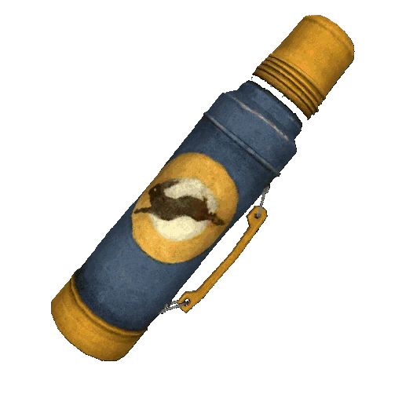 / *Insulated\_Flasks\_animation.gif* | [Insulated Flask](./Insulated%20Flask.md) | N/A | 0.20 kg / *(0.44 lb)* | - Can store and transport multiple drinks inside, keeping them warm / - Comes in 7 fun design patterns! |
| 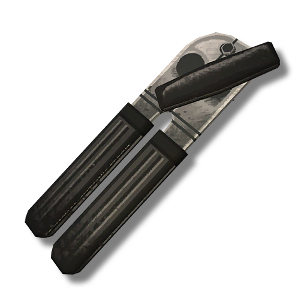 / *Can\_Opener\_icon.png* | [Can Opener](./Can%20Opener.md) | N/A | 0.25 kg / *(0.55 lb)* | - Used to open food cans without losing food/damaging can / - Repaired with scrap metal |

### Lighting

|  / *Tools.png* | Item | Weight | Comment |
| --- | --- | --- | --- |
|  / *Flare\_icon.png* | [Flare](./Flare.md) | 0.25 kg / *(0.55 lb)* | - Can keep [Wolf](./Wolf.md) at bay. / - Lasts longer than the [Marine flare](./Marine%20Flare.md). |
|  / *Flashlight\_icon.png* | [Flashlight](./Flashlight.md) | 1.00 kg / *(2.2 lb)* | - Can keep predators at bay during [Aurora](./Aurora.md) or [Glimmer Fog](./Glimmer%20Fog.md). / - Usable only during Aurora or Glimmer Fog. |
|  / *Miner's\_Flashlight\_icon.png* | [Miner's Flashlight](./Miner%27s%20Flashlight.md) | 1.25 kg / *(2.75 lb)* | - Can keep predators at bay during [Aurora](./Aurora.md) or [Glimmer Fog](./Glimmer%20Fog.md). / - Usable only during Aurora or Glimmer Fog. / - Bigger battery, but Heavier than standard variant |
|  / *Marine\_Flare\_icon.png* | [Marine Flare](./Marine%20Flare.md) | 0.25 kg / *(0.55 lb)* | - Can keep [Wolf](./Wolf.md) and [Timberwolf](./Timberwolf.md) at bay. / - Lasts shorter than the regular [Flare](./Flare.md). |
|  / *Storm\_Lantern\_icon.png* | [Storm Lantern](./Storm%20Lantern.md) | 1.00 kg / *(2.2 lb)* | - You can refuel it with [lantern fuel](./Lantern%20Fuel.md) or [kerosene](./Jerry%20Can.md). / - Can hold up to 1L of fuel / - Weighs 1.80 kg when full |
|  / *Spelunker's\_Lantern\_icon.png* | [Spelunker's Lantern](./Spelunker%27s%20Lantern.md) | 1.00 kg / *(2.2 lb)* | - You can refuel it with [lantern fuel](./Lantern%20Fuel.md) or [kerosene](./Jerry%20Can.md). / - Can hold up to 1L of fuel / - Weighs 1.80 kg when full / - Uses 40% less fuel, but light is 40% dimmer than regular variant |
|  / *Torch\_icon.png* | [Torch](./Torch.md) | 0.3 kg / *(0.66 lb)* | - Can keep [Wolf](./Wolf.md) at bay. / - Can be obtained with a lit fire. |
| 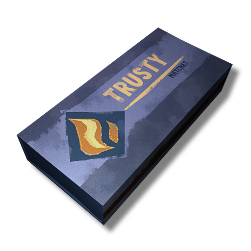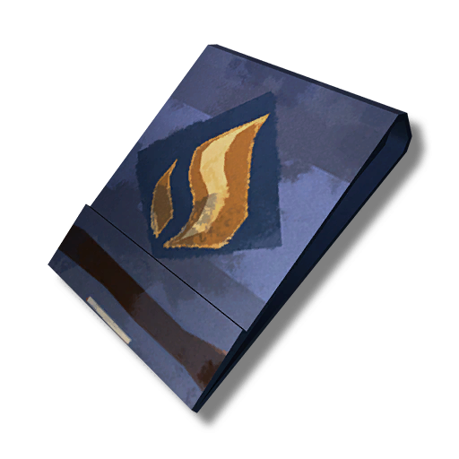 | [Cardboard Matches](./Cardboard%20Matches.md)/[Wood Matches](./Wood%20Matches.md) | 0.005 kg / *(0.011 lb)*0.10 kg / *(0.22 lb)* | - Very limited light source time. Only practical when used indoors |

- 

### Fire Starting

|  / *Tools.png* | Item | Weight | Comment |
| --- | --- | --- | --- |
|  / *Accelerant\_icon.png* | [Accelerant](./Accelerant.md) | 0.10 kg / *(0.22 lb)* | - Greatly increases the chance of starting fires / - Only used to start fires |
|  / *Can\_of\_Gunpowder\_icon.png* | [Can of Gunpowder](./Can%20of%20Gunpowder.md) | 0.50 kg / *(1.1 lb)* | - Can be used to craft Ammunition / - Can be used to greatly increase chances of starting fires / - 5 uses to start fires |
|  / *Cardboard\_Matches\_icon.png* | [Cardboard Matches](./Cardboard%20Matches.md) | 0.005 kg / *(0.011 lb)* | - More common than wood matches / - less useful at starting fires than wood matches / - Can be used as a light source |
| 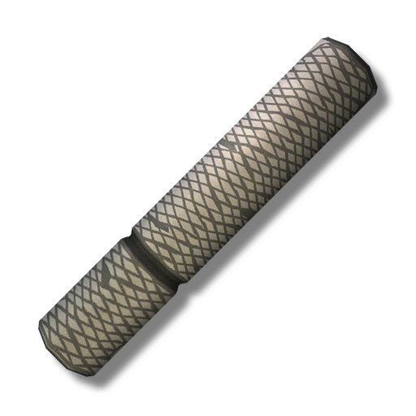 / *Firestriker\_icon.png* | [Firestriker](./Firestriker.md) | 0.10 kg / *(0.22 lb)* | - Most effective fire starter / - Cannot be repaired and is very rare |
|  / *Flare\_icon.png* | [Flare](./Flare.md) | 0.25 kg / *(0.55 lb)* | - Cannot turn off after activating. Limited Fire-starting capability |
| 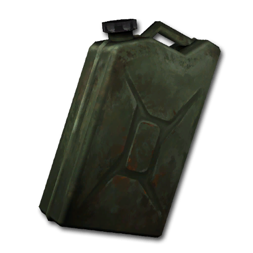 / *Jerry\_Can\_icon.png* | [Jerry Can](./Jerry%20Can.md) | 3.30 kg / *(7.26 lb)* | - 0.30L can be used as accelerant / - Can hold up to 4L of fuel / - Collects fuel from scrapped lanterns |
|  / *Lantern\_Fuel\_icon.png* | [Lantern Fuel](./Lantern%20Fuel.md) | 0.50 kg / *(1.1 lb)* | - Can be used to fuel Lanterns / - Can hold up to 0.5L of fuel / - Can be obtained from cooking fish / - Can be used to greatly increase the chances of starting fires (requires 0.30 L) |
| 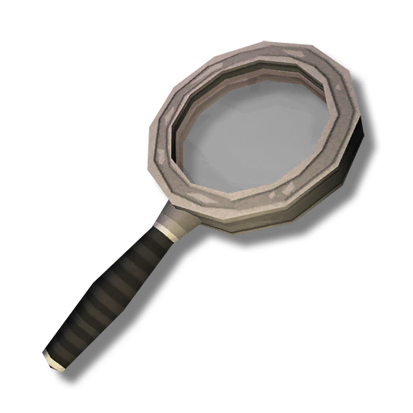 / *Magnifying\_Lens\_icon.png* | [Magnifying Lens](./Magnifying%20Lens.md) | 0.10 kg / *(0.22 lb)* | - Doesn't lose condition when used / - Can only be used outside in clear weather |
|  / *Marine\_Flare\_icon.png* | [Marine Flare](./Marine%20Flare.md) | 0.25 kg / *(0.55 lb)* | - Cannot turn off after activating. Limited Fire-starting capability |
|  / *Torch\_icon.png* | [Torch](./Torch.md) | 0.30 kg / *(0.66 lb)* | - Can be pulled from fires and used to start a fire elsewhere ([Daisy Chaining](./Daisy%20Chaining.md)) / - Must use a match if unlit in order to start a fire |
|  / *Wood\_Matches\_icon.png* | [Wood Matches](./Wood%20Matches.md) | 0.10 kg / *(0.22 lb)* | - Less common than Cardboard Matches / - Increases chance of starting fires / - Can be used as a light source |

### Fishing

|  / *Tools.png* | Item | Weight | Comment |
| --- | --- | --- | --- |
| 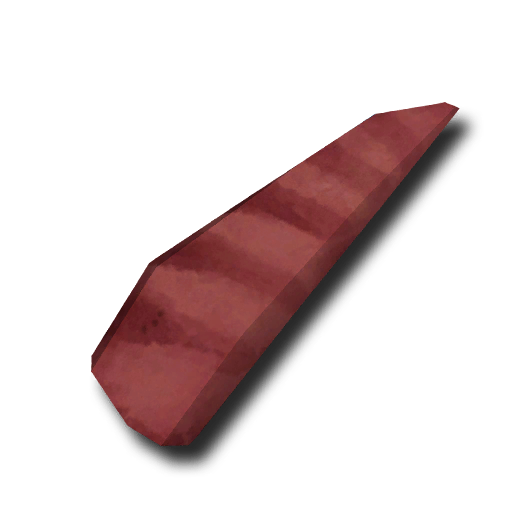 / *Fishing\_Bait\_icon.png* | [Fishing Bait](./Fishing%20Bait.md) | 0.05 kg / *(0.11 lb)* | - Can be used to increase [Ice Fishing](./Ice%20Fishing.md) odds |
|  | - [Fishing Lure (Acorns)](./Fishing%20Lure%20%28Acorns%29.md) / - [Fishing Lure (Wire Bundle)](./Fishing%20Lure%20%28Wire%20Bundle%29.md) / - [Fishing Lure (Revolver Shell Casing)](./Fishing%20Lure%20%28Revolver%20Shell%20Casing%29.md) | 0.01 kg *(0.02 lbs)* | - Can be used to increase [Ice Fishing](./Ice%20Fishing.md) odds / - Better than Simple Fishing Lure |
|  / *Simple\_Fishing\_Lure\_icon.png* | [Simple Fishing Lure](./Simple%20Fishing%20Lure.md) | 0.01 kg / *(0.022 lb)* | - Can be used to increase [Ice Fishing](./Ice%20Fishing.md) odds |
|  / *Fishing\_Tackle\_icon.png* | [Fishing Tackle](./Fishing%20Tackle.md) | 0.02 kg / *(0.044 lb)* | - Required for fishing at ice holes / - Can be used to repair clothing |
|  / *Fishing\_Tip-Up\_icon.png* | [Fishing Tip-Up](./Fishing%20Tip-Up.md) | 0.30 kg / *(0.66 lb)* | - Trap used to catch fish over time / - Breaks after multiple uses |
|  / *Hook\_icon.png* | [Hook](./Hook.md) | 0.01 kg / *(0.022 lb)* | - Required to craft [Fishing Tackle](./Fishing%20Tackle.md) / - Crafted using 1 [Scrap Metal](./Scrap%20Metal.md) |
|  / *Line\_icon.png* | [Line](./Line.md) | 0.01 kg / *(0.022 lb)* | - Required to craft [Fishing Tackle](./Fishing%20Tackle.md) / - Crafted using 1 [Cured Gut](./Cured%20Gut.md) |

### Hand Tools

|  / *Tools.png* | Item | Weight | Comment |
| --- | --- | --- | --- |
|  / *Hatchet\_icon.png* | [Hatchet](./Hatchet.md) | 1.50 kg / *(3.3 lb)* | - Used to break down furniture and tree limbs / - Can be used in a Wolf [Struggle](./Struggle.md) / - Can be used to harvest and craft |
|  / *Improvised\_Hatchet\_icon.png* | [Improvised Hatchet](./Improvised%20Hatchet.md) | 1.75 kg / *(3.85 lb)* | - Crafted in the [Forge](./Forge.md) / - Works slower than manufactured [Hatchets](./Hatchet.md) |
|  / *Hunting\_Knife\_icon.png* | [Hunting Knife](./Hunting%20Knife.md) | 0.50 kg / *(1.1 lb)* | - Used to break down cloth and cardboard items / - Can be used in a [Struggle](./Struggle.md) / - Can be used to harvest and craft |
|  / *Improvised\_Knife\_icon.png* | [Improvised Knife](./Improvised%20Knife.md) | 0.75 kg / *(1.65 lb)* | - Crafted in the [Forge](./Forge.md) / - Slower than manufactured [knives](./Hunting%20Knife.md) |
|  / *Cougar\_Claw\_Knife\_icon.png* | [Cougar Claw Knife](./Cougar%20Claw%20Knife.md) | 0.60 kg / *(1.32 lb)* | - Crafted in the [Forge](./Forge.md) / - Does the highest damage during a [Struggle](./Struggle.md) / - Requires killing a [Cougar](./Cougar.md) for materials |
|  / *Survival\_Knife\_icon.png* | [Survival Knife](./Survival%20Knife.md) | 0.75 kg / *(1.65 lb)* | - Traded from the [Trader](./Trader.md) / - Most durable knife |
|  / *Hacksaw\_icon.png* | [Hacksaw](./Hacksaw.md) | 1.00 kg / *(2.2 lb)* | - Used to break down metal furniture / - Can break down tree limbs and harvest saplings |
|  / *Heavy\_Hammer\_icon.png* | [Heavy Hammer](./Heavy%20Hammer.md) | 2.00 kg / *(4.4 lb)* | - Used to craft tools in a [Forge](./Forge.md) / - Can be used to break down furniture |
|  / *Prybar\_icon.png* | [Prybar](./Prybar.md) | 1.00 kg / *(2.2 lb)* | - Used to open locked doors and cars / - Cannot be repaired |

### Hunting

|  / *Tools.png* | Item | Weight | Comment |
| --- | --- | --- | --- |
|  / *Distress\_Pistol\_icon.png* | [Distress Pistol](./Distress%20Pistol.md) | 0.40 kg / *(0.88 lb)* | - Rarest firearm in the game / - Offers the best bleed out time of all weapons / - Shots can scare off bears and wolves |
|  / *Fishing\_Tip-Up\_icon.png* | [Fishing Tip-Up](./Fishing%20Tip-Up.md) | 0.30 kg *(0.66 lbs)* | - Trap used to catch fish over time / - Breaks after multiple uses / - Must be tended to more frequently than a Snare |
|  / *Flare\_Shell\_icon.png* | [Flare Shell](./Flare%20Shell.md) | 0.05 kg / *(0.11 lb)* | - Used in the [Distress Pistol](./Distress%20Pistol.md) / - Very rare and difficult to find |
|  / *Hunting\_Rifle\_icon.png* | [Hunting Rifle](./Hunting%20Rifle.md) | 4.00 kg / *(8.8 lb)* | - Most powerful firearm in the game / - Holds 10 rounds / - Very slow and can only be fired while aiming / - Base version of the Hunting Rifle |
|  / *Barb's\_Rifle\_icon.png* | [Barb's Rifle](./Barb%27s%20Rifle.md) | 4.50 kg / *(9.9 lb)* | - Most powerful firearm in the game / - Heaviest Hunting Rifle / - Highest durability of any Hunting Rifle |
|  / *Bunker\_Rifle\_icon.png* | [Bunker Rifle](./Bunker%20Rifle.md) | 1.50 kg / *(3.3 lb)* | - Traded from the [Trader](./Trader.md) / - Lowest durability of any Hunting Rifle |
|  / *Curator's\_Rifle\_icon.png* | [Curator's Rifle](./Curator%27s%20Rifle.md) | 4.00 kg / *(8.8 lb)* | - Most powerful firearm in the game / - Farthest range of any Hunting Rifle |
|  / *Vaughn's\_Rifle\_icon.png* | [Vaughn's Rifle](./Vaughn%27s%20Rifle.md) | 3.00 kg / *(6.6 lb)* | - Most powerful firearm in the game / - Second lowest durability Hunting Rifle / - Lightest Hunting Rifle |
|   | [Rifle Ammunition](./Rifle%20Ammunition.md) | 0.02 kg / *(0.044 lb)* | - Can be crafted at an [Ammunition Workbench](./Ammunition%20Work%20Bench.md) / - Used in the [Hunting Rifle](./Hunting%20Rifle.md) |
|  / *Revolver\_icon.png* | [Revolver](./Revolver.md) | 1.50 kg / *(3.3 lb)* | - Holds fewer rounds than the [Hunting Rifle](./Hunting%20Rifle.md) (6 rounds) / - Defensive over Offensive firearm / - Base version of the Revolver / - Faster draw speed than hunting rifle |
|  / *Forester's\_Revolver\_icon.png* | [Forester's Revolver](./Forester%27s%20Revolver.md) | 1.50 kg / *(3.3 lb)* | - Highest durability of any Revolver |
|  / *Hunter's\_Revolver\_icon.png* | [Hunter's Revolver](./Hunter%27s%20Revolver.md) | 1.75 kg / *(3.85 lb)* | - Heaviest Revolver / - Farthest range of any Revolver |
|  / *Warden's\_Revolver\_icon.png* | [Warden's Revolver](./Warden%27s%20Revolver.md) | 1.25 kg / *(2.75 lb)* | - Lightest Revolver / - Fastest draw speed of any Revolver |
|   | [Revolver Ammunition](./Revolver%20Ammunition.md) | 0.081 kg / *(0.178 lb)* | - Can be crafted at an [Ammunition Workbench](./Ammunition%20Work%20Bench.md) / - More common than most ammunition / - Used in the [Revolver](./Revolver.md) |
|  / *Survival\_Bow\_icon.png* | [Survival Bow](./Survival%20Bow.md) | 0.50 kg / *(1.1 lb)* | - Must be crafted / - Base version of the Bow / - Ammunition is reusable / - Cannot be Repaired |
|  / *Bushcraft\_Bow\_icon.png* | [Bushcraft Bow](./Bushcraft%20Bow.md) | 0.50 kg / *(1.1 lb)* | - Must be crafted / - Upgraded version of the Survival Bow / - Requires [Bushcraft Bow Blueprint Card](./Bushcraft%20Bow%20Blueprint%20Card.md) from the [Trader](./Trader.md) to be crafted / - Ammunition is reusable / - Cannot be Repaired |
|  / *Woodwright's\_Bow\_icon.png* | [Woodwright's Bow](./Woodwright%27s%20Bow.md) | 0.75 kg *(1.65 lbs)* | - Heaviest Bow / - Highest durability Bow / - Less sway and but also least range of any Bow / - Ammunition is reusable / - Cannot be Repaired |
|  / *Sport\_Bow\_icon.png* | [Sport Bow](./Sport%20Bow.md) | 0.35 kg *(0.77 lbs)* | - Lightest Bow / - Same stats as Survival Bow, but more durable / - Ammunition is reusable / - Cannot be Repaired |
|  / *Simple\_Arrow\_icon.png* | [Simple Arrow](./Simple%20Arrow.md) | 0.15 kg / *(0.33 lb)* | - Can be crafted at a workbench / - Harder to acquire resources to produce / - Breaks after many shots / - Can ricochet off of hard surfaces / - Best durability arrow |
| 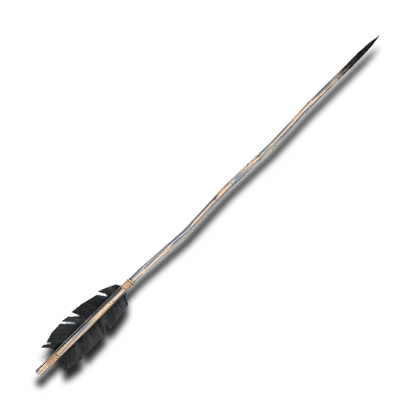 / *Fire\_Hardened\_Arrow\_icon.png* | [Fire Hardened Arrow](./Fire%20Hardened%20Arrow.md) | 0.10 kg / *(0.22 lb)* | - Improvised Arrow that can be made at Campfires / - Easier to manufacture than Simple Arrows due to cheaper materials / - Breaks after many shots / - Can ricochet off of hard surfaces / - Less durable than Simple Arrows |
|  / *Manufactured\_Arrow\_icon.png* | [Manufactured Arrow](./Manufactured%20Arrow.md) | 0.15 kg / *(0.33 lb)* | - Must be traded from the [Trader](./Trader.md) / - More durable than Simple Arrow / - Does more damage than Simple Arrow / - When broken, cannot be harvested for Materials |
|  / *Snare\_icon.png* | [Snare](./Snare.md) | 0.30 kg / *(0.66 lb)* | - Crafted at a workbench with 1 [Cured Gut](./Cured%20Gut.md) and 1 [Reclaimed Wood](./Reclaimed%20Wood.md) / - Used to catch [rabbits](./Rabbit.md) over time / - Breaks after multiple uses |
| 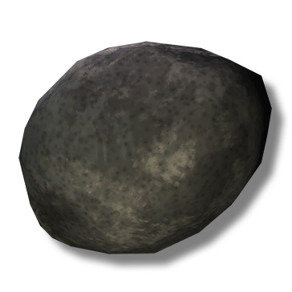 / *Stone\_icon.png* | [Stone](./Stone.md) | 0.15 kg / *(0.33 lb)* | - Most common ranged weapon / - Used to stun [rabbits](./Rabbit.md) and [ptarmigans](./Ptarmigan.md) / - Can be used to build [rock caches](./Rock%20Cache.md) |
|  / *Noisemaker\_icon.png* | [Noisemaker](./Noisemaker.md) | 0.20 kg *(0.44 lb)* |  |

### Repair

|  / *Tools.png* | Item | Survival skill | Weight | Comment |
| --- | --- | --- | --- | --- |
|  / *Sewing\_Kit\_icon.png* | [Sewing Kit](./Sewing%20Kit.md) | [Mending](./Mending.md) | 0.10 kg / *(0.22 lb)* | - Allows players to repair damaged clothing or craft new [clothing](./Clothing.md) with the appropriate materials. |
|  / *Fishing\_Tackle\_icon.png* | [Fishing Tackle](./Fishing%20Tackle.md) | [Mending](./Mending.md) | 0.02 kg / *(0.044 lb)* | - Allows players to repair damaged clothing or craft new [clothing](./Clothing.md) with the appropriate materials. |
|  / *Firearm\_Cleaning\_Kit\_icon.png* | [Firearm Cleaning Kit](./Firearm%20Cleaning%20Kit.md) | [Cleaning](./Cleaning.md) | 0.10 kg / *(0.22 lb)* | - Allows players to repair damaged [hunting rifle](./Hunting%20Rifle.md) and [revolver](./Revolver.md). |
| 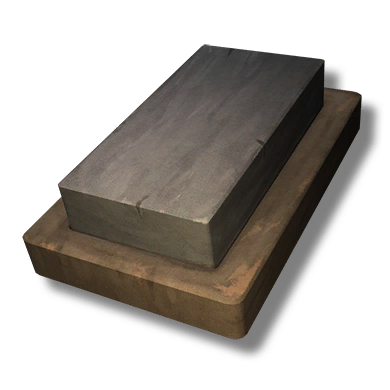 / *Whetstone\_icon.png* | [Whetstone](./Whetstone.md) | [Sharpening](./Sharpening.md) | 0.10 kg / *(0.22 lb)* | - Allows players to repair damaged [bladed tools](./Sharpening.md#Bladed_tools). |
|  / *Simple\_Tools\_icon.png* | [Simple Tools](./Simple%20Tools.md) | [Repair](./Repair.md) | 1.00 kg / *(2.2 lb)* | - Allows players to repair a variety of damaged tools. |
|  / *Quality\_Tools\_icon.png* | [Quality Tools](./Quality%20Tools.md) | [Repair](./Repair.md) | 0.75 kg / *(1.65 lb)* | - Allows players to repair a variety of damaged tools at a better rate. |

### Sleep

|  / *Tools.png* | Item | Weight | Warmth | Comment |
| --- | --- | --- | --- | --- |
|  / *Bedroll\_icon.png* | [Bedroll](./Bedroll.md) | 1.00 kg / *(2.2 lb)* | 5 °C / *(9 °F)* | - Allows players to [sleep](./Sleep.md). |
|  / *Improvised\_Down\_Bedroll\_icon.png* | [Improvised Down Bedroll](./Improvised%20Down%20Bedroll.md) | 1.10 kg *(2.42 lbs)* | 8 °C / *(14.4 °F)* | - Allows players to [sleep](./Sleep.md). / - Improved version of the Bedroll. |
| 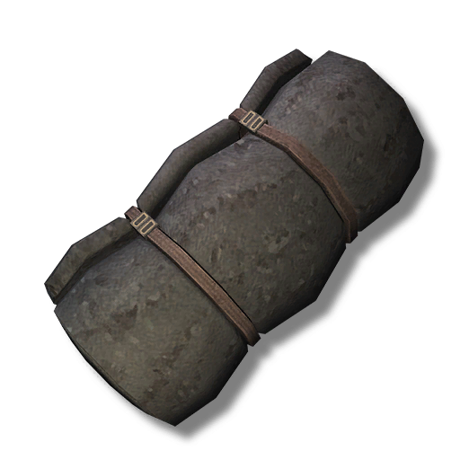 / *Bear\_Skin\_Bedroll\_icon.png* | [Bear Skin Bedroll](./Bear%20Skin%20Bedroll.md) | 3.00 kg / *(6.6 lb)* | 12 °C / *(21.6 °F)* | - Allows players to [sleep](./Sleep.md). / - Can keep [Wolf](./Wolf.md) at bay. / - Warmest, but also Heaviest, Bedroll |

### Transmitter Parts

|  / *Tools.png* | Item | Weight | Comment |
| --- | --- | --- | --- |
|  / *Handheld\_Shortwave\_Radio\_icon.png* | [Handheld Shortwave Radio](./Handheld%20Shortwave%20Radio.md) | 0 kg / *(0 lb)* | - Used to find [Supply Caches](./Supply%20Cache.md) and hidden Bunkers in the [Signal Void Tale](./Signal%20Void.md) / - Requires a repaired [Transmitter](./Transmitters.md) and the Aurora/Glimmer Fog to be present in order to pick up a signal |
|  / *Wires\_icon.png* | [Wires](./Wires.md) | 0.10 kg / *(0.22 lb)* | - 2 are needed to repair a Transmitter / - 1 bundle can be used to make a [Fishing Lure (Wire Bundle)](./Fishing%20Lure%20%28Wire%20Bundle%29.md) / - 1 is needed to destroy [Prepper's Abandoned Cache](./Prepper%27s%20Abandoned%20Cache.md) |
| 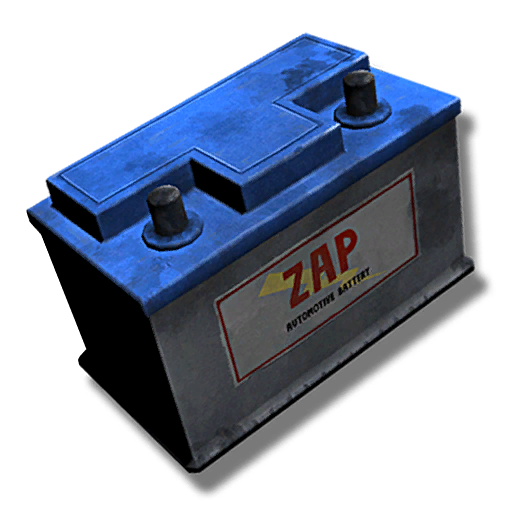 / *Car\_Battery\_icon.png* | [Car Battery](./Car%20Battery.md) | 15.00 kg / *(33 lb)* | - Heaviest item in the game, but 1 is needed to repair Transmitters / - Can be broken down into [Scrap Lead](./Scrap%20Lead.md) and turned into [Bullets](./Bullet.md) at an [Ammunition Work Bench](./Ammunition%20Work%20Bench.md) |
|  / *Replacement\_Fuse\_icon.png* | [Replacement Fuse](./Replacement%20Fuse.md) | 0.20 kg / *(0.44 lb)* | - 3 are needed to repair a Transmitter |

Research Book

|  / *Tools.png* | Item | Weight | Comment |
| --- | --- | --- | --- |
| 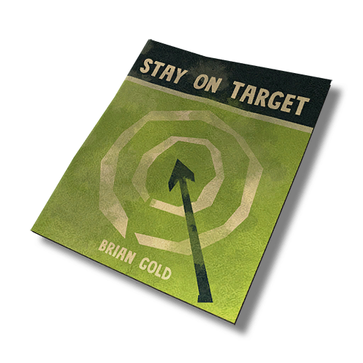 / *Stay\_on\_Target\_icon.png* | [Stay on Target](./Stay%20on%20Target.md) | 0.50 kg / *(1.1 lb)* | - Can be Researched to raise the [Archery](./Archery.md) Skill |
|  / *Field\_Dressing\_Your\_Kill,\_Vol.\_I\_icon.png* | [Field Dressing Your Kill, Vol. I](./Field%20Dressing%20Your%20Kill%2C%20Vol.%20I.md) | 0.50 kg / *(1.1 lb)* | - Can be Researched to raise the [Carcass Harvesting](./Carcass%20Harvesting.md) Skill |
|  / *Wilderness\_Kitchen\_icon.png* | [Wilderness Kitchen](./Wilderness%20Kitchen.md) | 0.50 kg / *(1.1 lb)* | - Can be Researched to raise the [Cooking](./Cooking.md) Skill |
| 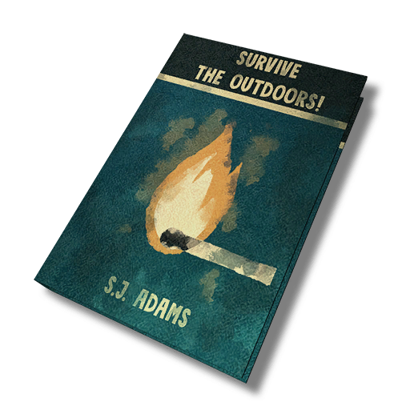 / *Survive\_the\_Outdoors!\_icon.png* | [Survive the Outdoors!](./Survive%20the%20Outdoors!.md) | 0.50 kg / *(1.1 lb)* | - Can be Researched to raise the [Fire Starting](./Fire%20Starting.md) Skill |
|  / *The\_Frozen\_Angler\_icon.png* | [The Frozen Angler](./The%20Frozen%20Angler.md) | 0.50 kg / *(1.1 lb)* | - Can be Researched to raise the [Ice Fishing](./Ice%20Fishing.md) Skill |
|  / *A\_Sewing\_Primer\_icon.png* | [A Sewing Primer](./A%20Sewing%20Primer.md) | 0.50 kg / *(1.1 lb)* | - Can be Researched to raise the [Mending](./Mending.md) Skill |
|  / *Frontier\_Shooting\_Guide\_icon.png* | [Frontier Shooting Guide](./Frontier%20Shooting%20Guide.md) | 0.50 kg / *(1.1 lb)* | - Can be Researched to raise the [Rifle Firearm](./Rifle%20Firearm.md) Skill |
|  / *Advanced\_Guns\_Guns\_Guns!\_icon.png* | [Advanced Guns Guns Guns!](./Advanced%20Guns%20Guns%20Guns!.md) | 0.50 kg / *(1.1 lb)* | - Can be Researched to raise the [Rifle Firearm](./Rifle%20Firearm.md) Skill |
|  / *Small\_Arms\_Handbook\_icon.png* | [Small Arms Handbook](./Small%20Arms%20Handbook.md) | 0.50 kg / *(1.1 lb)* | - Can be Researched to raise the [Revolver Firearm](./Revolver%20Firearm.md) Skill |
| 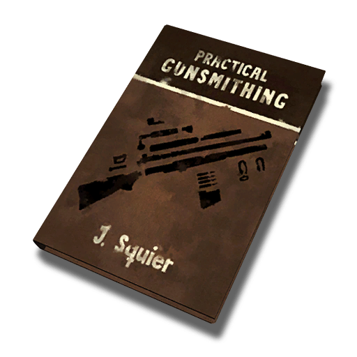 / *Practical\_Gunsmithing\_icon.png* | [Practical Gunsmithing](./Practical%20Gunsmithing.md) | 0.50 kg / *(1.1 lb)* | - Can be Researched to raise the [Gunsmithing](./Gunsmithing.md) Skill |

### Camera

|  / *Tools.png* | Item | Weight | Comment |
| --- | --- | --- | --- |
| 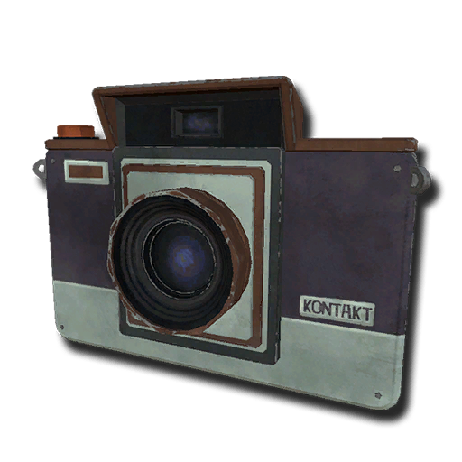 / *Camera\_icon.png* | [Camera](./Camera.md) | 0.00 kg / *(0 lb)* | - Can be used to take photos |
| 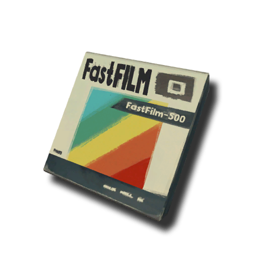 / *FastFilm-500\_icon.png* | [FastFilm-500](./FastFilm-500.md) | 0.50 kg / *(1.1 lb)* | - Used with the Camera. Uses Coloured film |
| 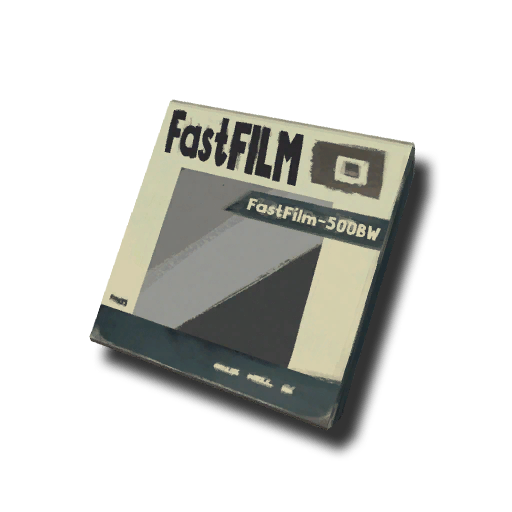 / *FastFilm-500BW\_icon.png* | [FastFilm-500BW](./FastFilm-500BW.md) | 0.50 kg / *(1.1 lb)* | - Used with the Camera. Uses Black &amp; White film |
| 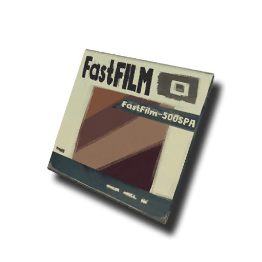 / *FastFilm-500SPA\_icon.png* | [FastFilm-500SPA](./FastFilm-500SPA.md) | 0.50 kg / *(1.1 lb)* | - Used with the Camera. Uses Sepia film |

### Other

|  / *Tools.png* | Item | Weight | Comment |
| --- | --- | --- | --- |
|  / *Broken\_Arrow\_icon.png* | [Broken Arrow](./Broken%20Arrow.md) | 0.15 kg / *(0.33 lb)* | - Can be harvested for 1 Arrowhead and 2 Crow Feathers |
| 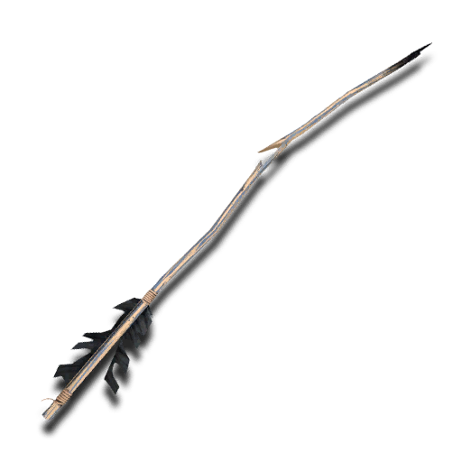 / *Broken\_Fire\_Hardened\_Arrow\_icon.png* | [Broken Fire Hardened Arrow](./Broken%20Fire%20Hardened%20Arrow.md) | 0.15 kg / *(0.33 lb)* | - Can be harvested for 1 Crow Feather |
| 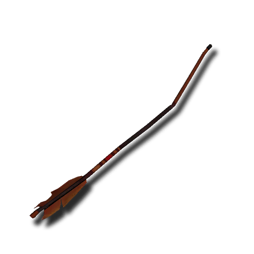 / *Broken\_Manufactured\_Arrow\_icon.png* | [Broken Manufactured Arrow](./Broken%20Manufactured%20Arrow.md) | 0.15 kg / *(0.33 lb)* | - Cannot be harvested |
|  / *Charcoal\_icon.png* | [Charcoal](./Charcoal.md) | 0.10 kg / *(0.22 lb)* | - Allows players to map regions / - Collected from burned out fires / - Not available in story mode |
|  / *Elevator\_Crank\_icon.png* | [Elevator Crank](./Elevator%20Crank.md) | 1.00 kg / *(2.2 lb)* | - Used to operate the elevator in the [Last Prospect](./Last%20Prospect.md) mine |
| 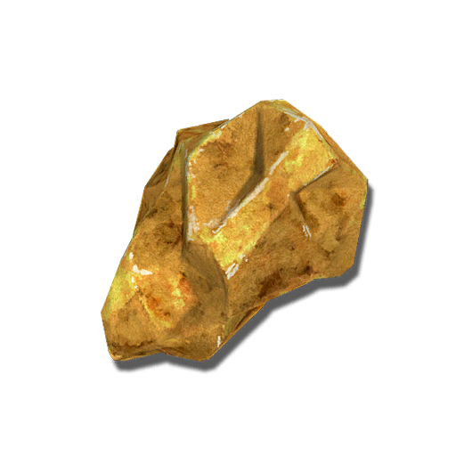 / *Gold\_Nugget\_icon.png* | [Gold Nugget](./Gold%20Nugget.md) | 0.20 kg / *(0.44 lb)* | - A small clump of gold found in the [Langston Mine](./Langston%20Mine.md). |
| 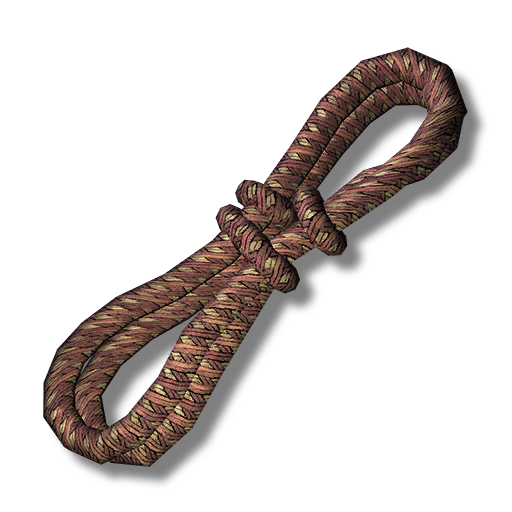 / *Mountaineering\_Rope\_icon.png* | [Mountaineering Rope](./Mountaineering%20Rope.md) | 5.00 kg / *(11 lb)* | - Allows players to [Rope Climb](./Rope%20Climbing.md) in designated areas / - Can create safer, faster shortcuts at the expense of [Fatigue](./Fatigue.md) |
|  / *Spray\_Paint\_icon.png* | [Spray Paint](./Spray%20Paint.md) | 0.54 kg / *(1.188 lb)* | - Allows players to tag environments / - Not available in story mode |
| 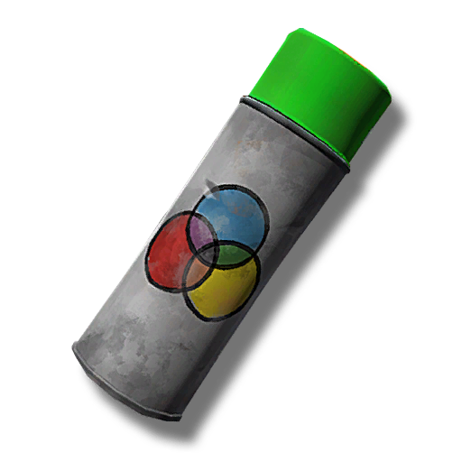 / *Spray\_Paint\_-\_Glyph\_icon.png* | [Spray Paint - Glyph](./Spray%20Paint%20-%20Glyph.md) | 0.54 kg / *(1.188 lb)* | - Can be used to distract, stop, or halve the fog of the [Darkwalker](./Escape%20the%20Darkwalker.md) |
| 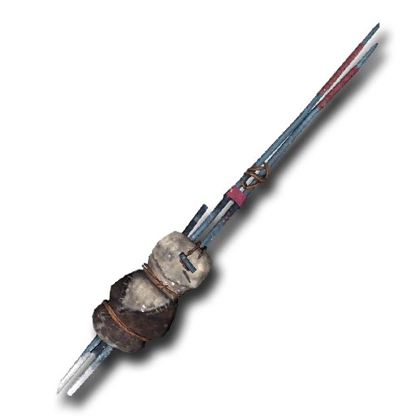 / *Travois\_icon.png* | [Travois](./Travois.md) | 1.00 kg / *(2.2 lb)* | - Can be used to transport items anywhere on the Island |
|  / *Woodworking\_Tools\_icon.png* | [Woodworking Tools](./Woodworking%20Tools.md) | 1.50 kg / *(3.3 lb)* | - Used to create advanced [Decorations](./Decorations.md) Furniture / - Only 4 exist in Survival Mode |

### Sutherland's Tale

|  / *Tools.png* | Item | Weight | Comment |
| --- | --- | --- | --- |
|  / *Document\_Stash\_1\_icon.png* | [Document Stash 1](./Document%20Stash%201.md) | 0.00 kg / *(0 lb)* | - Traded to the [Trader](./Trader.md) as part of his quest |
|  / *Document\_Stash\_1\_icon.png* | [Document Stash 2](./Document%20Stash%202.md) | 0.00 kg / *(0 lb)* | - Traded to the [Trader](./Trader.md) as part of his quest |
|  / *Document\_Stash\_1\_icon.png* | [Document Stash 3](./Document%20Stash%203.md) | 0.50 kg / *(1.1 lb)* | - Traded to the [Trader](./Trader.md) as part of his quest |
|  / *Document\_Stash\_1\_icon.png* | [Document Stash 4](./Document%20Stash%204.md) | 0.00 kg / *(0 lb)* | - Traded to the [Trader](./Trader.md) as part of his quest |
| 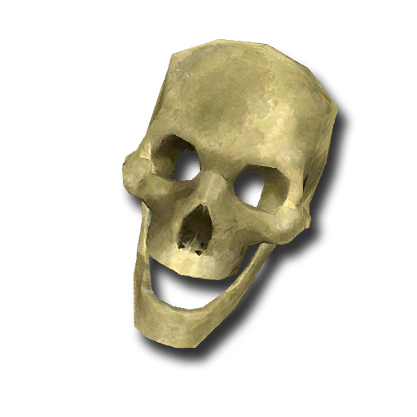 / *A\_Skeleton\_And\_Note\_icon.png* | [A Skeleton And Note](./A%20Skeleton%20And%20Note.md) | 0.00 kg / *(0 lb)* | - Traded to the [Trader](./Trader.md) as part of his quest |
|  / *A\_Skeleton\_And\_Note\_icon.png* | [Wyatt's Skeleton](./Wyatt%27s%20Skeleton.md) | 0.00 kg / *(0 lb)* | - Traded to the [Trader](./Trader.md) as part of his quest |
|  / *Broken\_Hatch\_Wheel\_icon.png* | [Broken Hatch Wheel](./Broken%20Hatch%20Wheel.md) | 0.00 kg / *(0 lb)* | - Traded to the [Trader](./Trader.md) as part of his quest |

### Wintermute Exclusive

|  / *Tools.png* | Item | Weight | Comment |
| --- | --- | --- | --- |
|  / *Astrid's\_Backpack\_icon.png* | [Astrid's Backpack](./Astrid%27s%20Backpack.md) | 5.00 kg / *(11 lb)* | - Used at the start of Episode 1 |
| 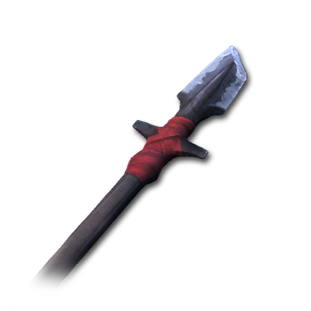 / *Broken\_Bear\_Spear\_icon.png* | [Broken Bear Spear](./Broken%20Bear%20Spear.md) | 3.75 kg / *(8.25 lb)* | - Found in the Hunting Lodge in Episode 2 |
| 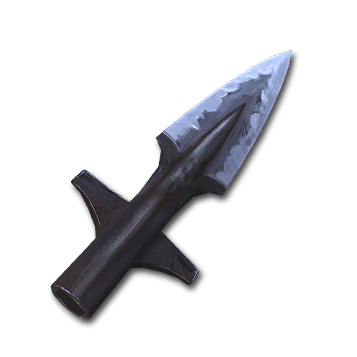 / *Spear\_Head\_icon.png* | [Spear Head](./Spear%20Head.md) | 0.50 kg / *(1.1 lb)* | - Forged to repair the Broken Bear Spear in Episode 2 |
| 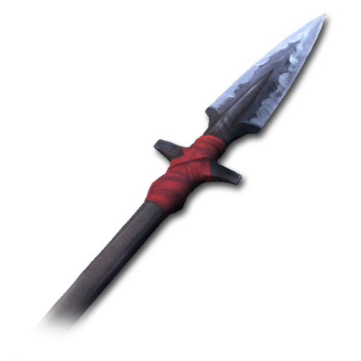 / *Bear\_Spear\_icon.png* | [Bear Spear](./Bear%20Spear.md) | 3.75 kg / *(8.25 lb)* | - Only found in Wintermute Episode 2 / - Can be used to attack hostile wildlife by taking a defensive posture |
| 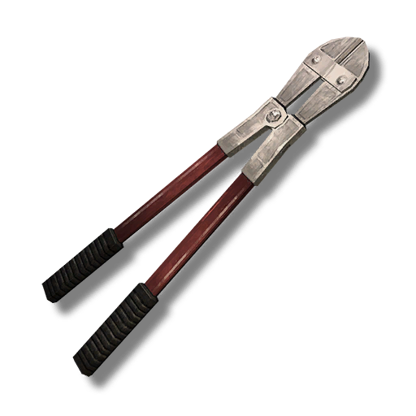 / *Bolt\_Cutters\_icon.png* | [Bolt Cutters](./Bolt%20Cutters.md) | 1.50 kg / *(3.3 lb)* | - Used in Wintermute Episode 3 and 4 to cut through locked gates |
| 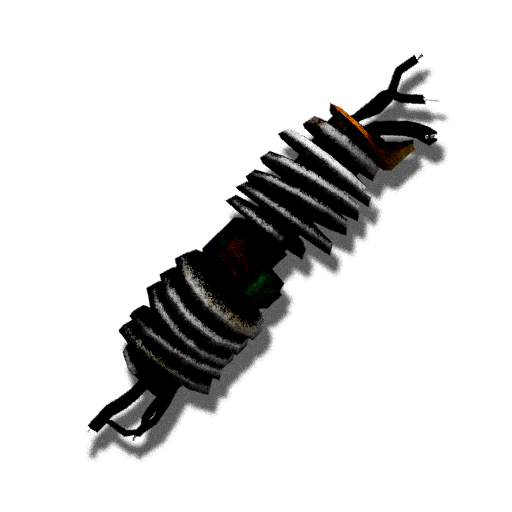 / *Burned\_Out\_Fuse\_icon.png* | [Burned Out Fuse](./Burned%20Out%20Fuse.md) | 0.20 kg / *(0.44 lb)* | - Found in Wintermute Episode 3 and serves no purpose other than to be replaced / - Model is used in Transmitters in Survival Mode but cannot be obtained |
| 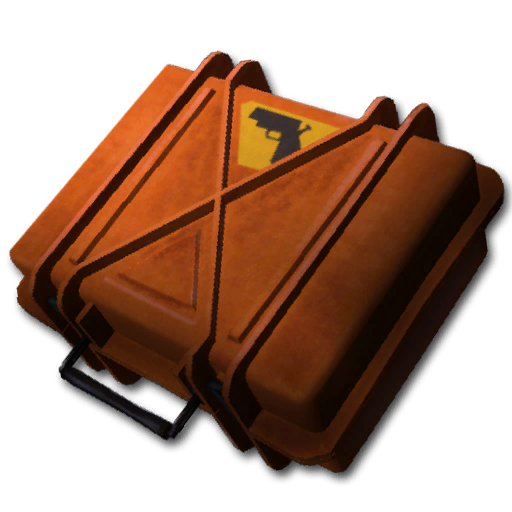 / *Distress\_Pistol\_Kit\_icon.png* | [Distress Pistol Kit](./Distress%20Pistol%20Kit.md) | 5.00 kg / *(11 lb)* | - Used at the start of Episode 1 |
|  / *Elevator\_Crank\_icon.png* | [Elevator Crank](./Elevator%20Crank.md) | 0.00 kg / *(0 lb)* | - Used to operate the elevator in the [Last Prospect](./Last%20Prospect.md) mine in Episode 4 |
| 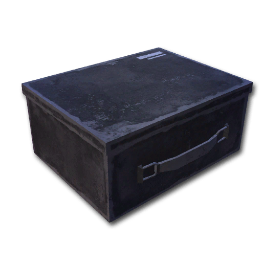 / *Emergency\_Food\_icon.png* | [Emergency Food](./Emergency%20Food.md) | 5.00 kg / *(11 lb)* | - Used at the start of Episode 1 |
|  / *First\_Aid\_Kit\_(tool)\_icon.png* | [First Aid Kit (tool)](./First%20Aid%20Kit%20%28tool%29.md) | 5.00 kg / *(11 lb)* | - Used at the start of Episode 1 |
|  / *Scrap\_Metal\_Shard\_icon.png* | [Scrap Metal Shard](./Scrap%20Metal%20Shard.md) | 0.30 kg / *(0.66 lb)* | - Found in Wintermute Episode 1 and can be carried to Episode 2 / - Slightly less effective version of the Hunting Knife |
|  / *Valve\_Socket\_Handle\_icon.png* | [Valve Socket Handle](./Valve%20Socket%20Handle.md) | 0.00 kg / *(0 lb)* | - Used to open mineshaft airflow valves in Episode 4 |

### Cut Tools

|  / *Tools.png* | Item | Weight | Comment |
| --- | --- | --- | --- |
|  / *Jeremiah's\_Knife\_icon.png* | [Jeremiah's Knife](./Jeremiah%27s%20Knife.md) | 0.50 kg / *(1.1 lb)* | - Only found in Wintermute Predux Episode 2 after completing [Survival School (Predux)](./Survival%20School%20%28Predux%29.md) / - Behaves as a reskinned Hunting Knife / - Currently inaccessible but still in the game files |
|  / *Brand\_icon.png* | [Brand](./Brand.md) | 0.30 kg / *(0.66 lb)* | - Removed from the Alpha versions of *[The Long Dark](./The%20Long%20Dark.md)* and replaced by the [Torch](./Torch.md) / - Can be Brandished to scare predator Wildlife |
|  / *Hunting\_Lodge\_Rifle\_icon.png* | [Hunting Lodge Rifle](./Hunting%20Lodge%20Rifle.md) | 4.00 kg / *(8.8 lb)* | - Found in the Predux Episode 2 Mission You Fix My Rifle? |

**Lua execution error in Module:Navbox function navbox**

[es:Herramientas](es:Herramientas) [fr:Outils](fr:Outils) [ru:Снаряжение](ru:%D0%A1%D0%BD%D0%B0%D1%80%D1%8F%D0%B6%D0%B5%D0%BD%D0%B8%D0%B5) [de:Werkzeuge](de:Werkzeuge)
