# Tools

**Contents**

- [Tool Types](#Tool_Types)
- [Cooking](#Cooking)
- [Lighting](#Lighting)
- [Fire Starting](#Fire_Starting)
- [Fishing](#Fishing)
- [Hand Tools](#Hand_Tools)
- [Hunting](#Hunting)
- [Repair](#Repair)
- [Sleep](#Sleep)
- [Transmitter Parts](#Transmitter_Parts)
- [Camera](#Camera)
- [Other](#Other)
- [Sutherland's Tale](#Sutherland%27s_Tale)
- [Wintermute Exclusive](#Wintermute_Exclusive)
- [Cut Tools](#Cut_Tools)

**Tools** are items with specialized purposes in <a href="./The%20Long%20Dark.md" class="wikilink" title="The Long Dark">The Long Dark</a>.

## Tool Types

### Cooking

<table>
<colgroup>
<col style="width: 20%" />
<col style="width: 20%" />
<col style="width: 20%" />
<col style="width: 20%" />
<col style="width: 20%" />
</colgroup>
<thead>
<tr>
<th class="unsortable" style="border-style: solid none solid solid"><figure>

<figcaption>Tools.png</figcaption>
</figure></th>
<th style="border-style: solid solid solid none">
Item
</th>
<th>
Boiling Water Capacity
</th>
<th>
Weight
</th>
<th>
Comment
</th>
</tr>
</thead>
<tbody>
<tr>
<td><figure>

<figcaption>Cooking_Pot_icon.png</figcaption>
</figure></td>
<td>
<a href="./Cooking%20Pot.md" class="wikilink" title="Cooking Pot">Cooking Pot</a>
</td>
<td>
2 liters
</td>
<td>
1.00 kg 
(2.2 lb)
</td>
<td><ul>
<li>Reduces the amount of time required to cook any food or drink on a <a href="./Fire.md" class="wikilink" title="fire">fire</a>.</li>
<li>Allows the player to melt snow and boil water on a <a href="./Fire.md" class="wikilink" title="fire">fire</a>.</li>
<li>Allows player to cook Food and Drinks</li>
<li>Allows the player to create (Pot) Cooking Recipes</li>
</ul></td>
</tr>
<tr>
<td><figure>

<figcaption>Cooking_Skillet_icon.png</figcaption>
</figure></td>
<td>
<a href="./Cooking%20Skillet.md" class="wikilink" title="Cooking Skillet">Cooking Skillet</a>
</td>
<td>
1 liter
</td>
<td>
1.00 kg 
(2.2 lb)
</td>
<td><ul>
<li>Allows the player to create (Skillet) Cooking Recipes</li>
<li>Allows player to cook Food and Drinks</li>
</ul></td>
</tr>
<tr>
<td><figure>

<figcaption>Recycled_Can_icon.png</figcaption>
</figure></td>
<td>
<a href="./Recycled%20Can.md" class="wikilink" title="Recycled Can">Recycled Can</a>
</td>
<td>
0.5 liters
</td>
<td>
0.15 kg 
(0.33 lb)
</td>
<td><ul>
<li>Allows the player to melt snow and boil water on a <a href="./Fire.md" class="wikilink" title="fire">fire</a>.</li>
<li>Allows player to cook Drinks</li>
</ul></td>
</tr>
<tr>
<td><figure>

<figcaption>Insulated_Flasks_animation.gif</figcaption>
</figure></td>
<td>
<a href="./Insulated%20Flask.md" class="wikilink" title="Insulated Flask">Insulated Flask</a>
</td>
<td>
N/A
</td>
<td>
0.20 kg 
(0.44 lb)
</td>
<td><ul>
<li>Can store and transport multiple drinks inside, keeping them warm</li>
<li>Comes in 7 fun design patterns!</li>
</ul></td>
</tr>
<tr>
<td><figure>

<figcaption>Can_Opener_icon.png</figcaption>
</figure></td>
<td>
<a href="./Can%20Opener.md" class="wikilink" title="Can Opener">Can Opener</a>
</td>
<td>
N/A
</td>
<td>
0.25 kg 
(0.55 lb)
</td>
<td><ul>
<li>Used to open food cans without losing food/damaging can</li>
<li>Repaired with scrap metal</li>
</ul></td>
</tr>
</tbody>
</table>

### Lighting

<table>
<colgroup>
<col style="width: 25%" />
<col style="width: 25%" />
<col style="width: 25%" />
<col style="width: 25%" />
</colgroup>
<thead>
<tr>
<th class="unsortable" style="border-style: solid none solid solid"><figure>

<figcaption>Tools.png</figcaption>
</figure></th>
<th style="border-style: solid solid solid none">
Item
</th>
<th>
Weight
</th>
<th>
Comment
</th>
</tr>
</thead>
<tbody>
<tr>
<td><figure>
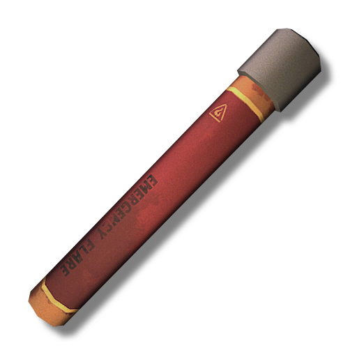
<figcaption>Flare_icon.png</figcaption>
</figure></td>
<td>
<a href="./Flare.md" class="wikilink" title="Flare">Flare</a>
</td>
<td>
0.25 kg 
(0.55 lb)
</td>
<td><ul>
<li>Can keep <a href="./Wolf.md" class="wikilink" title="Wolf">Wolf</a> at bay.</li>
<li>Lasts longer than the <a href="./Marine%20Flare.md" class="wikilink" title="Marine flare">Marine flare</a>.</li>
</ul></td>
</tr>
<tr>
<td><figure>

<figcaption>Flashlight_icon.png</figcaption>
</figure></td>
<td>
<a href="./Flashlight.md" class="wikilink" title="Flashlight">Flashlight</a>
</td>
<td>
1.00 kg 
(2.2 lb)
</td>
<td><ul>
<li>Can keep predators at bay during <a href="./Aurora.md" class="wikilink" title="Aurora">Aurora</a> or <a href="./Glimmer%20Fog.md" class="wikilink" title="Glimmer Fog">Glimmer Fog</a>.</li>
<li>Usable only during Aurora or Glimmer Fog.</li>
</ul></td>
</tr>
<tr>
<td><figure>

<figcaption>Miner's_Flashlight_icon.png</figcaption>
</figure></td>
<td>
<a href="./Miner%27s%20Flashlight.md" class="wikilink" title="Miner&#39;s Flashlight">Miner's Flashlight</a>
</td>
<td>
1.25 kg 
(2.75 lb)
</td>
<td><ul>
<li>Can keep predators at bay during <a href="./Aurora.md" class="wikilink" title="Aurora">Aurora</a> or <a href="./Glimmer%20Fog.md" class="wikilink" title="Glimmer Fog">Glimmer Fog</a>.</li>
<li>Usable only during Aurora or Glimmer Fog.</li>
<li>Bigger battery, but Heavier than standard variant</li>
</ul></td>
</tr>
<tr>
<td><figure>

<figcaption>Marine_Flare_icon.png</figcaption>
</figure></td>
<td>
<a href="./Marine%20Flare.md" class="wikilink" title="Marine Flare">Marine Flare</a>
</td>
<td>
0.25 kg 
(0.55 lb)
</td>
<td><ul>
<li>Can keep <a href="./Wolf.md" class="wikilink" title="Wolf">Wolf</a> and <a href="./Timberwolf.md" class="wikilink" title="Timberwolf">Timberwolf</a> at bay.</li>
<li>Lasts shorter than the regular <a href="./Flare.md" class="wikilink" title="Flare">Flare</a>.</li>
</ul></td>
</tr>
<tr>
<td><figure>

<figcaption>Storm_Lantern_icon.png</figcaption>
</figure></td>
<td>
<a href="./Storm%20Lantern.md" class="wikilink" title="Storm Lantern">Storm Lantern</a>
</td>
<td>
1.00 kg 
(2.2 lb)
</td>
<td><ul>
<li>You can refuel it with <a href="./Lantern%20Fuel.md" class="wikilink" title="lantern fuel">lantern fuel</a> or <a href="./Jerry%20Can.md" class="wikilink" title="kerosene">kerosene</a>.</li>
<li>Can hold up to 1L of fuel</li>
<li>Weighs 1.80 kg when full</li>
</ul></td>
</tr>
<tr>
<td><figure>

<figcaption>Spelunker's_Lantern_icon.png</figcaption>
</figure></td>
<td>
<a href="./Spelunker%27s%20Lantern.md" class="wikilink" title="Spelunker&#39;s Lantern">Spelunker's Lantern</a>
</td>
<td>
1.00 kg 
(2.2 lb)
</td>
<td><ul>
<li>You can refuel it with <a href="./Lantern%20Fuel.md" class="wikilink" title="lantern fuel">lantern fuel</a> or <a href="./Jerry%20Can.md" class="wikilink" title="kerosene">kerosene</a>.</li>
<li>Can hold up to 1L of fuel</li>
<li>Weighs 1.80 kg when full</li>
<li>Uses 40% less fuel, but light is 40% dimmer than regular variant</li>
</ul></td>
</tr>
<tr>
<td><figure>

<figcaption>Torch_icon.png</figcaption>
</figure></td>
<td>
<a href="./Torch.md" class="wikilink" title="Torch">Torch</a>
</td>
<td>
0.3 kg 
(0.66 lb)
</td>
<td><ul>
<li>Can keep <a href="./Wolf.md" class="wikilink" title="Wolf">Wolf</a> at bay.</li>
<li>Can be obtained with a lit fire.</li>
</ul></td>
</tr>
<tr>
<td>

</td>
<td>
<a href="./Cardboard%20Matches.md" class="wikilink" title="Cardboard Matches">Cardboard Matches</a>/<a href="./Wood%20Matches.md" class="wikilink" title="Wood Matches">Wood Matches</a>
</td>
<td>
0.005 kg 
(0.011 lb)0.10 kg 
(0.22 lb)
</td>
<td><ul>
<li>Very limited light source time. Only practical when used indoors</li>
</ul></td>
</tr>
</tbody>
</table>

- 

### Fire Starting

<table>
<colgroup>
<col style="width: 25%" />
<col style="width: 25%" />
<col style="width: 25%" />
<col style="width: 25%" />
</colgroup>
<thead>
<tr>
<th class="unsortable" style="border-style: solid none solid solid"><figure>

<figcaption>Tools.png</figcaption>
</figure></th>
<th style="border-style: solid solid solid none">
Item
</th>
<th>
Weight
</th>
<th>
Comment
</th>
</tr>
</thead>
<tbody>
<tr>
<td><figure>

<figcaption>Accelerant_icon.png</figcaption>
</figure></td>
<td>
<a href="./Accelerant.md" class="wikilink" title="Accelerant">Accelerant</a>
</td>
<td>
0.10 kg 
(0.22 lb)
</td>
<td><ul>
<li>Greatly increases the chance of starting fires</li>
<li>Only used to start fires</li>
</ul></td>
</tr>
<tr>
<td><figure>

<figcaption>Can_of_Gunpowder_icon.png</figcaption>
</figure></td>
<td>
<a href="./Can%20of%20Gunpowder.md" class="wikilink" title="Can of Gunpowder">Can of Gunpowder</a>
</td>
<td>
0.50 kg 
(1.1 lb)
</td>
<td><ul>
<li>Can be used to craft Ammunition</li>
<li>Can be used to greatly increase chances of starting fires</li>
<li>5 uses to start fires</li>
</ul></td>
</tr>
<tr>
<td><figure>

<figcaption>Cardboard_Matches_icon.png</figcaption>
</figure></td>
<td>
<a href="./Cardboard%20Matches.md" class="wikilink" title="Cardboard Matches">Cardboard Matches</a>
</td>
<td>
0.005 kg 
(0.011 lb)
</td>
<td><ul>
<li>More common than wood matches</li>
<li>less useful at starting fires than wood matches</li>
<li>Can be used as a light source</li>
</ul></td>
</tr>
<tr>
<td><figure>

<figcaption>Firestriker_icon.png</figcaption>
</figure></td>
<td>
<a href="./Firestriker.md" class="wikilink" title="Firestriker">Firestriker</a>
</td>
<td>
0.10 kg 
(0.22 lb)
</td>
<td><ul>
<li>Most effective fire starter</li>
<li>Cannot be repaired and is very rare</li>
</ul></td>
</tr>
<tr>
<td><figure>

<figcaption>Flare_icon.png</figcaption>
</figure></td>
<td>
<a href="./Flare.md" class="wikilink" title="Flare">Flare</a>
</td>
<td>
0.25 kg 
(0.55 lb)
</td>
<td><ul>
<li>Cannot turn off after activating. Limited Fire-starting capability</li>
</ul></td>
</tr>
<tr>
<td><figure>

<figcaption>Jerry_Can_icon.png</figcaption>
</figure></td>
<td>
<a href="./Jerry%20Can.md" class="wikilink" title="Jerry Can">Jerry Can</a>
</td>
<td>
3.30 kg 
(7.26 lb)
</td>
<td><ul>
<li>0.30L can be used as accelerant</li>
<li>Can hold up to 4L of fuel</li>
<li>Collects fuel from scrapped lanterns</li>
</ul></td>
</tr>
<tr>
<td><figure>

<figcaption>Lantern_Fuel_icon.png</figcaption>
</figure></td>
<td>
<a href="./Lantern%20Fuel.md" class="wikilink" title="Lantern Fuel">Lantern Fuel</a>
</td>
<td>
0.50 kg 
(1.1 lb)
</td>
<td><ul>
<li>Can be used to fuel Lanterns</li>
<li>Can hold up to 0.5L of fuel</li>
<li>Can be obtained from cooking fish</li>
<li>Can be used to greatly increase the chances of starting fires (requires 0.30 L)</li>
</ul></td>
</tr>
<tr>
<td><figure>

<figcaption>Magnifying_Lens_icon.png</figcaption>
</figure></td>
<td>
<a href="./Magnifying%20Lens.md" class="wikilink" title="Magnifying Lens">Magnifying Lens</a>
</td>
<td>
0.10 kg 
(0.22 lb)
</td>
<td><ul>
<li>Doesn't lose condition when used</li>
<li>Can only be used outside in clear weather</li>
</ul></td>
</tr>
<tr>
<td><figure>

<figcaption>Marine_Flare_icon.png</figcaption>
</figure></td>
<td>
<a href="./Marine%20Flare.md" class="wikilink" title="Marine Flare">Marine Flare</a>
</td>
<td>
0.25 kg 
(0.55 lb)
</td>
<td><ul>
<li>Cannot turn off after activating. Limited Fire-starting capability</li>
</ul></td>
</tr>
<tr>
<td><figure>

<figcaption>Torch_icon.png</figcaption>
</figure></td>
<td>
<a href="./Torch.md" class="wikilink" title="Torch">Torch</a>
</td>
<td>
0.30 kg 
(0.66 lb)
</td>
<td><ul>
<li>Can be pulled from fires and used to start a fire elsewhere (<a href="./Daisy%20Chaining.md" class="wikilink" title="Daisy Chaining">Daisy Chaining</a>)</li>
<li>Must use a match if unlit in order to start a fire</li>
</ul></td>
</tr>
<tr>
<td><figure>

<figcaption>Wood_Matches_icon.png</figcaption>
</figure></td>
<td>
<a href="./Wood%20Matches.md" class="wikilink" title="Wood Matches">Wood Matches</a>
</td>
<td>
0.10 kg 
(0.22 lb)
</td>
<td><ul>
<li>Less common than Cardboard Matches</li>
<li>Increases chance of starting fires</li>
<li>Can be used as a light source</li>
</ul></td>
</tr>
</tbody>
</table>

### Fishing

<table>
<colgroup>
<col style="width: 25%" />
<col style="width: 25%" />
<col style="width: 25%" />
<col style="width: 25%" />
</colgroup>
<thead>
<tr>
<th class="unsortable" style="border-style: solid none solid solid"><figure>

<figcaption>Tools.png</figcaption>
</figure></th>
<th style="border-style: solid solid solid none">
Item
</th>
<th>
Weight
</th>
<th>
Comment
</th>
</tr>
</thead>
<tbody>
<tr>
<td><figure>

<figcaption>Fishing_Bait_icon.png</figcaption>
</figure></td>
<td>
<a href="./Fishing%20Bait.md" class="wikilink" title="Fishing Bait">Fishing Bait</a>
</td>
<td>
0.05 kg 
(0.11 lb)
</td>
<td><ul>
<li>Can be used to increase <a href="./Ice%20Fishing.md" class="wikilink" title="Ice Fishing">Ice Fishing</a> odds</li>
</ul></td>
</tr>
<tr>
<td>

</td>
<td><ul>
<li><a href="./Fishing%20Lure%20%28Acorns%29.md" class="wikilink" title="Fishing Lure (Acorns)">Fishing Lure (Acorns)</a></li>
<li><a href="./Fishing%20Lure%20%28Wire%20Bundle%29.md" class="wikilink" title="Fishing Lure (Wire Bundle)">Fishing Lure (Wire Bundle)</a></li>
<li><a href="./Fishing%20Lure%20%28Revolver%20Shell%20Casing%29.md" class="wikilink" title="Fishing Lure (Revolver Shell Casing)">Fishing Lure (Revolver Shell Casing)</a></li>
</ul></td>
<td>
0.01 kg (0.02 lbs)
</td>
<td><ul>
<li>Can be used to increase <a href="./Ice%20Fishing.md" class="wikilink" title="Ice Fishing">Ice Fishing</a> odds</li>
<li>Better than Simple Fishing Lure</li>
</ul></td>
</tr>
<tr>
<td><figure>

<figcaption>Simple_Fishing_Lure_icon.png</figcaption>
</figure></td>
<td>
<a href="./Simple%20Fishing%20Lure.md" class="wikilink" title="Simple Fishing Lure">Simple Fishing Lure</a>
</td>
<td>
0.01 kg 
(0.022 lb)
</td>
<td><ul>
<li>Can be used to increase <a href="./Ice%20Fishing.md" class="wikilink" title="Ice Fishing">Ice Fishing</a> odds</li>
</ul></td>
</tr>
<tr>
<td><figure>

<figcaption>Fishing_Tackle_icon.png</figcaption>
</figure></td>
<td>
<a href="./Fishing%20Tackle.md" class="wikilink" title="Fishing Tackle">Fishing Tackle</a>
</td>
<td>
0.02 kg 
(0.044 lb)
</td>
<td><ul>
<li>Required for fishing at ice holes</li>
<li>Can be used to repair clothing</li>
</ul></td>
</tr>
<tr>
<td><figure>

<figcaption>Fishing_Tip-Up_icon.png</figcaption>
</figure></td>
<td>
<a href="./Fishing%20Tip-Up.md" class="wikilink" title="Fishing Tip-Up">Fishing Tip-Up</a>
</td>
<td>
0.30 kg 
(0.66 lb)
</td>
<td><ul>
<li>Trap used to catch fish over time</li>
<li>Breaks after multiple uses</li>
</ul></td>
</tr>
<tr>
<td><figure>

<figcaption>Hook_icon.png</figcaption>
</figure></td>
<td>
<a href="./Hook.md" class="wikilink" title="Hook">Hook</a>
</td>
<td>
0.01 kg 
(0.022 lb)
</td>
<td><ul>
<li>Required to craft <a href="./Fishing%20Tackle.md" class="wikilink" title="Fishing Tackle">Fishing Tackle</a></li>
<li>Crafted using 1 <a href="./Scrap%20Metal.md" class="wikilink" title="Scrap Metal">Scrap Metal</a></li>
</ul></td>
</tr>
<tr>
<td><figure>

<figcaption>Line_icon.png</figcaption>
</figure></td>
<td>
<a href="./Line.md" class="wikilink" title="Line">Line</a>
</td>
<td>
0.01 kg 
(0.022 lb)
</td>
<td><ul>
<li>Required to craft <a href="./Fishing%20Tackle.md" class="wikilink" title="Fishing Tackle">Fishing Tackle</a></li>
<li>Crafted using 1 <a href="./Cured%20Gut.md" class="wikilink" title="Cured Gut">Cured Gut</a></li>
</ul></td>
</tr>
</tbody>
</table>

### Hand Tools

<table>
<colgroup>
<col style="width: 25%" />
<col style="width: 25%" />
<col style="width: 25%" />
<col style="width: 25%" />
</colgroup>
<thead>
<tr>
<th class="unsortable" style="border-style: solid none solid solid"><figure>

<figcaption>Tools.png</figcaption>
</figure></th>
<th style="border-style: solid solid solid none">
Item
</th>
<th>
Weight
</th>
<th>
Comment
</th>
</tr>
</thead>
<tbody>
<tr>
<td><figure>

<figcaption>Hatchet_icon.png</figcaption>
</figure></td>
<td>
<a href="./Hatchet.md" class="wikilink" title="Hatchet">Hatchet</a>
</td>
<td>
1.50 kg 
(3.3 lb)
</td>
<td><ul>
<li>Used to break down furniture and tree limbs</li>
<li>Can be used in a Wolf <a href="./Struggle.md" class="wikilink" title="Struggle">Struggle</a></li>
<li>Can be used to harvest and craft</li>
</ul></td>
</tr>
<tr>
<td><figure>

<figcaption>Improvised_Hatchet_icon.png</figcaption>
</figure></td>
<td>
<a href="./Improvised%20Hatchet.md" class="wikilink" title="Improvised Hatchet">Improvised Hatchet</a>
</td>
<td>
1.75 kg 
(3.85 lb)
</td>
<td><ul>
<li>Crafted in the <a href="./Forge.md" class="wikilink" title="Forge">Forge</a></li>
<li>Works slower than manufactured <a href="./Hatchet.md" class="wikilink" title="Hatchet">Hatchets</a></li>
</ul></td>
</tr>
<tr>
<td><figure>

<figcaption>Hunting_Knife_icon.png</figcaption>
</figure></td>
<td>
<a href="./Hunting%20Knife.md" class="wikilink" title="Hunting Knife">Hunting Knife</a>
</td>
<td>
0.50 kg 
(1.1 lb)
</td>
<td><ul>
<li>Used to break down cloth and cardboard items</li>
<li>Can be used in a <a href="./Struggle.md" class="wikilink" title="Struggle">Struggle</a></li>
<li>Can be used to harvest and craft</li>
</ul></td>
</tr>
<tr>
<td><figure>

<figcaption>Improvised_Knife_icon.png</figcaption>
</figure></td>
<td>
<a href="./Improvised%20Knife.md" class="wikilink" title="Improvised Knife">Improvised Knife</a>
</td>
<td>
0.75 kg 
(1.65 lb)
</td>
<td><ul>
<li>Crafted in the <a href="./Forge.md" class="wikilink" title="Forge">Forge</a></li>
<li>Slower than manufactured <a href="./Hunting%20Knife.md" class="wikilink" title="knives">knives</a></li>
</ul></td>
</tr>
<tr>
<td><figure>

<figcaption>Cougar_Claw_Knife_icon.png</figcaption>
</figure></td>
<td>
<a href="./Cougar%20Claw%20Knife.md" class="wikilink" title="Cougar Claw Knife">Cougar Claw Knife</a>
</td>
<td>
0.60 kg 
(1.32 lb)
</td>
<td><ul>
<li>Crafted in the <a href="./Forge.md" class="wikilink" title="Forge">Forge</a></li>
<li>Does the highest damage during a <a href="./Struggle.md" class="wikilink" title="Struggle">Struggle</a></li>
<li>Requires killing a <a href="./Cougar.md" class="wikilink" title="Cougar">Cougar</a> for materials</li>
</ul></td>
</tr>
<tr>
<td><figure>

<figcaption>Survival_Knife_icon.png</figcaption>
</figure></td>
<td>
<a href="./Survival%20Knife.md" class="wikilink" title="Survival Knife">Survival Knife</a>
</td>
<td>
0.75 kg 
(1.65 lb)
</td>
<td><ul>
<li>Traded from the <a href="./Trader.md" class="wikilink" title="Trader">Trader</a></li>
<li>Most durable knife</li>
</ul></td>
</tr>
<tr>
<td><figure>

<figcaption>Hacksaw_icon.png</figcaption>
</figure></td>
<td>
<a href="./Hacksaw.md" class="wikilink" title="Hacksaw">Hacksaw</a>
</td>
<td>
1.00 kg 
(2.2 lb)
</td>
<td><ul>
<li>Used to break down metal furniture</li>
<li>Can break down tree limbs and harvest saplings</li>
</ul></td>
</tr>
<tr>
<td><figure>

<figcaption>Heavy_Hammer_icon.png</figcaption>
</figure></td>
<td>
<a href="./Heavy%20Hammer.md" class="wikilink" title="Heavy Hammer">Heavy Hammer</a>
</td>
<td>
2.00 kg 
(4.4 lb)
</td>
<td><ul>
<li>Used to craft tools in a <a href="./Forge.md" class="wikilink" title="Forge">Forge</a></li>
<li>Can be used to break down furniture</li>
</ul></td>
</tr>
<tr>
<td><figure>

<figcaption>Prybar_icon.png</figcaption>
</figure></td>
<td>
<a href="./Prybar.md" class="wikilink" title="Prybar">Prybar</a>
</td>
<td>
1.00 kg 
(2.2 lb)
</td>
<td><ul>
<li>Used to open locked doors and cars</li>
<li>Cannot be repaired</li>
</ul></td>
</tr>
</tbody>
</table>

### Hunting

<table>
<colgroup>
<col style="width: 25%" />
<col style="width: 25%" />
<col style="width: 25%" />
<col style="width: 25%" />
</colgroup>
<thead>
<tr>
<th class="unsortable" style="border-style: solid none solid solid"><figure>

<figcaption>Tools.png</figcaption>
</figure></th>
<th style="border-style: solid solid solid none">
Item
</th>
<th>
Weight
</th>
<th>
Comment
</th>
</tr>
</thead>
<tbody>
<tr>
<td><figure>

<figcaption>Distress_Pistol_icon.png</figcaption>
</figure></td>
<td>
<a href="./Distress%20Pistol.md" class="wikilink" title="Distress Pistol">Distress Pistol</a>
</td>
<td>
0.40 kg 
(0.88 lb)
</td>
<td><ul>
<li>Rarest firearm in the game</li>
<li>Offers the best bleed out time of all weapons</li>
<li>Shots can scare off bears and wolves</li>
</ul></td>
</tr>
<tr>
<td><figure>

<figcaption>Fishing_Tip-Up_icon.png</figcaption>
</figure></td>
<td>
<a href="./Fishing%20Tip-Up.md" class="wikilink" title="Fishing Tip-Up">Fishing Tip-Up</a>
</td>
<td>
0.30 kg (0.66 lbs)
</td>
<td><ul>
<li>Trap used to catch fish over time</li>
<li>Breaks after multiple uses</li>
<li>Must be tended to more frequently than a Snare</li>
</ul></td>
</tr>
<tr>
<td><figure>

<figcaption>Flare_Shell_icon.png</figcaption>
</figure></td>
<td>
<a href="./Flare%20Shell.md" class="wikilink" title="Flare Shell">Flare Shell</a>
</td>
<td>
0.05 kg 
(0.11 lb)
</td>
<td><ul>
<li>Used in the <a href="./Distress%20Pistol.md" class="wikilink" title="Distress Pistol">Distress Pistol</a></li>
<li>Very rare and difficult to find</li>
</ul></td>
</tr>
<tr>
<td><figure>

<figcaption>Hunting_Rifle_icon.png</figcaption>
</figure></td>
<td>
<a href="./Hunting%20Rifle.md" class="wikilink" title="Hunting Rifle">Hunting Rifle</a>
</td>
<td>
4.00 kg 
(8.8 lb)
</td>
<td><ul>
<li>Most powerful firearm in the game</li>
<li>Holds 10 rounds</li>
<li>Very slow and can only be fired while aiming</li>
<li>Base version of the Hunting Rifle</li>
</ul></td>
</tr>
<tr>
<td><figure>

<figcaption>Barb's_Rifle_icon.png</figcaption>
</figure></td>
<td>
<a href="./Barb%27s%20Rifle.md" class="wikilink" title="Barb&#39;s Rifle">Barb's Rifle</a>
</td>
<td>
4.50 kg 
(9.9 lb)
</td>
<td><ul>
<li>Most powerful firearm in the game</li>
<li>Heaviest Hunting Rifle</li>
<li>Highest durability of any Hunting Rifle</li>
</ul></td>
</tr>
<tr>
<td><figure>

<figcaption>Bunker_Rifle_icon.png</figcaption>
</figure></td>
<td>
<a href="./Bunker%20Rifle.md" class="wikilink" title="Bunker Rifle">Bunker Rifle</a>
</td>
<td>
1.50 kg 
(3.3 lb)
</td>
<td><ul>
<li>Traded from the <a href="./Trader.md" class="wikilink" title="Trader">Trader</a></li>
<li>Lowest durability of any Hunting Rifle</li>
</ul></td>
</tr>
<tr>
<td><figure>

<figcaption>Curator's_Rifle_icon.png</figcaption>
</figure></td>
<td>
<a href="./Curator%27s%20Rifle.md" class="wikilink" title="Curator&#39;s Rifle">Curator's Rifle</a>
</td>
<td>
4.00 kg 
(8.8 lb)
</td>
<td><ul>
<li>Most powerful firearm in the game</li>
<li>Farthest range of any Hunting Rifle</li>
</ul></td>
</tr>
<tr>
<td><figure>

<figcaption>Vaughn's_Rifle_icon.png</figcaption>
</figure></td>
<td>
<a href="./Vaughn%27s%20Rifle.md" class="wikilink" title="Vaughn&#39;s Rifle">Vaughn's Rifle</a>
</td>
<td>
3.00 kg 
(6.6 lb)
</td>
<td><ul>
<li>Most powerful firearm in the game</li>
<li>Second lowest durability Hunting Rifle</li>
<li>Lightest Hunting Rifle</li>
</ul></td>
</tr>
<tr>
<td>
 
</td>
<td>
<a href="./Rifle%20Ammunition.md" class="wikilink" title="Rifle Ammunition">Rifle Ammunition</a>
</td>
<td>
0.02 kg 
(0.044 lb)
</td>
<td><ul>
<li>Can be crafted at an <a href="./Ammunition%20Work%20Bench.md" class="wikilink" title="Ammunition Workbench">Ammunition Workbench</a></li>
<li>Used in the <a href="./Hunting%20Rifle.md" class="wikilink" title="Hunting Rifle">Hunting Rifle</a></li>
</ul></td>
</tr>
<tr>
<td><figure>
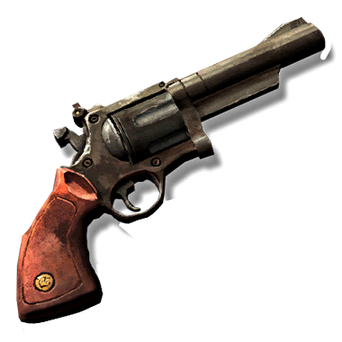
<figcaption>Revolver_icon.png</figcaption>
</figure></td>
<td>
<a href="./Revolver.md" class="wikilink" title="Revolver">Revolver</a>
</td>
<td>
1.50 kg 
(3.3 lb)
</td>
<td><ul>
<li>Holds fewer rounds than the <a href="./Hunting%20Rifle.md" class="wikilink" title="Hunting Rifle">Hunting Rifle</a> (6 rounds)</li>
<li>Defensive over Offensive firearm</li>
<li>Base version of the Revolver</li>
<li>Faster draw speed than hunting rifle</li>
</ul></td>
</tr>
<tr>
<td><figure>

<figcaption>Forester's_Revolver_icon.png</figcaption>
</figure></td>
<td>
<a href="./Forester%27s%20Revolver.md" class="wikilink" title="Forester&#39;s Revolver">Forester's Revolver</a>
</td>
<td>
1.50 kg 
(3.3 lb)
</td>
<td><ul>
<li>Highest durability of any Revolver</li>
</ul></td>
</tr>
<tr>
<td><figure>

<figcaption>Hunter's_Revolver_icon.png</figcaption>
</figure></td>
<td>
<a href="./Hunter%27s%20Revolver.md" class="wikilink" title="Hunter&#39;s Revolver">Hunter's Revolver</a>
</td>
<td>
1.75 kg 
(3.85 lb)
</td>
<td><ul>
<li>Heaviest Revolver</li>
<li>Farthest range of any Revolver</li>
</ul></td>
</tr>
<tr>
<td><figure>

<figcaption>Warden's_Revolver_icon.png</figcaption>
</figure></td>
<td>
<a href="./Warden%27s%20Revolver.md" class="wikilink" title="Warden&#39;s Revolver">Warden's Revolver</a>
</td>
<td>
1.25 kg 
(2.75 lb)
</td>
<td><ul>
<li>Lightest Revolver</li>
<li>Fastest draw speed of any Revolver</li>
</ul></td>
</tr>
<tr>
<td>
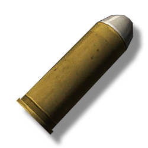 
</td>
<td>
<a href="./Revolver%20Ammunition.md" class="wikilink" title="Revolver Ammunition">Revolver Ammunition</a>
</td>
<td>
0.081 kg 
(0.178 lb)
</td>
<td><ul>
<li>Can be crafted at an <a href="./Ammunition%20Work%20Bench.md" class="wikilink" title="Ammunition Workbench">Ammunition Workbench</a></li>
<li>More common than most ammunition</li>
<li>Used in the <a href="./Revolver.md" class="wikilink" title="Revolver">Revolver</a></li>
</ul></td>
</tr>
<tr>
<td><figure>

<figcaption>Survival_Bow_icon.png</figcaption>
</figure></td>
<td>
<a href="./Survival%20Bow.md" class="wikilink" title="Survival Bow">Survival Bow</a>
</td>
<td>
0.50 kg 
(1.1 lb)
</td>
<td><ul>
<li>Must be crafted</li>
<li>Base version of the Bow</li>
<li>Ammunition is reusable</li>
<li>Cannot be Repaired</li>
</ul></td>
</tr>
<tr>
<td><figure>

<figcaption>Bushcraft_Bow_icon.png</figcaption>
</figure></td>
<td>
<a href="./Bushcraft%20Bow.md" class="wikilink" title="Bushcraft Bow">Bushcraft Bow</a>
</td>
<td>
0.50 kg 
(1.1 lb)
</td>
<td><ul>
<li>Must be crafted</li>
<li>Upgraded version of the Survival Bow</li>
<li>Requires <a href="./Bushcraft%20Bow%20Blueprint%20Card.md" class="wikilink" title="Bushcraft Bow Blueprint Card">Bushcraft Bow Blueprint Card</a> from the <a href="./Trader.md" class="wikilink" title="Trader">Trader</a> to be crafted</li>
<li>Ammunition is reusable</li>
<li>Cannot be Repaired</li>
</ul></td>
</tr>
<tr>
<td><figure>

<figcaption>Woodwright's_Bow_icon.png</figcaption>
</figure></td>
<td>
<a href="./Woodwright%27s%20Bow.md" class="wikilink" title="Woodwright&#39;s Bow">Woodwright's Bow</a>
</td>
<td>
0.75 kg (1.65 lbs)
</td>
<td><ul>
<li>Heaviest Bow</li>
<li>Highest durability Bow</li>
<li>Less sway and but also least range of any Bow</li>
<li>Ammunition is reusable</li>
<li>Cannot be Repaired</li>
</ul></td>
</tr>
<tr>
<td><figure>
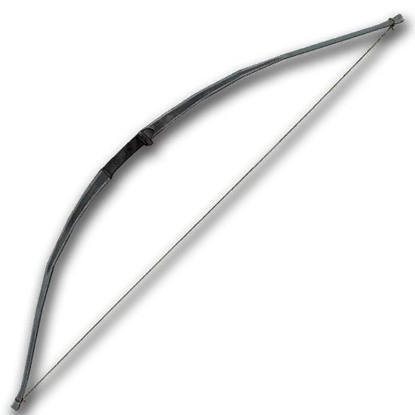
<figcaption>Sport_Bow_icon.png</figcaption>
</figure></td>
<td>
<a href="./Sport%20Bow.md" class="wikilink" title="Sport Bow">Sport Bow</a>
</td>
<td>
0.35 kg (0.77 lbs)
</td>
<td><ul>
<li>Lightest Bow</li>
<li>Same stats as Survival Bow, but more durable</li>
<li>Ammunition is reusable</li>
<li>Cannot be Repaired</li>
</ul></td>
</tr>
<tr>
<td><figure>

<figcaption>Simple_Arrow_icon.png</figcaption>
</figure></td>
<td>
<a href="./Simple%20Arrow.md" class="wikilink" title="Simple Arrow">Simple Arrow</a>
</td>
<td>
0.15 kg 
(0.33 lb)
</td>
<td><ul>
<li>Can be crafted at a workbench</li>
<li>Harder to acquire resources to produce</li>
<li>Breaks after many shots</li>
<li>Can ricochet off of hard surfaces</li>
<li>Best durability arrow</li>
</ul></td>
</tr>
<tr>
<td><figure>

<figcaption>Fire_Hardened_Arrow_icon.png</figcaption>
</figure></td>
<td>
<a href="./Fire%20Hardened%20Arrow.md" class="wikilink" title="Fire Hardened Arrow">Fire Hardened Arrow</a>
</td>
<td>
0.10 kg 
(0.22 lb)
</td>
<td><ul>
<li>Improvised Arrow that can be made at Campfires</li>
<li>Easier to manufacture than Simple Arrows due to cheaper materials</li>
<li>Breaks after many shots</li>
<li>Can ricochet off of hard surfaces</li>
<li>Less durable than Simple Arrows</li>
</ul></td>
</tr>
<tr>
<td><figure>
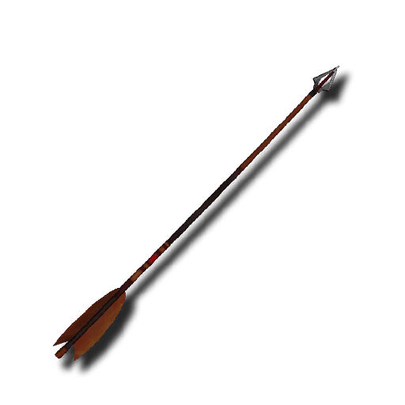
<figcaption>Manufactured_Arrow_icon.png</figcaption>
</figure></td>
<td>
<a href="./Manufactured%20Arrow.md" class="wikilink" title="Manufactured Arrow">Manufactured Arrow</a>
</td>
<td>
0.15 kg 
(0.33 lb)
</td>
<td><ul>
<li>Must be traded from the <a href="./Trader.md" class="wikilink" title="Trader">Trader</a></li>
<li>More durable than Simple Arrow</li>
<li>Does more damage than Simple Arrow</li>
<li>When broken, cannot be harvested for Materials</li>
</ul></td>
</tr>
<tr>
<td><figure>

<figcaption>Snare_icon.png</figcaption>
</figure></td>
<td>
<a href="./Snare.md" class="wikilink" title="Snare">Snare</a>
</td>
<td>
0.30 kg 
(0.66 lb)
</td>
<td><ul>
<li>Crafted at a workbench with 1 <a href="./Cured%20Gut.md" class="wikilink" title="Cured Gut">Cured Gut</a> and 1 <a href="./Reclaimed%20Wood.md" class="wikilink" title="Reclaimed Wood">Reclaimed Wood</a></li>
<li>Used to catch <a href="./Rabbit.md" class="wikilink" title="rabbit">rabbits</a> over time</li>
<li>Breaks after multiple uses</li>
</ul></td>
</tr>
<tr>
<td><figure>

<figcaption>Stone_icon.png</figcaption>
</figure></td>
<td>
<a href="./Stone.md" class="wikilink" title="Stone">Stone</a>
</td>
<td>
0.15 kg 
(0.33 lb)
</td>
<td><ul>
<li>Most common ranged weapon</li>
<li>Used to stun <a href="./Rabbit.md" class="wikilink" title="rabbit">rabbits</a> and <a href="./Ptarmigan.md" class="wikilink" title="ptarmigans">ptarmigans</a></li>
<li>Can be used to build <a href="./Rock%20Cache.md" class="wikilink" title="rock cache">rock caches</a></li>
</ul></td>
</tr>
<tr>
<td><figure>

<figcaption>Noisemaker_icon.png</figcaption>
</figure></td>
<td>
<a href="./Noisemaker.md" class="wikilink" title="Noisemaker">Noisemaker</a>
</td>
<td>
0.20 kg (0.44 lb)
</td>
<td></td>
</tr>
</tbody>
</table>

### Repair

<table>
<colgroup>
<col style="width: 20%" />
<col style="width: 20%" />
<col style="width: 20%" />
<col style="width: 20%" />
<col style="width: 20%" />
</colgroup>
<thead>
<tr>
<th class="unsortable" style="border-style: solid none solid solid"><figure>

<figcaption>Tools.png</figcaption>
</figure></th>
<th style="border-style: solid solid solid none">
Item
</th>
<th>
Survival skill
</th>
<th>
Weight
</th>
<th>
Comment
</th>
</tr>
</thead>
<tbody>
<tr>
<td><figure>

<figcaption>Sewing_Kit_icon.png</figcaption>
</figure></td>
<td>
<a href="./Sewing%20Kit.md" class="wikilink" title="Sewing Kit">Sewing Kit</a>
</td>
<td>
<a href="./Mending.md" class="wikilink" title="Mending">Mending</a>
</td>
<td>
0.10 kg 
(0.22 lb)
</td>
<td><ul>
<li>Allows players to repair damaged clothing or craft new <a href="./Clothing.md" class="wikilink" title="clothing">clothing</a> with the appropriate materials.</li>
</ul></td>
</tr>
<tr>
<td><figure>

<figcaption>Fishing_Tackle_icon.png</figcaption>
</figure></td>
<td>
<a href="./Fishing%20Tackle.md" class="wikilink" title="Fishing Tackle">Fishing Tackle</a>
</td>
<td>
<a href="./Mending.md" class="wikilink" title="Mending">Mending</a>
</td>
<td>
0.02 kg 
(0.044 lb)
</td>
<td><ul>
<li>Allows players to repair damaged clothing or craft new <a href="./Clothing.md" class="wikilink" title="clothing">clothing</a> with the appropriate materials.</li>
</ul></td>
</tr>
<tr>
<td><figure>

<figcaption>Firearm_Cleaning_Kit_icon.png</figcaption>
</figure></td>
<td>
<a href="./Firearm%20Cleaning%20Kit.md" class="wikilink" title="Firearm Cleaning Kit">Firearm Cleaning Kit</a>
</td>
<td>
<a href="./Cleaning.md" class="wikilink" title="Cleaning">Cleaning</a>
</td>
<td>
0.10 kg 
(0.22 lb)
</td>
<td><ul>
<li>Allows players to repair damaged <a href="./Hunting%20Rifle.md" class="wikilink" title="hunting rifle">hunting rifle</a> and <a href="./Revolver.md" class="wikilink" title="revolver">revolver</a>.</li>
</ul></td>
</tr>
<tr>
<td><figure>

<figcaption>Whetstone_icon.png</figcaption>
</figure></td>
<td>
<a href="./Whetstone.md" class="wikilink" title="Whetstone">Whetstone</a>
</td>
<td>
<a href="./Sharpening.md" class="wikilink" title="Sharpening">Sharpening</a>
</td>
<td>
0.10 kg 
(0.22 lb)
</td>
<td><ul>
<li>Allows players to repair damaged <a href="./Sharpening.md#Bladed_tools" class="wikilink" title="bladed tools">bladed tools</a>.</li>
</ul></td>
</tr>
<tr>
<td><figure>

<figcaption>Simple_Tools_icon.png</figcaption>
</figure></td>
<td>
<a href="./Simple%20Tools.md" class="wikilink" title="Simple Tools">Simple Tools</a>
</td>
<td>
<a href="./Repair.md" class="wikilink" title="Repair">Repair</a>
</td>
<td>
1.00 kg 
(2.2 lb)
</td>
<td><ul>
<li>Allows players to repair a variety of damaged tools.</li>
</ul></td>
</tr>
<tr>
<td><figure>

<figcaption>Quality_Tools_icon.png</figcaption>
</figure></td>
<td>
<a href="./Quality%20Tools.md" class="wikilink" title="Quality Tools">Quality Tools</a>
</td>
<td>
<a href="./Repair.md" class="wikilink" title="Repair">Repair</a>
</td>
<td>
0.75 kg 
(1.65 lb)
</td>
<td><ul>
<li>Allows players to repair a variety of damaged tools at a better rate.</li>
</ul></td>
</tr>
</tbody>
</table>

### Sleep

<table>
<colgroup>
<col style="width: 20%" />
<col style="width: 20%" />
<col style="width: 20%" />
<col style="width: 20%" />
<col style="width: 20%" />
</colgroup>
<thead>
<tr>
<th class="unsortable" style="border-style: solid none solid solid"><figure>

<figcaption>Tools.png</figcaption>
</figure></th>
<th style="border-style: solid solid solid none">
Item
</th>
<th>
Weight
</th>
<th>
Warmth
</th>
<th>
Comment
</th>
</tr>
</thead>
<tbody>
<tr>
<td><figure>

<figcaption>Bedroll_icon.png</figcaption>
</figure></td>
<td>
<a href="./Bedroll.md" class="wikilink" title="Bedroll">Bedroll</a>
</td>
<td>
1.00 kg 
(2.2 lb)
</td>
<td>
5 °C 
(9 °F)
</td>
<td><ul>
<li>Allows players to <a href="./Sleep.md" class="wikilink" title="sleep">sleep</a>.</li>
</ul></td>
</tr>
<tr>
<td><figure>

<figcaption>Improvised_Down_Bedroll_icon.png</figcaption>
</figure></td>
<td>
<a href="./Improvised%20Down%20Bedroll.md" class="wikilink" title="Improvised Down Bedroll">Improvised Down Bedroll</a>
</td>
<td>
1.10 kg (2.42 lbs)
</td>
<td>
8 °C 
(14.4 °F)
</td>
<td><ul>
<li>Allows players to <a href="./Sleep.md" class="wikilink" title="sleep">sleep</a>.</li>
<li>Improved version of the Bedroll.</li>
</ul></td>
</tr>
<tr>
<td><figure>

<figcaption>Bear_Skin_Bedroll_icon.png</figcaption>
</figure></td>
<td>
<a href="./Bear%20Skin%20Bedroll.md" class="wikilink" title="Bear Skin Bedroll">Bear Skin Bedroll</a>
</td>
<td>
3.00 kg 
(6.6 lb)
</td>
<td>
12 °C 
(21.6 °F)
</td>
<td><ul>
<li>Allows players to <a href="./Sleep.md" class="wikilink" title="sleep">sleep</a>.</li>
<li>Can keep <a href="./Wolf.md" class="wikilink" title="Wolf">Wolf</a> at bay.</li>
<li>Warmest, but also Heaviest, Bedroll</li>
</ul></td>
</tr>
</tbody>
</table>

### Transmitter Parts

<table>
<colgroup>
<col style="width: 25%" />
<col style="width: 25%" />
<col style="width: 25%" />
<col style="width: 25%" />
</colgroup>
<thead>
<tr>
<th><figure>

<figcaption>Tools.png</figcaption>
</figure></th>
<th>
Item
</th>
<th>
Weight
</th>
<th>
Comment
</th>
</tr>
</thead>
<tbody>
<tr>
<td><figure>
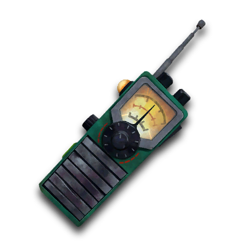
<figcaption>Handheld_Shortwave_Radio_icon.png</figcaption>
</figure></td>
<td>
<a href="./Handheld%20Shortwave%20Radio.md" class="wikilink" title="Handheld Shortwave Radio">Handheld Shortwave Radio</a>
</td>
<td>
0 kg 
(0 lb)
</td>
<td><ul>
<li>Used to find <a href="./Supply%20Cache.md" class="wikilink" title="Supply Cache">Supply Caches</a> and hidden Bunkers in the <a href="./Signal%20Void.md" class="wikilink" title="Signal Void Tale">Signal Void Tale</a></li>
<li>Requires a repaired <a href="./Transmitters.md" class="wikilink" title="Transmitter">Transmitter</a> and the Aurora/Glimmer Fog to be present in order to pick up a signal</li>
</ul></td>
</tr>
<tr>
<td><figure>

<figcaption>Wires_icon.png</figcaption>
</figure></td>
<td>
<a href="./Wires.md" class="wikilink" title="Wires">Wires</a>
</td>
<td>
0.10 kg 
(0.22 lb)
</td>
<td><ul>
<li>2 are needed to repair a Transmitter</li>
<li>1 bundle can be used to make a <a href="./Fishing%20Lure%20%28Wire%20Bundle%29.md" class="wikilink" title="Fishing Lure (Wire Bundle)">Fishing Lure (Wire Bundle)</a></li>
<li>1 is needed to destroy <a href="./Prepper%27s%20Abandoned%20Cache.md" class="wikilink" title="Prepper&#39;s Abandoned Cache">Prepper's Abandoned Cache</a></li>
</ul></td>
</tr>
<tr>
<td><figure>

<figcaption>Car_Battery_icon.png</figcaption>
</figure></td>
<td>
<a href="./Car%20Battery.md" class="wikilink" title="Car Battery">Car Battery</a>
</td>
<td>
15.00 kg 
(33 lb)
</td>
<td><ul>
<li>Heaviest item in the game, but 1 is needed to repair Transmitters</li>
<li>Can be broken down into <a href="./Scrap%20Lead.md" class="wikilink" title="Scrap Lead">Scrap Lead</a> and turned into <a href="./Bullet.md" class="wikilink" title="Bullets">Bullets</a> at an <a href="./Ammunition%20Work%20Bench.md" class="wikilink" title="Ammunition Work Bench">Ammunition Work Bench</a></li>
</ul></td>
</tr>
<tr>
<td><figure>
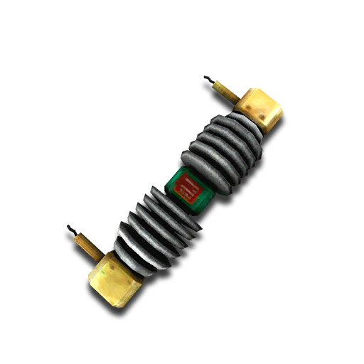
<figcaption>Replacement_Fuse_icon.png</figcaption>
</figure></td>
<td>
<a href="./Replacement%20Fuse.md" class="wikilink" title="Replacement Fuse">Replacement Fuse</a>
</td>
<td>
0.20 kg 
(0.44 lb)
</td>
<td><ul>
<li>3 are needed to repair a Transmitter</li>
</ul></td>
</tr>
</tbody>
</table>

Research Book

<table>
<colgroup>
<col style="width: 25%" />
<col style="width: 25%" />
<col style="width: 25%" />
<col style="width: 25%" />
</colgroup>
<thead>
<tr>
<th class="unsortable" style="border-style: solid none solid solid"><figure>

<figcaption>Tools.png</figcaption>
</figure></th>
<th style="border-style: solid solid solid none">
Item
</th>
<th>
Weight
</th>
<th>
Comment
</th>
</tr>
</thead>
<tbody>
<tr>
<td><figure>

<figcaption>Stay_on_Target_icon.png</figcaption>
</figure></td>
<td>
<a href="./Stay%20on%20Target.md" class="wikilink" title="Stay on Target">Stay on Target</a>
</td>
<td>
0.50 kg 
(1.1 lb)
</td>
<td><ul>
<li>Can be Researched to raise the <a href="./Archery.md" class="wikilink" title="Archery">Archery</a> Skill</li>
</ul></td>
</tr>
<tr>
<td><figure>

<figcaption>Field_Dressing_Your_Kill,_Vol._I_icon.png</figcaption>
</figure></td>
<td>
<a href="./Field%20Dressing%20Your%20Kill%2C%20Vol.%20I.md" class="wikilink" title="Field Dressing Your Kill, Vol. I">Field Dressing Your Kill, Vol. I</a>
</td>
<td>
0.50 kg 
(1.1 lb)
</td>
<td><ul>
<li>Can be Researched to raise the <a href="./Carcass%20Harvesting.md" class="wikilink" title="Carcass Harvesting">Carcass Harvesting</a> Skill</li>
</ul></td>
</tr>
<tr>
<td><figure>
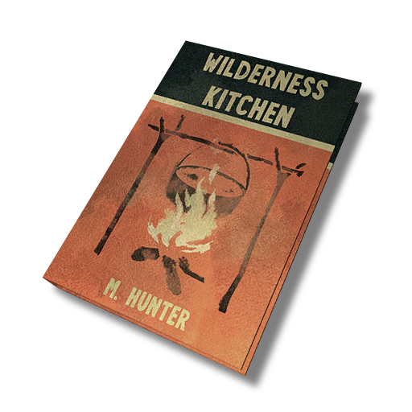
<figcaption>Wilderness_Kitchen_icon.png</figcaption>
</figure></td>
<td>
<a href="./Wilderness%20Kitchen.md" class="wikilink" title="Wilderness Kitchen">Wilderness Kitchen</a>
</td>
<td>
0.50 kg 
(1.1 lb)
</td>
<td><ul>
<li>Can be Researched to raise the <a href="./Cooking.md" class="wikilink" title="Cooking">Cooking</a> Skill</li>
</ul></td>
</tr>
<tr>
<td><figure>

<figcaption>Survive_the_Outdoors!_icon.png</figcaption>
</figure></td>
<td>
<a href="./Survive%20the%20Outdoors!.md" class="wikilink" title="Survive the Outdoors!">Survive the Outdoors!</a>
</td>
<td>
0.50 kg 
(1.1 lb)
</td>
<td><ul>
<li>Can be Researched to raise the <a href="./Fire%20Starting.md" class="wikilink" title="Fire Starting">Fire Starting</a> Skill</li>
</ul></td>
</tr>
<tr>
<td><figure>

<figcaption>The_Frozen_Angler_icon.png</figcaption>
</figure></td>
<td>
<a href="./The%20Frozen%20Angler.md" class="wikilink" title="The Frozen Angler">The Frozen Angler</a>
</td>
<td>
0.50 kg 
(1.1 lb)
</td>
<td><ul>
<li>Can be Researched to raise the <a href="./Ice%20Fishing.md" class="wikilink" title="Ice Fishing">Ice Fishing</a> Skill</li>
</ul></td>
</tr>
<tr>
<td><figure>

<figcaption>A_Sewing_Primer_icon.png</figcaption>
</figure></td>
<td>
<a href="./A%20Sewing%20Primer.md" class="wikilink" title="A Sewing Primer">A Sewing Primer</a>
</td>
<td>
0.50 kg 
(1.1 lb)
</td>
<td><ul>
<li>Can be Researched to raise the <a href="./Mending.md" class="wikilink" title="Mending">Mending</a> Skill</li>
</ul></td>
</tr>
<tr>
<td><figure>
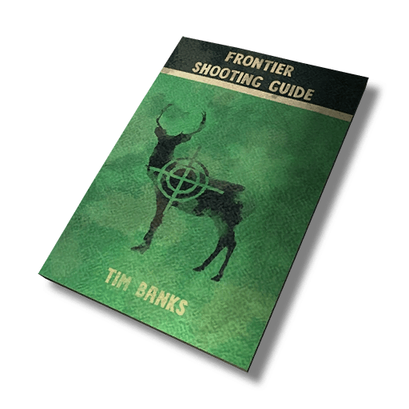
<figcaption>Frontier_Shooting_Guide_icon.png</figcaption>
</figure></td>
<td>
<a href="./Frontier%20Shooting%20Guide.md" class="wikilink" title="Frontier Shooting Guide">Frontier Shooting Guide</a>
</td>
<td>
0.50 kg 
(1.1 lb)
</td>
<td><ul>
<li>Can be Researched to raise the <a href="./Rifle%20Firearm.md" class="wikilink" title="Rifle Firearm">Rifle Firearm</a> Skill</li>
</ul></td>
</tr>
<tr>
<td><figure>
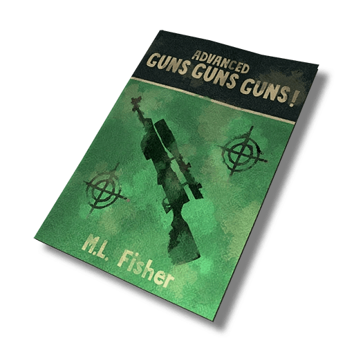
<figcaption>Advanced_Guns_Guns_Guns!_icon.png</figcaption>
</figure></td>
<td>
<a href="./Advanced%20Guns%20Guns%20Guns!.md" class="wikilink" title="Advanced Guns Guns Guns!">Advanced Guns Guns Guns!</a>
</td>
<td>
0.50 kg 
(1.1 lb)
</td>
<td><ul>
<li>Can be Researched to raise the <a href="./Rifle%20Firearm.md" class="wikilink" title="Rifle Firearm">Rifle Firearm</a> Skill</li>
</ul></td>
</tr>
<tr>
<td><figure>
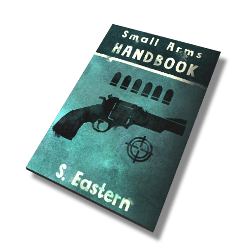
<figcaption>Small_Arms_Handbook_icon.png</figcaption>
</figure></td>
<td>
<a href="./Small%20Arms%20Handbook.md" class="wikilink" title="Small Arms Handbook">Small Arms Handbook</a>
</td>
<td>
0.50 kg 
(1.1 lb)
</td>
<td><ul>
<li>Can be Researched to raise the <a href="./Revolver%20Firearm.md" class="wikilink" title="Revolver Firearm">Revolver Firearm</a> Skill</li>
</ul></td>
</tr>
<tr>
<td><figure>

<figcaption>Practical_Gunsmithing_icon.png</figcaption>
</figure></td>
<td>
<a href="./Practical%20Gunsmithing.md" class="wikilink" title="Practical Gunsmithing">Practical Gunsmithing</a>
</td>
<td>
0.50 kg 
(1.1 lb)
</td>
<td><ul>
<li>Can be Researched to raise the <a href="./Gunsmithing.md" class="wikilink" title="Gunsmithing">Gunsmithing</a> Skill</li>
</ul></td>
</tr>
</tbody>
</table>

### Camera

<table>
<colgroup>
<col style="width: 25%" />
<col style="width: 25%" />
<col style="width: 25%" />
<col style="width: 25%" />
</colgroup>
<thead>
<tr>
<th class="unsortable" style="border-style: solid none solid solid"><figure>

<figcaption>Tools.png</figcaption>
</figure></th>
<th style="border-style: solid solid solid none">
Item
</th>
<th>
Weight
</th>
<th>
Comment
</th>
</tr>
</thead>
<tbody>
<tr>
<td><figure>

<figcaption>Camera_icon.png</figcaption>
</figure></td>
<td>
<a href="./Camera.md" class="wikilink" title="Camera">Camera</a>
</td>
<td>
0.00 kg 
(0 lb)
</td>
<td><ul>
<li>Can be used to take photos</li>
</ul></td>
</tr>
<tr>
<td><figure>

<figcaption>FastFilm-500_icon.png</figcaption>
</figure></td>
<td>
<a href="./FastFilm-500.md" class="wikilink" title="FastFilm-500">FastFilm-500</a>
</td>
<td>
0.50 kg 
(1.1 lb)
</td>
<td><ul>
<li>Used with the Camera. Uses Coloured film</li>
</ul></td>
</tr>
<tr>
<td><figure>

<figcaption>FastFilm-500BW_icon.png</figcaption>
</figure></td>
<td>
<a href="./FastFilm-500BW.md" class="wikilink" title="FastFilm-500BW">FastFilm-500BW</a>
</td>
<td>
0.50 kg 
(1.1 lb)
</td>
<td><ul>
<li>Used with the Camera. Uses Black &amp; White film</li>
</ul></td>
</tr>
<tr>
<td><figure>

<figcaption>FastFilm-500SPA_icon.png</figcaption>
</figure></td>
<td>
<a href="./FastFilm-500SPA.md" class="wikilink" title="FastFilm-500SPA">FastFilm-500SPA</a>
</td>
<td>
0.50 kg 
(1.1 lb)
</td>
<td><ul>
<li>Used with the Camera. Uses Sepia film</li>
</ul></td>
</tr>
</tbody>
</table>

### Other

<table>
<colgroup>
<col style="width: 25%" />
<col style="width: 25%" />
<col style="width: 25%" />
<col style="width: 25%" />
</colgroup>
<thead>
<tr>
<th class="unsortable" style="border-style: solid none solid solid"><figure>

<figcaption>Tools.png</figcaption>
</figure></th>
<th style="border-style: solid solid solid none">
Item
</th>
<th>
Weight
</th>
<th>
Comment
</th>
</tr>
</thead>
<tbody>
<tr>
<td><figure>

<figcaption>Broken_Arrow_icon.png</figcaption>
</figure></td>
<td>
<a href="./Broken%20Arrow.md" class="wikilink" title="Broken Arrow">Broken Arrow</a>
</td>
<td>
0.15 kg 
(0.33 lb)
</td>
<td><ul>
<li>Can be harvested for 1 Arrowhead and 2 Crow Feathers</li>
</ul></td>
</tr>
<tr>
<td><figure>

<figcaption>Broken_Fire_Hardened_Arrow_icon.png</figcaption>
</figure></td>
<td>
<a href="./Broken%20Fire%20Hardened%20Arrow.md" class="wikilink" title="Broken Fire Hardened Arrow">Broken Fire Hardened Arrow</a>
</td>
<td>
0.15 kg 
(0.33 lb)
</td>
<td><ul>
<li>Can be harvested for 1 Crow Feather</li>
</ul></td>
</tr>
<tr>
<td><figure>

<figcaption>Broken_Manufactured_Arrow_icon.png</figcaption>
</figure></td>
<td>
<a href="./Broken%20Manufactured%20Arrow.md" class="wikilink" title="Broken Manufactured Arrow">Broken Manufactured Arrow</a>
</td>
<td>
0.15 kg 
(0.33 lb)
</td>
<td><ul>
<li>Cannot be harvested</li>
</ul></td>
</tr>
<tr>
<td><figure>

<figcaption>Charcoal_icon.png</figcaption>
</figure></td>
<td>
<a href="./Charcoal.md" class="wikilink" title="Charcoal">Charcoal</a>
</td>
<td>
0.10 kg 
(0.22 lb)
</td>
<td><ul>
<li>Allows players to map regions</li>
<li>Collected from burned out fires</li>
<li>Not available in story mode</li>
</ul></td>
</tr>
<tr>
<td><figure>

<figcaption>Elevator_Crank_icon.png</figcaption>
</figure></td>
<td>
<a href="./Elevator%20Crank.md" class="wikilink" title="Elevator Crank">Elevator Crank</a>
</td>
<td>
1.00 kg 
(2.2 lb)
</td>
<td><ul>
<li>Used to operate the elevator in the <a href="./Last%20Prospect.md" class="wikilink" title="Last Prospect">Last Prospect</a> mine</li>
</ul></td>
</tr>
<tr>
<td><figure>

<figcaption>Gold_Nugget_icon.png</figcaption>
</figure></td>
<td>
<a href="./Gold%20Nugget.md" class="wikilink" title="Gold Nugget">Gold Nugget</a>
</td>
<td>
0.20 kg 
(0.44 lb)
</td>
<td><ul>
<li>A small clump of gold found in the <a href="./Langston%20Mine.md" class="wikilink" title="Langston Mine">Langston Mine</a>.</li>
</ul></td>
</tr>
<tr>
<td><figure>

<figcaption>Mountaineering_Rope_icon.png</figcaption>
</figure></td>
<td>
<a href="./Mountaineering%20Rope.md" class="wikilink" title="Mountaineering Rope">Mountaineering Rope</a>
</td>
<td>
5.00 kg 
(11 lb)
</td>
<td><ul>
<li>Allows players to <a href="./Rope%20Climbing.md" class="wikilink" title="Rope Climb">Rope Climb</a> in designated areas</li>
<li>Can create safer, faster shortcuts at the expense of <a href="./Fatigue.md" class="wikilink" title="Fatigue">Fatigue</a></li>
</ul></td>
</tr>
<tr>
<td><figure>

<figcaption>Spray_Paint_icon.png</figcaption>
</figure></td>
<td>
<a href="./Spray%20Paint.md" class="wikilink" title="Spray Paint">Spray Paint</a>
</td>
<td>
0.54 kg 
(1.188 lb)
</td>
<td><ul>
<li>Allows players to tag environments</li>
<li>Not available in story mode</li>
</ul></td>
</tr>
<tr>
<td><figure>

<figcaption>Spray_Paint_-_Glyph_icon.png</figcaption>
</figure></td>
<td>
<a href="./Spray%20Paint%20-%20Glyph.md" class="wikilink" title="Spray Paint - Glyph">Spray Paint - Glyph</a>
</td>
<td>
0.54 kg 
(1.188 lb)
</td>
<td><ul>
<li>Can be used to distract, stop, or halve the fog of the <a href="./Escape%20the%20Darkwalker.md" class="wikilink" title="Darkwalker">Darkwalker</a></li>
</ul></td>
</tr>
<tr>
<td><figure>
[Missing image: Travois_icon.png]
<figcaption>Travois_icon.png</figcaption>
</figure></td>
<td>
<a href="./Travois.md" class="wikilink" title="Travois">Travois</a>
</td>
<td>
1.00 kg 
(2.2 lb)
</td>
<td><ul>
<li>Can be used to transport items anywhere on the Island</li>
</ul></td>
</tr>
<tr>
<td><figure>

<figcaption>Woodworking_Tools_icon.png</figcaption>
</figure></td>
<td>
<a href="./Woodworking%20Tools.md" class="wikilink" title="Woodworking Tools">Woodworking Tools</a>
</td>
<td>
1.50 kg 
(3.3 lb)
</td>
<td><ul>
<li>Used to create advanced <a href="./Decorations.md" class="wikilink" title="Decorations">Decorations</a> Furniture</li>
<li>Only 4 exist in Survival Mode</li>
</ul></td>
</tr>
</tbody>
</table>

### Sutherland's Tale

<table>
<colgroup>
<col style="width: 25%" />
<col style="width: 25%" />
<col style="width: 25%" />
<col style="width: 25%" />
</colgroup>
<thead>
<tr>
<th class="unsortable" style="border-style: solid none solid solid"><figure>

<figcaption>Tools.png</figcaption>
</figure></th>
<th style="border-style: solid solid solid none">
Item
</th>
<th>
Weight
</th>
<th>
Comment
</th>
</tr>
</thead>
<tbody>
<tr>
<td><figure>

<figcaption>Document_Stash_1_icon.png</figcaption>
</figure></td>
<td>
<a href="./Document%20Stash%201.md" class="wikilink" title="Document Stash 1">Document Stash 1</a>
</td>
<td>
0.00 kg 
(0 lb)
</td>
<td><ul>
<li>Traded to the <a href="./Trader.md" class="wikilink" title="Trader">Trader</a> as part of his quest</li>
</ul></td>
</tr>
<tr>
<td><figure>

<figcaption>Document_Stash_1_icon.png</figcaption>
</figure></td>
<td>
<a href="./Document%20Stash%202.md" class="wikilink" title="Document Stash 2">Document Stash 2</a>
</td>
<td>
0.00 kg 
(0 lb)
</td>
<td><ul>
<li>Traded to the <a href="./Trader.md" class="wikilink" title="Trader">Trader</a> as part of his quest</li>
</ul></td>
</tr>
<tr>
<td><figure>

<figcaption>Document_Stash_1_icon.png</figcaption>
</figure></td>
<td>
<a href="./Document%20Stash%203.md" class="wikilink" title="Document Stash 3">Document Stash 3</a>
</td>
<td>
0.50 kg 
(1.1 lb)
</td>
<td><ul>
<li>Traded to the <a href="./Trader.md" class="wikilink" title="Trader">Trader</a> as part of his quest</li>
</ul></td>
</tr>
<tr>
<td><figure>

<figcaption>Document_Stash_1_icon.png</figcaption>
</figure></td>
<td>
<a href="./Document%20Stash%204.md" class="wikilink" title="Document Stash 4">Document Stash 4</a>
</td>
<td>
0.00 kg 
(0 lb)
</td>
<td><ul>
<li>Traded to the <a href="./Trader.md" class="wikilink" title="Trader">Trader</a> as part of his quest</li>
</ul></td>
</tr>
<tr>
<td><figure>

<figcaption>A_Skeleton_And_Note_icon.png</figcaption>
</figure></td>
<td>
<a href="./A%20Skeleton%20And%20Note.md" class="wikilink" title="A Skeleton And Note">A Skeleton And Note</a>
</td>
<td>
0.00 kg 
(0 lb)
</td>
<td><ul>
<li>Traded to the <a href="./Trader.md" class="wikilink" title="Trader">Trader</a> as part of his quest</li>
</ul></td>
</tr>
<tr>
<td><figure>

<figcaption>A_Skeleton_And_Note_icon.png</figcaption>
</figure></td>
<td>
<a href="./Wyatt%27s%20Skeleton.md" class="wikilink" title="Wyatt&#39;s Skeleton">Wyatt's Skeleton</a>
</td>
<td>
0.00 kg 
(0 lb)
</td>
<td><ul>
<li>Traded to the <a href="./Trader.md" class="wikilink" title="Trader">Trader</a> as part of his quest</li>
</ul></td>
</tr>
<tr>
<td><figure>
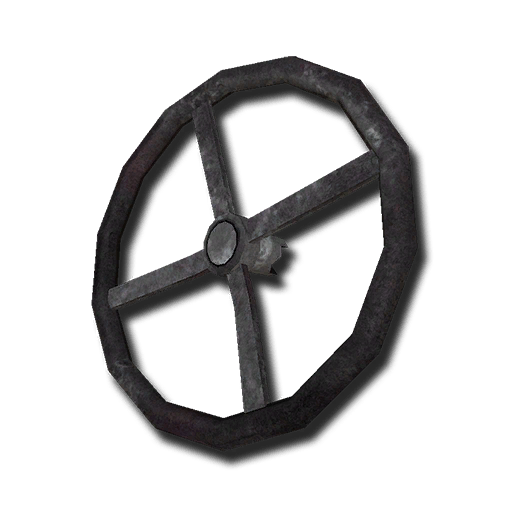
<figcaption>Broken_Hatch_Wheel_icon.png</figcaption>
</figure></td>
<td>
<a href="./Broken%20Hatch%20Wheel.md" class="wikilink" title="Broken Hatch Wheel">Broken Hatch Wheel</a>
</td>
<td>
0.00 kg 
(0 lb)
</td>
<td><ul>
<li>Traded to the <a href="./Trader.md" class="wikilink" title="Trader">Trader</a> as part of his quest</li>
</ul></td>
</tr>
</tbody>
</table>

### Wintermute Exclusive

<table>
<colgroup>
<col style="width: 25%" />
<col style="width: 25%" />
<col style="width: 25%" />
<col style="width: 25%" />
</colgroup>
<thead>
<tr>
<th><figure>

<figcaption>Tools.png</figcaption>
</figure></th>
<th>
Item
</th>
<th>
Weight
</th>
<th>
Comment
</th>
</tr>
</thead>
<tbody>
<tr>
<td><figure>

<figcaption>Astrid's_Backpack_icon.png</figcaption>
</figure></td>
<td>
<a href="./Astrid%27s%20Backpack.md" class="wikilink" title="Astrid&#39;s Backpack">Astrid's Backpack</a>
</td>
<td>
5.00 kg 
(11 lb)
</td>
<td><ul>
<li>Used at the start of Episode 1</li>
</ul></td>
</tr>
<tr>
<td><figure>

<figcaption>Broken_Bear_Spear_icon.png</figcaption>
</figure></td>
<td>
<a href="./Broken%20Bear%20Spear.md" class="wikilink" title="Broken Bear Spear">Broken Bear Spear</a>
</td>
<td>
3.75 kg 
(8.25 lb)
</td>
<td><ul>
<li>Found in the Hunting Lodge in Episode 2</li>
</ul></td>
</tr>
<tr>
<td><figure>

<figcaption>Spear_Head_icon.png</figcaption>
</figure></td>
<td>
<a href="./Spear%20Head.md" class="wikilink" title="Spear Head">Spear Head</a>
</td>
<td>
0.50 kg 
(1.1 lb)
</td>
<td><ul>
<li>Forged to repair the Broken Bear Spear in Episode 2</li>
</ul></td>
</tr>
<tr>
<td><figure>

<figcaption>Bear_Spear_icon.png</figcaption>
</figure></td>
<td>
<a href="./Bear%20Spear.md" class="wikilink" title="Bear Spear">Bear Spear</a>
</td>
<td>
3.75 kg 
(8.25 lb)
</td>
<td><ul>
<li>Only found in Wintermute Episode 2</li>
<li>Can be used to attack hostile wildlife by taking a defensive posture</li>
</ul></td>
</tr>
<tr>
<td><figure>

<figcaption>Bolt_Cutters_icon.png</figcaption>
</figure></td>
<td>
<a href="./Bolt%20Cutters.md" class="wikilink" title="Bolt Cutters">Bolt Cutters</a>
</td>
<td>
1.50 kg 
(3.3 lb)
</td>
<td><ul>
<li>Used in Wintermute Episode 3 and 4 to cut through locked gates</li>
</ul></td>
</tr>
<tr>
<td><figure>

<figcaption>Burned_Out_Fuse_icon.png</figcaption>
</figure></td>
<td>
<a href="./Burned%20Out%20Fuse.md" class="wikilink" title="Burned Out Fuse">Burned Out Fuse</a>
</td>
<td>
0.20 kg 
(0.44 lb)
</td>
<td><ul>
<li>Found in Wintermute Episode 3 and serves no purpose other than to be replaced</li>
<li>Model is used in Transmitters in Survival Mode but cannot be obtained</li>
</ul></td>
</tr>
<tr>
<td><figure>

<figcaption>Distress_Pistol_Kit_icon.png</figcaption>
</figure></td>
<td>
<a href="./Distress%20Pistol%20Kit.md" class="wikilink" title="Distress Pistol Kit">Distress Pistol Kit</a>
</td>
<td>
5.00 kg 
(11 lb)
</td>
<td><ul>
<li>Used at the start of Episode 1</li>
</ul></td>
</tr>
<tr>
<td><figure>

<figcaption>Elevator_Crank_icon.png</figcaption>
</figure></td>
<td>
<a href="./Elevator%20Crank.md" class="wikilink" title="Elevator Crank">Elevator Crank</a>
</td>
<td>
0.00 kg 
(0 lb)
</td>
<td><ul>
<li>Used to operate the elevator in the <a href="./Last%20Prospect.md" class="wikilink" title="Last Prospect">Last Prospect</a> mine in Episode 4</li>
</ul></td>
</tr>
<tr>
<td><figure>

<figcaption>Emergency_Food_icon.png</figcaption>
</figure></td>
<td>
<a href="./Emergency%20Food.md" class="wikilink" title="Emergency Food">Emergency Food</a>
</td>
<td>
5.00 kg 
(11 lb)
</td>
<td><ul>
<li>Used at the start of Episode 1</li>
</ul></td>
</tr>
<tr>
<td><figure>

<figcaption>First_Aid_Kit_(tool)_icon.png</figcaption>
</figure></td>
<td>
<a href="./First%20Aid%20Kit%20%28tool%29.md" class="wikilink" title="First Aid Kit (tool)">First Aid Kit (tool)</a>
</td>
<td>
5.00 kg 
(11 lb)
</td>
<td><ul>
<li>Used at the start of Episode 1</li>
</ul></td>
</tr>
<tr>
<td><figure>

<figcaption>Scrap_Metal_Shard_icon.png</figcaption>
</figure></td>
<td>
<a href="./Scrap%20Metal%20Shard.md" class="wikilink" title="Scrap Metal Shard">Scrap Metal Shard</a>
</td>
<td>
0.30 kg 
(0.66 lb)
</td>
<td><ul>
<li>Found in Wintermute Episode 1 and can be carried to Episode 2</li>
<li>Slightly less effective version of the Hunting Knife</li>
</ul></td>
</tr>
<tr>
<td><figure>

<figcaption>Valve_Socket_Handle_icon.png</figcaption>
</figure></td>
<td>
<a href="./Valve%20Socket%20Handle.md" class="wikilink" title="Valve Socket Handle">Valve Socket Handle</a>
</td>
<td>
0.00 kg 
(0 lb)
</td>
<td><ul>
<li>Used to open mineshaft airflow valves in Episode 4</li>
</ul></td>
</tr>
</tbody>
</table>

### Cut Tools

<table>
<colgroup>
<col style="width: 25%" />
<col style="width: 25%" />
<col style="width: 25%" />
<col style="width: 25%" />
</colgroup>
<thead>
<tr>
<th><figure>

<figcaption>Tools.png</figcaption>
</figure></th>
<th>
Item
</th>
<th>
Weight
</th>
<th>
Comment
</th>
</tr>
</thead>
<tbody>
<tr>
<td><figure>

<figcaption>Jeremiah's_Knife_icon.png</figcaption>
</figure></td>
<td>
<a href="./Jeremiah%27s%20Knife.md" class="wikilink" title="Jeremiah&#39;s Knife">Jeremiah's Knife</a>
</td>
<td>
0.50 kg 
(1.1 lb)
</td>
<td><ul>
<li>Only found in Wintermute Predux Episode 2 after completing <a href="./Survival%20School%20%28Predux%29.md" class="wikilink" title="Survival School (Predux)">Survival School (Predux)</a></li>
<li>Behaves as a reskinned Hunting Knife</li>
<li>Currently inaccessible but still in the game files</li>
</ul></td>
</tr>
<tr>
<td><figure>

<figcaption>Brand_icon.png</figcaption>
</figure></td>
<td>
<a href="./Brand.md" class="wikilink" title="Brand">Brand</a>
</td>
<td>
0.30 kg 
(0.66 lb)
</td>
<td><ul>
<li>Removed from the Alpha versions of <em><a href="./The%20Long%20Dark.md" class="wikilink" title="The Long Dark">The Long Dark</a></em> and replaced by the <a href="./Torch.md" class="wikilink" title="Torch">Torch</a></li>
<li>Can be Brandished to scare predator Wildlife</li>
</ul></td>
</tr>
<tr>
<td><figure>

<figcaption>Hunting_Lodge_Rifle_icon.png</figcaption>
</figure></td>
<td>
<a href="./Hunting%20Lodge%20Rifle.md" class="wikilink" title="Hunting Lodge Rifle">Hunting Lodge Rifle</a>
</td>
<td>
4.00 kg 
(8.8 lb)
</td>
<td><ul>
<li>Found in the Predux Episode 2 Mission You Fix My Rifle?</li>
</ul></td>
</tr>
</tbody>
</table>

**Lua execution error in Module:Navbox function navbox**

<a href="es:Herramientas" class="wikilink" title="es:Herramientas">es:Herramientas</a> <a href="fr:Outils" class="wikilink" title="fr:Outils">fr:Outils</a> <a href="ru:%D0%A1%D0%BD%D0%B0%D1%80%D1%8F%D0%B6%D0%B5%D0%BD%D0%B8%D0%B5" class="wikilink" title="ru:Снаряжение">ru:Снаряжение</a> <a href="de:Werkzeuge" class="wikilink" title="de:Werkzeuge">de:Werkzeuge</a>

