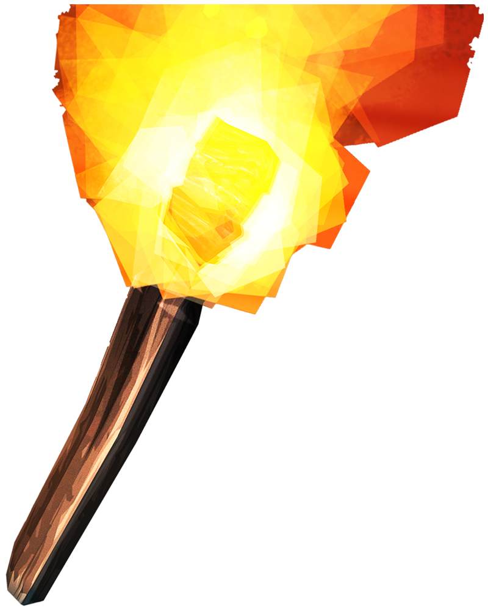

# Torch

**Contents**

- [Overview](#Overview)
- [Advanced uses](#Advanced_uses)
- [Fire Starting info](#Fire_Starting_info)
- [Crafting](#Crafting)
- [Crafting](#Crafting_2)
- [Harvesting](#Harvesting)
- [Gallery](#Gallery)
- [Update history](#Update_history)

<table class="infobox">
<caption>Torch</caption>
<colgroup>
<col style="width: 50%" />
<col style="width: 50%" />
</colgroup>
<tbody>
<tr>
<td colspan="2"><figure>

<figcaption>Torch_icon.png</figcaption>
</figure></td>
</tr>
<tr>
<td>
Release
</td>
<td>
<a href="./The%20Long%20Dark%20%E2%80%94%20Changelog.md#0.192" class="wikilink" title="7 February 2015">7 February 2015</a>
</td>
</tr>
<tr>
<td>
Wintermute
</td>
<td>
No
</td>
</tr>
<tr>
<td>
Renewable
</td>
<td>
Yes
</td>
</tr>
<tr>
<td colspan="2" class="section">
<strong>Properties</strong>
</td>
</tr>
<tr>
<td>
Item type
</td>
<td>
<a href="./Fire%20Starting.md" class="wikilink" title="Fire Starting">Fire Starting</a><a href="./Tools.md" class="wikilink" title="Tools">Tools</a>|-
</td>
</tr>
<tr>
<td>
Stackable
</td>
<td>
No
</td>
</tr>
<tr>
<td>
Examine
</td>
<td>
A simple torch -- the same kind that's dispelled the darkness for thousands of years. Might even keep the Wolves at bay.
</td>
</tr>
<tr>
<td colspan="2" class="section">
<strong>Values</strong>
</td>
</tr>
<tr>
<td>
Weight
</td>
<td>
0.30 kg (0.66 lbs)
</td>
</tr>
<tr>
<td colspan="2" class="section">
<strong>Advanced data</strong>
</td>
</tr>
<tr>
<td>
Item key
</td>
<td>
GAMEPLAY_Torch
</td>
</tr>
</tbody>
</table>

**Template:quote2**A **Torch** is a craftable tool that creates light and a small amount of heat, adding +3°C to your "Feels Like" temperature. If more than one is dropped on the ground (at your feet) while burning, the warmth bonus they provide stacks, unless a fire is nearby, in which case it overrides the warmth from torches.

## Overview

Torches are a mobile light source the can be ignited anywhere with either <a href="./Wood%20Matches.md" class="wikilink" title="Wood Matches">Wood Matches</a>, <a href="./Cardboard%20Matches.md" class="wikilink" title="Cardboard Matches">Cardboard Matches</a>, or a <a href="./Firestriker.md" class="wikilink" title="Firestriker">Firestriker</a>. They can also be ignited with a pre-existing <a href="./Fire.md" class="wikilink" title="Fire">Fire</a>, such as from an active Firebox, or even another lit Torch, <a href="./Flare.md" class="wikilink" title="Flare">Flare</a>, or <a href="./Marine%20Flare.md" class="wikilink" title="Marine Flare">Marine Flare</a> (the later being a process known as <a href="./Daisy%20Chaining.md" class="wikilink" title="Daisy Chaining">Daisy Chaining</a>).

The Torch works like a <a href="./Flare.md" class="wikilink" title="Flare">Flare</a>, lighting up the surrounding area and possibly scaring away <a href="./Wolf.md" class="wikilink" title="Wolves">Wolves</a>, although it's less reliable than a Flare. If you're carrying a lit Torch, a Wolf will run up to you and stand a short distance away, similar to a fire. Throwing a lit Torch at a Wolf sometimes causes the Wolf to flee, but they will more likely overcome their fear of the Torch if your <a href="./Scent.md" class="wikilink" title="Scent">Scent</a> is too high or an <a href="./Aurora.md" class="wikilink" title="Aurora">Aurora</a> is out (in which case a <a href="./Flashlight.md" class="wikilink" title="Flashlight">Flashlight</a> is better suited to scaring Wolves).

A lit Torch can be extinguished for later use and can be re-lit when the weather is calm enough, or indoors, by equipping it with the '1' key or from inventory, then pressing the left mouse button and selecting a match or Firestriker. Keep in mind that even if the Torch isn't lit with your match or Firestriker, it will still consume a match or condition if you start the process of lighting it and cancel out. Therefore some players like to only have a Torch equipped when they need it, in order to not accidentally waste matches or condition. Another way to not waste matches is to carry multiple types of firestarting items (excluding the magnifying lense), so that an accidental click brings up the selection screen instead.

Unlike the Flare or Storm Lantern, Torches cannot be lit in overly windy <a href="./Weather.md" class="wikilink" title="Weather">Weather</a>, and their flames will burn out if winds become too harsh. Torches can also become extinguished if walking through a waterfall.

## Advanced uses

In more difficult game modes, where matches are much less common, a good practice is to start all fires by first lighting a Torch and then using the burning Torch to light the fire. If the attempt fails, just try again. This eliminates the chance of wasting a match on a failed fire-starting attempt.

Another technique to save matches and to preserve <a href="./Condition.md" class="wikilink" title="Condition">Condition</a> and <a href="./Warmth.md" class="wikilink" title="Warmth">Warmth</a> is to practice <a href="./Daisy%20Chaining.md" class="wikilink" title="Daisy Chaining">Daisy Chaining</a>, whereas a player pulls out multple Torches out of a fire and then uses a lit one to keep warm in their travels. As that Torch dies out, toss it on the ground and use a new Torch to pass the flame to your new Torch, thus chaining the flame.

A **guaranteed** way to scare off a Wolf is to throw or place a lit Torch or Flare on the ground, standing closely behind it, and aim any weapon, including stones, at the Wolf. The animal will charge at you, stop at a few meters distance in front of the Torch, and then flee. This trick is fundamental to survive on Interloper difficulty, and very helpful in the beginning of any game.

Pulling torches out of a lit fire and throwing them at <a href="./Timberwolf.md" class="wikilink" title="Timberwolves">Timberwolves</a> is a **very effective** strategy to deplete pack morale and scare off the pack.

## Fire Starting info

A <a href="./Torch.md" class="wikilink" title="Torch">Torch</a> can be used either as a Starter or as Fuel. The properties of a Torch when used as a Starter are:

<table class="infobox">
<caption>Torch</caption>
<thead>
<tr>
<th>
Type
</th>
<th>
Starter
</th>
</tr>
</thead>
<tbody>
<tr>
<th colspan="2" class="section">
<strong>Statistics</strong>
</th>
</tr>
&#10;<tr>
<th>
Start Chance
</th>
<td>
 +5%
</td>
</tr>
</tbody>
</table>

The properties of a Torch when used as Fuel are:

<table class="infobox">
<caption>Torch</caption>
<thead>
<tr>
<th>
Type
</th>
<th>
Fuel
</th>
</tr>
</thead>
<tbody>
<tr>
<th colspan="2" class="section">
<strong>Statistics</strong>
</th>
</tr>
&#10;<tr>
<th>
Duration
</th>
<td>
 10 minutes
</td>
</tr>
<tr>
<th>
Start Chance
</th>
<td>
 -5%
</td>
</tr>
<tr>
<th>
Heat
</th>
<td>
 +1°C (+1.8°F)
</td>
</tr>
<tr>
<th>
Burn Density
</th>
<td>
0.55 hr/kg (0.25 hr/lb)
</td>
</tr>
</tbody>
</table>

## Crafting

Crafting a 100% durability Torch uses 0.10 liters of <a href="./Lantern%20Fuel.md" class="wikilink" title="Lantern Fuel">Lantern Fuel</a>, and it will burn for 7.5 minutes (1.5 in-game hours). In that same period of time, a Storm Lantern will burn over three times as much fuel. This makes crafted Torches a much more efficient choice of light source for the player who wants to conserve their fuel store, but at the cost of using a match (if a fire is not already present)

You can also pull a Torch from any fire, but their condition will always be randomly between 20-50% durability, and this will reduce your fire by 10 minutes and 1°C per Torch (the fire must have at least 10 minutes duration remaining to perform this action).

## Crafting

<table class="infobox">
<caption>Torch</caption>
<tbody>
<tr>
<td colspan="2">
-
</td>
</tr>
<tr>
<td colspan="2">
-
</td>
</tr>
<tr>
<td colspan="2">
15 minutes
</td>
</tr>
<tr>
<td colspan="2" class="section">
<strong>Requirements</strong>
</td>
</tr>
<tr>
<td>
Facility
</td>
<td>
[[File:Anywhere icon.png
</td>
</tr>
<tr>
<td colspan="2" class="section">
<strong>Materials</strong>
</td>
</tr>
<tr>
<td colspan="2" class="section">
<strong>Template:iconlink plain</strong>
</td>
</tr>
<tr>
<td>
Item
</td>
<td>
<a href="./Stick.md" class="wikilink" title="Stick">Stick</a>
</td>
</tr>
<tr>
<td>
Quantity
</td>
<td>
3
</td>
</tr>
<tr>
<td colspan="2" class="section">
<strong>Template:iconlink plain</strong>
</td>
</tr>
<tr>
<td colspan="2">
<a href="./Cloth.md" class="wikilink" title="Cloth">Cloth</a>
</td>
</tr>
<tr>
<td colspan="2">
1
</td>
</tr>
<tr>
<td colspan="2" class="section">
<strong>Template:iconlink plain</strong>
</td>
</tr>
<tr>
<td colspan="2">
<a href="./Lantern%20Fuel.md" class="wikilink" title="Lantern Fuel">Lantern Fuel</a>
</td>
</tr>
<tr>
<td colspan="2">
0.10 L
</td>
</tr>
</tbody>
</table>

## Harvesting

Torches cannot be repaired. They can be 'recycled' by adding them to fires or harvested for 1 x <a href="./Stick.md" class="wikilink" title="Stick">Stick</a> in 2 minutes.

## Gallery

<table class="gallery">
<colgroup>
<col style="width: 33%" />
<col style="width: 33%" />
<col style="width: 33%" />
</colgroup>
<tbody>
<tr>
<td><figure>
[Missing image: Torch_-_unused.png]
<figcaption>Old model - unused</figcaption>
</figure></td>
<td><figure>

<figcaption>Old model - burning</figcaption>
</figure></td>
<td><figure>
[Missing image: Torch.png]
<figcaption>Old model - ruined</figcaption>
</figure></td>
</tr>
</tbody>
</table>

## Update history

- UPDATE **7 February 2015 (<a href="./The%20Long%20Dark%20%E2%80%94%20Early%20Access%20Changelog.md#0.192" class="wikilink" title="Update">Update</a>):**
  - Added to game.

**Lua execution error in Module:Navbox function navbox** **Lua execution error in Module:Navbox function navbox** <a href="ru:%D0%A4%D0%BE%D0%BD%D0%B0%D1%80%D1%8C" class="wikilink" title="ru:Фонарь">ru:Фонарь</a> <a href="es:Antorcha" class="wikilink" title="es:Antorcha">es:Antorcha</a>

