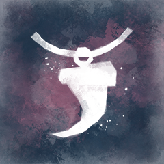

# Tough Enough

**Contents**

- [Guide](#Guide)
- [Requirements](#Requirements)
- [Tips](#Tips)
- [Trivia](#Trivia)

<table class="infobox">
<caption>Tough Enough</caption>
<colgroup>
<col style="width: 50%" />
<col style="width: 50%" />
</colgroup>
<tbody>
<tr>
<td colspan="2"><figure>

<figcaption>Tough_Enough_icon.png</figcaption>
</figure></td>
</tr>
<tr>
<td colspan="2"></td>
</tr>
<tr>
<td>
Description
</td>
<td>
Survive 25 Cougar Struggles.
</td>
</tr>
</tbody>
</table>

**Tough Enough** is an <a href="./The%20Long%20Dark%20%E2%80%94%20Achievements.md" class="wikilink" title="achievement">achievement</a> in *<a href="./The%20Long%20Dark.md" class="wikilink" title="The Long Dark">The Long Dark</a>*.

## Guide

This achievement is easiest to unlock in <a href="./Survival%20Mode.md" class="wikilink" title="Survival Mode">Survival Mode</a> when playing on <a href="./Voyageur.md" class="wikilink" title="Voyageur">Voyageur</a>, as <a href="./Cougar.md" class="wikilink" title="Cougars">Cougars</a> are disabled on <a href="./Pilgrim.md" class="wikilink" title="Pilgrim">Pilgrim</a> and higher Experiences cause more Condition damage to the player from <a href="./Struggle.md" class="wikilink" title="Struggles">Struggles</a>. The player must enable the Cougar in their survival run and survive long enough for them to start spawning in the game world, then survive 25 Struggles with a Cougar.

### Requirements

The requirements to unlock this achievement necessitates the player being fully overwhelmed by the Cougar for progress to count. A Cougar has 2 different attack patterns:

- A "Glancing Blow" attack occurs when the Cougar swipes a weapon from the player's hand and runs away, causing small Condition damage. This attack is not counted as a Struggle and is not tracked by the game.
- A Struggle occurs when the player is fully overwhelmed by a Cougar and a cutscene occurs. The player will wake up with <a href="./Severe%20Lacerations.md" class="wikilink" title="Severe Lacerations">Severe Lacerations</a> and major <a href="./Condition.md" class="wikilink" title="Condition">Condition</a> damage.
  - Surviving this attack will count as surviving 1 Cougar Struggle.
  - Dying from the Struggle will not count towards progress.
- Progress is tracked across multiple Survival Mode save files, and it does not need to be done in a single game.

### Tips

- This achievement is one of the hardest to unlock in the game, and thus requires great patience and planning. A guide to hunting and surviving Cougar encounters (including using proper <a href="./First%20Aid.md" class="wikilink" title="First Aid">First Aid</a> to heal from <a href="./Severe%20Lacerations.md" class="wikilink" title="Severe Lacerations">Severe Lacerations</a>) can be found <a href="./Cougar.md#Hunting" class="wikilink" title="Here">Here</a>.
- Deliberately being attacked by the same Cougar over and over within a short time span will more than likely result in your death, so plan ahead when recovering from injuries.
- Wearing a <a href="./Ballistic%20Vest.md" class="wikilink" title="Ballistic Vest">Ballistic Vest</a> significantly lowers Condition damage to the player. Consider also wearing <a href="./Clothing.md" class="wikilink" title="Clothing">Clothing</a> with high Protection stats.

## Trivia

This achievement is a reference to the fact that the player must be quite tough to survive so many attacks from a Cougar, considering how much damage their Struggles do to the player's Condition.**Lua execution error in Module:Navbox function navbox**

