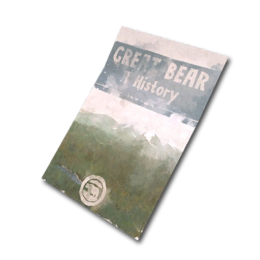

# Town of Milton

**Town of Milton**

| Property | Details |
| --- | --- |
|  |  / *Town\_of\_Milton\_icon.png* |
| Wintermute | [Episode 1](./Episode%201%20-%20Do%20Not%20Go%20Gentle.md) |
| **Properties** |  |
| Item type | [Collectibles](./Collectibles.md)\|- |
| Stackable | No |
| Examine | Leaflet containing information about Great Bear Island, presented by the Great Bear Historical Society. |
| **Values** |  |
| Weight | 0.00 kg (0 lbs) |
| **Actions** |  |
| Backpack | Examine |
| On ground | Take It, Read Text, Leave It |

**Town of Milton** is a [Collectible](./Collectibles.md) item found in [Episode 1](./Episode%201%20-%20Do%20Not%20Go%20Gentle.md) of the [Wintermute](./Wintermute.md) story mode, and can be found on the desk in the [Post Office](./Milton%20Post%20Office.md).

Currently, the collectible serves no additional purpose during [Episode 1](./Episode%201%20-%20Do%20Not%20Go%20Gentle.md).

## Transcript

*The following text is transcribed from **Town of Milton***

**Founded in 1911 during the early rush to mine coal in the surrounding mountains, Milton went through a boom/bust cycle throughout the 1900s, at one point peaking at about 1000 residents. In the 2000s, it settled into the 100s, and Post-Collapse, the population has struggled to remain in the low double digits. Originally built along a supply route from the coastline leading into the interior, the old dirt path was replaced by a paved highway in 1960. It’s location about halfway between Port Mary and the interior mountains gave it a natural advantage as a convenient stopping off point for fuel and supplies for miners, loggers, mill workers, and campers from the Mainland, a dynamic that fueled the town’s growth as the Island’s economy boomed in the 1980s. However, the construction of the Great Bear Highway (AKA Highway 15) meant travellers could easily bypass Milton on their way North, which in many ways triggered the gradual decline of Milton’s importance as a gateway town.

This decline was exaggerated even more in the Post-Collapse economic environment, where very few travelers or resource workers had reason to visit Great Bear. Eventually, apart from a few stalwarts and old-timers with deep roots in the area, Milton became, for all intents and purposes, a ghost town.**

## Game History

\* UPDATE **17 December 2018 ([Update](./The%20Long%20Dark%20%E2%80%94%20Changelog.md#1.41)):**

- 
  - Added to game.

**Lua execution error in Module:Navbox function navbox**
