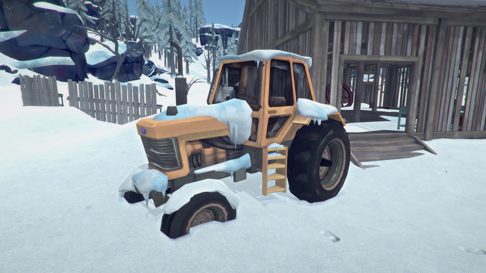
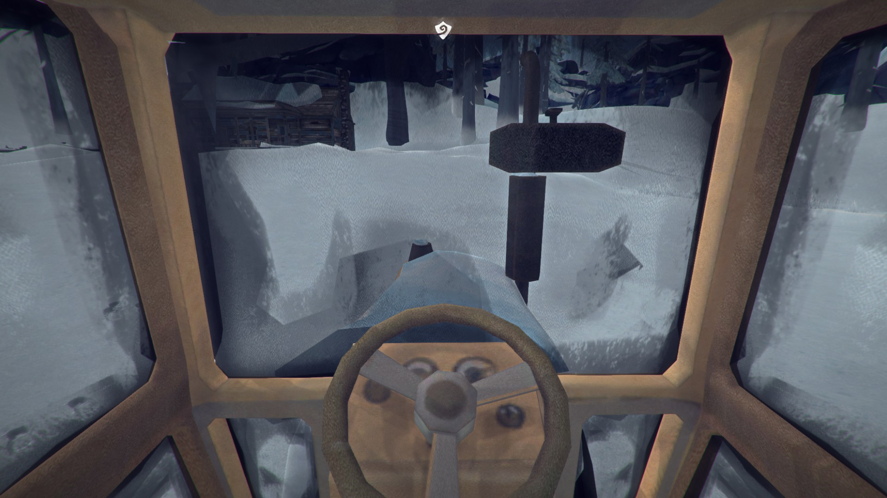

# Tractor

**Categories:** Interactable Objects · **Source:** [Fandom](https://thelongdark.fandom.com/wiki/Tractor)

 **Tractors** are interactable [vehicle](./Vehicle.md) objects found near farms and garages, such as the [Pleasant Valley Outbuildings](./Pleasant%20Valley%20Outbuildings.md), [Paradise Meadows Farm](./Paradise%20Meadows%20Farm.md), and [Quonset Garage](./Quonset%20Garage.md).

## Overview

The rarest of vehicles on [Great Bear Island](./Great%20Bear%20Island.md), tractors have been rendered useless by the [aurora](./Aurora.md), and now serve as an uncommon reminder of humanity's past technological achievements. Much like all vehicles, tractors can be used as temporary shelters from the wind and predators, but are risky to sleep in due to a lack of insulation.

Unlike [cars](./Car.md) and [trucks](./Truck.md), the hood and fuel panels cannot be opened, and there is obviously no trunk. Sun visors are also missing from tractors, meaning that [Mementos](./Mementos.md) will not spawn inside them. When an aurora is active, the tractors lights will flicker back to life.

Snacks like [Candy Bars](./Chocolate%20Bar.md) or [Sodas](./Soda%20%28disambiguation%29.md) are very common food items found inside the floors of tractors. Common crafting items such as [cloth](./Cloth.md) may also spawn, as may unique items (e.g., a key to the Paradise Meadows Farmhouse) on rare occasions. Due to a lack of an interactable hood, a [vehicle battery](./Car%20Battery.md) cannot be obtained from tractors.

## Gallery

_The interior_

[ru:Трактор](ru:%D0%A2%D1%80%D0%B0%D0%BA%D1%82%D0%BE%D1%80)
