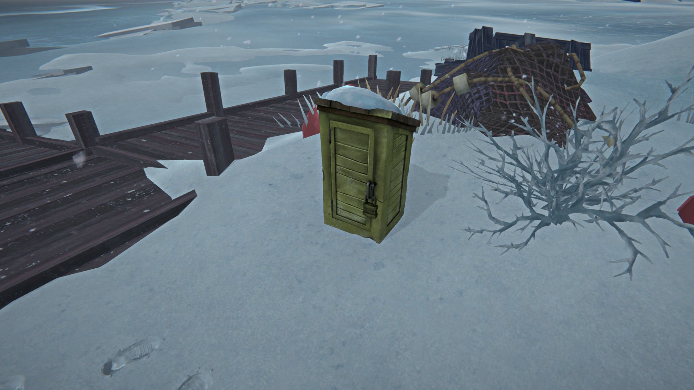
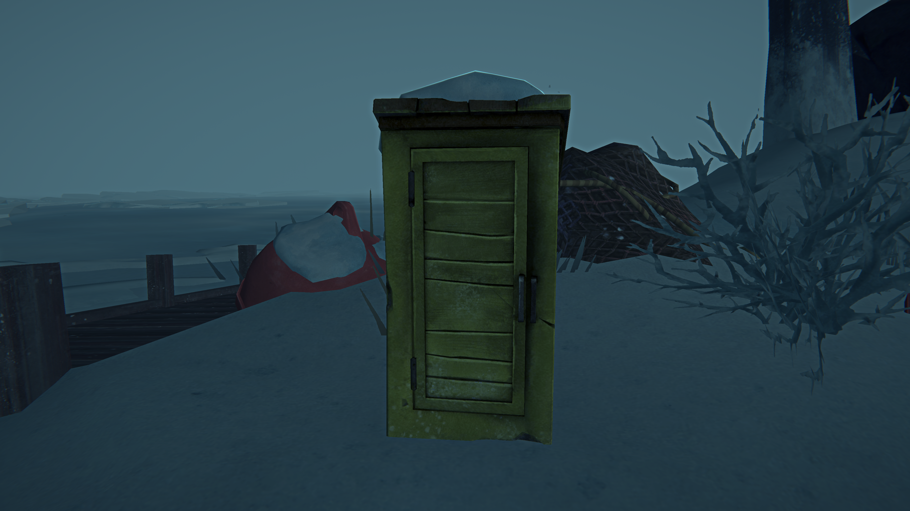

# Trade Drop Box

**Trade Drop Box**

| Property | Details |
| --- | --- |
| \[\[File: / \|  / *Locked* \|  / *Unlocked* \| / \| --- \| --- \| | 250px\]\] |
|  / *Locked* |  / *Unlocked* |
| Release | TFTFT Part 6 Broken Silence |
| Update | [2.33](./The%20Long%20Dark%20%E2%80%94%20Changelog.md#2.33) |

| Column 1 | Column 2 | Column 3 |
| --- | --- | --- |
|  / *Ptarmigan\_icon.png* | **DLC-Exclusive content.** / This content requires the [Tales from the Far Territory](./Tales%20from%20the%20Far%20Territory.md) addon to be installed before it can be seen or used in regular gameplay. | \|} A **Trade Drop Box** is a container used to make trades with the [Trader](./Trader.md) in [Survival Mode](./Survival%20Mode.md). It does not appear if the Trader is not enabled on a Survival save file. / ## Overview / The Trade Drop Box is normally locked when first found, but becomes unlocked when making a deal to trade with the Trader. The trade box is only located in the [Misanthrope's Homestead](./Misanthrope%27s%20Homestead.md) in [Coastal Highway](./Coastal%20Highway.md), by a pier near the ocean edge. / **Lua execution error in Module:Navbox function navbox** |
