# Trader

**Contents**

- [Overview](#Overview)
- [Enable Option](#Enable_Option)
- [Arrival Time and Radio](#Arrival_Time_and_Radio)
- [Arrival Time](#Arrival_Time)
- [Radio Locations](#Radio_Locations)
- [Trading](#Trading)
- [Trader Mechanics](#Trader_Mechanics)
- [Trading Tips](#Trading_Tips)
- [Trust](#Trust)
- [Trust Gained and Lost](#Trust_Gained_and_Lost)
- [Trust Thresholds](#Trust_Thresholds)
- [Special Requests](#Special_Requests)
- [Trader's Inventory](#Trader%27s_Inventory)
- [Normal Trades](#Normal_Trades)
- [Special Trade Items](#Special_Trade_Items)
- [Sutherland's Past](#Sutherland%27s_Past)
- [Trivia](#Trivia)
- [Gallery](#Gallery)
- [Achievements](#Achievements)
- [Game History](#Game_History)

<table style="width:100%;">
<colgroup>
<col style="width: 16%" />
<col style="width: 16%" />
<col style="width: 16%" />
<col style="width: 16%" />
<col style="width: 16%" />
<col style="width: 16%" />
</colgroup>
<tbody>
<tr>
<td width="40px"><figure>
[Missing image: Ptarmigan_icon.png]
<figcaption>Ptarmigan_icon.png</figcaption>
</figure></td>
<td>
<strong>DLC-Exclusive content.</strong> 

This content requires the <a href="./Tales%20from%20the%20Far%20Territory.md" class="wikilink" title="Tales from the Far Territory">Tales from the Far Territory</a> addon to be installed before it can be seen or used in regular gameplay.

</td>
<td>
|} Icon for the Trader used in the marketing of TftFT{| style="margin:auto"
</td>
<td style="vertical-align: top; font-size: 3em; color: #5d5980; padding-right: 10px">
“
</td>
<td>
A source of rare goods and useful information, for a price.

&#10;

Official Hinterland Description

</td>
<td style="vertical-align: bottom; font-size: 3em; color: #5d5980; padding-left: 10px">
”
</td>
</tr>
</tbody>
</table>

The **Trader** is an NPC that "appears" in <a href="./Survival%20Mode.md" class="wikilink" title="Survival Mode">Survival Mode</a>. He may be contacted via Radio to propose bartering for items, and functions as a source of renewable items if the player has the resources to trade with him. The Trader was released in the Part 6 Broken Silence update for the <a href="./Tales%20from%20the%20Far%20Territory.md" class="wikilink" title="Tales from the Far Territory">Tales from the Far Territory</a> expansion.

## Overview

A man known as Sutherland, the Trader communicates with the survivor over Radios during an active <a href="./Aurora.md" class="wikilink" title="Aurora">Aurora</a>. He will offer the survivor rare or unique items for a price, and requires his requested trade items to be placed inside the <a href="./Trade%20Drop%20Box.md" class="wikilink" title="Trade Drop Box">Trade Drop Box</a> on <a href="./Misanthrope%27s%20Homestead.md" class="wikilink" title="Misanthrope&#39;s Island">Misanthrope's Island</a> in <a href="./Coastal%20Highway.md" class="wikilink" title="Coastal Highway">Coastal Highway</a>. The Trader becomes accessible after a fixed number of days have passed (determined by chosen Experience).

Despite being the only living NPC in Survival Mode, The Trader is never physically seen and will always keep his distance, remaining at sea in a sailboat and refusing to set foot on Great Bear Island except to complete trades.

He is the center of his own unique <a href="./Tales.md" class="wikilink" title="Tale">Tale</a>: <a href="./Sutherland%27s%20Tale.md" class="wikilink" title="Sutherland&#39;s Tale">Sutherland's Tale</a>.

## Enable Option

<figure>
[Missing image: Trader_Enablement.jpg]
<figcaption>Trader_Enablement.jpg</figcaption>
</figure>

<table>
<colgroup>
<col style="width: 33%" />
<col style="width: 33%" />
<col style="width: 33%" />
</colgroup>
<tbody>
<tr>
<td style="vertical-align: top; font-size: 3em; color: #5d5980; padding-right: 10px">
“
</td>
<td>
A mysterious voice on the radio. Set up trade exchanges, gain his trust, and receive access to new, unique items. 
Disable if you do not want the Trader to be present in your game.
</td>
<td style="vertical-align: bottom; font-size: 3em; color: #5d5980; padding-left: 10px">
”
</td>
</tr>
</tbody>
</table>

The player has the option to enable/disable the Trader before starting their survival game. The option to disable the Trader appears on all Experiences. If disabled, the Trader's radios do not appear on the Island.

## Arrival Time and Radio

### Arrival Time

Below is the survival time required before Sutherland can be contacted. In dialogue Sutherland reveals that his radio has not been working, and that he spent this time repairing it:

| Experience | Days Survived |
|----|----|
| <a href="./Pilgrim.md" class="wikilink" title="Pilgrim">Pilgrim</a> | 15 |
| <a href="./Voyageur.md" class="wikilink" title="Voyageur">Voyageur</a> | 20 |
| <a href="./Stalker.md" class="wikilink" title="Stalker">Stalker</a> | 30 |
| <a href="./Interloper.md" class="wikilink" title="Interloper">Interloper</a>/<a href="./Misery.md" class="wikilink" title="Misery">Misery</a> | 40 |

Trader Arrival Date

### Radio Locations

<figure>
[Missing image: Trader's_Radio.jpg]
<figcaption>Trader's_Radio.jpg</figcaption>
</figure>

The Trader can only be contacted by special yellow <a href="./Radio.md" class="wikilink" title="Radios">Radios</a> with a microphone and portable antenna, which can be found at fixed locations on <a href="./Great%20Bear%20Island.md" class="wikilink" title="Great Bear Island">Great Bear Island</a> (and cannot be moved with <a href="./Safehouse%20Customization.md" class="wikilink" title="Safehouse Customization">Safehouse Customization</a>).

- The Radio must be powered during an active <a href="./Aurora.md" class="wikilink" title="Aurora">Aurora</a> (or <a href="./Glimmer%20Fog.md" class="wikilink" title="Glimmer Fog">Glimmer Fog</a> in the Far Territory). These radios will not appear if The Trader is disabled.
- If the message "Trader Unavailable" appears when using the Radio, this means that the minimum arrival date has not passed yet or the Trader is delivering your items after completing a trade. A good way to tell if Sutherland is around is to listen for him shouting when the Radio is powered.

| Region | Location |
|----|----|
| <a href="./Blackrock.md" class="wikilink" title="Blackrock">Blackrock</a> | <a href="./Blackrock%20Prison.md" class="wikilink" title="Blackrock Prison">Blackrock Prison</a> (Guard Barracks) |
| <a href="./Bleak%20Inlet.md" class="wikilink" title="Bleak Inlet">Bleak Inlet</a> | <a href="./Last%20Resort%20Cannery.md" class="wikilink" title="Last Resort Cannery">Last Resort Cannery</a> (White Trailer) |
| <a href="./Broken%20Railroad.md" class="wikilink" title="Broken Railroad">Broken Railroad</a> | <a href="./Maintenance%20Yard.md" class="wikilink" title="Maintenance Yard">Maintenance Yard</a> (Outdoor Office) |
| <a href="./Coastal%20Highway.md" class="wikilink" title="Coastal Highway">Coastal Highway</a> | <a href="./Quonset%20Garage.md" class="wikilink" title="Quonset Garage">Quonset Garage</a> |
| <a href="./Forsaken%20Airfield.md" class="wikilink" title="Forsaken Airfield">Forsaken Airfield</a> | <a href="./Terminal.md" class="wikilink" title="Terminal">Terminal</a> |
| <a href="./Mountain%20Town.md" class="wikilink" title="Mountain Town">Mountain Town</a> | <a href="./Milton%20Post%20Office.md" class="wikilink" title="Milton Post Office">Milton Post Office</a> |
| <a href="./Mystery%20Lake%20%28region%29.md" class="wikilink" title="Mystery Lake">Mystery Lake</a> | <a href="./Camp%20Office.md" class="wikilink" title="Camp Office">Camp Office</a> |
| <a href="./Pleasant%20Valley.md" class="wikilink" title="Pleasant Valley">Pleasant Valley</a> | <a href="./Community%20Hall.md" class="wikilink" title="Community Hall">Community Hall</a> |
| <a href="./Transfer%20Pass.md" class="wikilink" title="Transfer Pass">Transfer Pass</a> | <a href="./Vacant%20Depot.md" class="wikilink" title="Vacant Depot">Vacant Depot</a> |
| <a href="./Zone%20of%20Contamination.md" class="wikilink" title="Zone of Contamination">Zone of Contamination</a> | <a href="./Idle%20Camp.md" class="wikilink" title="Idle Camp">Idle Camp</a> (Mess Hall) |

Trader Radio Locations

## Trading

### Trader Mechanics

- Sutherland is contacted by Radio to trade or talk (after he arrives).
  - Radios present at fixed locations around <a href="./Great%20Bear%20Island.md" class="wikilink" title="Great Bear Island">Great Bear Island</a> and are powered during <a href="./Aurora.md" class="wikilink" title="Aurora">Aurora</a> or <a href="./Glimmer%20Fog.md" class="wikilink" title="Glimmer Fog">Glimmer Fog</a> weather.
  - 6-10 different types of items are offered per trade.
  - Most items can be traded in multiples (between 1-10).
  - Unique items can only be traded once (equipment/recipes/blueprints).
- Once a trade is confirmed, the <a href="./Trade%20Drop%20Box.md" class="wikilink" title="Trade Drop Box">Trade Drop Box</a> must be filled with the requested items (at <a href="./Misanthrope%27s%20Homestead.md" class="wikilink" title="Misanthrope&#39;s Homestead">Misanthrope's Homestead</a> in <a href="./Coastal%20Highway.md" class="wikilink" title="Coastal Highway">Coastal Highway</a>).
  - Trade progress is tracked on Journal \> Active Trades and at the Trade Drop Box.
  - The Trade Drop Box becomes locked when not in use, or when complete and waiting pickup.
  - The Trade Drop Box may be marked early for pickup (even with trades incomplete):
    - Completed trades yield the the requested item(s).
    - **Incomplete trades will be lost lost (no refund).**
  - Trades can be canceled via radio.
  - An Aurora always occurs immediately (if at night) or the next night when the last requested item is dropped in the Trade Drop Box and the box is marked as "Complete Trade." This also occurs when marked for incomplete pickup.
- Once the Trade Drop Box is marked as ready for pickup, Sutherland must be contacted via Radio to confirm pickup.
  - After confirming the trade, Sutherland will pick up **all items in the Trade Drop Box** and reward completed trades.
  - After signaling to Sutherland a completed trade, he will not respond for one hour as he drops off the items.
  - Items must be claimed from the Trade Drop Box before starting a new trade.

### Trading Tips

- Time does not pass when communicating with Sutherland.
- Items from Sutherland are always 100% Condition.
- On <a href="./Interloper.md" class="wikilink" title="Interloper">Interloper</a>/<a href="./Misery.md" class="wikilink" title="Misery">Misery</a> mainly firearms and clothing are not available.
  - On Misery the trader also offers less items per trade.
- Trades have no time limit, but stock will not rotate until the current trade is completed or canceled.
  - Successful trades increase Trust, cancelled trades reduces it.
- Items traded often have the following requirements:
  - 50% or more Condition when placed inside the Trade Drop Box
  - Trades may require a specific type of meat: "any raw animal meat", "any raw fish meat" or either "any raw animal or raw fish meat".
  - Meat and Fish must be raw.
  - Hides/Pelts must be <a href="./Curing.md" class="wikilink" title="cured">cured</a> and may be of any type of <a href="./Wildlife.md" class="wikilink" title="Wildlife">Wildlife</a>:
    -  <a href="./Cured%20Black%20Bear%20Hide.md" class="wikilink" title="Cured Black Bear Hide">Cured Black Bear Hide</a>
    -  <a href="./Cured%20Cougar%20Hide.md" class="wikilink" title="Cured Cougar Hide">Cured Cougar Hide</a>
    -  <a href="./Cured%20Deer%20Hide.md" class="wikilink" title="Cured Deer Hide">Cured Deer Hide</a>
    -  <a href="./Cured%20Moose%20Hide.md" class="wikilink" title="Cured Moose Hide">Cured Moose Hide</a>
    -  <a href="./Cured%20Rabbit%20Pelt.md" class="wikilink" title="Cured Rabbit Pelt">Cured Rabbit Pelt</a>
    -  <a href="./Cured%20Wolf%20Pelt.md" class="wikilink" title="Cured Wolf Pelt">Cured Wolf Pelt</a>
  - Harvestable plants must be "raw" and unprocessed, which can include:
    - 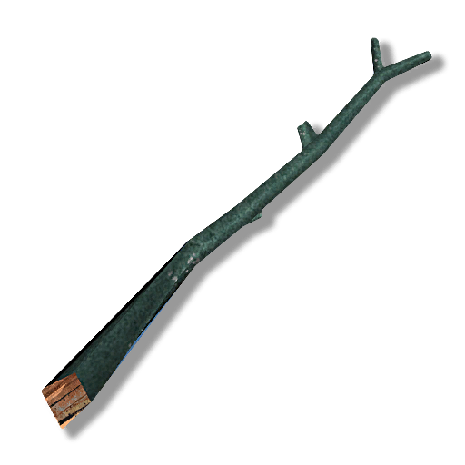 <a href="./Green%20Maple%20Sapling.md" class="wikilink" title="Green Maple Sapling">Green Maple Sapling</a>
    -  <a href="./Green%20Birch%20Sapling.md" class="wikilink" title="Green Birch Sapling">Green Birch Sapling</a>
    -  <a href="./Birch%20Bark.md" class="wikilink" title="Birch Bark">Birch Bark</a>
    - 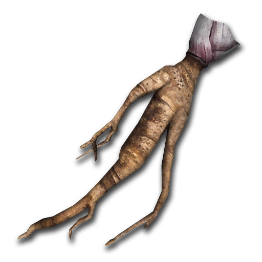 <a href="./Burdock%20Root.md" class="wikilink" title="Burdock Root">Burdock Root</a>
    -  <a href="./Old%20Man%27s%20Beard%20Lichen.md" class="wikilink" title="Old Man&#39;s Beard Lichen">Old Man's Beard Lichen</a>
    - 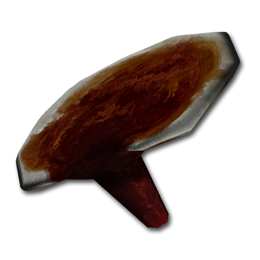 <a href="./Reishi%20Mushroom.md" class="wikilink" title="Reishi Mushroom">Reishi Mushroom</a>
    - 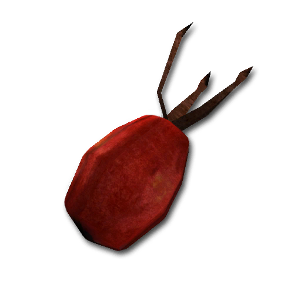 <a href="./Rose%20Hip.md" class="wikilink" title="Rose Hip">Rose Hip</a>
  - Item weight over the trade requirement is **not refunded**.
    - <a href="./Jerry%20Can.md" class="wikilink" title="Jerry Cans">Jerry Cans</a> are **not returned** if over the kg limit when used to trade their <a href="./Lantern%20Fuel.md" class="wikilink" title="Lantern Fuel">Lantern Fuel</a>.

<!-- -->

- Items <a href="./Decay.md" class="wikilink" title="Decay">Decay</a> inside the Trade Drop Box decay slowly.
  - Items which decay below 50% Condition are still accepted, and those reaching 0% Condition will not despawn.
  - 
- After marking the trade box for pick-up The Aurora can be used to begin another trade.
- An unlimited number of trades can be performed in one night, provided the items are available and the Aurora does not end. Sutherland will only offer the same selection of items on the same night, minus items already traded (i.e. he will not rotate the stock on offer until the next aurora night).
- Reloading your save file will reset the list of items that Sutherland offers for trade, as long as no trades have already been completed that night (see above).
- Gaining a certain level of Trust gives a slight permanent discount on trading requirements.

<!-- -->

- 

## Trust

The Trader requires building up Trust in order to unlock most of his stock. The player starts with 0 Trust and each successful trade adds a certain amount of Trust, depending on the experience mode (this stat is hidden, so consider keeping track of completed trades in the General Notes section of the <a href="./Journal.md" class="wikilink" title="Journal">Journal</a>).

- Highest possible Trust is capped at 500 and lowest possible Trust is -100.
- Reaching a set amount of Trust (350) with Sutherland gives a discount to most items when trading.
- Trust can be lost by cancelling trades or by contacting Sutherland repeatedly. If Trust is lost, fully completing trades will slowly build up good will to restore lost Trust.
- Reaching 500 Trust will unlock the <a href="./The%20Long%20Dark%20%E2%80%94%20Achievements.md" class="wikilink" title="Achievement">Achievement</a> <a href="./Goods%20and%20Services.md" class="wikilink" title="Goods and Services">Goods and Services</a>.

### Trust Gained and Lost

Every successful, completed trade increases Trust by a set amount, based on the players experience mode (see table below). The quantity of items traded does not matter, so long as the trade is completed. This means it doesn't matter if you trade 10 different items at a time or just 1, you will receive the same amount of Trust regardless. Completing a Special Request will also increase Trust by a set amount.

Trust can also be lost by repeatedly cancelling an active trade, or by repeatedly contacting Sutherland more than three times in one night (unless it is to start a new trade or signal a completed trade).

| Experience Mode | Complete Trade | Partial Trade | Cancelled Trade Penalty | Completed Special Request | Repeated Contact Penalty |
|----|----|----|----|----|----|
| <a href="./Pilgrim.md" class="wikilink" title="Pilgrim">Pilgrim</a> | 30 | 20 | -10, after 5 cancelled trades | 25 | -10 |
| <a href="./Voyageur.md" class="wikilink" title="Voyageur">Voyageur</a> | 25 | 15 | -15, after 3 cancelled trades | 25 | -10 |
| <a href="./Stalker.md" class="wikilink" title="Stalker">Stalker</a> | 25 | 15 | -15, after 3 cancelled trades | 25 | -15 |
| <a href="./Interloper.md" class="wikilink" title="Interloper">Interloper</a>/<a href="./Misery.md" class="wikilink" title="Misery">Misery</a> | 20 | 10 | -20, after 2 cancelled trades | 25 | -10 |

It is advisable to finish all available conversation options with the Trader as this will also raise Trust by a small amount (2 Trust per conversation).

### Trust Thresholds

Only a certain amount of items is available for purchase at start. Additional items are unlocked and made available for trade at certain Trust thresholds (see table below). Note: Once an additional item has been unlocked, it will stay unlocked even if you later lose Trust and go below that threshold.

| Trust Level | Unlocks                            |
|-------------|------------------------------------|
| 50 Trust    | 1 additional food item             |
| 100 Trust   | 1 additional clothing item (legs)  |
| 150 Trust   | 1 additional food item             |
| 200 Trust   | 1 additional clothing item (torso) |
| 250 Trust   | 1 additional rare item             |
| 300 Trust   | 1 additional tool item             |
| 350 Trust   | Discount on prices                 |
| 400 Trust   | 1 additional medicine item         |
| 500 Trust   | 1 additional weapon                |

## Special Requests

After 100 Trust is reached, Sutherland will ask for a special request which starts the special requests section of his Tale and unlocks new conversation options that are shown in blue color. Completing a special request raises his Trust in the player and unlocks special items for trade.

- Completing Sutherland's first special request unlocks:
  - Guaranteed <a href="./Manufactured%20Arrow.md" class="wikilink" title="Manufactured Arrow">Manufactured Arrow</a> (not on Interloper/Misery)
- Completing Sutherland's second special request unlocks:
  - Guaranteed <a href="./Wolfskin%20Hat%20Blueprint%20Card.md" class="wikilink" title="Wolfskin Hat Blueprint Card">Wolfskin Hat Blueprint Card</a>
- Completing Sutherland's third special request unlocks:
  - The following items, one of which will be offered at a time:
    - <a href="./Aviator%20Cap.md" class="wikilink" title="Aviator Cap">Aviator Cap</a>
    - <a href="./Survival%20Knife.md" class="wikilink" title="Survival Knife">Survival Knife</a> (not on Interloper/Misery)
- Completing Sutherland's fourth special request unlocks:
  - Guaranteed <a href="./Bunker%20Rifle.md" class="wikilink" title="Bunker Rifle">Bunker Rifle</a> (not on Interloper/Misery)
- Completing Sutherland's fifth and final special request
  - Guaranteed <a href="./Bushcraft%20Bow%20Blueprint%20Card.md" class="wikilink" title="Bushcraft Bow Blueprint Card">Bushcraft Bow Blueprint Card</a>

## Trader's Inventory

Below is a list of items that the Trader can offer to the player. His stock is always randomized, but certain items will be available for trade every time.

At 1 Trust you will be offered following items:

- Guaranteed <a href="./Cooking%20Oil.md" class="wikilink" title="Cooking Oil">Cooking Oil</a>, <a href="./Old%20Mill%20Flour.md" class="wikilink" title="Old Mill Flour">Old Mill Flour</a> and <a href="./Salt%20%28Bag%29.md" class="wikilink" title="Salt (Bag)">Salt (Bag)</a>
- Guaranteed <a href="./Revolver%20Ammunition.md" class="wikilink" title="Revolver Ammunition">Revolver Ammunition</a> and <a href="./Rifle%20Ammunition.md" class="wikilink" title="Rifle Ammunition">Rifle Ammunition</a> (not on Interloper/Misery)
- 1 piece of clothing from the following list (guaranteed): <a href="./Wool%20Toque.md" class="wikilink" title="Wool Toque">Wool Toque</a>, <a href="./Wool%20Ear%20Wrap.md" class="wikilink" title="Wool Ear Wrap">Wool Ear Wrap</a>, <a href="./Hardhat.md" class="wikilink" title="Hardhat">Hardhat</a>, <a href="./Work%20Gloves.md" class="wikilink" title="Work Gloves">Work Gloves</a>, <a href="./Trail%20Boots.md" class="wikilink" title="Trail Boots">Trail Boots</a>, <a href="./Work%20Boots.md" class="wikilink" title="Work Boots">Work Boots</a> or <a href="./Chemical%20Boots.md" class="wikilink" title="Chemical Boots">Chemical Boots</a>.
  - For non-interloper players this list is expanded with <a href="./Wool%20Mittens.md" class="wikilink" title="Wool Mittens">Wool Mittens</a>, <a href="./Patterned%20Wool%20Mittens%20%28Brown%29.md" class="wikilink" title="Patterned Wool Mittens (Brown)">Patterned Wool Mittens (Brown)</a>, <a href="./Patterned%20Wool%20Mittens%20%28Blue%29.md" class="wikilink" title="Patterned Wool Mittens (Blue)">Patterned Wool Mittens (Blue)</a>, <a href="./Patterned%20Wool%20Mittens%20%28Burgundy%29.md" class="wikilink" title="Patterned Wool Mittens (Burgundy)">Patterned Wool Mittens (Burgundy)</a>, <a href="./Ski%20Gloves.md" class="wikilink" title="Ski Gloves">Ski Gloves</a> and <a href="./Mukluks.md" class="wikilink" title="Mukluks">Mukluks</a>.
- 2 items from the following list:
  - Not yet unlocked food recipe
  - <a href="./Wolfskin%20Pants%20Blueprint%20Card.md" class="wikilink" title="Wolfskin Pants Blueprint Card">Wolfskin Pants Blueprint Card</a>
  - Random <a href="./Research%20Book.md" class="wikilink" title="Research Book">Research Book</a>
  - <a href="./Flare%20Shell.md" class="wikilink" title="Flare Shell">Flare Shell</a>
  - Random tool: <a href="./Flare.md" class="wikilink" title="Flare">Flare</a>, <a href="./Flashlight.md" class="wikilink" title="Flashlight">Flashlight</a>, <a href="./Marine%20Flare.md" class="wikilink" title="Marine Flare">Marine Flare</a>, <a href="./Storm%20Lantern.md" class="wikilink" title="Storm Lantern">Storm Lantern</a> or <a href="./Wood%20Matches.md" class="wikilink" title="Wood Matches">Wood Matches</a>.
    - Interloper players will be only offered <a href="./Marine%20Flare.md" class="wikilink" title="Marine Flare">Marine Flare</a> or <a href="./Wood%20Matches.md" class="wikilink" title="Wood Matches">Wood Matches</a>.

At 50 Trust you will be offered additionally:

- 1 extra food item (guaranteed)

At 100 Trust you will additionally be offered:

- 1 extra piece of clothing from this list (guaranteed): <a href="./Jeans.md" class="wikilink" title="Jeans">Jeans</a>, <a href="./Patterned%20Wool%20Socks%20%28Plaid%29.md" class="wikilink" title="Patterned Wool Socks (Plaid)">Patterned Wool Socks (Plaid)</a>, <a href="./Patterned%20Wool%20Socks%20%28Moose%29.md" class="wikilink" title="Patterned Wool Socks (Moose)">Patterned Wool Socks (Moose)</a>, <a href="./Patterned%20Wool%20Socks%20%28Dots%29.md" class="wikilink" title="Patterned Wool Socks (Dots)">Patterned Wool Socks (Dots)</a> or <a href="./Thermal%20Underwear.md" class="wikilink" title="Thermal Underwear">Thermal Underwear</a>.
  - For non-interloper players this list is expanded with <a href="./Cargo%20Pants.md" class="wikilink" title="Cargo Pants">Cargo Pants</a>, <a href="./Work%20Pants.md" class="wikilink" title="Work Pants">Work Pants</a>, <a href="./Wool%20Longjohns.md" class="wikilink" title="Wool Longjohns">Wool Longjohns</a> and <a href="./Climbing%20Socks.md" class="wikilink" title="Climbing Socks">Climbing Socks</a> .

At 150 Trust you will additionally be offered:

- 1 extra food item (guaranteed)

At 200 Trust you will be offered:

- 1 extra piece of clothing from this list (guaranteed): <a href="./Light%20Shell.md" class="wikilink" title="Light Shell">Light Shell</a>, <a href="./Mackinaw%20Jacket.md" class="wikilink" title="Mackinaw Jacket">Mackinaw Jacket</a>, <a href="./T-Shirt%20%28Snappy%29.md" class="wikilink" title="T-Shirt (Snappy)">T-Shirt (Snappy)</a>, <a href="./T-Shirt%20%28GBI%29.md" class="wikilink" title="T-Shirt (GBI)">T-Shirt (GBI)</a>, <a href="./T-Shirt%20%28CM%29.md" class="wikilink" title="T-Shirt (CM)">T-Shirt (CM)</a> or <a href="./Thin%20Wool%20Sweater.md" class="wikilink" title="Thin Wool Sweater">Thin Wool Sweater</a>.
  - For non-interloper players this list is expanded with <a href="./Thick%20Wool%20Sweater.md" class="wikilink" title="Thick Wool Sweater">Thick Wool Sweater</a> and <a href="./Wool%20Shirt.md" class="wikilink" title="Wool Shirt">Wool Shirt</a>.

At 300 Trust the following items will be available to you:

- One extra tool from this list (guaranteed): <a href="./FastFilm-500.md" class="wikilink" title="FastFilm-500">FastFilm-500</a>, <a href="./FastFilm-500SPA.md" class="wikilink" title="FastFilm-500SPA">FastFilm-500SPA</a>, <a href="./FastFilm-500BW.md" class="wikilink" title="FastFilm-500BW">FastFilm-500BW</a>, <a href="./Quality%20Tools.md" class="wikilink" title="Quality Tools">Quality Tools</a>, <a href="./Sewing%20Kit.md" class="wikilink" title="Sewing Kit">Sewing Kit</a> and <a href="./Whetstone.md" class="wikilink" title="Whetstone">Whetstone</a>.
  - For non-interloper players, also with: <a href="./Hacksaw.md" class="wikilink" title="Hacksaw">Hacksaw</a>, <a href="./Hatchet.md" class="wikilink" title="Hatchet">Hatchet</a>, <a href="./Heavy%20Hammer.md" class="wikilink" title="Heavy Hammer">Heavy Hammer</a>.
- One rare tool from this list: <a href="./Heat%20Pack.md" class="wikilink" title="Heat Pack">Heat Pack</a>, <a href="./Insulated%20Flask.md" class="wikilink" title="Insulated Flask">Insulated Flask</a>
  - For non-interloper players, also: <a href="./Firearm%20Cleaning%20Kit.md" class="wikilink" title="Firearm Cleaning Kit">Firearm Cleaning Kit</a>, <a href="./Magnifying%20Lens.md" class="wikilink" title="Magnifying Lens">Magnifying Lens</a>, <a href="./Firestriker.md" class="wikilink" title="Firestriker">Firestriker</a>

At 400 Trust the following items will be available:

- One extra medicinal item from this list: <a href="./Caffeine%20Pills.md" class="wikilink" title="Caffeine Pills">Caffeine Pills</a>, <a href="./Vitamin-C%20Pills.md" class="wikilink" title="Vitamin-C Pills">Vitamin-C Pills</a>, <a href="./Antibiotics.md" class="wikilink" title="Antibiotics">Antibiotics</a>, <a href="./Painkillers.md" class="wikilink" title="Painkillers">Painkillers</a>, <a href="./Antiseptic.md" class="wikilink" title="Antiseptic">Antiseptic</a>, <a href="./Water%20Purification%20Tablets.md" class="wikilink" title="Water Purification Tablets">Water Purification Tablets</a>
  - For non-interloper players, also: <a href="./Emergency%20Stim.md" class="wikilink" title="Emergency Stim">Emergency Stim</a>

At 500 Trust the following item will be available:

- For non-interloper players, one weapon from this list: <a href="./Revolver.md" class="wikilink" title="Revolver">Revolver</a>, <a href="./Hunting%20Rifle.md" class="wikilink" title="Hunting Rifle">Hunting Rifle</a>.

### Normal Trades

<table style="width:100%;">
<colgroup>
<col style="width: 14%" />
<col style="width: 14%" />
<col style="width: 14%" />
<col style="width: 14%" />
<col style="width: 14%" />
<col style="width: 14%" />
<col style="width: 14%" />
</colgroup>
<thead>
<tr>
<th></th>
<th>
Name
</th>
<th>
Trust
</th>
<th>
Item Type
</th>
<th>
Max Multiples
</th>
<th>
Cost
</th>
<th>
Cost with discount (After 350 Trust)
</th>
</tr>
</thead>
<tbody>
<tr>
<td><figure>

<figcaption>Canned_Corn_icon.png</figcaption>
</figure></td>
<td>
<a href="./Canned%20Corn.md" class="wikilink" title="Canned Corn">Canned Corn</a>
</td>
<td>
1
</td>
<td>
<a href="./Food%20And%20Drink.md" class="wikilink" title="Food And Drink">Food And Drink</a>
</td>
<td>
10
</td>
<td><ul>
<li>12  <a href="./Fir%20Firewood.md" class="wikilink" title="Fir Firewood">Fir Firewood</a></li>
<li>2.00 L  <a href="./Water%20%28Potable%29.md" class="wikilink" title="Water (Potable)">Water (Potable)</a></li>
</ul></td>
<td><ul>
<li>8  <a href="./Fir%20Firewood.md" class="wikilink" title="Fir Firewood">Fir Firewood</a></li>
<li>1.50 L  <a href="./Water%20%28Potable%29.md" class="wikilink" title="Water (Potable)">Water (Potable)</a></li>
</ul></td>
</tr>
<tr>
<td><figure>

<figcaption>Carrot_icon.png</figcaption>
</figure></td>
<td>
<a href="./Carrot.md" class="wikilink" title="Carrot">Carrot</a>
</td>
<td>
1
</td>
<td>
<a href="./Food%20And%20Drink.md" class="wikilink" title="Food And Drink">Food And Drink</a>
</td>
<td>
10
</td>
<td><ul>
<li>6 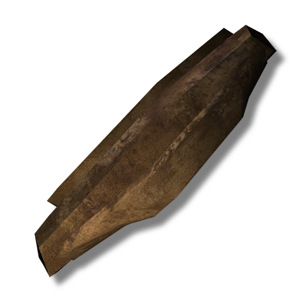 <a href="./Cedar%20Firewood.md" class="wikilink" title="Cedar Firewood">Cedar Firewood</a></li>
<li>1.00L  <a href="./Water%20%28Potable%29.md" class="wikilink" title="Water (Potable)">Water (Potable)</a></li>
</ul></td>
<td><ul>
<li>3  <a href="./Cedar%20Firewood.md" class="wikilink" title="Cedar Firewood">Cedar Firewood</a></li>
<li>0.50 L  <a href="./Water%20%28Potable%29.md" class="wikilink" title="Water (Potable)">Water (Potable)</a></li>
</ul></td>
</tr>
<tr>
<td><figure>

<figcaption>Cooking_Oil_icon.png</figcaption>
</figure></td>
<td>
<a href="./Cooking%20Oil.md" class="wikilink" title="Cooking Oil">Cooking Oil</a>
</td>
<td>
1
</td>
<td>
<a href="./Food%20And%20Drink.md" class="wikilink" title="Food And Drink">Food And Drink</a>
</td>
<td>
10
</td>
<td><ul>
<li>2.00 kg Any Raw Animal or Raw Fish Meat</li>
<li>1.00 L  <a href="./Water%20%28Potable%29.md" class="wikilink" title="Water (Potable)">Water (Potable)</a></li>
</ul></td>
<td><ul>
<li>1.50 kg Any Raw Animal or Raw Fish Meat</li>
<li>0.75 L  <a href="./Water%20%28Potable%29.md" class="wikilink" title="Water (Potable)">Water (Potable)</a></li>
</ul></td>
</tr>
<tr>
<td><figure>
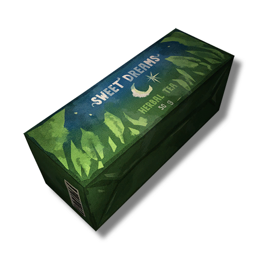
<figcaption>Herbal_Tea_icon.png</figcaption>
</figure></td>
<td>
<a href="./Herbal%20Tea.md" class="wikilink" title="Herbal Tea">Herbal Tea</a> (5)
</td>
<td>
1
</td>
<td>
<a href="./Food%20And%20Drink.md" class="wikilink" title="Food And Drink">Food And Drink</a>
</td>
<td>
10
</td>
<td><ul>
<li>3.00 kg Any Raw Fish Meat</li>
<li>2.00 L  <a href="./Water%20%28Potable%29.md" class="wikilink" title="Water (Potable)">Water (Potable)</a></li>
<li>2 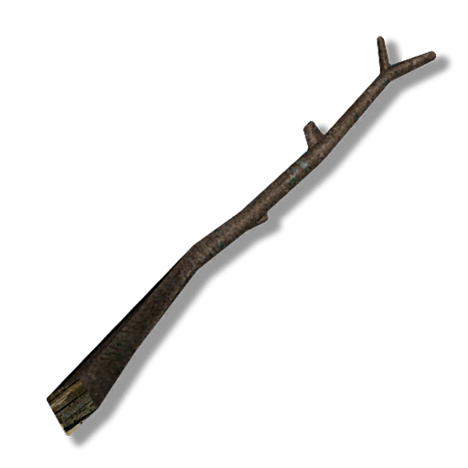 <a href="./Cured%20Maple%20Sapling.md" class="wikilink" title="Cured Maple Sapling">Cured Maple Sapling</a></li>
</ul></td>
<td><ul>
<li>1.50 L  <a href="./Water%20%28Potable%29.md" class="wikilink" title="Water (Potable)">Water (Potable)</a></li>
<li>1  <a href="./Cured%20Maple%20Sapling.md" class="wikilink" title="Cured Maple Sapling">Cured Maple Sapling</a></li>
</ul></td>
</tr>
<tr>
<td><figure>

<figcaption>Maple_Syrup_icon.png</figcaption>
</figure></td>
<td>
<a href="./Maple%20Syrup.md" class="wikilink" title="Maple Syrup">Maple Syrup</a>
</td>
<td>
1
</td>
<td>
<a href="./Food%20And%20Drink.md" class="wikilink" title="Food And Drink">Food And Drink</a>
</td>
<td>
10
</td>
<td><ul>
<li>3.00 kg Any Raw Fish Meat</li>
<li>1.00 L  <a href="./Water%20%28Potable%29.md" class="wikilink" title="Water (Potable)">Water (Potable)</a></li>
<li>1  <a href="./Cured%20Maple%20Sapling.md" class="wikilink" title="Cured Maple Sapling">Cured Maple Sapling</a></li>
</ul></td>
<td><ul>
<li>2.25 kg Any Raw Fish Meat</li>
<li>0.75 L  <a href="./Water%20%28Potable%29.md" class="wikilink" title="Water (Potable)">Water (Potable)</a></li>
</ul></td>
</tr>
<tr>
<td><figure>

<figcaption>Military-Grade_MRE_icon.png</figcaption>
</figure></td>
<td>
<a href="./Military-Grade%20MRE.md" class="wikilink" title="Military-Grade MRE">Military-Grade MRE</a>
</td>
<td>
1
</td>
<td>
<a href="./Food%20And%20Drink.md" class="wikilink" title="Food And Drink">Food And Drink</a>
</td>
<td>
10
</td>
<td><ul>
<li>5.00 kg Any Raw Fish Meat</li>
<li>1.00 L  <a href="./Water%20%28Potable%29.md" class="wikilink" title="Water (Potable)">Water (Potable)</a></li>
<li>1  <a href="./Cured%20Maple%20Sapling.md" class="wikilink" title="Cured Maple Sapling">Cured Maple Sapling</a></li>
</ul></td>
<td><ul>
<li>3.00 kg Any Raw Fish Meat</li>
<li>0.75 L  <a href="./Water%20%28Potable%29.md" class="wikilink" title="Water (Potable)">Water (Potable)</a></li>
</ul></td>
</tr>
<tr>
<td><figure>
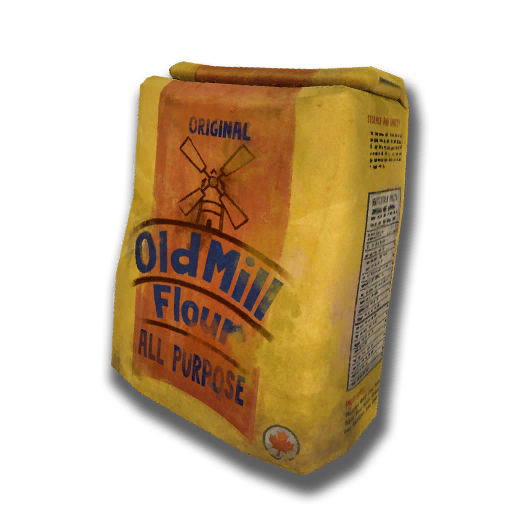
<figcaption>Old_Mill_Flour_icon.png</figcaption>
</figure></td>
<td>
<a href="./Old%20Mill%20Flour.md" class="wikilink" title="Old Mill Flour">Old Mill Flour</a>
</td>
<td>
1
</td>
<td>
<a href="./Food%20And%20Drink.md" class="wikilink" title="Food And Drink">Food And Drink</a>
</td>
<td>
10
</td>
<td><ul>
<li>2.00 kg Any Raw Animal or Raw Fish Meat</li>
<li>1.00 L  <a href="./Water%20%28Potable%29.md" class="wikilink" title="Water (Potable)">Water (Potable)</a></li>
</ul></td>
<td><ul>
<li>1.50 kg Any Raw Animal or Raw Fish Meat</li>
<li>0.75 L  <a href="./Water%20%28Potable%29.md" class="wikilink" title="Water (Potable)">Water (Potable)</a></li>
</ul></td>
</tr>
<tr>
<td><figure>

<figcaption>Pinnacle_Peaches_icon.png</figcaption>
</figure></td>
<td>
<a href="./Pinnacle%20Peaches.md" class="wikilink" title="Pinnacle Peaches">Pinnacle Peaches</a>
</td>
<td>
1
</td>
<td>
<a href="./Food%20And%20Drink.md" class="wikilink" title="Food And Drink">Food And Drink</a>
</td>
<td>
10
</td>
<td><ul>
<li>6  <a href="./Fir%20Firewood.md" class="wikilink" title="Fir Firewood">Fir Firewood</a></li>
<li>1.00L  <a href="./Water%20%28Potable%29.md" class="wikilink" title="Water (Potable)">Water (Potable)</a></li>
</ul></td>
<td><ul>
<li>3  <a href="./Fir%20Firewood.md" class="wikilink" title="Fir Firewood">Fir Firewood</a></li>
<li>0.50 L  <a href="./Water%20%28Potable%29.md" class="wikilink" title="Water (Potable)">Water (Potable)</a></li>
</ul></td>
</tr>
<tr>
<td><figure>
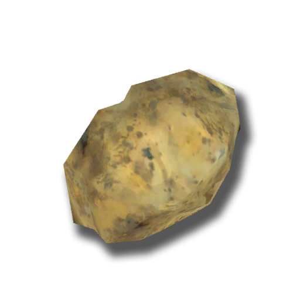
<figcaption>Potato_icon.png</figcaption>
</figure></td>
<td>
<a href="./Potato.md" class="wikilink" title="Potato">Potato</a>
</td>
<td>
1
</td>
<td>
<a href="./Food%20And%20Drink.md" class="wikilink" title="Food And Drink">Food And Drink</a>
</td>
<td>
10
</td>
<td><ul>
<li>6  <a href="./Cedar%20Firewood.md" class="wikilink" title="Cedar Firewood">Cedar Firewood</a></li>
<li>1.00L  <a href="./Water%20%28Potable%29.md" class="wikilink" title="Water (Potable)">Water (Potable)</a></li>
</ul></td>
<td><ul>
<li>3  <a href="./Cedar%20Firewood.md" class="wikilink" title="Cedar Firewood">Cedar Firewood</a></li>
<li>0.50 L  <a href="./Water%20%28Potable%29.md" class="wikilink" title="Water (Potable)">Water (Potable)</a></li>
</ul></td>
</tr>
<tr>
<td><figure>
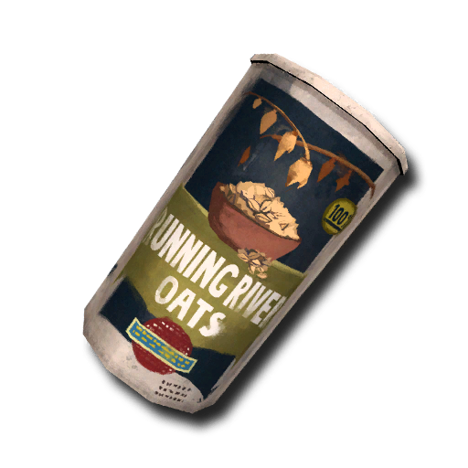
<figcaption>Running_River_Oats_icon.png</figcaption>
</figure></td>
<td>
<a href="./Running%20River%20Oats.md" class="wikilink" title="Running River Oats">Running River Oats</a>
</td>
<td>
1
</td>
<td>
<a href="./Food%20And%20Drink.md" class="wikilink" title="Food And Drink">Food And Drink</a>
</td>
<td>
10
</td>
<td><ul>
<li>2.00 kg Any Raw Fish Meat</li>
<li>1.00 L  <a href="./Water%20%28Potable%29.md" class="wikilink" title="Water (Potable)">Water (Potable)</a></li>
</ul></td>
<td><ul>
<li>1.50 kg Any Raw Fish Meat</li>
<li>0.75 L  <a href="./Water%20%28Potable%29.md" class="wikilink" title="Water (Potable)">Water (Potable)</a></li>
</ul></td>
</tr>
<tr>
<td><figure>

<figcaption>Salt_(Bag)_icon.png</figcaption>
</figure></td>
<td>
<a href="./Salt%20%28Bag%29.md" class="wikilink" title="Salt (Bag)">Salt (Bag)</a>
</td>
<td>
1
</td>
<td>
<a href="./Food%20And%20Drink.md" class="wikilink" title="Food And Drink">Food And Drink</a>
</td>
<td>
3
</td>
<td><ul>
<li>3.00 kg Any Raw Animal or Raw Fish Meat</li>
<li>1.00 L  <a href="./Water%20%28Potable%29.md" class="wikilink" title="Water (Potable)">Water (Potable)</a></li>
</ul></td>
<td><ul>
<li>2.00 kg Any Raw Animal or Raw Fish Meat</li>
<li>0.75 L  <a href="./Water%20%28Potable%29.md" class="wikilink" title="Water (Potable)">Water (Potable)</a></li>
</ul></td>
</tr>
<tr>
<td><figure>

<figcaption>Tin_of_Coffee_icon.png</figcaption>
</figure></td>
<td>
<a href="./Tin%20of%20Coffee.md" class="wikilink" title="Tin of Coffee">Tin of Coffee</a> (5)
</td>
<td>
1
</td>
<td>
<a href="./Food%20And%20Drink.md" class="wikilink" title="Food And Drink">Food And Drink</a>
</td>
<td>
10
</td>
<td><ul>
<li>4.00 kg Raw Fish Meat</li>
<li>2.00 L  <a href="./Water%20%28Potable%29.md" class="wikilink" title="Water (Potable)">Water (Potable)</a></li>
<li>2  <a href="./Cured%20Maple%20Sapling.md" class="wikilink" title="Cured Maple Sapling">Cured Maple Sapling</a></li>
</ul></td>
<td><ul>
<li>3.00 kg Raw Fish Meat</li>
<li>1.50 L  <a href="./Water%20%28Potable%29.md" class="wikilink" title="Water (Potable)">Water (Potable)</a></li>
<li>1  <a href="./Cured%20Maple%20Sapling.md" class="wikilink" title="Cured Maple Sapling">Cured Maple Sapling</a></li>
</ul></td>
</tr>
<tr>
<td><figure>

<figcaption>Antibiotics_icon.png</figcaption>
</figure></td>
<td>
<a href="./Antibiotics.md" class="wikilink" title="Antibiotics">Antibiotics</a> (6)
</td>
<td>
400
</td>
<td>
<a href="./First%20Aid.md" class="wikilink" title="First Aid">First Aid</a>
</td>
<td>
10
</td>
<td>
N/A
</td>
<td><ul>
<li>4 Any Harvestable Plants</li>
<li>1.75 L  <a href="./Water%20%28Potable%29.md" class="wikilink" title="Water (Potable)">Water (Potable)</a></li>
</ul></td>
</tr>
<tr>
<td><figure>

<figcaption>Antiseptic_icon.png</figcaption>
</figure></td>
<td>
<a href="./Antiseptic.md" class="wikilink" title="Antiseptic">Antiseptic</a>
</td>
<td>
400
</td>
<td>
<a href="./First%20Aid.md" class="wikilink" title="First Aid">First Aid</a>
</td>
<td>
10
</td>
<td>
N/A
</td>
<td><ul>
<li>4 Any Harvestable Plants</li>
<li>1.75 L  <a href="./Water%20%28Potable%29.md" class="wikilink" title="Water (Potable)">Water (Potable)</a></li>
</ul></td>
</tr>
<tr>
<td><figure>

<figcaption>Emergency_Stim_icon.png</figcaption>
</figure></td>
<td>
<a href="./Emergency%20Stim.md" class="wikilink" title="Emergency Stim">Emergency Stim</a>
</td>
<td>
400
</td>
<td>
<a href="./First%20Aid.md" class="wikilink" title="First Aid">First Aid</a>
</td>
<td>
10
</td>
<td>
N/A
</td>
<td><ul>
<li>11 Any Harvestable Plants</li>
<li>3.00 L  <a href="./Water%20%28Potable%29.md" class="wikilink" title="Water (Potable)">Water (Potable)</a></li>
<li>3  <a href="./Crow%20Feather.md" class="wikilink" title="Crow Feather">Crow Feather</a></li>
</ul></td>
</tr>
<tr>
<td><figure>

<figcaption>Painkillers_icon.png</figcaption>
</figure></td>
<td>
<a href="./Painkillers.md" class="wikilink" title="Painkillers">Painkillers</a> (6)
</td>
<td>
400
</td>
<td>
<a href="./First%20Aid.md" class="wikilink" title="First Aid">First Aid</a>
</td>
<td>
10
</td>
<td>
N/A
</td>
<td><ul>
<li>4 Any Harvestable Plants</li>
<li>1.75 L  <a href="./Water%20%28Potable%29.md" class="wikilink" title="Water (Potable)">Water (Potable)</a></li>
</ul></td>
</tr>
<tr>
<td><figure>

<figcaption>Water_Purification_Tablets_icon.png</figcaption>
</figure></td>
<td>
<a href="./Water%20Purification%20Tablets.md" class="wikilink" title="Water Purification Tablets">Water Purification Tablets</a> (4)
</td>
<td>
400
</td>
<td>
<a href="./First%20Aid.md" class="wikilink" title="First Aid">First Aid</a>
</td>
<td>
10
</td>
<td>
N/A
</td>
<td><ul>
<li>2 Any Harvestable Plants</li>
<li>0.75 L  <a href="./Water%20%28Potable%29.md" class="wikilink" title="Water (Potable)">Water (Potable)</a></li>
</ul></td>
</tr>
<tr>
<td><figure>

<figcaption>Revolver_icon.png</figcaption>
</figure></td>
<td>
<a href="./Revolver.md" class="wikilink" title="Revolver">Revolver</a>
</td>
<td>
500
</td>
<td>
<a href="./Tools.md" class="wikilink" title="Tools">Tools</a>
</td>
<td>
1
</td>
<td>
N/A
</td>
<td><ul>
<li>7.50 Kg Any Raw Animal or Raw Fish Meat</li>
<li>4  <a href="./Cured%20Maple%20Sapling.md" class="wikilink" title="Cured Maple Sapling">Cured Maple Sapling</a></li>
<li>3.00 L  <a href="./Lantern%20Fuel.md" class="wikilink" title="Lantern Fuel">Lantern Fuel</a></li>
</ul></td>
</tr>
<tr>
<td><figure>

<figcaption>Hunting_Rifle_icon.png</figcaption>
</figure></td>
<td>
<a href="./Hunting%20Rifle.md" class="wikilink" title="Hunting Rifle">Hunting Rifle</a>
</td>
<td>
500
</td>
<td>
<a href="./Tools.md" class="wikilink" title="Tools">Tools</a>
</td>
<td>
1
</td>
<td>
N/A
</td>
<td><ul>
<li>7.50 Kg Any Raw Animal or Raw Fish Meat</li>
<li>4  <a href="./Cured%20Maple%20Sapling.md" class="wikilink" title="Cured Maple Sapling">Cured Maple Sapling</a></li>
<li>3.00 L  <a href="./Lantern%20Fuel.md" class="wikilink" title="Lantern Fuel">Lantern Fuel</a></li>
</ul></td>
</tr>
<tr>
<td><figure>

<figcaption>Revolver_Ammunition_icon.png</figcaption>
</figure></td>
<td>
<a href="./Revolver%20Ammunition.md" class="wikilink" title="Revolver Ammunition">Revolver Ammunition</a> (10)
</td>
<td>
1
</td>
<td>
<a href="./Tools.md" class="wikilink" title="Tools">Tools</a>
</td>
<td>
10
</td>
<td><ul>
<li>4 Any Cured Hides</li>
<li>4.50 L  <a href="./Water%20%28Potable%29.md" class="wikilink" title="Water (Potable)">Water (Potable)</a></li>
<li>6  <a href="./Ptarmigan%20Down.md" class="wikilink" title="Ptarmigan Down">Ptarmigan Down</a></li>
</ul></td>
<td><ul>
<li>3 Any Cured Hides</li>
<li>3.25 L  <a href="./Water%20%28Potable%29.md" class="wikilink" title="Water (Potable)">Water (Potable)</a></li>
<li>4  <a href="./Ptarmigan%20Down.md" class="wikilink" title="Ptarmigan Down">Ptarmigan Down</a></li>
</ul></td>
</tr>
<tr>
<td><figure>

<figcaption>Rifle_Ammunition_icon.png</figcaption>
</figure></td>
<td>
<a href="./Rifle%20Ammunition.md" class="wikilink" title="Rifle Ammunition">Rifle Ammunition</a> (5)
</td>
<td>
1
</td>
<td>
<a href="./Tools.md" class="wikilink" title="Tools">Tools</a>
</td>
<td>
10
</td>
<td><ul>
<li>4 Any Cured Hides</li>
<li>4.50 L  <a href="./Water%20%28Potable%29.md" class="wikilink" title="Water (Potable)">Water (Potable)</a></li>
<li>6  <a href="./Ptarmigan%20Down.md" class="wikilink" title="Ptarmigan Down">Ptarmigan Down</a></li>
</ul></td>
<td><ul>
<li>3 Any Cured Hides</li>
<li>3.25 L  <a href="./Water%20%28Potable%29.md" class="wikilink" title="Water (Potable)">Water (Potable)</a></li>
<li>4  <a href="./Ptarmigan%20Down.md" class="wikilink" title="Ptarmigan Down">Ptarmigan Down</a></li>
</ul></td>
</tr>
<tr>
<td><figure>

<figcaption>Wood_Matches_icon.png</figcaption>
</figure></td>
<td>
<a href="./Wood%20Matches.md" class="wikilink" title="Wood Matches">Wood Matches</a> (12)
</td>
<td>
1
</td>
<td>
<a href="./Tools.md" class="wikilink" title="Tools">Tools</a>
</td>
<td>
10
</td>
<td><ul>
<li>5 Any Harvestable Plants</li>
<li>2  <a href="./Fir%20Firewood.md" class="wikilink" title="Fir Firewood">Fir Firewood</a></li>
</ul></td>
<td><ul>
<li>4 Any Harvestable Plants</li>
<li>1  <a href="./Fir%20Firewood.md" class="wikilink" title="Fir Firewood">Fir Firewood</a></li>
</ul></td>
</tr>
<tr>
<td><figure>

<figcaption>Storm_Lantern_icon.png</figcaption>
</figure></td>
<td>
<a href="./Storm%20Lantern.md" class="wikilink" title="Storm Lantern">Storm Lantern</a>
</td>
<td>
1
</td>
<td>
<a href="./Tools.md" class="wikilink" title="Tools">Tools</a>
</td>
<td>
1
</td>
<td><ul>
<li>15 Any Harvestable Plants</li>
<li>9  <a href="./Fir%20Firewood.md" class="wikilink" title="Fir Firewood">Fir Firewood</a></li>
<li>10  <a href="./Charcoal.md" class="wikilink" title="Charcoal">Charcoal</a></li>
</ul></td>
<td><ul>
<li>11 Any Harvestable Plants</li>
<li>7  <a href="./Fir%20Firewood.md" class="wikilink" title="Fir Firewood">Fir Firewood</a></li>
<li>8  <a href="./Charcoal.md" class="wikilink" title="Charcoal">Charcoal</a></li>
</ul></td>
</tr>
<tr>
<td><figure>
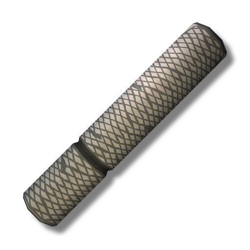
<figcaption>Firestriker_icon.png</figcaption>
</figure></td>
<td>
<a href="./Firestriker.md" class="wikilink" title="Firestriker">Firestriker</a>
</td>
<td>
300
</td>
<td>
<a href="./Tools.md" class="wikilink" title="Tools">Tools</a>
</td>
<td>
1
</td>
<td><ul>
<li>10.00 kg Any Raw Animal Or Raw Fish Meat</li>
<li>4 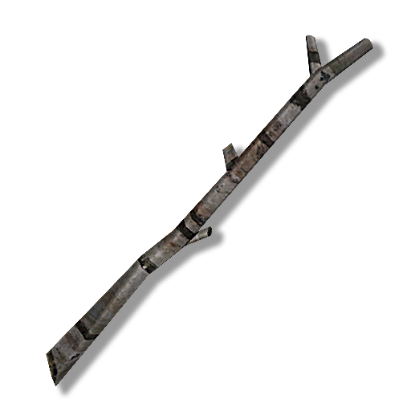 <a href="./Cured%20Birch%20Sapling.md" class="wikilink" title="Cured Birch Sapling">Cured Birch Sapling</a></li>
<li>5  <a href="./Cured%20Maple%20Sapling.md" class="wikilink" title="Cured Maple Sapling">Cured Maple Sapling</a></li>
</ul></td>
<td><ul>
<li>7.50 kg Any Raw Animal Or Raw Fish Meat</li>
<li>3  <a href="./Cured%20Birch%20Sapling.md" class="wikilink" title="Cured Birch Sapling">Cured Birch Sapling</a></li>
<li>4  <a href="./Cured%20Maple%20Sapling.md" class="wikilink" title="Cured Maple Sapling">Cured Maple Sapling</a></li>
</ul></td>
</tr>
<tr>
<td><figure>
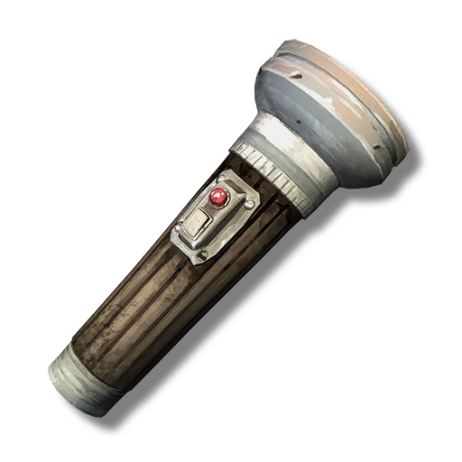
<figcaption>Flashlight_icon.png</figcaption>
</figure></td>
<td>
<a href="./Flashlight.md" class="wikilink" title="Flashlight">Flashlight</a>
</td>
<td>
1
</td>
<td>
<a href="./Tools.md" class="wikilink" title="Tools">Tools</a>
</td>
<td>
1
</td>
<td><ul>
<li>15 Any Harvestable Plants</li>
<li>9 <a href="./Fir%20Firewood.md" class="wikilink" title="Fir Firewood">Fir Firewood</a></li>
<li>10  <a href="./Charcoal.md" class="wikilink" title="Charcoal">Charcoal</a></li>
</ul></td>
<td><ul>
<li>11 Any Harvestable Plants</li>
<li>7  <a href="./Fir%20Firewood.md" class="wikilink" title="Fir Firewood">Fir Firewood</a></li>
<li>8  <a href="./Charcoal.md" class="wikilink" title="Charcoal">Charcoal</a></li>
</ul></td>
</tr>
<tr>
<td><figure>

<figcaption>Flare_icon.png</figcaption>
</figure></td>
<td>
<a href="./Flare.md" class="wikilink" title="Flare">Flare</a>
</td>
<td>
1
</td>
<td>
<a href="./Tools.md" class="wikilink" title="Tools">Tools</a>
</td>
<td>
10
</td>
<td><ul>
<li>5 Any Harvestable Plants</li>
<li>2  <a href="./Fir%20Firewood.md" class="wikilink" title="Fir Firewood">Fir Firewood</a></li>
</ul></td>
<td><ul>
<li>4 Any Harvestable Plants</li>
<li>1  <a href="./Fir%20Firewood.md" class="wikilink" title="Fir Firewood">Fir Firewood</a></li>
</ul></td>
</tr>
<tr>
<td><figure>

<figcaption>Marine_Flare_icon.png</figcaption>
</figure></td>
<td>
<a href="./Marine%20Flare.md" class="wikilink" title="Marine Flare">Marine Flare</a>
</td>
<td>
1
</td>
<td>
<a href="./Tools.md" class="wikilink" title="Tools">Tools</a>
</td>
<td>
10
</td>
<td><ul>
<li>10 Any Harvestable Plants</li>
<li>3  <a href="./Fir%20Firewood.md" class="wikilink" title="Fir Firewood">Fir Firewood</a></li>
<li>5  <a href="./Charcoal.md" class="wikilink" title="Charcoal">Charcoal</a></li>
</ul></td>
<td><ul>
<li>7 Any Harvestable Plants</li>
<li>2  <a href="./Fir%20Firewood.md" class="wikilink" title="Fir Firewood">Fir Firewood</a></li>
<li>3  <a href="./Charcoal.md" class="wikilink" title="Charcoal">Charcoal</a></li>
</ul></td>
</tr>
<tr>
<td><figure>

<figcaption>Hacksaw_icon.png</figcaption>
</figure></td>
<td>
<a href="./Hacksaw.md" class="wikilink" title="Hacksaw">Hacksaw</a>
</td>
<td>
300
</td>
<td>
<a href="./Tools.md" class="wikilink" title="Tools">Tools</a>
</td>
<td>
1
</td>
<td><ul>
<li>4.00 kg Any Raw Animal or Raw Fish Meat</li>
<li>2  <a href="./Cured%20Birch%20Sapling.md" class="wikilink" title="Cured Birch Sapling">Cured Birch Sapling</a></li>
</ul></td>
<td><ul>
<li>3.00 kg Any Raw Animal or Raw Fish Meat</li>
</ul></td>
</tr>
<tr>
<td><figure>
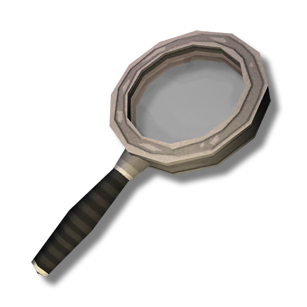
<figcaption>Magnifying_Lens_icon.png</figcaption>
</figure></td>
<td>
<a href="./Magnifying%20Lens.md" class="wikilink" title="Magnifying Lens">Magnifying Lens</a>
</td>
<td>
300
</td>
<td>
<a href="./Tools.md" class="wikilink" title="Tools">Tools</a>
</td>
<td>
1
</td>
<td><ul>
<li>10.00 kg Any Raw Animal or Raw Fish Meat</li>
<li>4  <a href="./Cured%20Birch%20Sapling.md" class="wikilink" title="Cured Birch Sapling">Cured Birch Sapling</a></li>
<li>5  <a href="./Cured%20Maple%20Sapling.md" class="wikilink" title="Cured Maple Sapling">Cured Maple Sapling</a></li>
</ul></td>
<td><ul>
<li>7.50 kg Any Raw Animal or Raw Fish Meat</li>
<li>3  <a href="./Cured%20Birch%20Sapling.md" class="wikilink" title="Cured Birch Sapling">Cured Birch Sapling</a></li>
<li>4  <a href="./Cured%20Maple%20Sapling.md" class="wikilink" title="Cured Maple Sapling">Cured Maple Sapling</a></li>
</ul></td>
</tr>
<tr>
<td><figure>

<figcaption>Hatchet_icon.png</figcaption>
</figure></td>
<td>
<a href="./Hatchet.md" class="wikilink" title="Hatchet">Hatchet</a>
</td>
<td>
300
</td>
<td>
<a href="./Tools.md" class="wikilink" title="Tools">Tools</a>
</td>
<td>
1
</td>
<td><ul>
<li>4.00 kg Any Raw Animal or Raw Fish Meat</li>
<li>1  <a href="./Cured%20Birch%20Sapling.md" class="wikilink" title="Cured Birch Sapling">Cured Birch Sapling</a></li>
</ul></td>
<td><ul>
<li>3.00 kg Any Raw Animal or Raw Fish Meat</li>
</ul></td>
</tr>
<tr>
<td><figure>

<figcaption>Heavy_Hammer_icon.png</figcaption>
</figure></td>
<td>
<a href="./Heavy%20Hammer.md" class="wikilink" title="Heavy Hammer">Heavy Hammer</a>
</td>
<td>
300
</td>
<td>
<a href="./Tools.md" class="wikilink" title="Tools">Tools</a>
</td>
<td>
1
</td>
<td><ul>
<li>8.00 kg Any Raw Animal Or Raw Fish Meat</li>
<li>2  <a href="./Cured%20Birch%20Sapling.md" class="wikilink" title="Cured Birch Sapling">Cured Birch Sapling</a></li>
<li>3  <a href="./Cured%20Maple%20Sapling.md" class="wikilink" title="Cured Maple Sapling">Cured Maple Sapling</a></li>
</ul></td>
<td><ul>
<li>6.00 kg Any Raw Animal Or Raw Fish Meat</li>
<li>1  <a href="./Cured%20Birch%20Sapling.md" class="wikilink" title="Cured Birch Sapling">Cured Birch Sapling</a></li>
<li>2  <a href="./Cured%20Maple%20Sapling.md" class="wikilink" title="Cured Maple Sapling">Cured Maple Sapling</a></li>
</ul></td>
</tr>
<tr>
<td><figure>

<figcaption>Quality_Tools_icon.png</figcaption>
</figure></td>
<td>
<a href="./Quality%20Tools.md" class="wikilink" title="Quality Tools">Quality Tools</a>
</td>
<td>
300
</td>
<td>
<a href="./Tools.md" class="wikilink" title="Tools">Tools</a>
</td>
<td>
1
</td>
<td><ul>
<li>4.00 kg Any Raw Animal Or Raw Fish Meat</li>
<li>1  <a href="./Cured%20Birch%20Sapling.md" class="wikilink" title="Cured Birch Sapling">Cured Birch Sapling</a></li>
</ul></td>
<td><ul>
<li>3.00 kg Any Raw Animal Or Raw Fish Meat</li>
</ul></td>
</tr>
<tr>
<td><figure>

<figcaption>Sewing_Kit_icon.png</figcaption>
</figure></td>
<td>
<a href="./Sewing%20Kit.md" class="wikilink" title="Sewing Kit">Sewing Kit</a>
</td>
<td>
300
</td>
<td>
<a href="./Tools.md" class="wikilink" title="Tools">Tools</a>
</td>
<td>
1
</td>
<td><ul>
<li>4.00 kg Any Raw Animal Or Raw Fish Meat</li>
<li>1  <a href="./Cured%20Birch%20Sapling.md" class="wikilink" title="Cured Birch Sapling">Cured Birch Sapling</a></li>
</ul></td>
<td><ul>
<li>3.00 kg Any Raw Animal Or Raw Fish Meat</li>
</ul></td>
</tr>
<tr>
<td><figure>
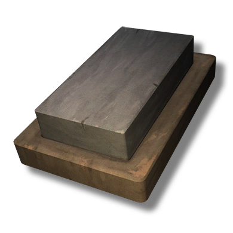
<figcaption>Whetstone_icon.png</figcaption>
</figure></td>
<td>
<a href="./Whetstone.md" class="wikilink" title="Whetstone">Whetstone</a>
</td>
<td>
300
</td>
<td>
<a href="./Tools.md" class="wikilink" title="Tools">Tools</a>
</td>
<td>
1
</td>
<td><ul>
<li>6.00 kg Any Raw Animal Or Raw Fish Meat</li>
<li>1  <a href="./Cured%20Birch%20Sapling.md" class="wikilink" title="Cured Birch Sapling">Cured Birch Sapling</a></li>
<li>2  <a href="./Cured%20Maple%20Sapling.md" class="wikilink" title="Cured Maple Sapling">Cured Maple Sapling</a></li>
</ul></td>
<td><ul>
<li>4.50 kg Any Raw Animal Or Raw Fish Meat</li>
<li>1  <a href="./Cured%20Maple%20Sapling.md" class="wikilink" title="Cured Maple Sapling">Cured Maple Sapling</a></li>
</ul></td>
</tr>
<tr>
<td><figure>

<figcaption>Firearm_Cleaning_Kit_icon.png</figcaption>
</figure></td>
<td>
<a href="./Firearm%20Cleaning%20Kit.md" class="wikilink" title="Firearm Cleaning Kit">Firearm Cleaning Kit</a>
</td>
<td>
300
</td>
<td>
<a href="./Tools.md" class="wikilink" title="Tools">Tools</a>
</td>
<td>
1
</td>
<td><ul>
<li>10.00 kg Any Raw Animal Or Raw Fish Meat</li>
<li>4  <a href="./Cured%20Birch%20Sapling.md" class="wikilink" title="Cured Birch Sapling">Cured Birch Sapling</a></li>
<li>5  <a href="./Cured%20Maple%20Sapling.md" class="wikilink" title="Cured Maple Sapling">Cured Maple Sapling</a></li>
</ul></td>
<td><ul>
<li>7.50 kg Any Raw Animal Or Raw Fish Meat</li>
<li>3  <a href="./Cured%20Birch%20Sapling.md" class="wikilink" title="Cured Birch Sapling">Cured Birch Sapling</a></li>
<li>4  <a href="./Cured%20Maple%20Sapling.md" class="wikilink" title="Cured Maple Sapling">Cured Maple Sapling</a></li>
</ul></td>
</tr>
<tr>
<td><figure>

<figcaption>Flare_Shell_icon.png</figcaption>
</figure></td>
<td>
<a href="./Flare%20Shell.md" class="wikilink" title="Flare Shell">Flare Shell</a>
</td>
<td>
1
</td>
<td>
<a href="./Tools.md" class="wikilink" title="Tools">Tools</a>
</td>
<td>
10
</td>
<td><ul>
<li>2 Any Cured Hides</li>
<li>2.00 L  <a href="./Water%20%28Potable%29.md" class="wikilink" title="Water (Potable)">Water (Potable)</a></li>
<li>2  <a href="./Ptarmigan%20Down.md" class="wikilink" title="Ptarmigan Down">Ptarmigan Down</a></li>
</ul></td>
<td><ul>
<li>1 Any Cured Hides</li>
<li>1.50 L  <a href="./Water%20%28Potable%29.md" class="wikilink" title="Water (Potable)">Water (Potable)</a></li>
<li>1  <a href="./Ptarmigan%20Down.md" class="wikilink" title="Ptarmigan Down">Ptarmigan Down</a></li>
</ul></td>
</tr>
<tr>
<td><figure>
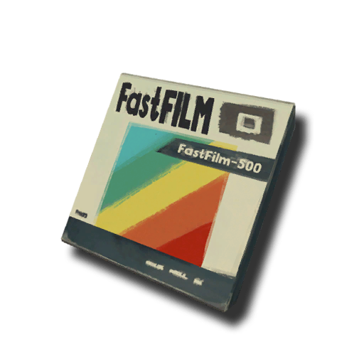
<figcaption>FastFilm-500_icon.png</figcaption>
</figure></td>
<td>
<a href="./FastFilm-500.md" class="wikilink" title="FastFilm-500">FastFilm-500</a> (6)
</td>
<td>
300
</td>
<td>
<a href="./Tools.md" class="wikilink" title="Tools">Tools</a>
</td>
<td>
10
</td>
<td><ul>
<li>6.00 kg Any Raw Animal Meat</li>
<li>10  <a href="./Tinder%20Plug.md" class="wikilink" title="Tinder Plug">Tinder Plug</a></li>
</ul></td>
<td><ul>
<li>3.00 kg Any Raw Animal Meat</li>
<li>6  <a href="./Tinder%20Plug.md" class="wikilink" title="Tinder Plug">Tinder Plug</a></li>
</ul></td>
</tr>
<tr>
<td><figure>
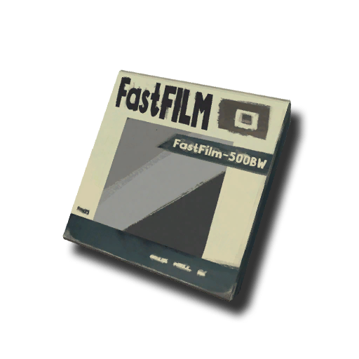
<figcaption>FastFilm-500BW_icon.png</figcaption>
</figure></td>
<td>
<a href="./FastFilm-500BW.md" class="wikilink" title="FastFilm-500BW">FastFilm-500BW</a> (6)
</td>
<td>
300
</td>
<td>
<a href="./Tools.md" class="wikilink" title="Tools">Tools</a>
</td>
<td>
10
</td>
<td><ul>
<li>6.00 kg Any Raw Animal Meat</li>
<li>10  <a href="./Tinder%20Plug.md" class="wikilink" title="Tinder Plug">Tinder Plug</a></li>
</ul></td>
<td><ul>
<li>3.00 kg Any Raw Animal Meat</li>
<li>6  <a href="./Tinder%20Plug.md" class="wikilink" title="Tinder Plug">Tinder Plug</a></li>
</ul></td>
</tr>
<tr>
<td><figure>
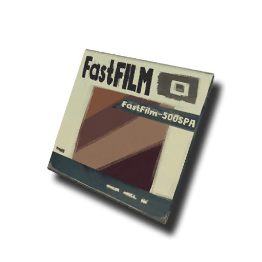
<figcaption>FastFilm-500SPA_icon.png</figcaption>
</figure></td>
<td>
<a href="./FastFilm-500SPA.md" class="wikilink" title="FastFilm-500SPA">FastFilm-500SPA</a> (6)
</td>
<td>
300
</td>
<td>
<a href="./Tools.md" class="wikilink" title="Tools">Tools</a>
</td>
<td>
10
</td>
<td><ul>
<li>6.00 kg Any Raw Animal Meat</li>
<li>10  <a href="./Tinder%20Plug.md" class="wikilink" title="Tinder Plug">Tinder Plug</a></li>
</ul></td>
<td><ul>
<li>3.00 kg Any Raw Animal Meat</li>
<li>6  <a href="./Tinder%20Plug.md" class="wikilink" title="Tinder Plug">Tinder Plug</a></li>
</ul></td>
</tr>
<tr>
<td><figure>
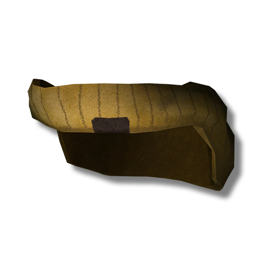
<figcaption>Wool_Ear_Wrap_icon.png</figcaption>
</figure></td>
<td>
<a href="./Wool%20Ear%20Wrap.md" class="wikilink" title="Wool Ear Wrap">Wool Ear Wrap</a>
</td>
<td>
1
</td>
<td>
<a href="./Clothing.md" class="wikilink" title="Clothing">Clothing</a>
</td>
<td>
1
</td>
<td><ul>
<li>3.00 L  <a href="./Lantern%20Fuel.md" class="wikilink" title="Lantern Fuel">Lantern Fuel</a></li>
<li>5  <a href="./Crow%20Feather.md" class="wikilink" title="Crow Feather">Crow Feather</a></li>
<li>6  <a href="./Ptarmigan%20Down.md" class="wikilink" title="Ptarmigan Down">Ptarmigan Down</a></li>
</ul></td>
<td><ul>
<li>2.25 L  <a href="./Lantern%20Fuel.md" class="wikilink" title="Lantern Fuel">Lantern Fuel</a></li>
<li>3  <a href="./Crow%20Feather.md" class="wikilink" title="Crow Feather">Crow Feather</a></li>
<li>4  <a href="./Ptarmigan%20Down.md" class="wikilink" title="Ptarmigan Down">Ptarmigan Down</a></li>
</ul></td>
</tr>
<tr>
<td><figure>

<figcaption>Wool_Toque_icon.png</figcaption>
</figure></td>
<td>
<a href="./Wool%20Toque.md" class="wikilink" title="Wool Toque">Wool Toque</a>
</td>
<td>
1
</td>
<td>
<a href="./Clothing.md" class="wikilink" title="Clothing">Clothing</a>
</td>
<td>
1
</td>
<td><ul>
<li>1.00 L  <a href="./Lantern%20Fuel.md" class="wikilink" title="Lantern Fuel">Lantern Fuel</a></li>
<li>2  <a href="./Scrap%20Metal.md" class="wikilink" title="Scrap Metal">Scrap Metal</a></li>
</ul></td>
<td><ul>
<li>0.75 L  <a href="./Lantern%20Fuel.md" class="wikilink" title="Lantern Fuel">Lantern Fuel</a></li>
<li>1  <a href="./Scrap%20Metal.md" class="wikilink" title="Scrap Metal">Scrap Metal</a></li>
</ul></td>
</tr>
<tr>
<td><figure>
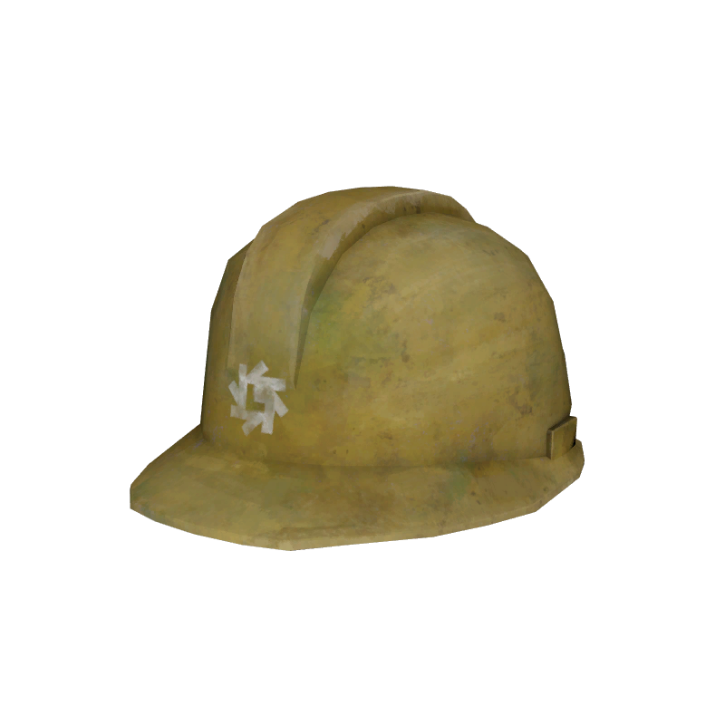
<figcaption>Hardhat_Model_icon.png</figcaption>
</figure></td>
<td>
<a href="./Hardhat.md" class="wikilink" title="Hardhat">Hardhat</a>
</td>
<td>
1
</td>
<td>
<a href="./Clothing.md" class="wikilink" title="Clothing">Clothing</a>
</td>
<td>
1
</td>
<td><ul>
<li>2.00 L  <a href="./Lantern%20Fuel.md" class="wikilink" title="Lantern Fuel">Lantern Fuel</a></li>
<li>8 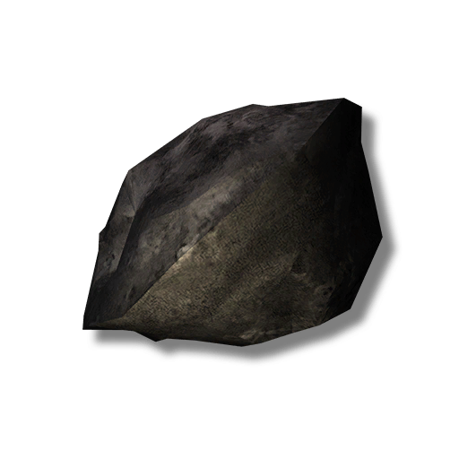 <a href="./Coal.md" class="wikilink" title="Coal">Coal</a></li>
<li>5  <a href="./Cloth.md" class="wikilink" title="Cloth">Cloth</a></li>
</ul></td>
<td><ul>
<li>1.50 L  <a href="./Lantern%20Fuel.md" class="wikilink" title="Lantern Fuel">Lantern Fuel</a></li>
<li>4  <a href="./Coal.md" class="wikilink" title="Coal">Coal</a></li>
<li>3  <a href="./Cloth.md" class="wikilink" title="Cloth">Cloth</a></li>
</ul></td>
</tr>
<tr>
<td><figure>
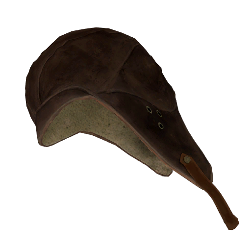
<figcaption>Aviator_Cap_icon.png</figcaption>
</figure></td>
<td>
<a href="./Aviator%20Cap.md" class="wikilink" title="Aviator Cap">Aviator Cap</a>
</td>
<td>
N/A
</td>
<td>
<a href="./Clothing.md" class="wikilink" title="Clothing">Clothing</a>
</td>
<td>
1
</td>
<td><ul>
<li>10.00 kg Any Raw Fish Meat</li>
<li>8 Any Harvestable Plants</li>
<li>4 Any Cured Hides</li>
</ul></td>
<td><ul>
<li>No discount</li>
</ul></td>
</tr>
<tr>
<td><figure>

<figcaption>Thin_Wool_Sweater_icon.png</figcaption>
</figure></td>
<td>
<a href="./Thin%20Wool%20Sweater.md" class="wikilink" title="Thin Wool Sweater">Thin Wool Sweater</a>
</td>
<td>
200
</td>
<td>
<a href="./Clothing.md" class="wikilink" title="Clothing">Clothing</a>
</td>
<td>
1
</td>
<td><ul>
<li>2 Any Cured Hides</li>
<li>3  <a href="./Cured%20Gut.md" class="wikilink" title="Cured Gut">Cured Gut</a></li>
</ul></td>
<td><ul>
<li>1 Any Cured Hides</li>
<li>2  <a href="./Cured%20Gut.md" class="wikilink" title="Cured Gut">Cured Gut</a></li>
</ul></td>
</tr>
<tr>
<td><figure>

<figcaption>Wool_Shirt_icon.png</figcaption>
</figure></td>
<td>
<a href="./Wool%20Shirt.md" class="wikilink" title="Wool Shirt">Wool Shirt</a>
</td>
<td>
200
</td>
<td>
<a href="./Clothing.md" class="wikilink" title="Clothing">Clothing</a>
</td>
<td>
1
</td>
<td><ul>
<li>2 Any Cured Hides</li>
<li>3  <a href="./Cured%20Gut.md" class="wikilink" title="Cured Gut">Cured Gut</a></li>
</ul></td>
<td><ul>
<li>1 Any Cured Hides</li>
<li>2  <a href="./Cured%20Gut.md" class="wikilink" title="Cured Gut">Cured Gut</a></li>
</ul></td>
</tr>
<tr>
<td><figure>

<figcaption>Thick_Wool_Sweater_icon.png</figcaption>
</figure></td>
<td>
<a href="./Thick%20Wool%20Sweater.md" class="wikilink" title="Thick Wool Sweater">Thick Wool Sweater</a>
</td>
<td>
200
</td>
<td>
<a href="./Clothing.md" class="wikilink" title="Clothing">Clothing</a>
</td>
<td>
1
</td>
<td><ul>
<li>4 Any Cured Hides</li>
<li>4  <a href="./Cured%20Gut.md" class="wikilink" title="Cured Gut">Cured Gut</a></li>
<li>5  <a href="./Cloth.md" class="wikilink" title="Cloth">Cloth</a></li>
</ul></td>
<td><ul>
<li>3 Cured Hide</li>
<li>3  <a href="./Cured%20Gut.md" class="wikilink" title="Cured Gut">Cured Gut</a></li>
<li>4  <a href="./Cloth.md" class="wikilink" title="Cloth">Cloth</a></li>
</ul></td>
</tr>
<tr>
<td><figure>

<figcaption>Light_Shell_icon.png</figcaption>
</figure></td>
<td>
<a href="./Light%20Shell.md" class="wikilink" title="Light Shell">Light Shell</a>
</td>
<td>
200
</td>
<td>
<a href="./Clothing.md" class="wikilink" title="Clothing">Clothing</a>
</td>
<td>
1
</td>
<td><ul>
<li>4 Any Cured Hides</li>
<li>4  <a href="./Cured%20Gut.md" class="wikilink" title="Cured Gut">Cured Gut</a></li>
<li>5  <a href="./Cloth.md" class="wikilink" title="Cloth">Cloth</a></li>
</ul></td>
<td><ul>
<li>3 Any Cured Hides</li>
<li>3  <a href="./Cured%20Gut.md" class="wikilink" title="Cured Gut">Cured Gut</a></li>
<li>4  <a href="./Cloth.md" class="wikilink" title="Cloth">Cloth</a></li>
</ul></td>
</tr>
<tr>
<td><figure>

<figcaption>Mackinaw_Jacket_icon.png</figcaption>
</figure></td>
<td>
<a href="./Mackinaw%20Jacket.md" class="wikilink" title="Mackinaw Jacket">Mackinaw Jacket</a>
</td>
<td>
200
</td>
<td>
<a href="./Clothing.md" class="wikilink" title="Clothing">Clothing</a>
</td>
<td>
1
</td>
<td><ul>
<li>4 Any Cured Hides</li>
<li>4  <a href="./Cured%20Gut.md" class="wikilink" title="Cured Gut">Cured Gut</a></li>
<li>5  <a href="./Cloth.md" class="wikilink" title="Cloth">Cloth</a></li>
</ul></td>
<td><ul>
<li>3 Any Cured Hides</li>
<li>3  <a href="./Cured%20Gut.md" class="wikilink" title="Cured Gut">Cured Gut</a></li>
<li>4  <a href="./Cloth.md" class="wikilink" title="Cloth">Cloth</a></li>
</ul></td>
</tr>
<tr>
<td><figure>

<figcaption>Cargo_Pants_icon.png</figcaption>
</figure></td>
<td>
<a href="./Cargo%20Pants.md" class="wikilink" title="Cargo Pants">Cargo Pants</a>
</td>
<td>
100
</td>
<td>
<a href="./Clothing.md" class="wikilink" title="Clothing">Clothing</a>
</td>
<td>
1
</td>
<td><ul>
<li>20 Any Harvestable Plants</li>
<li>2  <a href="./Cured%20Gut.md" class="wikilink" title="Cured Gut">Cured Gut</a></li>
<li>5  <a href="./Crow%20Feather.md" class="wikilink" title="Crow Feather">Crow Feather</a></li>
</ul></td>
<td><ul>
<li>15 Any Harvestable Plants</li>
<li>1  <a href="./Cured%20Gut.md" class="wikilink" title="Cured Gut">Cured Gut</a></li>
<li>3  <a href="./Crow%20Feather.md" class="wikilink" title="Crow Feather">Crow Feather</a></li>
</ul></td>
</tr>
<tr>
<td><figure>

<figcaption>Jeans_icon.png</figcaption>
</figure></td>
<td>
<a href="./Jeans.md" class="wikilink" title="Jeans">Jeans</a>
</td>
<td>
100
</td>
<td>
<a href="./Clothing.md" class="wikilink" title="Clothing">Clothing</a>
</td>
<td>
1
</td>
<td><ul>
<li>10 Any Harvestable Plants</li>
<li>1 <a href="./Cured%20Gut.md" class="wikilink" title="Cured Gut">Cured Gut</a></li>
</ul></td>
<td><ul>
<li>8 Any Harvestable Plants</li>
</ul></td>
</tr>
<tr>
<td><figure>

<figcaption>Work_Pants_icon.png</figcaption>
</figure></td>
<td>
<a href="./Work%20Pants.md" class="wikilink" title="Work Pants">Work Pants</a>
</td>
<td>
100
</td>
<td>
<a href="./Clothing.md" class="wikilink" title="Clothing">Clothing</a>
</td>
<td>
1
</td>
<td><ul>
<li>20 Any Harvestable Plants</li>
<li>2  <a href="./Cured%20Gut.md" class="wikilink" title="Cured Gut">Cured Gut</a></li>
<li>5  <a href="./Crow%20Feather.md" class="wikilink" title="Crow Feather">Crow Feather</a></li>
</ul></td>
<td><ul>
<li>15 Any Harvestable Plants</li>
<li>1  <a href="./Cured%20Gut.md" class="wikilink" title="Cured Gut">Cured Gut</a></li>
<li>3  <a href="./Crow%20Feather.md" class="wikilink" title="Crow Feather">Crow Feather</a></li>
</ul></td>
</tr>
<tr>
<td><figure>

<figcaption>Thermal_Underwear_icon.png</figcaption>
</figure></td>
<td>
<a href="./Thermal%20Underwear.md" class="wikilink" title="Thermal Underwear">Thermal Underwear</a>
</td>
<td>
100
</td>
<td>
<a href="./Clothing.md" class="wikilink" title="Clothing">Clothing</a>
</td>
<td>
1
</td>
<td><ul>
<li>10 Any Harvestable Plants</li>
<li>1 <a href="./Cured%20Gut.md" class="wikilink" title="Cured Gut">Cured Gut</a></li>
</ul></td>
<td><ul>
<li>8 Any Harvestable Plants</li>
</ul></td>
</tr>
<tr>
<td><figure>

<figcaption>Wool_Longjohns_icon.png</figcaption>
</figure></td>
<td>
<a href="./Wool%20Longjohns.md" class="wikilink" title="Wool Longjohns">Wool Longjohns</a>
</td>
<td>
100
</td>
<td>
<a href="./Clothing.md" class="wikilink" title="Clothing">Clothing</a>
</td>
<td>
1
</td>
<td><ul>
<li>20 Any Harvestable Plants</li>
<li>2  <a href="./Cured%20Gut.md" class="wikilink" title="Cured Gut">Cured Gut</a></li>
<li>5  <a href="./Crow%20Feather.md" class="wikilink" title="Crow Feather">Crow Feather</a></li>
</ul></td>
<td><ul>
<li>15 Any Harvestable Plants</li>
<li>1  <a href="./Cured%20Gut.md" class="wikilink" title="Cured Gut">Cured Gut</a></li>
<li>3  <a href="./Crow%20Feather.md" class="wikilink" title="Crow Feather">Crow Feather</a></li>
</ul></td>
</tr>
<tr>
<td><figure>
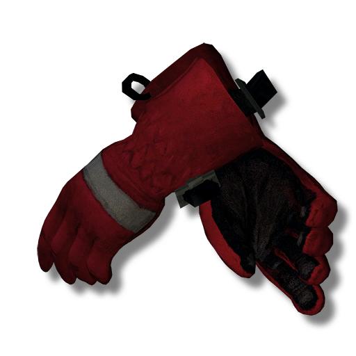
<figcaption>Ski_Gloves_icon.png</figcaption>
</figure></td>
<td>
<a href="./Ski%20Gloves.md" class="wikilink" title="Ski Gloves">Ski Gloves</a>
</td>
<td>
1
</td>
<td>
<a href="./Clothing.md" class="wikilink" title="Clothing">Clothing</a>
</td>
<td>
1
</td>
<td><ul>
<li>2.00 L  <a href="./Lantern%20Fuel.md" class="wikilink" title="Lantern Fuel">Lantern Fuel</a></li>
<li>10  <a href="./Coal.md" class="wikilink" title="Coal">Coal</a></li>
<li>5  <a href="./Cloth.md" class="wikilink" title="Cloth">Cloth</a></li>
</ul></td>
<td><ul>
<li>1.50 L  <a href="./Lantern%20Fuel.md" class="wikilink" title="Lantern Fuel">Lantern Fuel</a></li>
<li>7  <a href="./Coal.md" class="wikilink" title="Coal">Coal</a></li>
<li>4  <a href="./Cloth.md" class="wikilink" title="Cloth">Cloth</a></li>
</ul></td>
</tr>
<tr>
<td><figure>

<figcaption>Wool_Mittens_icon.png</figcaption>
</figure></td>
<td>
<a href="./Wool%20Mittens.md" class="wikilink" title="Wool Mittens">Wool Mittens</a>
</td>
<td>
1
</td>
<td>
<a href="./Clothing.md" class="wikilink" title="Clothing">Clothing</a>
</td>
<td>
3
</td>
<td><ul>
<li>1 L  <a href="./Lantern%20Fuel.md" class="wikilink" title="Lantern Fuel">Lantern Fuel</a></li>
<li>5 <a href="./Birch%20Bark.md" class="wikilink" title="Birch Bark">Birch Bark</a></li>
</ul></td>
<td><ul>
<li>0.7 L  <a href="./Lantern%20Fuel.md" class="wikilink" title="Lantern Fuel">Lantern Fuel</a></li>
<li>3 <a href="./Birch%20Bark.md" class="wikilink" title="Birch Bark">Birch Bark</a></li>
</ul></td>
</tr>
<tr>
<td><figure>

<figcaption>Work_Gloves_icon.png</figcaption>
</figure></td>
<td>
<a href="./Work%20Gloves.md" class="wikilink" title="Work Gloves">Work Gloves</a>
</td>
<td>
1
</td>
<td>
<a href="./Clothing.md" class="wikilink" title="Clothing">Clothing</a>
</td>
<td>
1
</td>
<td><ul>
<li>1.50 L  <a href="./Lantern%20Fuel.md" class="wikilink" title="Lantern Fuel">Lantern Fuel</a></li>
<li>5 <a href="./Coal.md" class="wikilink" title="Coal">Coal</a></li>
<li>5  <a href="./Cloth.md" class="wikilink" title="Cloth">Cloth</a></li>
</ul></td>
<td><ul>
<li>1.00 L  <a href="./Lantern%20Fuel.md" class="wikilink" title="Lantern Fuel">Lantern Fuel</a></li>
<li>3 <a href="./Coal.md" class="wikilink" title="Coal">Coal</a></li>
<li>4  <a href="./Cloth.md" class="wikilink" title="Cloth">Cloth</a></li>
</ul></td>
</tr>
<tr>
<td><figure>

<figcaption>Climbing_Socks_icon.png</figcaption>
</figure></td>
<td>
<a href="./Climbing%20Socks.md" class="wikilink" title="Climbing Socks">Climbing Socks</a>
</td>
<td>
100
</td>
<td>
<a href="./Clothing.md" class="wikilink" title="Clothing">Clothing</a>
</td>
<td>
3
</td>
<td><ul>
<li>10 Any Harvestable Plants</li>
<li>2  <a href="./Cured%20Gut.md" class="wikilink" title="Cured Gut">Cured Gut</a></li>
<li>5  <a href="./Cured%20Rabbit%20Pelt.md" class="wikilink" title="Cured Rabbit Pelt">Cured Rabbit Pelt</a></li>
</ul></td>
<td><ul>
<li>8 Any Harvestable Plants</li>
<li>1  <a href="./Cured%20Gut.md" class="wikilink" title="Cured Gut">Cured Gut</a></li>
<li>3  <a href="./Cured%20Rabbit%20Pelt.md" class="wikilink" title="Cured Rabbit Pelt">Cured Rabbit Pelt</a></li>
</ul></td>
</tr>
<tr>
<td><figure>
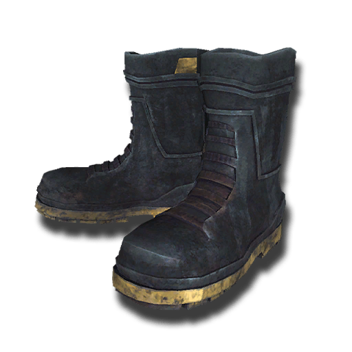
<figcaption>Chemical_Boots_icon.png</figcaption>
</figure></td>
<td>
<a href="./Chemical%20Boots.md" class="wikilink" title="Chemical Boots">Chemical Boots</a>
</td>
<td>
1
</td>
<td>
<a href="./Clothing.md" class="wikilink" title="Clothing">Clothing</a>
</td>
<td>
1
</td>
<td><ul>
<li>2.00 L  <a href="./Lantern%20Fuel.md" class="wikilink" title="Lantern Fuel">Lantern Fuel</a></li>
<li>4  <a href="./Coal.md" class="wikilink" title="Coal">Coal</a></li>
<li>5  <a href="./Cloth.md" class="wikilink" title="Cloth">Cloth</a></li>
</ul></td>
<td><ul>
<li>1.50 L  <a href="./Lantern%20Fuel.md" class="wikilink" title="Lantern Fuel">Lantern Fuel</a></li>
<li>3  <a href="./Coal.md" class="wikilink" title="Coal">Coal</a></li>
<li>4  <a href="./Cloth.md" class="wikilink" title="Cloth">Cloth</a></li>
</ul></td>
</tr>
<tr>
<td><figure>

<figcaption>Mukluks_icon.png</figcaption>
</figure></td>
<td>
<a href="./Mukluks.md" class="wikilink" title="Mukluks">Mukluks</a>
</td>
<td>
1
</td>
<td>
<a href="./Clothing.md" class="wikilink" title="Clothing">Clothing</a>
</td>
<td>
1
</td>
<td><ul>
<li>8 Any Cured Hides</li>
<li>5  <a href="./Cloth.md" class="wikilink" title="Cloth">Cloth</a></li>
<li>6  <a href="./Ptarmigan%20Down.md" class="wikilink" title="Ptarmigan Down">Ptarmigan Down</a></li>
</ul></td>
<td><ul>
<li>5 Any Cured Hides</li>
<li>3  <a href="./Cloth.md" class="wikilink" title="Cloth">Cloth</a></li>
<li>4  <a href="./Ptarmigan%20Down.md" class="wikilink" title="Ptarmigan Down">Ptarmigan Down</a></li>
</ul></td>
</tr>
<tr>
<td><figure>
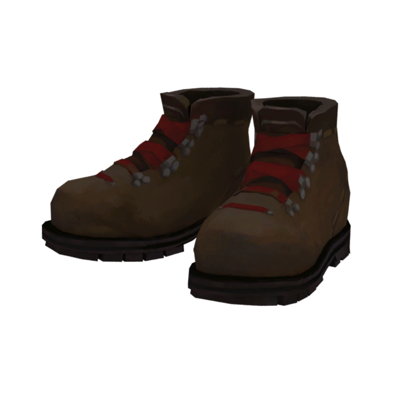
<figcaption>Trail_Boots_Model_icon.png</figcaption>
</figure></td>
<td>
<a href="./Trail%20Boots.md" class="wikilink" title="Trail Boots">Trail Boots</a>
</td>
<td>
1
</td>
<td>
<a href="./Clothing.md" class="wikilink" title="Clothing">Clothing</a>
</td>
<td>
1
</td>
<td><ul>
<li>1.00 L  <a href="./Lantern%20Fuel.md" class="wikilink" title="Lantern Fuel">Lantern Fuel</a></li>
<li>5  <a href="./Coal.md" class="wikilink" title="Coal">Coal</a></li>
</ul></td>
<td><ul>
<li>0.75 L  <a href="./Lantern%20Fuel.md" class="wikilink" title="Lantern Fuel">Lantern Fuel</a></li>
<li>3  <a href="./Coal.md" class="wikilink" title="Coal">Coal</a></li>
</ul></td>
</tr>
<tr>
<td><figure>

<figcaption>Work_Boots_icon.png</figcaption>
</figure></td>
<td>
<a href="./Work%20Boots.md" class="wikilink" title="Work Boots">Work Boots</a>
</td>
<td>
1
</td>
<td>
<a href="./Clothing.md" class="wikilink" title="Clothing">Clothing</a>
</td>
<td>
1
</td>
<td><ul>
<li>1.00 L  <a href="./Lantern%20Fuel.md" class="wikilink" title="Lantern Fuel">Lantern Fuel</a></li>
<li>2 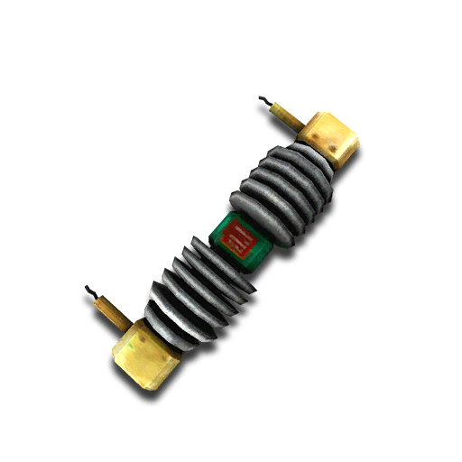 <a href="./Replacement%20Fuse.md" class="wikilink" title="Replacement Fuse">Replacement Fuse</a></li>
</ul></td>
<td><ul>
<li>0.75 L  <a href="./Lantern%20Fuel.md" class="wikilink" title="Lantern Fuel">Lantern Fuel</a></li>
<li>1  <a href="./Replacement%20Fuse.md" class="wikilink" title="Replacement Fuse">Replacement Fuse</a></li>
</ul></td>
</tr>
<tr>
<td><figure>

<figcaption>The_Frozen_Angler_icon.png</figcaption>
</figure></td>
<td>
<a href="./The%20Frozen%20Angler.md" class="wikilink" title="The Frozen Angler">The Frozen Angler</a>
</td>
<td>
1
</td>
<td>
<a href="./Research%20Book.md" class="wikilink" title="Research Book">Research Book</a>
</td>
<td>
1
</td>
<td><ul>
<li>3.00 kg Any Raw Animal Or Raw Fish Meat</li>
<li>2.00 L  <a href="./Water%20%28Potable%29.md" class="wikilink" title="Water (Potable)">Water (Potable)</a></li>
<li>6  <a href="./Ptarmigan%20Down.md" class="wikilink" title="Ptarmigan Down">Ptarmigan Down</a></li>
</ul></td>
<td><ul>
<li>2.25 kg Any Raw Animal Or Raw Fish Meat</li>
<li>1.50 L  <a href="./Water%20%28Potable%29.md" class="wikilink" title="Water (Potable)">Water (Potable)</a></li>
<li>4  <a href="./Ptarmigan%20Down.md" class="wikilink" title="Ptarmigan Down">Ptarmigan Down</a></li>
</ul></td>
</tr>
<tr>
<td><figure>
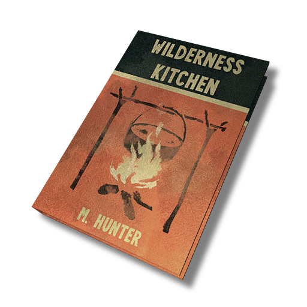
<figcaption>Wilderness_Kitchen_icon.png</figcaption>
</figure></td>
<td>
<a href="./Wilderness%20Kitchen.md" class="wikilink" title="Wilderness Kitchen">Wilderness Kitchen</a>
</td>
<td>
1
</td>
<td>
<a href="./Research%20Book.md" class="wikilink" title="Research Book">Research Book</a>
</td>
<td>
1
</td>
<td><ul>
<li>3.00 kg Any Raw Animal Or Raw Fish Meat</li>
<li>2.00 L  <a href="./Water%20%28Potable%29.md" class="wikilink" title="Water (Potable)">Water (Potable)</a></li>
<li>6  <a href="./Ptarmigan%20Down.md" class="wikilink" title="Ptarmigan Down">Ptarmigan Down</a></li>
</ul></td>
<td><ul>
<li>2.25 kg Any Raw Animal Or Raw Fish Meat</li>
<li>1.50 L  <a href="./Water%20%28Potable%29.md" class="wikilink" title="Water (Potable)">Water (Potable)</a></li>
<li>4  <a href="./Ptarmigan%20Down.md" class="wikilink" title="Ptarmigan Down">Ptarmigan Down</a></li>
</ul></td>
</tr>
<tr>
<td><figure>
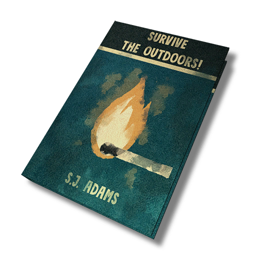
<figcaption>Survive_the_Outdoors!_icon.png</figcaption>
</figure></td>
<td>
<a href="./Survive%20the%20Outdoors!.md" class="wikilink" title="Survive the Outdoors!">Survive the Outdoors!</a>
</td>
<td>
1
</td>
<td>
<a href="./Research%20Book.md" class="wikilink" title="Research Book">Research Book</a>
</td>
<td>
1
</td>
<td><ul>
<li>3.00 kg Any Raw Animal Or Raw Fish Meat</li>
<li>2.00 L  <a href="./Water%20%28Potable%29.md" class="wikilink" title="Water (Potable)">Water (Potable)</a></li>
<li>6  <a href="./Ptarmigan%20Down.md" class="wikilink" title="Ptarmigan Down">Ptarmigan Down</a></li>
</ul></td>
<td><ul>
<li>2.25 kg Any Raw Animal Or Raw Fish Meat</li>
<li>1.50 L  <a href="./Water%20%28Potable%29.md" class="wikilink" title="Water (Potable)">Water (Potable)</a></li>
<li>4  <a href="./Ptarmigan%20Down.md" class="wikilink" title="Ptarmigan Down">Ptarmigan Down</a></li>
</ul></td>
</tr>
<tr>
<td><figure>
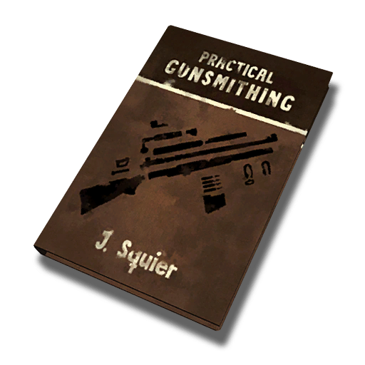
<figcaption>Practical_Gunsmithing_icon.png</figcaption>
</figure></td>
<td>
<a href="./Practical%20Gunsmithing.md" class="wikilink" title="Practical Gunsmithing">Practical Gunsmithing</a>
</td>
<td>
1
</td>
<td>
<a href="./Research%20Book.md" class="wikilink" title="Research Book">Research Book</a>
</td>
<td>
1
</td>
<td><ul>
<li>3.00 kg Any Raw Animal Or Raw Fish Meat</li>
<li>2.00 L  <a href="./Water%20%28Potable%29.md" class="wikilink" title="Water (Potable)">Water (Potable)</a></li>
<li>6  <a href="./Ptarmigan%20Down.md" class="wikilink" title="Ptarmigan Down">Ptarmigan Down</a></li>
</ul></td>
<td><ul>
<li>2.25 kg Any Raw Animal Or Raw Fish Meat</li>
<li>1.50 L  <a href="./Water%20%28Potable%29.md" class="wikilink" title="Water (Potable)">Water (Potable)</a></li>
<li>4  <a href="./Ptarmigan%20Down.md" class="wikilink" title="Ptarmigan Down">Ptarmigan Down</a></li>
</ul></td>
</tr>
<tr>
<td><figure>
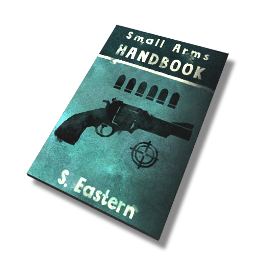
<figcaption>Small_Arms_Handbook_icon.png</figcaption>
</figure></td>
<td>
<a href="./Small%20Arms%20Handbook.md" class="wikilink" title="Small Arms Handbook">Small Arms Handbook</a>
</td>
<td>
1
</td>
<td>
<a href="./Research%20Book.md" class="wikilink" title="Research Book">Research Book</a>
</td>
<td>
1
</td>
<td><ul>
<li>3.00 kg Any Raw Animal Or Raw Fish Meat</li>
<li>2.00 L  <a href="./Water%20%28Potable%29.md" class="wikilink" title="Water (Potable)">Water (Potable)</a></li>
<li>6  <a href="./Ptarmigan%20Down.md" class="wikilink" title="Ptarmigan Down">Ptarmigan Down</a></li>
</ul></td>
<td><ul>
<li>2.25 kg Any Raw Animal Or Raw Fish Meat</li>
<li>1.50 L  <a href="./Water%20%28Potable%29.md" class="wikilink" title="Water (Potable)">Water (Potable)</a></li>
<li>4  <a href="./Ptarmigan%20Down.md" class="wikilink" title="Ptarmigan Down">Ptarmigan Down</a></li>
</ul></td>
</tr>
<tr>
<td><figure>

<figcaption>Advanced_Guns_Guns_Guns!_(Survival_School)_icon.png</figcaption>
</figure></td>
<td>
<a href="./Advanced%20Guns%20Guns%20Guns!.md" class="wikilink" title="Advanced Guns Guns Guns!">Advanced Guns Guns Guns!</a>
</td>
<td>
1
</td>
<td>
<a href="./Research%20Book.md" class="wikilink" title="Research Book">Research Book</a>
</td>
<td>
1
</td>
<td><ul>
<li>3.00 kg Any Raw Animal Or Raw Fish Meat</li>
<li>2.00 L  <a href="./Water%20%28Potable%29.md" class="wikilink" title="Water (Potable)">Water (Potable)</a></li>
<li>6  <a href="./Ptarmigan%20Down.md" class="wikilink" title="Ptarmigan Down">Ptarmigan Down</a></li>
</ul></td>
<td><ul>
<li>2.25 kg Any Raw Animal Or Raw Fish Meat</li>
<li>1.50 L  <a href="./Water%20%28Potable%29.md" class="wikilink" title="Water (Potable)">Water (Potable)</a></li>
<li>4  <a href="./Ptarmigan%20Down.md" class="wikilink" title="Ptarmigan Down">Ptarmigan Down</a></li>
</ul></td>
</tr>
<tr>
<td><figure>

<figcaption>A_Sewing_Primer_icon.png</figcaption>
</figure></td>
<td>
<a href="./A%20Sewing%20Primer.md" class="wikilink" title="A Sewing Primer">A Sewing Primer</a>
</td>
<td>
1
</td>
<td>
<a href="./Research%20Book.md" class="wikilink" title="Research Book">Research Book</a>
</td>
<td>
1
</td>
<td><ul>
<li>3.00 kg Any Raw Animal Or Raw Fish Meat</li>
<li>2.00 L  <a href="./Water%20%28Potable%29.md" class="wikilink" title="Water (Potable)">Water (Potable)</a></li>
<li>6  <a href="./Ptarmigan%20Down.md" class="wikilink" title="Ptarmigan Down">Ptarmigan Down</a></li>
</ul></td>
<td><ul>
<li>2.25 kg Any Raw Animal Or Raw Fish Meat</li>
<li>1.50 L  <a href="./Water%20%28Potable%29.md" class="wikilink" title="Water (Potable)">Water (Potable)</a></li>
<li>4  <a href="./Ptarmigan%20Down.md" class="wikilink" title="Ptarmigan Down">Ptarmigan Down</a></li>
</ul></td>
</tr>
<tr>
<td><figure>
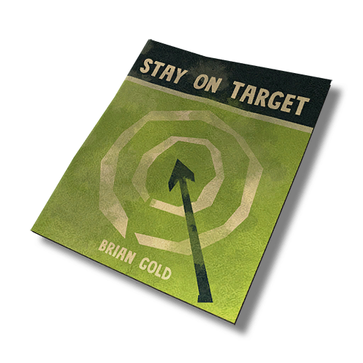
<figcaption>Stay_on_Target_icon.png</figcaption>
</figure></td>
<td>
<a href="./Stay%20on%20Target.md" class="wikilink" title="Stay On Target">Stay On Target</a>
</td>
<td>
1
</td>
<td>
<a href="./Research%20Book.md" class="wikilink" title="Research Book">Research Book</a>
</td>
<td>
1
</td>
<td><ul>
<li>3.00 kg Any Raw Animal Or Raw Fish Meat</li>
<li>2.00 L  <a href="./Water%20%28Potable%29.md" class="wikilink" title="Water (Potable)">Water (Potable)</a></li>
<li>6  <a href="./Ptarmigan%20Down.md" class="wikilink" title="Ptarmigan Down">Ptarmigan Down</a></li>
</ul></td>
<td><ul>
<li>2.25 kg Any Raw Animal Or Raw Fish Meat</li>
<li>1.50 L  <a href="./Water%20%28Potable%29.md" class="wikilink" title="Water (Potable)">Water (Potable)</a></li>
<li>4  <a href="./Ptarmigan%20Down.md" class="wikilink" title="Ptarmigan Down">Ptarmigan Down</a></li>
</ul></td>
</tr>
</tbody>
</table>

### Special Trade Items

These special items are only found by trading with Sutherland, and are quite costly. The first 5 are requests needed to progress <a href="./Sutherland%27s%20Tale.md" class="wikilink" title="Sutherland&#39;s Tale">Sutherland's Tale</a>, and unlock rarer items. Blueprint/Recipe Cards can only be purchased once.

<table style="width:100%;">
<colgroup>
<col style="width: 14%" />
<col style="width: 14%" />
<col style="width: 14%" />
<col style="width: 14%" />
<col style="width: 14%" />
<col style="width: 14%" />
<col style="width: 14%" />
</colgroup>
<thead>
<tr>
<th></th>
<th>
Name
</th>
<th>
Trust
</th>
<th>
Item Type
</th>
<th>
Max Multiples
</th>
<th>
Cost
</th>
<th>
Cost with discount (After 350 Trust)
</th>
</tr>
</thead>
<tbody>
<tr>
<td><figure>

<figcaption>Unique_Recipe_Star_icon.png</figcaption>
</figure></td>
<td>
Special Request (#1)
</td>
<td>
N/A
</td>
<td>
Search for Signs of Wyatt
</td>
<td>
1
</td>
<td>
Travel to the Stockpile <a href="./Prepper%20Cache.md" class="wikilink" title="Prepper Cache">Prepper Cache</a> and deliver <a href="./Document%20Stash%201.md" class="wikilink" title="Document Stash 1">Document Stash 1</a>. Reward: <a href="./Mackinaw%20Jacket.md" class="wikilink" title="Mackinaw Jacket">Mackinaw Jacket</a>
</td>
<td><ul>
<li>No discount</li>
</ul></td>
</tr>
<tr>
<td><figure>

<figcaption>Unique_Recipe_Star_icon.png</figcaption>
</figure></td>
<td>
Special Request (#2)
</td>
<td>
N/A
</td>
<td>
Search for Signs of Wyatt
</td>
<td>
1
</td>
<td>
Travel to the Hunting <a href="./Prepper%20Cache.md" class="wikilink" title="Prepper Cache">Prepper Cache</a> and deliver <a href="./Document%20Stash%202.md" class="wikilink" title="Document Stash 2">Document Stash 2</a>. Reward: <a href="./Arrowhead.md" class="wikilink" title="3x Arrowhead">3x Arrowhead</a>
</td>
<td><ul>
<li>No discount</li>
</ul></td>
</tr>
<tr>
<td><figure>

<figcaption>Unique_Recipe_Star_icon.png</figcaption>
</figure></td>
<td>
Special Request (#3)
</td>
<td>
N/A
</td>
<td>
Search for Signs of Wyatt
</td>
<td>
1
</td>
<td>
Travel to the Conspiracy <a href="./Prepper%20Cache.md" class="wikilink" title="Prepper Cache">Prepper Cache</a> and deliver <a href="./Document%20Stash%203.md" class="wikilink" title="Document Stash 3">Document Stash 3</a>. Reward: <a href="./Improvised%20Knife.md" class="wikilink" title="Improvised Knife">Improvised Knife</a>
</td>
<td><ul>
<li>No discount</li>
</ul></td>
</tr>
<tr>
<td><figure>

<figcaption>Unique_Recipe_Star_icon.png</figcaption>
</figure></td>
<td>
Special Request (#4)
</td>
<td>
N/A
</td>
<td>
Search for Signs of Wyatt
</td>
<td>
1
</td>
<td>
Travel to the <a href="./Prepper%27s%20Abandoned%20Cache.md" class="wikilink" title="Prepper&#39;s Abandoned Cache">Prepper's Abandoned Cache</a> and deliver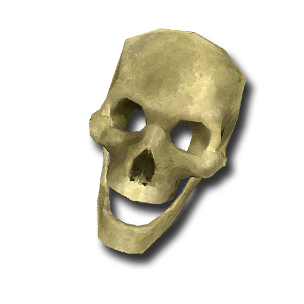 <a href="./A%20Skeleton%20And%20Note.md" class="wikilink" title="A Skeleton And Note">A Skeleton And Note</a>. Reward: <a href="./Hockey%20Jersey.md" class="wikilink" title="Hockey Jersey">Hockey Jersey</a>
</td>
<td><ul>
<li>No discount</li>
</ul></td>
</tr>
<tr>
<td><figure>

<figcaption>Unique_Recipe_Star_icon.png</figcaption>
</figure></td>
<td>
Special Request (#5)
</td>
<td>
N/A
</td>
<td>
Destroy the Abandoned Prepper Cache <strong><u>Note:</u> This will make this location (and contents) permanently inaccessible</strong>
</td>
<td>
1
</td>
<td>
Travel to the <a href="./Prepper%27s%20Abandoned%20Cache.md" class="wikilink" title="Prepper&#39;s Abandoned Cache">Prepper's Abandoned Cache</a> and return  <a href="./Wyatt%27s%20Skeleton.md" class="wikilink" title="Wyatt&#39;s Skeleton">Wyatt's Skeleton</a>. Destroy the cache, then deliver 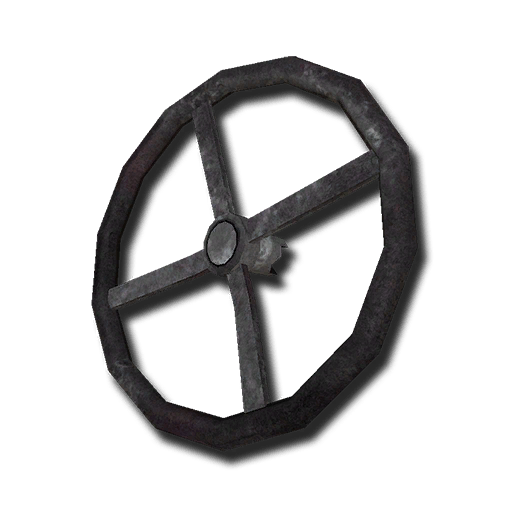 <a href="./Broken%20Hatch%20Wheel.md" class="wikilink" title="Broken Hatch Wheel">Broken Hatch Wheel</a>. Reward: <a href="./Heavy%20Hammer.md" class="wikilink" title="Heavy Hammer">Heavy Hammer</a>
</td>
<td><ul>
<li>No discount</li>
</ul></td>
</tr>
<tr>
<td><figure>
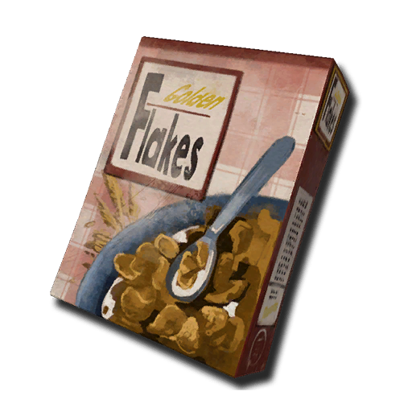
<figcaption>Cereal_icon.png</figcaption>
</figure></td>
<td>
<a href="./Cereal.md" class="wikilink" title="Cereal">Cereal</a>
</td>
<td>
1
</td>
<td>
<a href="./Food%20And%20Drink.md" class="wikilink" title="Food And Drink">Food And Drink</a>
</td>
<td>
10
</td>
<td><ul>
<li>20  <a href="./Cedar%20Firewood.md" class="wikilink" title="Cedar Firewood">Cedar Firewood</a></li>
<li>2.00 L  <a href="./Water%20%28Potable%29.md" class="wikilink" title="Water (Potable)">Water (Potable)</a></li>
</ul></td>
<td><ul>
<li>15  <a href="./Cedar%20Firewood.md" class="wikilink" title="Cedar Firewood">Cedar Firewood</a></li>
<li>1.50 L  <a href="./Water%20%28Potable%29.md" class="wikilink" title="Water (Potable)">Water (Potable)</a></li>
</ul></td>
</tr>
<tr>
<td><figure>

<figcaption>Canned_Pineapple_icon.png</figcaption>
</figure></td>
<td>
<a href="./Canned%20Pineapple.md" class="wikilink" title="Canned Pineapple">Canned Pineapple</a>
</td>
<td>
1
</td>
<td>
<a href="./Food%20And%20Drink.md" class="wikilink" title="Food And Drink">Food And Drink</a>
</td>
<td>
10
</td>
<td><ul>
<li>12  <a href="./Fir%20Firewood.md" class="wikilink" title="Fir Firewood">Fir Firewood</a></li>
<li>2.00 L  <a href="./Water%20%28Potable%29.md" class="wikilink" title="Water (Potable)">Water (Potable)</a></li>
</ul></td>
<td><ul>
<li>8  <a href="./Fir%20Firewood.md" class="wikilink" title="Fir Firewood">Fir Firewood</a></li>
<li>1.50 L  <a href="./Water%20%28Potable%29.md" class="wikilink" title="Water (Potable)">Water (Potable)</a></li>
</ul></td>
</tr>
<tr>
<td><figure>
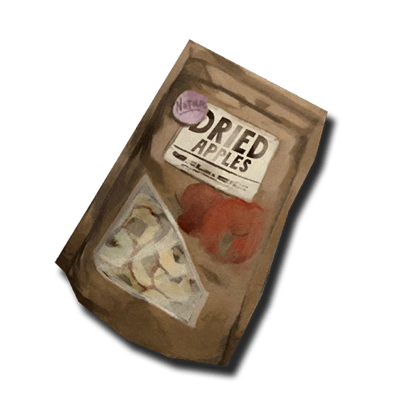
<figcaption>Dried_Apples_icon.png</figcaption>
</figure></td>
<td>
<a href="./Dried%20Apples.md" class="wikilink" title="Dried Apples">Dried Apples</a>
</td>
<td>
1
</td>
<td>
<a href="./Food%20And%20Drink.md" class="wikilink" title="Food And Drink">Food And Drink</a>
</td>
<td>
10
</td>
<td><ul>
<li>12  <a href="./Cedar%20Firewood.md" class="wikilink" title="Cedar Firewood">Cedar Firewood</a></li>
<li>2.00 L  <a href="./Water%20%28Potable%29.md" class="wikilink" title="Water (Potable)">Water (Potable)</a></li>
</ul></td>
<td><ul>
<li>8  <a href="./Cedar%20Firewood.md" class="wikilink" title="Cedar Firewood">Cedar Firewood</a></li>
<li>1.50 L  <a href="./Water%20%28Potable%29.md" class="wikilink" title="Water (Potable)">Water (Potable)</a></li>
</ul></td>
</tr>
<tr>
<td><figure>
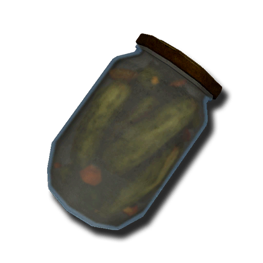
<figcaption>Pickles_icon.png</figcaption>
</figure></td>
<td>
<a href="./Pickles.md" class="wikilink" title="Pickles">Pickles</a>
</td>
<td>
1
</td>
<td>
<a href="./Food%20And%20Drink.md" class="wikilink" title="Food And Drink">Food And Drink</a>
</td>
<td>
10
</td>
<td><ul>
<li>4.00 kg Any Raw Fish Meat</li>
<li>2.00 L  <a href="./Water%20%28Potable%29.md" class="wikilink" title="Water (Potable)">Water (Potable)</a></li>
</ul></td>
<td><ul>
<li>3.00 kg Any Raw Fish Meat</li>
<li>1.50 L  <a href="./Water%20%28Potable%29.md" class="wikilink" title="Water (Potable)">Water (Potable)</a></li>
</ul></td>
</tr>
<tr>
<td><figure>

<figcaption>Caffeine_Pills_icon.png</figcaption>
</figure></td>
<td>
<a href="./Caffeine%20Pills.md" class="wikilink" title="Caffeine Pills">Caffeine Pills</a> (5)
</td>
<td>
400
</td>
<td>
<a href="./First%20Aid.md" class="wikilink" title="First Aid">First Aid</a>
</td>
<td>
10
</td>
<td>
N/A
</td>
<td><ul>
<li>9 Any Harvestable Plants</li>
<li>3.00 L  <a href="./Water%20%28Potable%29.md" class="wikilink" title="Water (Potable)">Water (Potable)</a></li>
<li>3  <a href="./Crow%20Feather.md" class="wikilink" title="Crow Feather">Crow Feather</a></li>
</ul></td>
</tr>
<tr>
<td><figure>
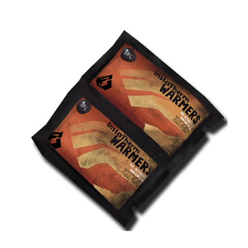
<figcaption>Heat_Pack_icon.png</figcaption>
</figure></td>
<td>
<a href="./Heat%20Pack.md" class="wikilink" title="Heat Pack">Heat Pack</a>
</td>
<td>
300
</td>
<td>
<a href="./First%20Aid.md" class="wikilink" title="First Aid">First Aid</a>
</td>
<td>
5
</td>
<td><ul>
<li>10  <a href="./Coal.md" class="wikilink" title="Coal">Coal</a></li>
<li>15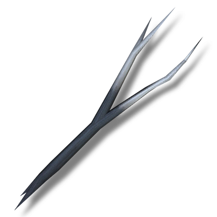 <a href="./Stick.md" class="wikilink" title="Stick">Stick</a></li>
</ul></td>
<td><ul>
<li>7  <a href="./Coal.md" class="wikilink" title="Coal">Coal</a></li>
<li>12 <a href="./Stick.md" class="wikilink" title="Stick">Stick</a></li>
</ul></td>
</tr>
<tr>
<td><figure>
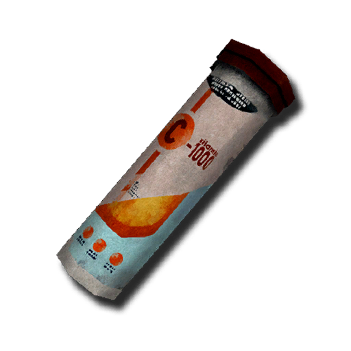
<figcaption>Vitamin-C_Pills_icon.png</figcaption>
</figure></td>
<td>
<a href="./Vitamin-C%20Pills.md" class="wikilink" title="Vitamin-C Pills">Vitamin-C Pills</a> (5)
</td>
<td>
400
</td>
<td>
<a href="./First%20Aid.md" class="wikilink" title="First Aid">First Aid</a>
</td>
<td>
10
</td>
<td>
N/A
</td>
<td><ul>
<li>9 Any Harvestable Plants</li>
<li>3.00 L  <a href="./Water%20%28Potable%29.md" class="wikilink" title="Water (Potable)">Water (Potable)</a></li>
<li>3  <a href="./Crow%20Feather.md" class="wikilink" title="Crow Feather">Crow Feather</a></li>
</ul></td>
</tr>
<tr>
<td><figure>

<figcaption>Bunker_Rifle_icon.png</figcaption>
</figure></td>
<td>
<a href="./Bunker%20Rifle.md" class="wikilink" title="Bunker Rifle">Bunker Rifle</a>
</td>
<td>
N/A
</td>
<td>
<a href="./Tools.md" class="wikilink" title="Tools">Tools</a>
</td>
<td>
1
</td>
<td><ul>
<li>10.00 kg Any Raw Animal Or Raw Fish Meat</li>
<li>5  <a href="./Cured%20Maple%20Sapling.md" class="wikilink" title="Cured Maple Sapling">Cured Maple Sapling</a></li>
<li>4.00 L  <a href="./Lantern%20Fuel.md" class="wikilink" title="Lantern Fuel">Lantern Fuel</a></li>
</ul></td>
<td><ul>
<li>7.50 kg Any Raw Animal Or Raw Fish Meat</li>
<li>4  <a href="./Cured%20Maple%20Sapling.md" class="wikilink" title="Cured Maple Sapling">Cured Maple Sapling</a></li>
<li>3.00 L  <a href="./Lantern%20Fuel.md" class="wikilink" title="Lantern Fuel">Lantern Fuel</a></li>
</ul></td>
</tr>
<tr>
<td><figure>
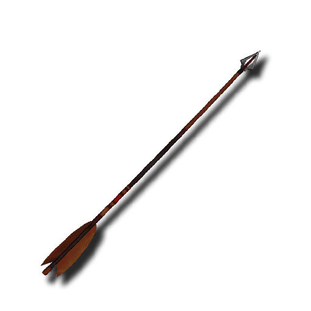
<figcaption>Manufactured_Arrow_icon.png</figcaption>
</figure></td>
<td>
<a href="./Manufactured%20Arrow.md" class="wikilink" title="Manufactured Arrow">Manufactured Arrow</a>
</td>
<td>
N/A
</td>
<td>
<a href="./Tools.md" class="wikilink" title="Tools">Tools</a>
</td>
<td>
10
</td>
<td><ul>
<li>2 Any Cured Hides</li>
<li>2.00 L  <a href="./Water%20%28Potable%29.md" class="wikilink" title="Water (Potable)">Water (Potable)</a></li>
<li>2  <a href="./Ptarmigan%20Down.md" class="wikilink" title="Ptarmigan Down">Ptarmigan Down</a></li>
</ul></td>
<td><ul>
<li>1 Any Cured Hides</li>
<li>1.50 L  <a href="./Water%20%28Potable%29.md" class="wikilink" title="Water (Potable)">Water (Potable)</a></li>
<li>1 <a href="./Ptarmigan%20Down.md" class="wikilink" title="Ptarmigan Down">Ptarmigan Down</a></li>
</ul></td>
</tr>
<tr>
<td><figure>

<figcaption>Survival_Knife_icon.png</figcaption>
</figure></td>
<td>
<a href="./Survival%20Knife.md" class="wikilink" title="Survival Knife">Survival Knife</a>
</td>
<td>
N/A
</td>
<td>
<a href="./Tools.md" class="wikilink" title="Tools">Tools</a>
</td>
<td>
1
</td>
<td><ul>
<li>1  <a href="./Whetstone.md" class="wikilink" title="Whetstone">Whetstone</a></li>
<li>1  <a href="./Hacksaw.md" class="wikilink" title="Hacksaw">Hacksaw</a></li>
<li>1  <a href="./Cooking%20Skillet.md" class="wikilink" title="Cooking Skillet">Cooking Skillet</a></li>
</ul></td>
<td><ul>
<li>No discount</li>
</ul></td>
</tr>
<tr>
<td><figure>
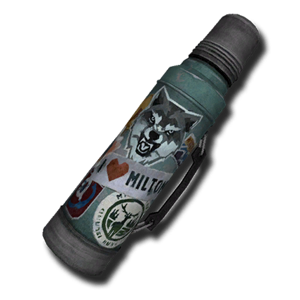
<figcaption>Insulated_Flask_G.png</figcaption>
</figure></td>
<td>
Sticker <a href="./Insulated%20Flask.md" class="wikilink" title="Insulated Flask">Insulated Flask</a>
</td>
<td>
300
</td>
<td>
<a href="./Tools.md" class="wikilink" title="Tools">Tools</a>
</td>
<td>
1
</td>
<td><ul>
<li>10.00 kg Any Raw Animal Or Raw Fish Meat</li>
<li>4  <a href="./Cured%20Birch%20Sapling.md" class="wikilink" title="Cured Birch Sapling">Cured Birch Sapling</a></li>
<li>5  <a href="./Cured%20Maple%20Sapling.md" class="wikilink" title="Cured Maple Sapling">Cured Maple Sapling</a></li>
</ul></td>
<td><ul>
<li>7.50 kg Any Raw Animal Or Raw Fish Meat</li>
<li>3  <a href="./Cured%20Birch%20Sapling.md" class="wikilink" title="Cured Birch Sapling">Cured Birch Sapling</a></li>
<li>4  <a href="./Cured%20Maple%20Sapling.md" class="wikilink" title="Cured Maple Sapling">Cured Maple Sapling</a></li>
</ul></td>
</tr>
<tr>
<td><figure>

<figcaption>Patterned_Wool_Mittens_(Blue)_icon.png</figcaption>
</figure></td>
<td>
<a href="./Patterned%20Wool%20Mittens%20%28Blue%29.md" class="wikilink" title="Patterned Wool Mittens (Blue)">Patterned Wool Mittens (Blue)</a>
</td>
<td>
1
</td>
<td>
<a href="./Clothing.md" class="wikilink" title="Clothing">Clothing</a>
</td>
<td>
3
</td>
<td><ul>
<li>2.00 L  <a href="./Lantern%20Fuel.md" class="wikilink" title="Lantern Fuel">Lantern Fuel</a></li>
<li>10  <a href="./Birch%20Bark.md" class="wikilink" title="Birch Bark">Birch Bark</a></li>
</ul></td>
<td><ul>
<li>1.25 L  <a href="./Lantern%20Fuel.md" class="wikilink" title="Lantern Fuel">Lantern Fuel</a></li>
<li>7  <a href="./Birch%20Bark.md" class="wikilink" title="Birch Bark">Birch Bark</a></li>
</ul></td>
</tr>
<tr>
<td><figure>

<figcaption>Patterned_Wool_Mittens_(Brown)_icon.png</figcaption>
</figure></td>
<td>
<a href="./Patterned%20Wool%20Mittens%20%28Brown%29.md" class="wikilink" title="Patterned Wool Mittens (Brown)">Patterned Wool Mittens (Brown)</a>
</td>
<td>
1
</td>
<td>
<a href="./Clothing.md" class="wikilink" title="Clothing">Clothing</a>
</td>
<td>
3
</td>
<td><ul>
<li>2.00 L  <a href="./Lantern%20Fuel.md" class="wikilink" title="Lantern Fuel">Lantern Fuel</a></li>
<li>10  <a href="./Birch%20Bark.md" class="wikilink" title="Birch Bark">Birch Bark</a></li>
</ul></td>
<td><ul>
<li>1.25 L  <a href="./Lantern%20Fuel.md" class="wikilink" title="Lantern Fuel">Lantern Fuel</a></li>
<li>7  <a href="./Birch%20Bark.md" class="wikilink" title="Birch Bark">Birch Bark</a></li>
</ul></td>
</tr>
<tr>
<td><figure>

<figcaption>Patterned_Wool_Mittens_(Burgundy)_icon.png</figcaption>
</figure></td>
<td>
<a href="./Patterned%20Wool%20Mittens%20%28Burgundy%29.md" class="wikilink" title="Patterned Wool Mittens (Burgundy)">Patterned Wool Mittens (Burgundy)</a>
</td>
<td>
1
</td>
<td>
<a href="./Clothing.md" class="wikilink" title="Clothing">Clothing</a>
</td>
<td>
3
</td>
<td><ul>
<li>2.00 L  <a href="./Lantern%20Fuel.md" class="wikilink" title="Lantern Fuel">Lantern Fuel</a></li>
<li>10  <a href="./Birch%20Bark.md" class="wikilink" title="Birch Bark">Birch Bark</a></li>
</ul></td>
<td><ul>
<li>1.25 L  <a href="./Lantern%20Fuel.md" class="wikilink" title="Lantern Fuel">Lantern Fuel</a></li>
<li>7  <a href="./Birch%20Bark.md" class="wikilink" title="Birch Bark">Birch Bark</a></li>
</ul></td>
</tr>
<tr>
<td><figure>

<figcaption>T-Shirt_(CM)_icon.png</figcaption>
</figure></td>
<td>
<a href="./T-Shirt%20%28CM%29.md" class="wikilink" title="T-Shirt (CM)">T-Shirt (CM)</a>
</td>
<td>
200
</td>
<td>
<a href="./Clothing.md" class="wikilink" title="Clothing">Clothing</a>
</td>
<td>
1
</td>
<td><ul>
<li>2 Any Cured Hides</li>
<li>12  <a href="./Cedar%20Firewood.md" class="wikilink" title="Cedar Firewood">Cedar Firewood</a></li>
</ul></td>
<td><ul>
<li>1 Any Cured Hides</li>
<li>8  <a href="./Cedar%20Firewood.md" class="wikilink" title="Cedar Firewood">Cedar Firewood</a></li>
</ul></td>
</tr>
<tr>
<td><figure>

<figcaption>T-Shirt_(GBI)_icon.png</figcaption>
</figure></td>
<td>
<a href="./T-Shirt%20%28GBI%29.md" class="wikilink" title="T-Shirt (GBI)">T-Shirt (GBI)</a>
</td>
<td>
200
</td>
<td>
<a href="./Clothing.md" class="wikilink" title="Clothing">Clothing</a>
</td>
<td>
1
</td>
<td><ul>
<li>2 Any Cured Hides</li>
<li>12  <a href="./Cedar%20Firewood.md" class="wikilink" title="Cedar Firewood">Cedar Firewood</a></li>
</ul></td>
<td><ul>
<li>1 Any Cured Hides</li>
<li>8  <a href="./Cedar%20Firewood.md" class="wikilink" title="Cedar Firewood">Cedar Firewood</a></li>
</ul></td>
</tr>
<tr>
<td><figure>

<figcaption>T-Shirt_(Snappy)_icon.png</figcaption>
</figure></td>
<td>
<a href="./T-Shirt%20%28Snappy%29.md" class="wikilink" title="T-Shirt (Snappy)">T-Shirt (Snappy)</a>
</td>
<td>
200
</td>
<td>
<a href="./Clothing.md" class="wikilink" title="Clothing">Clothing</a>
</td>
<td>
1
</td>
<td><ul>
<li>2 Any Cured Hides</li>
<li>12  <a href="./Cedar%20Firewood.md" class="wikilink" title="Cedar Firewood">Cedar Firewood</a></li>
</ul></td>
<td><ul>
<li>1 Any Cured Hide</li>
<li>8  <a href="./Cedar%20Firewood.md" class="wikilink" title="Cedar Firewood">Cedar Firewood</a></li>
</ul></td>
</tr>
<tr>
<td><figure>

<figcaption>Patterned_Wool_Socks_(Dots)_icon.png</figcaption>
</figure></td>
<td>
<a href="./Patterned%20Wool%20Socks%20%28Dots%29.md" class="wikilink" title="Patterned Wool Socks (Dots)">Patterned Wool Socks (Dots)</a>
</td>
<td>
100
</td>
<td>
<a href="./Clothing.md" class="wikilink" title="Clothing">Clothing</a>
</td>
<td>
3
</td>
<td><ul>
<li>10 Any Harvestable Plants</li>
<li>2  <a href="./Cured%20Gut.md" class="wikilink" title="Cured Gut">Cured Gut</a></li>
<li>3  <a href="./Cured%20Rabbit%20Pelt.md" class="wikilink" title="Cured Rabbit Pelt">Cured Rabbit Pelt</a></li>
</ul></td>
<td><ul>
<li>8 Any Harvestable Plants</li>
<li>1  <a href="./Cured%20Gut.md" class="wikilink" title="Cured Gut">Cured Gut</a></li>
<li>2  <a href="./Cured%20Rabbit%20Pelt.md" class="wikilink" title="Cured Rabbit Pelt">Cured Rabbit Pelt</a></li>
</ul></td>
</tr>
<tr>
<td><figure>

<figcaption>Patterned_Wool_Socks_(Moose)_icon.png</figcaption>
</figure></td>
<td>
<a href="./Patterned%20Wool%20Socks%20%28Moose%29.md" class="wikilink" title="Patterned Wool Socks (Moose)">Patterned Wool Socks (Moose)</a>
</td>
<td>
100
</td>
<td>
<a href="./Clothing.md" class="wikilink" title="Clothing">Clothing</a>
</td>
<td>
3
</td>
<td><ul>
<li>10 Any Harvestable Plants</li>
<li>2  <a href="./Cured%20Gut.md" class="wikilink" title="Cured Gut">Cured Gut</a></li>
<li>3  <a href="./Cured%20Rabbit%20Pelt.md" class="wikilink" title="Cured Rabbit Pelt">Cured Rabbit Pelt</a></li>
</ul></td>
<td><ul>
<li>8 Any Harvestable Plants</li>
<li>1  <a href="./Cured%20Gut.md" class="wikilink" title="Cured Gut">Cured Gut</a></li>
<li>2  <a href="./Cured%20Rabbit%20Pelt.md" class="wikilink" title="Cured Rabbit Pelt">Cured Rabbit Pelt</a></li>
</ul></td>
</tr>
<tr>
<td><figure>

<figcaption>Patterned_Wool_Socks_(Plaid)_icon.png</figcaption>
</figure></td>
<td>
<a href="./Patterned%20Wool%20Socks%20%28Plaid%29.md" class="wikilink" title="Patterned Wool Socks (Plaid)">Patterned Wool Socks (Plaid)</a>
</td>
<td>
100
</td>
<td>
<a href="./Clothing.md" class="wikilink" title="Clothing">Clothing</a>
</td>
<td>
3
</td>
<td><ul>
<li>10 Any Harvestable Plants</li>
<li>2  <a href="./Cured%20Gut.md" class="wikilink" title="Cured Gut">Cured Gut</a></li>
<li>3  <a href="./Cured%20Rabbit%20Pelt.md" class="wikilink" title="Cured Rabbit Pelt">Cured Rabbit Pelt</a></li>
</ul></td>
<td><ul>
<li>8 Any Harvestable Plants</li>
<li>1  <a href="./Cured%20Gut.md" class="wikilink" title="Cured Gut">Cured Gut</a></li>
<li>2  <a href="./Cured%20Rabbit%20Pelt.md" class="wikilink" title="Cured Rabbit Pelt">Cured Rabbit Pelt</a></li>
</ul></td>
</tr>
<tr>
<td><figure>
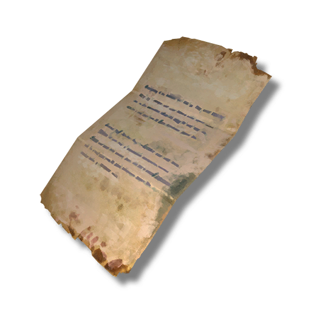
<figcaption>Note_icon.png</figcaption>
</figure></td>
<td>
<a href="./Bushcraft%20Bow%20Blueprint%20Card.md" class="wikilink" title="Bushcraft Bow Blueprint Card">Bushcraft Bow Blueprint Card</a>
</td>
<td>
N/A
</td>
<td>
Blueprint
</td>
<td>
1
</td>
<td><ul>
<li>10.00 kg Any Raw Animal Or Raw Fish Meat</li>
<li>5  <a href="./Cured%20Maple%20Sapling.md" class="wikilink" title="Cured Maple Sapling">Cured Maple Sapling</a></li>
<li>2 Any Cured Hides</li>
</ul></td>
<td><ul>
<li>5.00 kg Any Raw Animal Or Raw Fish Meat</li>
<li>2  <a href="./Cured%20Maple%20Sapling.md" class="wikilink" title="Cured Maple Sapling">Cured Maple Sapling</a></li>
<li>2 Any Cured Hides</li>
</ul></td>
</tr>
<tr>
<td><figure>

<figcaption>Note_icon.png</figcaption>
</figure></td>
<td>
<a href="./Wolfskin%20Hat%20Blueprint%20Card.md" class="wikilink" title="Wolfskin Hat Blueprint Card">Wolfskin Hat Blueprint Card</a>
</td>
<td>
N/A
</td>
<td>
Blueprint
</td>
<td>
1
</td>
<td><ul>
<li>3.00L  <a href="./Lantern%20Fuel.md" class="wikilink" title="Lantern Fuel">Lantern Fuel</a></li>
<li>1 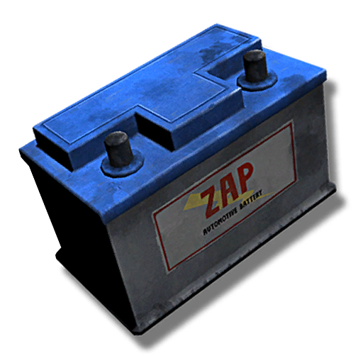 <a href="./Car%20Battery.md" class="wikilink" title="Car Battery">Car Battery</a></li>
<li>8  <a href="./Cloth.md" class="wikilink" title="Cloth">Cloth</a></li>
</ul></td>
<td><ul>
<li>2.25L  <a href="./Lantern%20Fuel.md" class="wikilink" title="Lantern Fuel">Lantern Fuel</a></li>
<li>1  <a href="./Car%20Battery.md" class="wikilink" title="Car Battery">Car Battery</a></li>
<li>6  <a href="./Cloth.md" class="wikilink" title="Cloth">Cloth</a></li>
</ul></td>
</tr>
<tr>
<td><figure>

<figcaption>Note_icon.png</figcaption>
</figure></td>
<td>
<a href="./Wolfskin%20Pants%20Blueprint%20Card.md" class="wikilink" title="Wolfskin Pants Blueprint Card">Wolfskin Pants Blueprint Card</a>
</td>
<td>
1
</td>
<td>
Blueprint
</td>
<td>
1
</td>
<td><ul>
<li>3.00L  <a href="./Lantern%20Fuel.md" class="wikilink" title="Lantern Fuel">Lantern Fuel</a></li>
<li>1  <a href="./Car%20Battery.md" class="wikilink" title="Car Battery">Car Battery</a></li>
<li>8  <a href="./Cloth.md" class="wikilink" title="Cloth">Cloth</a></li>
</ul></td>
<td><ul>
<li>2.25L  <a href="./Lantern%20Fuel.md" class="wikilink" title="Lantern Fuel">Lantern Fuel</a></li>
<li>1  <a href="./Car%20Battery.md" class="wikilink" title="Car Battery">Car Battery</a></li>
<li>6  <a href="./Cloth.md" class="wikilink" title="Cloth">Cloth</a></li>
</ul></td>
</tr>
<tr>
<td><figure>
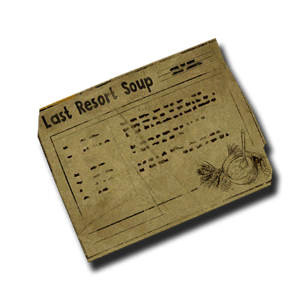
<figcaption>Recipe_Card_Soup_Potato.png</figcaption>
</figure></td>
<td>
<a href="./Last%20Resort%20Soup.md" class="wikilink" title="Last Resort Soup">Last Resort Soup</a>
</td>
<td>
1
</td>
<td>
<a href="./Recipe%20Cards.md" class="wikilink" title="Recipe Card">Recipe Card</a>
</td>
<td>
1
</td>
<td><ul>
<li>2.25L  <a href="./Lantern%20Fuel.md" class="wikilink" title="Lantern Fuel">Lantern Fuel</a></li>
<li>1  <a href="./Car%20Battery.md" class="wikilink" title="Car Battery">Car Battery</a></li>
<li>7  <a href="./Cloth.md" class="wikilink" title="Cloth">Cloth</a></li>
</ul></td>
<td><ul>
<li>1.50L  <a href="./Lantern%20Fuel.md" class="wikilink" title="Lantern Fuel">Lantern Fuel</a></li>
<li>5  <a href="./Cloth.md" class="wikilink" title="Cloth">Cloth</a></li>
</ul></td>
</tr>
<tr>
<td><figure>
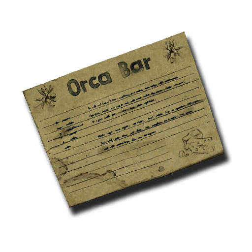
<figcaption>Recipe_Card_Orca_Bar.png</figcaption>
</figure></td>
<td>
<a href="./Pemmican%20Bar.md" class="wikilink" title="Pemmican Bar">Pemmican Bar</a>
</td>
<td>
1
</td>
<td>
<a href="./Recipe%20Cards.md" class="wikilink" title="Recipe Card">Recipe Card</a>
</td>
<td>
1
</td>
<td><ul>
<li>3.00L  <a href="./Lantern%20Fuel.md" class="wikilink" title="Lantern Fuel">Lantern Fuel</a></li>
<li>1  <a href="./Car%20Battery.md" class="wikilink" title="Car Battery">Car Battery</a></li>
<li>8  <a href="./Cloth.md" class="wikilink" title="Cloth">Cloth</a></li>
</ul></td>
<td><ul>
<li>2.25L  <a href="./Lantern%20Fuel.md" class="wikilink" title="Lantern Fuel">Lantern Fuel</a></li>
<li>6  <a href="./Cloth.md" class="wikilink" title="Cloth">Cloth</a></li>
</ul></td>
</tr>
<tr>
<td><figure>
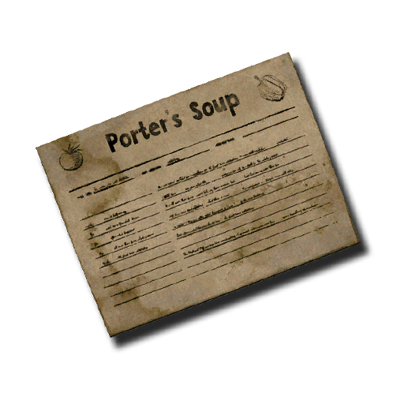
<figcaption>Recipe_Card_Soup_Ptarmigan.png</figcaption>
</figure></td>
<td>
<a href="./Porter%27s%20Soup.md" class="wikilink" title="Porter&#39;s Soup">Porter's Soup</a>
</td>
<td>
1
</td>
<td>
<a href="./Recipe%20Cards.md" class="wikilink" title="Recipe Card">Recipe Card</a>
</td>
<td>
1
</td>
<td><ul>
<li>3.00L  <a href="./Lantern%20Fuel.md" class="wikilink" title="Lantern Fuel">Lantern Fuel</a></li>
<li>1  <a href="./Car%20Battery.md" class="wikilink" title="Car Battery">Car Battery</a></li>
<li>8  <a href="./Cloth.md" class="wikilink" title="Cloth">Cloth</a></li>
</ul></td>
<td><ul>
<li>2.25L  <a href="./Lantern%20Fuel.md" class="wikilink" title="Lantern Fuel">Lantern Fuel</a></li>
<li>6  <a href="./Cloth.md" class="wikilink" title="Cloth">Cloth</a></li>
</ul></td>
</tr>
<tr>
<td><figure>
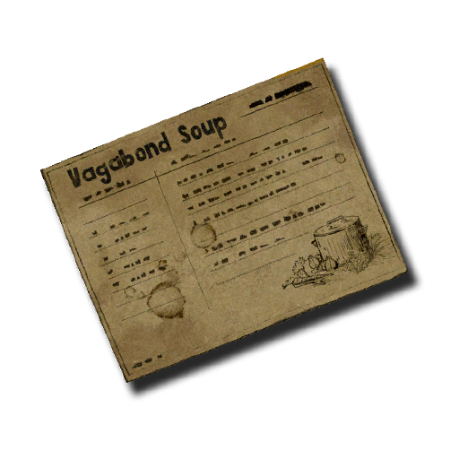
<figcaption>Recipe_Card_Rabbit_Soup.png</figcaption>
</figure></td>
<td>
<a href="./Vagabond%20Soup.md" class="wikilink" title="Vagabond Soup">Vagabond Soup</a>
</td>
<td>
1
</td>
<td>
<a href="./Recipe%20Cards.md" class="wikilink" title="Recipe Card">Recipe Card</a>
</td>
<td>
1
</td>
<td><ul>
<li>2.00L  <a href="./Lantern%20Fuel.md" class="wikilink" title="Lantern Fuel">Lantern Fuel</a></li>
<li>1  <a href="./Car%20Battery.md" class="wikilink" title="Car Battery">Car Battery</a></li>
<li>6  <a href="./Cloth.md" class="wikilink" title="Cloth">Cloth</a></li>
</ul></td>
<td><ul>
<li>1.50L  <a href="./Lantern%20Fuel.md" class="wikilink" title="Lantern Fuel">Lantern Fuel</a></li>
<li>5  <a href="./Cloth.md" class="wikilink" title="Cloth">Cloth</a></li>
</ul></td>
</tr>
</tbody>
</table>

## Sutherland's Past

- Speaking to the Trader reveals more about him, with more <a href="./Sutherland%27s%20Tale.md#Conversations" class="wikilink" title="Conversations">Conversations</a> being unlocked as you raise his Trust:
  - The Trader's real name is Sutherland, and he is a sailor by trade.
  - He seems to be afflicted with whatever disease is affecting the residents of <a href="./Perseverance%20Mills.md" class="wikilink" title="Perseverance Mills">Perseverance Mills</a>, as well as <a href="./Patient%207.md" class="wikilink" title="Patient 7">Patient 7</a>, <a href="./The%20Foreman.md" class="wikilink" title="The Foreman">The Foreman</a>, <a href="./Dr.%20R%C3%BCdiger.md" class="wikilink" title="Dr. Rüdiger">Dr. Rüdiger</a>, and <a href="./The%20Security%20Chief.md" class="wikilink" title="The Security Chief">The Security Chief</a>, which causes them to forget things and become fixated on open water.
    - One major example of a memory recall problem is that he hasn't heard from his brother Wyatt since the <a href="./First%20Flare.md" class="wikilink" title="First Flare">First Flare</a>, despite the fact that he should know that his brother died long ago. His brother's death is also one of the major reasons why Sutherland has a deep seeded resentment to strangers and is so slow to trust others.
    - It is likely that his disease was caused by <a href="./R%C3%BCdiger%27s%20Machine.md" class="wikilink" title="Rüdiger&#39;s Machine">Rüdiger's Machine</a>.
  - Sutherland mentions that the radios the survivor uses to communicate from him are from an old emergency messaging system meant to keep Islanders in contact with one another. The "<a href="./A%20page%20from%20an%20old%20newsletter..md" class="wikilink" title="A page from an old newsletter.">A page from an old newsletter.</a>" note also explains why these radios are found across the Island.
  - He is a Great Bear Island native born in Coastal Highway, being the titular "Misanthrope" that lived at <a href="./Misanthrope%27s%20Homestead.md" class="wikilink" title="Misanthrope&#39;s Homestead">Misanthrope's Homestead</a>. Sutherland, along with his "Pa" and brother Wyatt, lived there for most of their lives. Sutherland eventually states that he has abandoned his home and is more comfortable on his boat, saying that the survivor can do as they please with his house during the Quiet Apocalypse.
    - It is revealed that his brother Wyatt is the one who created all of the <a href="./Prepper%20Cache.md" class="wikilink" title="Prepper Cache">Prepper Cache</a> bunkers across the island, including <a href="./Joplin%27s%20Bunker%20Raid.md" class="wikilink" title="Joplin&#39;s Bunkers">Joplin's Bunkers</a>. Though not confirmed, he most like created <a href="./Hank%27s%20Hatch.md" class="wikilink" title="Hank&#39;s Hatch">Hank's Hatch</a>, the <a href="./Aurora%20Hatch.md" class="wikilink" title="Aurora Hatch">Aurora Hatch</a>, and the hatch in <a href="./Blackrock%20Rumours.md" class="wikilink" title="Blackrock Rumours">Blackrock Rumours</a> - Suspicious Person as well.
    - His reasoning was the belief that a nuclear exchange was coming that would destroy the world, confirming that the caches were fallout shelters.
    - Wyatt is also the original owner of Sutherland's sailboat.
    - 3 other people were a part of Wyatt's crew, but ultimately turned on him due to paranoia.
  - Sutherland has been at sea for a long time, and refuses to set foot on <a href="./Great%20Bear%20Island.md" class="wikilink" title="Great Bear Island">Great Bear Island</a> except to briefly complete trades. His sailboat can be seen off-shore on the morning after completing a trade in <a href="./Coastal%20Highway.md" class="wikilink" title="Coastal Highway">Coastal Highway</a>.
    - He mentions that his sailboat cannot escape Great Bear Island to the Mainland as his vessel would never survive the journey. Blizzards also keep his ship close to shore and the winds he catches only allow him to sail around the coast.
    - The Trader also mentions that he acquires his wares from shipwrecks, floating containers, and things drifting around the sea.
  - The Trader has a crippled leg that locks up on him in winter. He received it while at sea after heavy cables came loose on a ship and almost took his leg clean off. This information is conflicted moments later, with Sutherland mentioning that it might have instead have had something to do with his brother Wyatt.
    - Sutherland's leg is the one of the reasons why Wyatt's crew turned on him and lead to his death.

## Trivia

- Through trading with the Trader, many previously non-renewable items become renewable; most notably <a href="./Research%20Book.md" class="wikilink" title="Research Books">Research Books</a> and <a href="./Cooking.md" class="wikilink" title="Cooking">Cooking</a> ingredients.
- The Trader is the only other living human in *The Long Dark's* <a href="./Survival%20Mode.md" class="wikilink" title="Survival Mode">Survival Mode</a>, with all other humans being <a href="./Frozen%20Corpse.md" class="wikilink" title="Frozen Corpses">Frozen Corpses</a> or skeletal remains.
  - He hints that he has a theory as to where everyone went, but ultimately teases the survivor with this info without revealing his theory.
- How Sutherland survives on a small sailboat for so long is a mystery. How he prepares raw meat to become edible or what he does with so many Car Batteries is ultimately left to the player's imagination. It is presumed that he mainly survives off of what he scavenges from the sea, considering how much food he constantly offers up in trades and the fact that he allows for trades to last indefinitely, even when asking for raw food/water.
  - Another question that has been raised is how his radio is powered during Glimmer Fog, as this fog only appears and effects electronics in the Far Territory. As it is currently impossible for the fog to reach the sea and power his radio, this may be an oversight from the developers.
- The trader is voiced by Angus Macleod.

## Gallery

<table class="gallery">
<colgroup>
<col style="width: 50%" />
<col style="width: 50%" />
</colgroup>
<tbody>
<tr>
<td><figure>
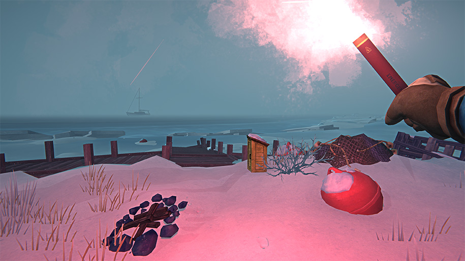
<figcaption>The Trader's sailboat just off the coast after completing a trade.</figcaption>
</figure></td>
<td><figure>

<figcaption>The Trader's sailboat seen up close.</figcaption>
</figure></td>
</tr>
</tbody>
</table>

## Achievements

- 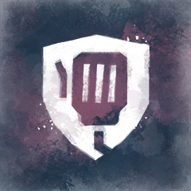 <a href="./Goods%20and%20Services.md" class="wikilink" title="Goods and Services">Goods and Services</a> - Reach maximum Trust with the Trader

## Game History

**Template:update history** **Lua execution error in Module:Navbox function navbox** <a href="ru:%D0%A2%D0%BE%D1%80%D0%B3%D0%BE%D0%B2%D0%B5%D1%86" class="wikilink" title="ru:Торговец">ru:Торговец</a>

