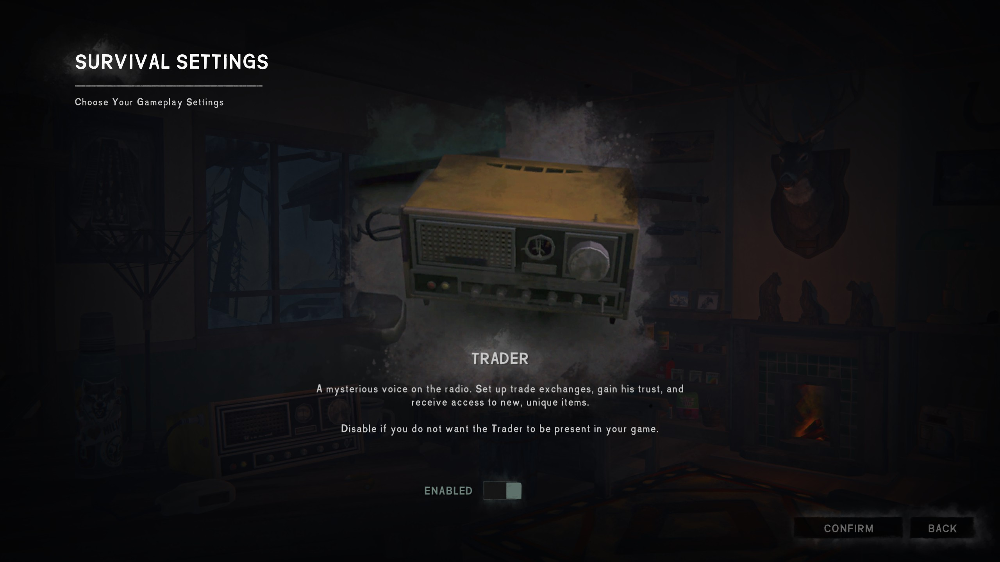

# Trader

**Categories:** DLC Content · **Source:** [Fandom](https://thelongdark.fandom.com/wiki/Trader)

**Contents**

- [Overview](#overview)
- [Enable Option](#enable-option)
- [Arrival Time and Radio](#arrival-time-and-radio)
- [Arrival Time](#arrival-time)
- [Radio Locations](#radio-locations)
- [Trading](#trading)
- [Trader Mechanics](#trader-mechanics)
- [Trading Tips](#trading-tips)
- [Trust](#trust)
- [Trust Gained and Lost](#trust-gained-and-lost)
- [Trust Thresholds](#trust-thresholds)
- [Special Requests](#special-requests)
- [Trader's Inventory](#trader-s-inventory)
- [Normal Trades](#normal-trades)
- [Special Trade Items](#special-trade-items)
- [Sutherland's Past](#sutherland-s-past)
- [Trivia](#trivia)
- [Gallery](#gallery)
- [Achievements](#achievements)
- [Game History](#game-history)

[Ptarmigan icon](../assets/Ptarmigan_icon.png)

**DLC-Exclusive content.**; This content requires the [Tales from the Far Territory](./Tales%20from%20the%20Far%20Territory.md) addon to be installed before it can be seen or used in regular gameplay.

 [Icon for the Trader used in the marketing of TftFT](../assets/Icon_Trader.svg)_Icon for the Trader used in the marketing of TftFT_

“

**A source of rare goods and useful information, for a price.**; Official Hinterland Description

”

The **Trader** is an NPC that "appears" in [Survival Mode](./Survival%20Mode.md). He may be contacted via Radio to propose bartering for items, and functions as a source of renewable items if the player has the resources to trade with him. The Trader was released in the Part 6 Broken Silence update for the [Tales from the Far Territory](./Tales%20from%20the%20Far%20Territory.md) expansion.

## Overview

A man known as Sutherland, the Trader communicates with the survivor over Radios during an active [Aurora](./Aurora.md). He will offer the survivor rare or unique items for a price, and requires his requested trade items to be placed inside the [Trade Drop Box](./Trade%20Drop%20Box.md) on [Misanthrope's Island](./Misanthrope%27s%20Homestead.md) in [Coastal Highway](./Coastal%20Highway.md). The Trader becomes accessible after a fixed number of days have passed (determined by chosen Experience).

Despite being the only living NPC in Survival Mode, The Trader is never physically seen and will always keep his distance, remaining at sea in a sailboat and refusing to set foot on Great Bear Island except to complete trades.

He is the center of his own unique [Tale](./Tales.md): [Sutherland's Tale](./Sutherland%27s%20Tale.md).

## Enable Option

> “**A mysterious voice on the radio. Set up trade exchanges, gain his trust, and receive access to new, unique items.  
 Disable if you do not want the Trader to be present in your game.**”

The player has the option to enable/disable the Trader before starting their survival game. The option to disable the Trader appears on all Experiences. If disabled, the Trader's radios do not appear on the Island.

## Arrival Time and Radio

### Arrival Time

Below is the survival time required before Sutherland can be contacted. In dialogue Sutherland reveals that his radio has not been working, and that he spent this time repairing it:

**Trader Arrival Date**

| Experience | Days Survived |
| --- | --- |
| [Pilgrim](./Pilgrim.md) | 15 |
| [Voyageur](./Voyageur.md) | 20 |
| [Stalker](./Stalker.md) | 30 |
| [Interloper](./Interloper.md)/[Misery](./Misery.md) | 40 |

### Radio Locations

The Trader can only be contacted by special yellow [Radios](./Radio.md) with a microphone and portable antenna, which can be found at fixed locations on [Great Bear Island](./Great%20Bear%20Island.md) (and cannot be moved with [Safehouse Customization](./Safehouse%20Customization.md)).

- The Radio must be powered during an active [Aurora](./Aurora.md) (or [Glimmer Fog](./Glimmer%20Fog.md) in the Far Territory). These radios will not appear if The Trader is disabled.
- If the message "Trader Unavailable" appears when using the Radio, this means that the minimum arrival date has not passed yet or the Trader is delivering your items after completing a trade. A good way to tell if Sutherland is around is to listen for him shouting when the Radio is powered.

**Trader Radio Locations**

| Region | Location |
| --- | --- |
| [Blackrock](./Blackrock.md) | [Blackrock Prison](./Blackrock%20Prison.md) (Guard Barracks) |
| [Bleak Inlet](./Bleak%20Inlet.md) | [Last Resort Cannery](./Last%20Resort%20Cannery.md) (White Trailer) |
| [Broken Railroad](./Broken%20Railroad.md) | [Maintenance Yard](./Maintenance%20Yard.md) (Outdoor Office) |
| [Coastal Highway](./Coastal%20Highway.md) | [Quonset Garage](./Quonset%20Garage.md) |
| [Forsaken Airfield](./Forsaken%20Airfield.md) | [Terminal](./Terminal.md) |
| [Mountain Town](./Mountain%20Town.md) | [Milton Post Office](./Milton%20Post%20Office.md) |
| [Mystery Lake](./Mystery%20Lake%20%28region%29.md) | [Camp Office](./Camp%20Office.md) |
| [Pleasant Valley](./Pleasant%20Valley.md) | [Community Hall](./Community%20Hall.md) |
| [Transfer Pass](./Transfer%20Pass.md) | [Vacant Depot](./Vacant%20Depot.md) |
| [Zone of Contamination](./Zone%20of%20Contamination.md) | [Idle Camp](./Idle%20Camp.md) (Mess Hall) |

## Trading

### Trader Mechanics

- Sutherland is contacted by Radio to trade or talk (after he arrives).
  - Radios present at fixed locations around [Great Bear Island](./Great%20Bear%20Island.md) and are powered during [Aurora](./Aurora.md) or [Glimmer Fog](./Glimmer%20Fog.md) weather.
  - 6-10 different types of items are offered per trade.
  - Most items can be traded in multiples (between 1-10).
  - Unique items can only be traded once (equipment/recipes/blueprints).
- Once a trade is confirmed, the [Trade Drop Box](./Trade%20Drop%20Box.md) must be filled with the requested items (at [Misanthrope's Homestead](./Misanthrope%27s%20Homestead.md) in [Coastal Highway](./Coastal%20Highway.md)).
  - Trade progress is tracked on Journal > Active Trades and at the Trade Drop Box.
  - The Trade Drop Box becomes locked when not in use, or when complete and waiting pickup.
  - The Trade Drop Box may be marked early for pickup (even with trades incomplete):
    - Completed trades yield the the requested item(s).
    - **Incomplete trades will be lost lost (no refund).**
  - Trades can be canceled via radio.
  - An Aurora always occurs immediately (if at night) or the next night when the last requested item is dropped in the Trade Drop Box and the box is marked as "Complete Trade." This also occurs when marked for incomplete pickup.
- Once the Trade Drop Box is marked as ready for pickup, Sutherland must be contacted via Radio to confirm pickup.
  - After confirming the trade, Sutherland will pick up **all items in the Trade Drop Box** and reward completed trades.
  - After signaling to Sutherland a completed trade, he will not respond for one hour as he drops off the items.
  - Items must be claimed from the Trade Drop Box before starting a new trade.

### Trading Tips

- Time does not pass when communicating with Sutherland.
- Items from Sutherland are always 100% Condition.
- On [Interloper](./Interloper.md)/[Misery](./Misery.md) mainly firearms and clothing are not available.
  - On Misery the trader also offers less items per trade.
- Trades have no time limit, but stock will not rotate until the current trade is completed or canceled.
  - Successful trades increase Trust, cancelled trades reduces it.
- Items traded often have the following requirements:
  - 50% or more Condition when placed inside the Trade Drop Box
  - Trades may require a specific type of meat: "any raw animal meat", "any raw fish meat" or either "any raw animal or raw fish meat".
  - Meat and Fish must be raw.
  - Hides/Pelts must be [cured](./Curing.md) and may be of any type of [Wildlife](./Wildlife.md):
    -  [Cured Black Bear Hide](./Cured%20Black%20Bear%20Hide.md)
    -  [Cured Cougar Hide](./Cured%20Cougar%20Hide.md)
    -  [Cured Deer Hide](./Cured%20Deer%20Hide.md)
    -  [Cured Moose Hide](./Cured%20Moose%20Hide.md)
    -  [Cured Rabbit Pelt](./Cured%20Rabbit%20Pelt.md)
    -  [Cured Wolf Pelt](./Cured%20Wolf%20Pelt.md)
  - Harvestable plants must be "raw" and unprocessed, which can include:
    -  [Green Maple Sapling](./Green%20Maple%20Sapling.md)
    -  [Green Birch Sapling](./Green%20Birch%20Sapling.md)
    -  [Birch Bark](./Birch%20Bark.md)
    -  [Burdock Root](./Burdock%20Root.md)
    -  [Old Man's Beard Lichen](./Old%20Man%27s%20Beard%20Lichen.md)
    -  [Reishi Mushroom](./Reishi%20Mushroom.md)
    -  [Rose Hip](./Rose%20Hip.md)
  - Item weight over the trade requirement is **not refunded**.
    - [Jerry Cans](./Jerry%20Can.md) are **not returned** if over the kg limit when used to trade their [Lantern Fuel](./Lantern%20Fuel.md).

- Items [Decay](./Decay.md) inside the Trade Drop Box decay slowly.
  - Items which decay below 50% Condition are still accepted, and those reaching 0% Condition will not despawn.
- After marking the trade box for pick-up The Aurora can be used to begin another trade.
- An unlimited number of trades can be performed in one night, provided the items are available and the Aurora does not end. Sutherland will only offer the same selection of items on the same night, minus items already traded (i.e. he will not rotate the stock on offer until the next aurora night).
- Reloading your save file will reset the list of items that Sutherland offers for trade, as long as no trades have already been completed that night (see above).
- Gaining a certain level of Trust gives a slight permanent discount on trading requirements.

## Trust

The Trader requires building up Trust in order to unlock most of his stock. The player starts with 0 Trust and each successful trade adds a certain amount of Trust, depending on the experience mode (this stat is hidden, so consider keeping track of completed trades in the General Notes section of the [Journal](./Journal.md)).

- Highest possible Trust is capped at 500 and lowest possible Trust is -100.
- Reaching a set amount of Trust (350) with Sutherland gives a discount to most items when trading.
- Trust can be lost by cancelling trades or by contacting Sutherland repeatedly. If Trust is lost, fully completing trades will slowly build up good will to restore lost Trust.
- Reaching 500 Trust will unlock the [Achievement](./The%20Long%20Dark%20%E2%80%94%20Achievements.md) [Goods and Services](./Goods%20and%20Services.md).

### Trust Gained and Lost

Every successful, completed trade increases Trust by a set amount, based on the players experience mode (see table below). The quantity of items traded does not matter, so long as the trade is completed. This means it doesn't matter if you trade 10 different items at a time or just 1, you will receive the same amount of Trust regardless. Completing a Special Request will also increase Trust by a set amount.

Trust can also be lost by repeatedly cancelling an active trade, or by repeatedly contacting Sutherland more than three times in one night (unless it is to start a new trade or signal a completed trade).

| Experience Mode | Complete Trade | Partial Trade | Cancelled Trade Penalty | Completed Special Request | Repeated Contact Penalty |
| --- | --- | --- | --- | --- | --- |
| [Pilgrim](./Pilgrim.md) | 30 | 20 | -10, after 5 cancelled trades | 25 | -10 |
| [Voyageur](./Voyageur.md) | 25 | 15 | -15, after 3 cancelled trades | 25 | -10 |
| [Stalker](./Stalker.md) | 25 | 15 | -15, after 3 cancelled trades | 25 | -15 |
| [Interloper](./Interloper.md)/[Misery](./Misery.md) | 20 | 10 | -20, after 2 cancelled trades | 25 | -10 |

It is advisable to finish all available conversation options with the Trader as this will also raise Trust by a small amount (2 Trust per conversation).

### Trust Thresholds

Only a certain amount of items is available for purchase at start. Additional items are unlocked and made available for trade at certain Trust thresholds (see table below). Note: Once an additional item has been unlocked, it will stay unlocked even if you later lose Trust and go below that threshold.

| Trust Level | Unlocks |
| --- | --- |
| 50 Trust | 1 additional food item |
| 100 Trust | 1 additional clothing item (legs) |
| 150 Trust | 1 additional food item |
| 200 Trust | 1 additional clothing item (torso) |
| 250 Trust | 1 additional rare item |
| 300 Trust | 1 additional tool item |
| 350 Trust | Discount on prices |
| 400 Trust | 1 additional medicine item |
| 500 Trust | 1 additional weapon |

## Special Requests

After 100 Trust is reached, Sutherland will ask for a special request which starts the special requests section of his Tale and unlocks new conversation options that are shown in blue color. Completing a special request raises his Trust in the player and unlocks special items for trade.

- Completing Sutherland's first special request unlocks:
  - Guaranteed [Manufactured Arrow](./Manufactured%20Arrow.md) (not on Interloper/Misery)
- Completing Sutherland's second special request unlocks:
  - Guaranteed [Wolfskin Hat Blueprint Card](./Wolfskin%20Hat%20Blueprint%20Card.md)
- Completing Sutherland's third special request unlocks:
  - The following items, one of which will be offered at a time:
    - [Aviator Cap](./Aviator%20Cap.md)
    - [Survival Knife](./Survival%20Knife.md) (not on Interloper/Misery)
- Completing Sutherland's fourth special request unlocks:
  - Guaranteed [Bunker Rifle](./Bunker%20Rifle.md) (not on Interloper/Misery)
- Completing Sutherland's fifth and final special request
  - Guaranteed [Bushcraft Bow Blueprint Card](./Bushcraft%20Bow%20Blueprint%20Card.md)

## Trader's Inventory

Below is a list of items that the Trader can offer to the player. His stock is always randomized, but certain items will be available for trade every time.

At 1 Trust you will be offered following items:

- Guaranteed [Cooking Oil](./Cooking%20Oil.md), [Old Mill Flour](./Old%20Mill%20Flour.md) and [Salt (Bag)](./Salt%20%28Bag%29.md)
- Guaranteed [Revolver Ammunition](./Revolver%20Ammunition.md) and [Rifle Ammunition](./Rifle%20Ammunition.md) (not on Interloper/Misery)
- 1 piece of clothing from the following list (guaranteed): [Wool Toque](./Wool%20Toque.md), [Wool Ear Wrap](./Wool%20Ear%20Wrap.md), [Hardhat](./Hardhat.md), [Work Gloves](./Work%20Gloves.md), [Trail Boots](./Trail%20Boots.md), [Work Boots](./Work%20Boots.md) or [Chemical Boots](./Chemical%20Boots.md).
  - For non-interloper players this list is expanded with [Wool Mittens](./Wool%20Mittens.md), [Patterned Wool Mittens (Brown)](./Patterned%20Wool%20Mittens%20%28Brown%29.md), [Patterned Wool Mittens (Blue)](./Patterned%20Wool%20Mittens%20%28Blue%29.md), [Patterned Wool Mittens (Burgundy)](./Patterned%20Wool%20Mittens%20%28Burgundy%29.md), [Ski Gloves](./Ski%20Gloves.md) and [Mukluks](./Mukluks.md).
- 2 items from the following list:
  - Not yet unlocked food recipe
  - [Wolfskin Pants Blueprint Card](./Wolfskin%20Pants%20Blueprint%20Card.md)
  - Random [Research Book](./Research%20Book.md)
  - [Flare Shell](./Flare%20Shell.md)
  - Random tool: [Flare](./Flare.md), [Flashlight](./Flashlight.md), [Marine Flare](./Marine%20Flare.md), [Storm Lantern](./Storm%20Lantern.md) or [Wood Matches](./Wood%20Matches.md).
    - Interloper players will be only offered [Marine Flare](./Marine%20Flare.md) or [Wood Matches](./Wood%20Matches.md).

At 50 Trust you will be offered additionally:

- 1 extra food item (guaranteed)

At 100 Trust you will additionally be offered:

- 1 extra piece of clothing from this list (guaranteed): [Jeans](./Jeans.md), [Patterned Wool Socks (Plaid)](./Patterned%20Wool%20Socks%20%28Plaid%29.md), [Patterned Wool Socks (Moose)](./Patterned%20Wool%20Socks%20%28Moose%29.md), [Patterned Wool Socks (Dots)](./Patterned%20Wool%20Socks%20%28Dots%29.md) or [Thermal Underwear](./Thermal%20Underwear.md).
  - For non-interloper players this list is expanded with [Cargo Pants](./Cargo%20Pants.md), [Work Pants](./Work%20Pants.md), [Wool Longjohns](./Wool%20Longjohns.md) and [Climbing Socks](./Climbing%20Socks.md) .

At 150 Trust you will additionally be offered:

- 1 extra food item (guaranteed)

At 200 Trust you will be offered:

- 1 extra piece of clothing from this list (guaranteed): [Light Shell](./Light%20Shell.md), [Mackinaw Jacket](./Mackinaw%20Jacket.md), [T-Shirt (Snappy)](./T-Shirt%20%28Snappy%29.md), [T-Shirt (GBI)](./T-Shirt%20%28GBI%29.md), [T-Shirt (CM)](./T-Shirt%20%28CM%29.md) or [Thin Wool Sweater](./Thin%20Wool%20Sweater.md).
  - For non-interloper players this list is expanded with [Thick Wool Sweater](./Thick%20Wool%20Sweater.md) and [Wool Shirt](./Wool%20Shirt.md).

At 300 Trust the following items will be available to you:

- One extra tool from this list (guaranteed): [FastFilm-500](./FastFilm-500.md), [FastFilm-500SPA](./FastFilm-500SPA.md), [FastFilm-500BW](./FastFilm-500BW.md), [Quality Tools](./Quality%20Tools.md), [Sewing Kit](./Sewing%20Kit.md) and [Whetstone](./Whetstone.md).
  - For non-interloper players, also with: [Hacksaw](./Hacksaw.md), [Hatchet](./Hatchet.md), [Heavy Hammer](./Heavy%20Hammer.md).
- One rare tool from this list: [Heat Pack](./Heat%20Pack.md), [Insulated Flask](./Insulated%20Flask.md)
  - For non-interloper players, also: [Firearm Cleaning Kit](./Firearm%20Cleaning%20Kit.md), [Magnifying Lens](./Magnifying%20Lens.md), [Firestriker](./Firestriker.md)

At 400 Trust the following items will be available:

- One extra medicinal item from this list: [Caffeine Pills](./Caffeine%20Pills.md), [Vitamin-C Pills](./Vitamin-C%20Pills.md), [Antibiotics](./Antibiotics.md), [Painkillers](./Painkillers.md), [Antiseptic](./Antiseptic.md), [Water Purification Tablets](./Water%20Purification%20Tablets.md)
  - For non-interloper players, also: [Emergency Stim](./Emergency%20Stim.md)

At 500 Trust the following item will be available:

- For non-interloper players, one weapon from this list: [Revolver](./Revolver.md), [Hunting Rifle](./Hunting%20Rifle.md).

### Normal Trades

| | Name | Trust | Item Type | Max Multiples | Cost | Cost with discount (After 350 Trust) |
| --- | --- | --- | --- | --- | --- | --- |
| [Canned Corn icon](../assets/Canned_Corn_icon.png) | [Canned Corn](./Canned%20Corn.md) | 1 | [Food And Drink](./Food%20And%20Drink.md) | 10 | - 12 [Fir Firewood icon](../assets/Fir_Firewood_icon.png) [Fir Firewood](./Fir%20Firewood.md); - 2.00 L [Water (Potable) icon](../assets/Water_%28Potable%29_icon.png) [Water (Potable)](./Water%20%28Potable%29.md) | - 8 [Fir Firewood icon](../assets/Fir_Firewood_icon.png) [Fir Firewood](./Fir%20Firewood.md); - 1.50 L [Water (Potable) icon](../assets/Water_%28Potable%29_icon.png) [Water (Potable)](./Water%20%28Potable%29.md) |
| [Carrot icon](../assets/Carrot_icon.png) | [Carrot](./Carrot.md) | 1 | [Food And Drink](./Food%20And%20Drink.md) | 10 | - 6 [Cedar Firewood icon](../assets/Cedar_Firewood_icon.png) [Cedar Firewood](./Cedar%20Firewood.md); - 1.00L [Water (Potable) icon](../assets/Water_%28Potable%29_icon.png) [Water (Potable)](./Water%20%28Potable%29.md) | - 3 [Cedar Firewood icon](../assets/Cedar_Firewood_icon.png) [Cedar Firewood](./Cedar%20Firewood.md); - 0.50 L [Water (Potable) icon](../assets/Water_%28Potable%29_icon.png) [Water (Potable)](./Water%20%28Potable%29.md) |
| [Cooking Oil icon](../assets/Cooking_Oil_icon.png) | [Cooking Oil](./Cooking%20Oil.md) | 1 | [Food And Drink](./Food%20And%20Drink.md) | 10 | - 2.00 kg Any Raw Animal or Raw Fish Meat; - 1.00 L [Water (Potable) icon](../assets/Water_%28Potable%29_icon.png) [Water (Potable)](./Water%20%28Potable%29.md) | - 1.50 kg Any Raw Animal or Raw Fish Meat; - 0.75 L [Water (Potable) icon](../assets/Water_%28Potable%29_icon.png) [Water (Potable)](./Water%20%28Potable%29.md) |
| [Herbal Tea icon](../assets/Herbal_Tea_icon.png) | [Herbal Tea](./Herbal%20Tea.md) (5) | 1 | [Food And Drink](./Food%20And%20Drink.md) | 10 | - 3.00 kg Any Raw Fish Meat; - 2.00 L [Water (Potable) icon](../assets/Water_%28Potable%29_icon.png) [Water (Potable)](./Water%20%28Potable%29.md); - 2 [Cured Maple Sapling icon](../assets/Cured_Maple_Sapling_icon.png) [Cured Maple Sapling](./Cured%20Maple%20Sapling.md) | - 1.50 L [Water (Potable) icon](../assets/Water_%28Potable%29_icon.png) [Water (Potable)](./Water%20%28Potable%29.md); - 1 [Cured Maple Sapling icon](../assets/Cured_Maple_Sapling_icon.png) [Cured Maple Sapling](./Cured%20Maple%20Sapling.md) |
| [Maple Syrup icon](../assets/Maple_Syrup_icon.png) | [Maple Syrup](./Maple%20Syrup.md) | 1 | [Food And Drink](./Food%20And%20Drink.md) | 10 | - 3.00 kg Any Raw Fish Meat; - 1.00 L [Water (Potable) icon](../assets/Water_%28Potable%29_icon.png) [Water (Potable)](./Water%20%28Potable%29.md); - 1 [Cured Maple Sapling icon](../assets/Cured_Maple_Sapling_icon.png) [Cured Maple Sapling](./Cured%20Maple%20Sapling.md) | - 2.25 kg Any Raw Fish Meat; - 0.75 L [Water (Potable) icon](../assets/Water_%28Potable%29_icon.png) [Water (Potable)](./Water%20%28Potable%29.md) |
| [Military Grade MRE icon](../assets/Military-Grade_MRE_icon.png) | [Military-Grade MRE](./Military-Grade%20MRE.md) | 1 | [Food And Drink](./Food%20And%20Drink.md) | 10 | - 5.00 kg Any Raw Fish Meat; - 1.00 L [Water (Potable) icon](../assets/Water_%28Potable%29_icon.png) [Water (Potable)](./Water%20%28Potable%29.md); - 1 [Cured Maple Sapling icon](../assets/Cured_Maple_Sapling_icon.png) [Cured Maple Sapling](./Cured%20Maple%20Sapling.md) | - 3.00 kg Any Raw Fish Meat; - 0.75 L [Water (Potable) icon](../assets/Water_%28Potable%29_icon.png) [Water (Potable)](./Water%20%28Potable%29.md) |
| [Old Mill Flour icon](../assets/Old_Mill_Flour_icon.png) | [Old Mill Flour](./Old%20Mill%20Flour.md) | 1 | [Food And Drink](./Food%20And%20Drink.md) | 10 | - 2.00 kg Any Raw Animal or Raw Fish Meat; - 1.00 L [Water (Potable) icon](../assets/Water_%28Potable%29_icon.png) [Water (Potable)](./Water%20%28Potable%29.md) | - 1.50 kg Any Raw Animal or Raw Fish Meat; - 0.75 L [Water (Potable) icon](../assets/Water_%28Potable%29_icon.png) [Water (Potable)](./Water%20%28Potable%29.md) |
| [Pinnacle Peaches icon](../assets/Pinnacle_Peaches_icon.png) | [Pinnacle Peaches](./Pinnacle%20Peaches.md) | 1 | [Food And Drink](./Food%20And%20Drink.md) | 10 | - 6 [Fir Firewood icon](../assets/Fir_Firewood_icon.png) [Fir Firewood](./Fir%20Firewood.md); - 1.00L [Water (Potable) icon](../assets/Water_%28Potable%29_icon.png) [Water (Potable)](./Water%20%28Potable%29.md) | - 3 [Fir Firewood icon](../assets/Fir_Firewood_icon.png) [Fir Firewood](./Fir%20Firewood.md); - 0.50 L [Water (Potable) icon](../assets/Water_%28Potable%29_icon.png) [Water (Potable)](./Water%20%28Potable%29.md) |
| [Potato icon](../assets/Potato_icon.png) | [Potato](./Potato.md) | 1 | [Food And Drink](./Food%20And%20Drink.md) | 10 | - 6 [Cedar Firewood icon](../assets/Cedar_Firewood_icon.png) [Cedar Firewood](./Cedar%20Firewood.md); - 1.00L [Water (Potable) icon](../assets/Water_%28Potable%29_icon.png) [Water (Potable)](./Water%20%28Potable%29.md) | - 3 [Cedar Firewood icon](../assets/Cedar_Firewood_icon.png) [Cedar Firewood](./Cedar%20Firewood.md); - 0.50 L [Water (Potable) icon](../assets/Water_%28Potable%29_icon.png) [Water (Potable)](./Water%20%28Potable%29.md) |
| [Running River Oats icon](../assets/Running_River_Oats_icon.png) | [Running River Oats](./Running%20River%20Oats.md) | 1 | [Food And Drink](./Food%20And%20Drink.md) | 10 | - 2.00 kg Any Raw Fish Meat; - 1.00 L [Water (Potable) icon](../assets/Water_%28Potable%29_icon.png) [Water (Potable)](./Water%20%28Potable%29.md) | - 1.50 kg Any Raw Fish Meat; - 0.75 L [Water (Potable) icon](../assets/Water_%28Potable%29_icon.png) [Water (Potable)](./Water%20%28Potable%29.md) |
| [Salt (Bag) icon](../assets/Salt_%28Bag%29_icon.png) | [Salt (Bag)](./Salt%20%28Bag%29.md) | 1 | [Food And Drink](./Food%20And%20Drink.md) | 3 | - 3.00 kg Any Raw Animal or Raw Fish Meat; - 1.00 L [Water (Potable) icon](../assets/Water_%28Potable%29_icon.png) [Water (Potable)](./Water%20%28Potable%29.md) | - 2.00 kg Any Raw Animal or Raw Fish Meat; - 0.75 L [Water (Potable) icon](../assets/Water_%28Potable%29_icon.png) [Water (Potable)](./Water%20%28Potable%29.md) |
| [Tin of Coffee icon](../assets/Tin_of_Coffee_icon.png) | [Tin of Coffee](./Tin%20of%20Coffee.md) (5) | 1 | [Food And Drink](./Food%20And%20Drink.md) | 10 | - 4.00 kg Raw Fish Meat; - 2.00 L [Water (Potable) icon](../assets/Water_%28Potable%29_icon.png) [Water (Potable)](./Water%20%28Potable%29.md); - 2 [Cured Maple Sapling icon](../assets/Cured_Maple_Sapling_icon.png) [Cured Maple Sapling](./Cured%20Maple%20Sapling.md) | - 3.00 kg Raw Fish Meat; - 1.50 L [Water (Potable) icon](../assets/Water_%28Potable%29_icon.png) [Water (Potable)](./Water%20%28Potable%29.md); - 1 [Cured Maple Sapling icon](../assets/Cured_Maple_Sapling_icon.png) [Cured Maple Sapling](./Cured%20Maple%20Sapling.md) |
| [Antibiotics icon](../assets/Antibiotics_icon.png) | [Antibiotics](./Antibiotics.md) (6) | 400 | [First Aid](./First%20Aid.md) | 10 | N/A | - 4 Any Harvestable Plants; - 1.75 L [Water (Potable) icon](../assets/Water_%28Potable%29_icon.png) [Water (Potable)](./Water%20%28Potable%29.md) |
| [Antiseptic icon](../assets/Antiseptic_icon.png) | [Antiseptic](./Antiseptic.md) | 400 | [First Aid](./First%20Aid.md) | 10 | N/A | - 4 Any Harvestable Plants; - 1.75 L [Water (Potable) icon](../assets/Water_%28Potable%29_icon.png) [Water (Potable)](./Water%20%28Potable%29.md) |
| [Emergency Stim icon](../assets/Emergency_Stim_icon.png) | [Emergency Stim](./Emergency%20Stim.md) | 400 | [First Aid](./First%20Aid.md) | 10 | N/A | - 11 Any Harvestable Plants; - 3.00 L [Water (Potable) icon](../assets/Water_%28Potable%29_icon.png) [Water (Potable)](./Water%20%28Potable%29.md); - 3 [Crow Feather icon](../assets/Crow_Feather_icon.png) [Crow Feather](./Crow%20Feather.md) |
| [Painkillers icon](../assets/Painkillers_icon.png) | [Painkillers](./Painkillers.md) (6) | 400 | [First Aid](./First%20Aid.md) | 10 | N/A | - 4 Any Harvestable Plants; - 1.75 L [Water (Potable) icon](../assets/Water_%28Potable%29_icon.png) [Water (Potable)](./Water%20%28Potable%29.md) |
| [Water Purification Tablets icon](../assets/Water_Purification_Tablets_icon.png) | [Water Purification Tablets](./Water%20Purification%20Tablets.md) (4) | 400 | [First Aid](./First%20Aid.md) | 10 | N/A | - 2 Any Harvestable Plants; - 0.75 L [Water (Potable) icon](../assets/Water_%28Potable%29_icon.png) [Water (Potable)](./Water%20%28Potable%29.md) |
| [Revolver icon](../assets/Revolver_icon.png) | [Revolver](./Revolver.md) | 500 | [Tools](./Tools.md) | 1 | N/A | - 7.50 Kg Any Raw Animal or Raw Fish Meat; - 4 [Cured Maple Sapling icon](../assets/Cured_Maple_Sapling_icon.png) [Cured Maple Sapling](./Cured%20Maple%20Sapling.md); - 3.00 L [Lantern Fuel icon](../assets/Lantern_Fuel_icon.png) [Lantern Fuel](./Lantern%20Fuel.md) |
| [Hunting Rifle icon](../assets/Hunting_Rifle_icon.png) | [Hunting Rifle](./Hunting%20Rifle.md) | 500 | [Tools](./Tools.md) | 1 | N/A | - 7.50 Kg Any Raw Animal or Raw Fish Meat; - 4 [Cured Maple Sapling icon](../assets/Cured_Maple_Sapling_icon.png) [Cured Maple Sapling](./Cured%20Maple%20Sapling.md); - 3.00 L [Lantern Fuel icon](../assets/Lantern_Fuel_icon.png) [Lantern Fuel](./Lantern%20Fuel.md) |
| [Revolver Ammunition icon](../assets/Revolver_Ammunition_icon.png) | [Revolver Ammunition](./Revolver%20Ammunition.md) (10) | 1 | [Tools](./Tools.md) | 10 | - 4 Any Cured Hides; - 4.50 L [Water (Potable) icon](../assets/Water_%28Potable%29_icon.png) [Water (Potable)](./Water%20%28Potable%29.md); - 6 [Ptarmigan Down icon](../assets/Ptarmigan_Down_icon.png) [Ptarmigan Down](./Ptarmigan%20Down.md) | - 3 Any Cured Hides; - 3.25 L [Water (Potable) icon](../assets/Water_%28Potable%29_icon.png) [Water (Potable)](./Water%20%28Potable%29.md); - 4 [Ptarmigan Down icon](../assets/Ptarmigan_Down_icon.png) [Ptarmigan Down](./Ptarmigan%20Down.md) |
| [Rifle Ammunition icon](../assets/Rifle_Ammunition_icon.png) | [Rifle Ammunition](./Rifle%20Ammunition.md) (5) | 1 | [Tools](./Tools.md) | 10 | - 4 Any Cured Hides; - 4.50 L [Water (Potable) icon](../assets/Water_%28Potable%29_icon.png) [Water (Potable)](./Water%20%28Potable%29.md); - 6 [Ptarmigan Down icon](../assets/Ptarmigan_Down_icon.png) [Ptarmigan Down](./Ptarmigan%20Down.md) | - 3 Any Cured Hides; - 3.25 L [Water (Potable) icon](../assets/Water_%28Potable%29_icon.png) [Water (Potable)](./Water%20%28Potable%29.md); - 4 [Ptarmigan Down icon](../assets/Ptarmigan_Down_icon.png) [Ptarmigan Down](./Ptarmigan%20Down.md) |
| [Wood Matches icon](../assets/Wood_Matches_icon.png) | [Wood Matches](./Wood%20Matches.md) (12) | 1 | [Tools](./Tools.md) | 10 | - 5 Any Harvestable Plants; - 2 [Fir Firewood icon](../assets/Fir_Firewood_icon.png) [Fir Firewood](./Fir%20Firewood.md) | - 4 Any Harvestable Plants; - 1 [Fir Firewood icon](../assets/Fir_Firewood_icon.png) [Fir Firewood](./Fir%20Firewood.md) |
| [Storm Lantern icon](../assets/Storm_Lantern_icon.png) | [Storm Lantern](./Storm%20Lantern.md) | 1 | [Tools](./Tools.md) | 1 | - 15 Any Harvestable Plants; - 9 [Fir Firewood icon](../assets/Fir_Firewood_icon.png) [Fir Firewood](./Fir%20Firewood.md); - 10 [Charcoal icon](../assets/Charcoal_icon.png) [Charcoal](./Charcoal.md) | - 11 Any Harvestable Plants; - 7 [Fir Firewood icon](../assets/Fir_Firewood_icon.png) [Fir Firewood](./Fir%20Firewood.md); - 8 [Charcoal icon](../assets/Charcoal_icon.png) [Charcoal](./Charcoal.md) |
| [Firestriker icon](../assets/Firestriker_icon.png) | [Firestriker](./Firestriker.md) | 300 | [Tools](./Tools.md) | 1 | - 10.00 kg Any Raw Animal Or Raw Fish Meat; - 4 [Cured Birch Sapling icon](../assets/Cured_Birch_Sapling_icon.png) [Cured Birch Sapling](./Cured%20Birch%20Sapling.md); - 5 [Cured Maple Sapling icon](../assets/Cured_Maple_Sapling_icon.png) [Cured Maple Sapling](./Cured%20Maple%20Sapling.md) | - 7.50 kg Any Raw Animal Or Raw Fish Meat; - 3 [Cured Birch Sapling icon](../assets/Cured_Birch_Sapling_icon.png) [Cured Birch Sapling](./Cured%20Birch%20Sapling.md); - 4 [Cured Maple Sapling icon](../assets/Cured_Maple_Sapling_icon.png) [Cured Maple Sapling](./Cured%20Maple%20Sapling.md) |
| [Flashlight icon](../assets/Flashlight_icon.png) | [Flashlight](./Flashlight.md) | 1 | [Tools](./Tools.md) | 1 | - 15 Any Harvestable Plants; - 9[Fir Firewood icon](../assets/Fir_Firewood_icon.png) [Fir Firewood](./Fir%20Firewood.md); - 10 [Charcoal icon](../assets/Charcoal_icon.png) [Charcoal](./Charcoal.md) | - 11 Any Harvestable Plants; - 7 [Fir Firewood icon](../assets/Fir_Firewood_icon.png) [Fir Firewood](./Fir%20Firewood.md); - 8 [Charcoal icon](../assets/Charcoal_icon.png) [Charcoal](./Charcoal.md) |
| [Flare icon](../assets/Flare_icon.png) | [Flare](./Flare.md) | 1 | [Tools](./Tools.md) | 10 | - 5 Any Harvestable Plants; - 2 [Fir Firewood icon](../assets/Fir_Firewood_icon.png) [Fir Firewood](./Fir%20Firewood.md) | - 4 Any Harvestable Plants; - 1 [Fir Firewood icon](../assets/Fir_Firewood_icon.png) [Fir Firewood](./Fir%20Firewood.md) |
| [Marine Flare icon](../assets/Marine_Flare_icon.png) | [Marine Flare](./Marine%20Flare.md) | 1 | [Tools](./Tools.md) | 10 | - 10 Any Harvestable Plants; - 3 [Fir Firewood icon](../assets/Fir_Firewood_icon.png) [Fir Firewood](./Fir%20Firewood.md); - 5 [Charcoal icon](../assets/Charcoal_icon.png) [Charcoal](./Charcoal.md) | - 7 Any Harvestable Plants; - 2 [Fir Firewood icon](../assets/Fir_Firewood_icon.png) [Fir Firewood](./Fir%20Firewood.md); - 3 [Charcoal icon](../assets/Charcoal_icon.png) [Charcoal](./Charcoal.md) |
| [Hacksaw icon](../assets/Hacksaw_icon.png) | [Hacksaw](./Hacksaw.md) | 300 | [Tools](./Tools.md) | 1 | - 4.00 kg Any Raw Animal or Raw Fish Meat; - 2 [Cured Birch Sapling icon](../assets/Cured_Birch_Sapling_icon.png) [Cured Birch Sapling](./Cured%20Birch%20Sapling.md) | - 3.00 kg Any Raw Animal or Raw Fish Meat |
| [Magnifying Lens icon](../assets/Magnifying_Lens_icon.png) | [Magnifying Lens](./Magnifying%20Lens.md) | 300 | [Tools](./Tools.md) | 1 | - 10.00 kg Any Raw Animal or Raw Fish Meat; - 4 [Cured Birch Sapling icon](../assets/Cured_Birch_Sapling_icon.png) [Cured Birch Sapling](./Cured%20Birch%20Sapling.md); - 5 [Cured Maple Sapling icon](../assets/Cured_Maple_Sapling_icon.png) [Cured Maple Sapling](./Cured%20Maple%20Sapling.md) | - 7.50 kg Any Raw Animal or Raw Fish Meat; - 3 [Cured Birch Sapling icon](../assets/Cured_Birch_Sapling_icon.png) [Cured Birch Sapling](./Cured%20Birch%20Sapling.md); - 4 [Cured Maple Sapling icon](../assets/Cured_Maple_Sapling_icon.png) [Cured Maple Sapling](./Cured%20Maple%20Sapling.md) |
| [Hatchet icon](../assets/Hatchet_icon.png) | [Hatchet](./Hatchet.md) | 300 | [Tools](./Tools.md) | 1 | - 4.00 kg Any Raw Animal or Raw Fish Meat; - 1 [Cured Birch Sapling icon](../assets/Cured_Birch_Sapling_icon.png) [Cured Birch Sapling](./Cured%20Birch%20Sapling.md) | - 3.00 kg Any Raw Animal or Raw Fish Meat |
| [Heavy Hammer icon](../assets/Heavy_Hammer_icon.png) | [Heavy Hammer](./Heavy%20Hammer.md) | 300 | [Tools](./Tools.md) | 1 | - 8.00 kg Any Raw Animal Or Raw Fish Meat; - 2 [Cured Birch Sapling icon](../assets/Cured_Birch_Sapling_icon.png) [Cured Birch Sapling](./Cured%20Birch%20Sapling.md); - 3 [Cured Maple Sapling icon](../assets/Cured_Maple_Sapling_icon.png) [Cured Maple Sapling](./Cured%20Maple%20Sapling.md) | - 6.00 kg Any Raw Animal Or Raw Fish Meat; - 1 [Cured Birch Sapling icon](../assets/Cured_Birch_Sapling_icon.png) [Cured Birch Sapling](./Cured%20Birch%20Sapling.md); - 2 [Cured Maple Sapling icon](../assets/Cured_Maple_Sapling_icon.png) [Cured Maple Sapling](./Cured%20Maple%20Sapling.md) |
| [Quality Tools icon](../assets/Quality_Tools_icon.png) | [Quality Tools](./Quality%20Tools.md) | 300 | [Tools](./Tools.md) | 1 | - 4.00 kg Any Raw Animal Or Raw Fish Meat; - 1 [Cured Birch Sapling icon](../assets/Cured_Birch_Sapling_icon.png) [Cured Birch Sapling](./Cured%20Birch%20Sapling.md) | - 3.00 kg Any Raw Animal Or Raw Fish Meat |
| [Sewing Kit icon](../assets/Sewing_Kit_icon.png) | [Sewing Kit](./Sewing%20Kit.md) | 300 | [Tools](./Tools.md) | 1 | - 4.00 kg Any Raw Animal Or Raw Fish Meat; - 1 [Cured Birch Sapling icon](../assets/Cured_Birch_Sapling_icon.png) [Cured Birch Sapling](./Cured%20Birch%20Sapling.md) | - 3.00 kg Any Raw Animal Or Raw Fish Meat |
| [Whetstone icon](../assets/Whetstone_icon.png) | [Whetstone](./Whetstone.md) | 300 | [Tools](./Tools.md) | 1 | - 6.00 kg Any Raw Animal Or Raw Fish Meat; - 1 [Cured Birch Sapling icon](../assets/Cured_Birch_Sapling_icon.png) [Cured Birch Sapling](./Cured%20Birch%20Sapling.md); - 2 [Cured Maple Sapling icon](../assets/Cured_Maple_Sapling_icon.png) [Cured Maple Sapling](./Cured%20Maple%20Sapling.md) | - 4.50 kg Any Raw Animal Or Raw Fish Meat; - 1 [Cured Maple Sapling icon](../assets/Cured_Maple_Sapling_icon.png) [Cured Maple Sapling](./Cured%20Maple%20Sapling.md) |
| [Firearm Cleaning Kit icon](../assets/Firearm_Cleaning_Kit_icon.png) | [Firearm Cleaning Kit](./Firearm%20Cleaning%20Kit.md) | 300 | [Tools](./Tools.md) | 1 | - 10.00 kg Any Raw Animal Or Raw Fish Meat; - 4 [Cured Birch Sapling icon](../assets/Cured_Birch_Sapling_icon.png) [Cured Birch Sapling](./Cured%20Birch%20Sapling.md); - 5 [Cured Maple Sapling icon](../assets/Cured_Maple_Sapling_icon.png) [Cured Maple Sapling](./Cured%20Maple%20Sapling.md) | - 7.50 kg Any Raw Animal Or Raw Fish Meat; - 3 [Cured Birch Sapling icon](../assets/Cured_Birch_Sapling_icon.png) [Cured Birch Sapling](./Cured%20Birch%20Sapling.md); - 4 [Cured Maple Sapling icon](../assets/Cured_Maple_Sapling_icon.png) [Cured Maple Sapling](./Cured%20Maple%20Sapling.md) |
| [Flare Shell icon](../assets/Flare_Shell_icon.png) | [Flare Shell](./Flare%20Shell.md) | 1 | [Tools](./Tools.md) | 10 | - 2 Any Cured Hides; - 2.00 L [Water (Potable) icon](../assets/Water_%28Potable%29_icon.png) [Water (Potable)](./Water%20%28Potable%29.md); - 2 [Ptarmigan Down icon](../assets/Ptarmigan_Down_icon.png) [Ptarmigan Down](./Ptarmigan%20Down.md) | - 1 Any Cured Hides; - 1.50 L [Water (Potable) icon](../assets/Water_%28Potable%29_icon.png) [Water (Potable)](./Water%20%28Potable%29.md); - 1 [Ptarmigan Down icon](../assets/Ptarmigan_Down_icon.png) [Ptarmigan Down](./Ptarmigan%20Down.md) |
| [FastFilm 500 icon](../assets/FastFilm-500_icon.png) | [FastFilm-500](./FastFilm-500.md) (6) | 300 | [Tools](./Tools.md) | 10 | - 6.00 kg Any Raw Animal Meat; - 10 [Tinder Plug icon](../assets/Tinder_Plug_icon.png) [Tinder Plug](./Tinder%20Plug.md) | - 3.00 kg Any Raw Animal Meat; - 6 [Tinder Plug icon](../assets/Tinder_Plug_icon.png) [Tinder Plug](./Tinder%20Plug.md) |
| [FastFilm 500BW icon](../assets/FastFilm-500BW_icon.png) | [FastFilm-500BW](./FastFilm-500BW.md) (6) | 300 | [Tools](./Tools.md) | 10 | - 6.00 kg Any Raw Animal Meat; - 10 [Tinder Plug icon](../assets/Tinder_Plug_icon.png) [Tinder Plug](./Tinder%20Plug.md) | - 3.00 kg Any Raw Animal Meat; - 6 [Tinder Plug icon](../assets/Tinder_Plug_icon.png) [Tinder Plug](./Tinder%20Plug.md) |
| [FastFilm 500SPA icon](../assets/FastFilm-500SPA_icon.png) | [FastFilm-500SPA](./FastFilm-500SPA.md) (6) | 300 | [Tools](./Tools.md) | 10 | - 6.00 kg Any Raw Animal Meat; - 10 [Tinder Plug icon](../assets/Tinder_Plug_icon.png) [Tinder Plug](./Tinder%20Plug.md) | - 3.00 kg Any Raw Animal Meat; - 6 [Tinder Plug icon](../assets/Tinder_Plug_icon.png) [Tinder Plug](./Tinder%20Plug.md) |
| [Wool Ear Wrap icon](../assets/Wool_Ear_Wrap_icon.png) | [Wool Ear Wrap](./Wool%20Ear%20Wrap.md) | 1 | [Clothing](./Clothing.md) | 1 | - 3.00 L [Lantern Fuel icon](../assets/Lantern_Fuel_icon.png) [Lantern Fuel](./Lantern%20Fuel.md); - 5 [Crow Feather icon](../assets/Crow_Feather_icon.png) [Crow Feather](./Crow%20Feather.md); - 6 [Ptarmigan Down icon](../assets/Ptarmigan_Down_icon.png) [Ptarmigan Down](./Ptarmigan%20Down.md) | - 2.25 L [Lantern Fuel icon](../assets/Lantern_Fuel_icon.png) [Lantern Fuel](./Lantern%20Fuel.md); - 3 [Crow Feather icon](../assets/Crow_Feather_icon.png) [Crow Feather](./Crow%20Feather.md); - 4 [Ptarmigan Down icon](../assets/Ptarmigan_Down_icon.png) [Ptarmigan Down](./Ptarmigan%20Down.md) |
| [Wool Toque icon](../assets/Wool_Toque_icon.png) | [Wool Toque](./Wool%20Toque.md) | 1 | [Clothing](./Clothing.md) | 1 | - 1.00 L [Lantern Fuel icon](../assets/Lantern_Fuel_icon.png) [Lantern Fuel](./Lantern%20Fuel.md); - 2 [Scrap Metal icon](../assets/Scrap_Metal_icon.png) [Scrap Metal](./Scrap%20Metal.md) | - 0.75 L [Lantern Fuel icon](../assets/Lantern_Fuel_icon.png) [Lantern Fuel](./Lantern%20Fuel.md); - 1 [Scrap Metal icon](../assets/Scrap_Metal_icon.png) [Scrap Metal](./Scrap%20Metal.md) |
| [Hardhat Model icon](../assets/Hardhat_Model_icon.png) | [Hardhat](./Hardhat.md) | 1 | [Clothing](./Clothing.md) | 1 | - 2.00 L [Lantern Fuel icon](../assets/Lantern_Fuel_icon.png) [Lantern Fuel](./Lantern%20Fuel.md); - 8 [Coal icon](../assets/Coal_icon.png) [Coal](./Coal.md); - 5 [Cloth icon](../assets/Cloth_icon.png) [Cloth](./Cloth.md) | - 1.50 L [Lantern Fuel icon](../assets/Lantern_Fuel_icon.png) [Lantern Fuel](./Lantern%20Fuel.md); - 4 [Coal icon](../assets/Coal_icon.png) [Coal](./Coal.md); - 3 [Cloth icon](../assets/Cloth_icon.png) [Cloth](./Cloth.md) |
| [Aviator Cap icon](../assets/Aviator_Cap_icon.png) | [Aviator Cap](./Aviator%20Cap.md) | N/A | [Clothing](./Clothing.md) | 1 | - 10.00 kg Any Raw Fish Meat; - 8 Any Harvestable Plants; - 4 Any Cured Hides | - No discount |
| [Thin Wool Sweater icon](../assets/Thin_Wool_Sweater_icon.png) | [Thin Wool Sweater](./Thin%20Wool%20Sweater.md) | 200 | [Clothing](./Clothing.md) | 1 | - 2 Any Cured Hides; - 3 [Cured Gut icon](../assets/Cured_Gut_icon.png) [Cured Gut](./Cured%20Gut.md) | - 1 Any Cured Hides; - 2 [Cured Gut icon](../assets/Cured_Gut_icon.png) [Cured Gut](./Cured%20Gut.md) |
| [Wool Shirt icon](../assets/Wool_Shirt_icon.png) | [Wool Shirt](./Wool%20Shirt.md) | 200 | [Clothing](./Clothing.md) | 1 | - 2 Any Cured Hides; - 3 [Cured Gut icon](../assets/Cured_Gut_icon.png) [Cured Gut](./Cured%20Gut.md) | - 1 Any Cured Hides; - 2 [Cured Gut icon](../assets/Cured_Gut_icon.png) [Cured Gut](./Cured%20Gut.md) |
| [Thick Wool Sweater icon](../assets/Thick_Wool_Sweater_icon.png) | [Thick Wool Sweater](./Thick%20Wool%20Sweater.md) | 200 | [Clothing](./Clothing.md) | 1 | - 4 Any Cured Hides; - 4 [Cured Gut icon](../assets/Cured_Gut_icon.png) [Cured Gut](./Cured%20Gut.md); - 5 [Cloth icon](../assets/Cloth_icon.png) [Cloth](./Cloth.md) | - 3 Cured Hide; - 3 [Cured Gut icon](../assets/Cured_Gut_icon.png) [Cured Gut](./Cured%20Gut.md); - 4 [Cloth icon](../assets/Cloth_icon.png) [Cloth](./Cloth.md) |
| [Light Shell icon](../assets/Light_Shell_icon.png) | [Light Shell](./Light%20Shell.md) | 200 | [Clothing](./Clothing.md) | 1 | - 4 Any Cured Hides; - 4 [Cured Gut icon](../assets/Cured_Gut_icon.png) [Cured Gut](./Cured%20Gut.md); - 5 [Cloth icon](../assets/Cloth_icon.png) [Cloth](./Cloth.md) | - 3 Any Cured Hides; - 3 [Cured Gut icon](../assets/Cured_Gut_icon.png) [Cured Gut](./Cured%20Gut.md); - 4 [Cloth icon](../assets/Cloth_icon.png) [Cloth](./Cloth.md) |
| [Mackinaw Jacket icon](../assets/Mackinaw_Jacket_icon.png) | [Mackinaw Jacket](./Mackinaw%20Jacket.md) | 200 | [Clothing](./Clothing.md) | 1 | - 4 Any Cured Hides; - 4 [Cured Gut icon](../assets/Cured_Gut_icon.png) [Cured Gut](./Cured%20Gut.md); - 5 [Cloth icon](../assets/Cloth_icon.png) [Cloth](./Cloth.md) | - 3 Any Cured Hides; - 3 [Cured Gut icon](../assets/Cured_Gut_icon.png) [Cured Gut](./Cured%20Gut.md); - 4 [Cloth icon](../assets/Cloth_icon.png) [Cloth](./Cloth.md) |
| [Cargo Pants icon](../assets/Cargo_Pants_icon.png) | [Cargo Pants](./Cargo%20Pants.md) | 100 | [Clothing](./Clothing.md) | 1 | - 20 Any Harvestable Plants; - 2 [Cured Gut icon](../assets/Cured_Gut_icon.png) [Cured Gut](./Cured%20Gut.md); - 5 [Crow Feather icon](../assets/Crow_Feather_icon.png) [Crow Feather](./Crow%20Feather.md) | - 15 Any Harvestable Plants; - 1 [Cured Gut icon](../assets/Cured_Gut_icon.png) [Cured Gut](./Cured%20Gut.md); - 3 [Crow Feather icon](../assets/Crow_Feather_icon.png) [Crow Feather](./Crow%20Feather.md) |
| [Jeans icon](../assets/Jeans_icon.png) | [Jeans](./Jeans.md) | 100 | [Clothing](./Clothing.md) | 1 | - 10 Any Harvestable Plants; - 1[Cured Gut icon](../assets/Cured_Gut_icon.png) [Cured Gut](./Cured%20Gut.md) | - 8 Any Harvestable Plants |
| [Work Pants icon](../assets/Work_Pants_icon.png) | [Work Pants](./Work%20Pants.md) | 100 | [Clothing](./Clothing.md) | 1 | - 20 Any Harvestable Plants; - 2 [Cured Gut icon](../assets/Cured_Gut_icon.png) [Cured Gut](./Cured%20Gut.md); - 5 [Crow Feather icon](../assets/Crow_Feather_icon.png) [Crow Feather](./Crow%20Feather.md) | - 15 Any Harvestable Plants; - 1 [Cured Gut icon](../assets/Cured_Gut_icon.png) [Cured Gut](./Cured%20Gut.md); - 3 [Crow Feather icon](../assets/Crow_Feather_icon.png) [Crow Feather](./Crow%20Feather.md) |
| [Thermal Underwear icon](../assets/Thermal_Underwear_icon.png) | [Thermal Underwear](./Thermal%20Underwear.md) | 100 | [Clothing](./Clothing.md) | 1 | - 10 Any Harvestable Plants; - 1[Cured Gut icon](../assets/Cured_Gut_icon.png) [Cured Gut](./Cured%20Gut.md) | - 8 Any Harvestable Plants |
| [Wool Longjohns icon](../assets/Wool_Longjohns_icon.png) | [Wool Longjohns](./Wool%20Longjohns.md) | 100 | [Clothing](./Clothing.md) | 1 | - 20 Any Harvestable Plants; - 2 [Cured Gut icon](../assets/Cured_Gut_icon.png) [Cured Gut](./Cured%20Gut.md); - 5 [Crow Feather icon](../assets/Crow_Feather_icon.png) [Crow Feather](./Crow%20Feather.md) | - 15 Any Harvestable Plants; - 1 [Cured Gut icon](../assets/Cured_Gut_icon.png) [Cured Gut](./Cured%20Gut.md); - 3 [Crow Feather icon](../assets/Crow_Feather_icon.png) [Crow Feather](./Crow%20Feather.md) |
| [Ski Gloves icon](../assets/Ski_Gloves_icon.png) | [Ski Gloves](./Ski%20Gloves.md) | 1 | [Clothing](./Clothing.md) | 1 | - 2.00 L [Lantern Fuel icon](../assets/Lantern_Fuel_icon.png) [Lantern Fuel](./Lantern%20Fuel.md); - 10 [Coal icon](../assets/Coal_icon.png) [Coal](./Coal.md); - 5 [Cloth icon](../assets/Cloth_icon.png) [Cloth](./Cloth.md) | - 1.50 L [Lantern Fuel icon](../assets/Lantern_Fuel_icon.png) [Lantern Fuel](./Lantern%20Fuel.md); - 7 [Coal icon](../assets/Coal_icon.png) [Coal](./Coal.md); - 4 [Cloth icon](../assets/Cloth_icon.png) [Cloth](./Cloth.md) |
| [Wool Mittens icon](../assets/Wool_Mittens_icon.png) | [Wool Mittens](./Wool%20Mittens.md) | 1 | [Clothing](./Clothing.md) | 3 | - 1 L [Lantern Fuel icon](../assets/Lantern_Fuel_icon.png) [Lantern Fuel](./Lantern%20Fuel.md); - 5[Birch Bark icon](../assets/Birch_Bark_icon.png) [Birch Bark](./Birch%20Bark.md) | - 0.7 L [Lantern Fuel icon](../assets/Lantern_Fuel_icon.png) [Lantern Fuel](./Lantern%20Fuel.md); - 3[Birch Bark icon](../assets/Birch_Bark_icon.png) [Birch Bark](./Birch%20Bark.md) |
| [Work Gloves icon](../assets/Work_Gloves_icon.png) | [Work Gloves](./Work%20Gloves.md) | 1 | [Clothing](./Clothing.md) | 1 | - 1.50 L [Lantern Fuel icon](../assets/Lantern_Fuel_icon.png) [Lantern Fuel](./Lantern%20Fuel.md); - 5[Coal icon](../assets/Coal_icon.png) [Coal](./Coal.md); - 5 [Cloth icon](../assets/Cloth_icon.png) [Cloth](./Cloth.md) | - 1.00 L [Lantern Fuel icon](../assets/Lantern_Fuel_icon.png) [Lantern Fuel](./Lantern%20Fuel.md); - 3[Coal icon](../assets/Coal_icon.png) [Coal](./Coal.md); - 4 [Cloth icon](../assets/Cloth_icon.png) [Cloth](./Cloth.md) |
| [Climbing Socks icon](../assets/Climbing_Socks_icon.png) | [Climbing Socks](./Climbing%20Socks.md) | 100 | [Clothing](./Clothing.md) | 3 | - 10 Any Harvestable Plants; - 2 [Cured Gut icon](../assets/Cured_Gut_icon.png) [Cured Gut](./Cured%20Gut.md); - 5 [Cured Rabbit Pelt icon](../assets/Cured_Rabbit_Pelt_icon.png) [Cured Rabbit Pelt](./Cured%20Rabbit%20Pelt.md) | - 8 Any Harvestable Plants; - 1 [Cured Gut icon](../assets/Cured_Gut_icon.png) [Cured Gut](./Cured%20Gut.md); - 3 [Cured Rabbit Pelt icon](../assets/Cured_Rabbit_Pelt_icon.png) [Cured Rabbit Pelt](./Cured%20Rabbit%20Pelt.md) |
| [Chemical Boots icon](../assets/Chemical_Boots_icon.png) | [Chemical Boots](./Chemical%20Boots.md) | 1 | [Clothing](./Clothing.md) | 1 | - 2.00 L [Lantern Fuel icon](../assets/Lantern_Fuel_icon.png) [Lantern Fuel](./Lantern%20Fuel.md); - 4 [Coal icon](../assets/Coal_icon.png) [Coal](./Coal.md); - 5 [Cloth icon](../assets/Cloth_icon.png) [Cloth](./Cloth.md) | - 1.50 L [Lantern Fuel icon](../assets/Lantern_Fuel_icon.png) [Lantern Fuel](./Lantern%20Fuel.md); - 3 [Coal icon](../assets/Coal_icon.png) [Coal](./Coal.md); - 4 [Cloth icon](../assets/Cloth_icon.png) [Cloth](./Cloth.md) |
| [Mukluks icon](../assets/Mukluks_icon.png) | [Mukluks](./Mukluks.md) | 1 | [Clothing](./Clothing.md) | 1 | - 8 Any Cured Hides; - 5 [Cloth icon](../assets/Cloth_icon.png) [Cloth](./Cloth.md); - 6 [Ptarmigan Down icon](../assets/Ptarmigan_Down_icon.png) [Ptarmigan Down](./Ptarmigan%20Down.md) | - 5 Any Cured Hides; - 3 [Cloth icon](../assets/Cloth_icon.png) [Cloth](./Cloth.md); - 4 [Ptarmigan Down icon](../assets/Ptarmigan_Down_icon.png) [Ptarmigan Down](./Ptarmigan%20Down.md) |
| [Trail Boots Model icon](../assets/Trail_Boots_Model_icon.png) | [Trail Boots](./Trail%20Boots.md) | 1 | [Clothing](./Clothing.md) | 1 | - 1.00 L [Lantern Fuel icon](../assets/Lantern_Fuel_icon.png) [Lantern Fuel](./Lantern%20Fuel.md); - 5 [Coal icon](../assets/Coal_icon.png) [Coal](./Coal.md) | - 0.75 L [Lantern Fuel icon](../assets/Lantern_Fuel_icon.png) [Lantern Fuel](./Lantern%20Fuel.md); - 3 [Coal icon](../assets/Coal_icon.png) [Coal](./Coal.md) |
| [Work Boots icon](../assets/Work_Boots_icon.png) | [Work Boots](./Work%20Boots.md) | 1 | [Clothing](./Clothing.md) | 1 | - 1.00 L [Lantern Fuel icon](../assets/Lantern_Fuel_icon.png) [Lantern Fuel](./Lantern%20Fuel.md); - 2 [Replacement Fuse icon](../assets/Replacement_Fuse_icon.png) [Replacement Fuse](./Replacement%20Fuse.md) | - 0.75 L [Lantern Fuel icon](../assets/Lantern_Fuel_icon.png) [Lantern Fuel](./Lantern%20Fuel.md); - 1 [Replacement Fuse icon](../assets/Replacement_Fuse_icon.png) [Replacement Fuse](./Replacement%20Fuse.md) |
| [The Frozen Angler icon](../assets/The_Frozen_Angler_icon.png) | [The Frozen Angler](./The%20Frozen%20Angler.md) | 1 | [Research Book](./Research%20Book.md) | 1 | - 3.00 kg Any Raw Animal Or Raw Fish Meat; - 2.00 L [Water (Potable) icon](../assets/Water_%28Potable%29_icon.png) [Water (Potable)](./Water%20%28Potable%29.md); - 6 [Ptarmigan Down icon](../assets/Ptarmigan_Down_icon.png) [Ptarmigan Down](./Ptarmigan%20Down.md) | - 2.25 kg Any Raw Animal Or Raw Fish Meat; - 1.50 L [Water (Potable) icon](../assets/Water_%28Potable%29_icon.png) [Water (Potable)](./Water%20%28Potable%29.md); - 4 [Ptarmigan Down icon](../assets/Ptarmigan_Down_icon.png) [Ptarmigan Down](./Ptarmigan%20Down.md) |
| [Wilderness Kitchen icon](../assets/Wilderness_Kitchen_icon.png) | [Wilderness Kitchen](./Wilderness%20Kitchen.md) | 1 | [Research Book](./Research%20Book.md) | 1 | - 3.00 kg Any Raw Animal Or Raw Fish Meat; - 2.00 L [Water (Potable) icon](../assets/Water_%28Potable%29_icon.png) [Water (Potable)](./Water%20%28Potable%29.md); - 6 [Ptarmigan Down icon](../assets/Ptarmigan_Down_icon.png) [Ptarmigan Down](./Ptarmigan%20Down.md) | - 2.25 kg Any Raw Animal Or Raw Fish Meat; - 1.50 L [Water (Potable) icon](../assets/Water_%28Potable%29_icon.png) [Water (Potable)](./Water%20%28Potable%29.md); - 4 [Ptarmigan Down icon](../assets/Ptarmigan_Down_icon.png) [Ptarmigan Down](./Ptarmigan%20Down.md) |
| [Survive the Outdoors! icon](../assets/Survive_the_Outdoors!_icon.png) | [Survive the Outdoors!](./Survive%20the%20Outdoors!.md) | 1 | [Research Book](./Research%20Book.md) | 1 | - 3.00 kg Any Raw Animal Or Raw Fish Meat; - 2.00 L [Water (Potable) icon](../assets/Water_%28Potable%29_icon.png) [Water (Potable)](./Water%20%28Potable%29.md); - 6 [Ptarmigan Down icon](../assets/Ptarmigan_Down_icon.png) [Ptarmigan Down](./Ptarmigan%20Down.md) | - 2.25 kg Any Raw Animal Or Raw Fish Meat; - 1.50 L [Water (Potable) icon](../assets/Water_%28Potable%29_icon.png) [Water (Potable)](./Water%20%28Potable%29.md); - 4 [Ptarmigan Down icon](../assets/Ptarmigan_Down_icon.png) [Ptarmigan Down](./Ptarmigan%20Down.md) |
| [Practical Gunsmithing icon](../assets/Practical_Gunsmithing_icon.png) | [Practical Gunsmithing](./Practical%20Gunsmithing.md) | 1 | [Research Book](./Research%20Book.md) | 1 | - 3.00 kg Any Raw Animal Or Raw Fish Meat; - 2.00 L [Water (Potable) icon](../assets/Water_%28Potable%29_icon.png) [Water (Potable)](./Water%20%28Potable%29.md); - 6 [Ptarmigan Down icon](../assets/Ptarmigan_Down_icon.png) [Ptarmigan Down](./Ptarmigan%20Down.md) | - 2.25 kg Any Raw Animal Or Raw Fish Meat; - 1.50 L [Water (Potable) icon](../assets/Water_%28Potable%29_icon.png) [Water (Potable)](./Water%20%28Potable%29.md); - 4 [Ptarmigan Down icon](../assets/Ptarmigan_Down_icon.png) [Ptarmigan Down](./Ptarmigan%20Down.md) |
| [Small Arms Handbook icon](../assets/Small_Arms_Handbook_icon.png) | [Small Arms Handbook](./Small%20Arms%20Handbook.md) | 1 | [Research Book](./Research%20Book.md) | 1 | - 3.00 kg Any Raw Animal Or Raw Fish Meat; - 2.00 L [Water (Potable) icon](../assets/Water_%28Potable%29_icon.png) [Water (Potable)](./Water%20%28Potable%29.md); - 6 [Ptarmigan Down icon](../assets/Ptarmigan_Down_icon.png) [Ptarmigan Down](./Ptarmigan%20Down.md) | - 2.25 kg Any Raw Animal Or Raw Fish Meat; - 1.50 L [Water (Potable) icon](../assets/Water_%28Potable%29_icon.png) [Water (Potable)](./Water%20%28Potable%29.md); - 4 [Ptarmigan Down icon](../assets/Ptarmigan_Down_icon.png) [Ptarmigan Down](./Ptarmigan%20Down.md) |
| [Advanced Guns Guns Guns! (Survival School) icon](../assets/Advanced_Guns_Guns_Guns!_%28Survival_School%29_icon.png) | [Advanced Guns Guns Guns!](./Advanced%20Guns%20Guns%20Guns!.md) | 1 | [Research Book](./Research%20Book.md) | 1 | - 3.00 kg Any Raw Animal Or Raw Fish Meat; - 2.00 L [Water (Potable) icon](../assets/Water_%28Potable%29_icon.png) [Water (Potable)](./Water%20%28Potable%29.md); - 6 [Ptarmigan Down icon](../assets/Ptarmigan_Down_icon.png) [Ptarmigan Down](./Ptarmigan%20Down.md) | - 2.25 kg Any Raw Animal Or Raw Fish Meat; - 1.50 L [Water (Potable) icon](../assets/Water_%28Potable%29_icon.png) [Water (Potable)](./Water%20%28Potable%29.md); - 4 [Ptarmigan Down icon](../assets/Ptarmigan_Down_icon.png) [Ptarmigan Down](./Ptarmigan%20Down.md) |
| [A Sewing Primer icon](../assets/A_Sewing_Primer_icon.png) | [A Sewing Primer](./A%20Sewing%20Primer.md) | 1 | [Research Book](./Research%20Book.md) | 1 | - 3.00 kg Any Raw Animal Or Raw Fish Meat; - 2.00 L [Water (Potable) icon](../assets/Water_%28Potable%29_icon.png) [Water (Potable)](./Water%20%28Potable%29.md); - 6 [Ptarmigan Down icon](../assets/Ptarmigan_Down_icon.png) [Ptarmigan Down](./Ptarmigan%20Down.md) | - 2.25 kg Any Raw Animal Or Raw Fish Meat; - 1.50 L [Water (Potable) icon](../assets/Water_%28Potable%29_icon.png) [Water (Potable)](./Water%20%28Potable%29.md); - 4 [Ptarmigan Down icon](../assets/Ptarmigan_Down_icon.png) [Ptarmigan Down](./Ptarmigan%20Down.md) |
| [Stay on Target icon](../assets/Stay_on_Target_icon.png) | [Stay On Target](./Stay%20on%20Target.md) | 1 | [Research Book](./Research%20Book.md) | 1 | - 3.00 kg Any Raw Animal Or Raw Fish Meat; - 2.00 L [Water (Potable) icon](../assets/Water_%28Potable%29_icon.png) [Water (Potable)](./Water%20%28Potable%29.md); - 6 [Ptarmigan Down icon](../assets/Ptarmigan_Down_icon.png) [Ptarmigan Down](./Ptarmigan%20Down.md) | - 2.25 kg Any Raw Animal Or Raw Fish Meat; - 1.50 L [Water (Potable) icon](../assets/Water_%28Potable%29_icon.png) [Water (Potable)](./Water%20%28Potable%29.md); - 4 [Ptarmigan Down icon](../assets/Ptarmigan_Down_icon.png) [Ptarmigan Down](./Ptarmigan%20Down.md) |

### Special Trade Items

These special items are only found by trading with Sutherland, and are quite costly. The first 5 are requests needed to progress [Sutherland's Tale](./Sutherland%27s%20Tale.md), and unlock rarer items. Blueprint/Recipe Cards can only be purchased once.

| | Name | Trust | Item Type | Max Multiples | Cost | Cost with discount (After 350 Trust) |
| --- | --- | --- | --- | --- | --- | --- |
| [Unique Recipe Star icon](../assets/Unique_Recipe_Star_icon.png) | Special Request (#1) | N/A | Search for Signs of Wyatt | 1 | Travel to the Stockpile [Prepper Cache](./Prepper%20Cache.md) and deliver[Document Stash 1 icon](../assets/Document_Stash_1_icon.png) [Document Stash 1](./Document%20Stash%201.md). Reward: [Mackinaw Jacket](./Mackinaw%20Jacket.md) | - No discount |
| [Unique Recipe Star icon](../assets/Unique_Recipe_Star_icon.png) | Special Request (#2) | N/A | Search for Signs of Wyatt | 1 | Travel to the Hunting [Prepper Cache](./Prepper%20Cache.md) and deliver[Document Stash 2 icon](../assets/Document_Stash_2_icon.png) [Document Stash 2](./Document%20Stash%202.md). Reward: [3x Arrowhead](./Arrowhead.md) | - No discount |
| [Unique Recipe Star icon](../assets/Unique_Recipe_Star_icon.png) | Special Request (#3) | N/A | Search for Signs of Wyatt | 1 | Travel to the Conspiracy [Prepper Cache](./Prepper%20Cache.md) and deliver[Document Stash 3 icon](../assets/Document_Stash_3_icon.png) [Document Stash 3](./Document%20Stash%203.md). Reward: [Improvised Knife](./Improvised%20Knife.md) | - No discount |
| [Unique Recipe Star icon](../assets/Unique_Recipe_Star_icon.png) | Special Request (#4) | N/A | Search for Signs of Wyatt | 1 | Travel to the [Prepper's Abandoned Cache](./Prepper%27s%20Abandoned%20Cache.md) and deliver[A Skeleton And Note icon](../assets/A_Skeleton_And_Note_icon.png) [A Skeleton And Note](./A%20Skeleton%20And%20Note.md). Reward: [Hockey Jersey](./Hockey%20Jersey.md) | - No discount |
| [Unique Recipe Star icon](../assets/Unique_Recipe_Star_icon.png) | Special Request (#5) | N/A | Destroy the Abandoned Prepper Cache **_Note:_ This will make this location (and contents) permanently inaccessible** | 1 | Travel to the [Prepper's Abandoned Cache](./Prepper%27s%20Abandoned%20Cache.md) and return [Wyatt's Skeleton icon](../assets/Wyatt%27s_Skeleton_icon.png) [Wyatt's Skeleton](./Wyatt%27s%20Skeleton.md). Destroy the cache, then deliver [Broken Hatch Wheel icon](../assets/Broken_Hatch_Wheel_icon.png) [Broken Hatch Wheel](./Broken%20Hatch%20Wheel.md). Reward: [Heavy Hammer](./Heavy%20Hammer.md) | - No discount |
| [Cereal icon](../assets/Cereal_icon.png) | [Cereal](./Cereal.md) | 1 | [Food And Drink](./Food%20And%20Drink.md) | 10 | - 20 [Cedar Firewood icon](../assets/Cedar_Firewood_icon.png) [Cedar Firewood](./Cedar%20Firewood.md); - 2.00 L [Water (Potable) icon](../assets/Water_%28Potable%29_icon.png) [Water (Potable)](./Water%20%28Potable%29.md) | - 15 [Cedar Firewood icon](../assets/Cedar_Firewood_icon.png) [Cedar Firewood](./Cedar%20Firewood.md); - 1.50 L [Water (Potable) icon](../assets/Water_%28Potable%29_icon.png) [Water (Potable)](./Water%20%28Potable%29.md) |
| [Canned Pineapple icon](../assets/Canned_Pineapple_icon.png) | [Canned Pineapple](./Canned%20Pineapple.md) | 1 | [Food And Drink](./Food%20And%20Drink.md) | 10 | - 12 [Fir Firewood icon](../assets/Fir_Firewood_icon.png) [Fir Firewood](./Fir%20Firewood.md); - 2.00 L [Water (Potable) icon](../assets/Water_%28Potable%29_icon.png) [Water (Potable)](./Water%20%28Potable%29.md) | - 8 [Fir Firewood icon](../assets/Fir_Firewood_icon.png) [Fir Firewood](./Fir%20Firewood.md); - 1.50 L [Water (Potable) icon](../assets/Water_%28Potable%29_icon.png) [Water (Potable)](./Water%20%28Potable%29.md) |
| [Dried Apples icon](../assets/Dried_Apples_icon.png) | [Dried Apples](./Dried%20Apples.md) | 1 | [Food And Drink](./Food%20And%20Drink.md) | 10 | - 12 [Cedar Firewood icon](../assets/Cedar_Firewood_icon.png) [Cedar Firewood](./Cedar%20Firewood.md); - 2.00 L [Water (Potable) icon](../assets/Water_%28Potable%29_icon.png) [Water (Potable)](./Water%20%28Potable%29.md) | - 8 [Cedar Firewood icon](../assets/Cedar_Firewood_icon.png) [Cedar Firewood](./Cedar%20Firewood.md); - 1.50 L [Water (Potable) icon](../assets/Water_%28Potable%29_icon.png) [Water (Potable)](./Water%20%28Potable%29.md) |
| [Pickles icon](../assets/Pickles_icon.png) | [Pickles](./Pickles.md) | 1 | [Food And Drink](./Food%20And%20Drink.md) | 10 | - 4.00 kg Any Raw Fish Meat; - 2.00 L [Water (Potable) icon](../assets/Water_%28Potable%29_icon.png) [Water (Potable)](./Water%20%28Potable%29.md) | - 3.00 kg Any Raw Fish Meat; - 1.50 L [Water (Potable) icon](../assets/Water_%28Potable%29_icon.png) [Water (Potable)](./Water%20%28Potable%29.md) |
| [Caffeine Pills icon](../assets/Caffeine_Pills_icon.png) | [Caffeine Pills](./Caffeine%20Pills.md) (5) | 400 | [First Aid](./First%20Aid.md) | 10 | N/A | - 9 Any Harvestable Plants; - 3.00 L [Water (Potable) icon](../assets/Water_%28Potable%29_icon.png) [Water (Potable)](./Water%20%28Potable%29.md); - 3 [Crow Feather icon](../assets/Crow_Feather_icon.png) [Crow Feather](./Crow%20Feather.md) |
| [Heat Pack icon](../assets/Heat_Pack_icon.png) | [Heat Pack](./Heat%20Pack.md) | 300 | [First Aid](./First%20Aid.md) | 5 | - 10 [Coal icon](../assets/Coal_icon.png) [Coal](./Coal.md); - 15[Stick icon](../assets/Stick_icon.png) [Stick](./Stick.md) | - 7 [Coal icon](../assets/Coal_icon.png) [Coal](./Coal.md); - 12[Stick icon](../assets/Stick_icon.png) [Stick](./Stick.md) |
| [Vitamin C Pills icon](../assets/Vitamin-C_Pills_icon.png) | [Vitamin-C Pills](./Vitamin-C%20Pills.md) (5) | 400 | [First Aid](./First%20Aid.md) | 10 | N/A | - 9 Any Harvestable Plants; - 3.00 L [Water (Potable) icon](../assets/Water_%28Potable%29_icon.png) [Water (Potable)](./Water%20%28Potable%29.md); - 3 [Crow Feather icon](../assets/Crow_Feather_icon.png) [Crow Feather](./Crow%20Feather.md) |
| [Bunker Rifle icon](../assets/Bunker_Rifle_icon.png) | [Bunker Rifle](./Bunker%20Rifle.md) | N/A | [Tools](./Tools.md) | 1 | - 10.00 kg Any Raw Animal Or Raw Fish Meat; - 5 [Cured Maple Sapling icon](../assets/Cured_Maple_Sapling_icon.png) [Cured Maple Sapling](./Cured%20Maple%20Sapling.md); - 4.00 L [Lantern Fuel icon](../assets/Lantern_Fuel_icon.png) [Lantern Fuel](./Lantern%20Fuel.md) | - 7.50 kg Any Raw Animal Or Raw Fish Meat; - 4 [Cured Maple Sapling icon](../assets/Cured_Maple_Sapling_icon.png) [Cured Maple Sapling](./Cured%20Maple%20Sapling.md); - 3.00 L [Lantern Fuel icon](../assets/Lantern_Fuel_icon.png) [Lantern Fuel](./Lantern%20Fuel.md) |
| [Manufactured Arrow icon](../assets/Manufactured_Arrow_icon.png) | [Manufactured Arrow](./Manufactured%20Arrow.md) | N/A | [Tools](./Tools.md) | 10 | - 2 Any Cured Hides; - 2.00 L [Water (Potable) icon](../assets/Water_%28Potable%29_icon.png) [Water (Potable)](./Water%20%28Potable%29.md); - 2 [Ptarmigan Down icon](../assets/Ptarmigan_Down_icon.png) [Ptarmigan Down](./Ptarmigan%20Down.md) | - 1 Any Cured Hides; - 1.50 L [Water (Potable) icon](../assets/Water_%28Potable%29_icon.png) [Water (Potable)](./Water%20%28Potable%29.md); - 1[Ptarmigan Down icon](../assets/Ptarmigan_Down_icon.png) [Ptarmigan Down](./Ptarmigan%20Down.md) |
| [Survival Knife icon](../assets/Survival_Knife_icon.png) | [Survival Knife](./Survival%20Knife.md) | N/A | [Tools](./Tools.md) | 1 | - 1 [Whetstone icon](../assets/Whetstone_icon.png) [Whetstone](./Whetstone.md); - 1 [Hacksaw icon](../assets/Hacksaw_icon.png) [Hacksaw](./Hacksaw.md); - 1 [Cooking Skillet icon](../assets/Cooking_Skillet_icon.png) [Cooking Skillet](./Cooking%20Skillet.md) | - No discount |
| [Insulated Flask G](../assets/Insulated_Flask_G.png) | Sticker [Insulated Flask](./Insulated%20Flask.md) | 300 | [Tools](./Tools.md) | 1 | - 10.00 kg Any Raw Animal Or Raw Fish Meat; - 4 [Cured Birch Sapling icon](../assets/Cured_Birch_Sapling_icon.png) [Cured Birch Sapling](./Cured%20Birch%20Sapling.md); - 5 [Cured Maple Sapling icon](../assets/Cured_Maple_Sapling_icon.png) [Cured Maple Sapling](./Cured%20Maple%20Sapling.md) | - 7.50 kg Any Raw Animal Or Raw Fish Meat; - 3 [Cured Birch Sapling icon](../assets/Cured_Birch_Sapling_icon.png) [Cured Birch Sapling](./Cured%20Birch%20Sapling.md); - 4 [Cured Maple Sapling icon](../assets/Cured_Maple_Sapling_icon.png) [Cured Maple Sapling](./Cured%20Maple%20Sapling.md) |
| [Patterned Wool Mittens (Blue) icon](../assets/Patterned_Wool_Mittens_%28Blue%29_icon.png) | [Patterned Wool Mittens (Blue)](./Patterned%20Wool%20Mittens%20%28Blue%29.md) | 1 | [Clothing](./Clothing.md) | 3 | - 2.00 L [Lantern Fuel icon](../assets/Lantern_Fuel_icon.png) [Lantern Fuel](./Lantern%20Fuel.md); - 10 [Birch Bark icon](../assets/Birch_Bark_icon.png) [Birch Bark](./Birch%20Bark.md) | - 1.25 L [Lantern Fuel icon](../assets/Lantern_Fuel_icon.png) [Lantern Fuel](./Lantern%20Fuel.md); - 7 [Birch Bark icon](../assets/Birch_Bark_icon.png) [Birch Bark](./Birch%20Bark.md) |
| [Patterned Wool Mittens (Brown) icon](../assets/Patterned_Wool_Mittens_%28Brown%29_icon.png) | [Patterned Wool Mittens (Brown)](./Patterned%20Wool%20Mittens%20%28Brown%29.md) | 1 | [Clothing](./Clothing.md) | 3 | - 2.00 L [Lantern Fuel icon](../assets/Lantern_Fuel_icon.png) [Lantern Fuel](./Lantern%20Fuel.md); - 10 [Birch Bark icon](../assets/Birch_Bark_icon.png) [Birch Bark](./Birch%20Bark.md) | - 1.25 L [Lantern Fuel icon](../assets/Lantern_Fuel_icon.png) [Lantern Fuel](./Lantern%20Fuel.md); - 7 [Birch Bark icon](../assets/Birch_Bark_icon.png) [Birch Bark](./Birch%20Bark.md) |
| [Patterned Wool Mittens (Burgundy) icon](../assets/Patterned_Wool_Mittens_%28Burgundy%29_icon.png) | [Patterned Wool Mittens (Burgundy)](./Patterned%20Wool%20Mittens%20%28Burgundy%29.md) | 1 | [Clothing](./Clothing.md) | 3 | - 2.00 L [Lantern Fuel icon](../assets/Lantern_Fuel_icon.png) [Lantern Fuel](./Lantern%20Fuel.md); - 10 [Birch Bark icon](../assets/Birch_Bark_icon.png) [Birch Bark](./Birch%20Bark.md) | - 1.25 L [Lantern Fuel icon](../assets/Lantern_Fuel_icon.png) [Lantern Fuel](./Lantern%20Fuel.md); - 7 [Birch Bark icon](../assets/Birch_Bark_icon.png) [Birch Bark](./Birch%20Bark.md) |
| [T Shirt (CM) icon](../assets/T-Shirt_%28CM%29_icon.png) | [T-Shirt (CM)](./T-Shirt%20%28CM%29.md) | 200 | [Clothing](./Clothing.md) | 1 | - 2 Any Cured Hides; - 12 [Cedar Firewood icon](../assets/Cedar_Firewood_icon.png) [Cedar Firewood](./Cedar%20Firewood.md) | - 1 Any Cured Hides; - 8 [Cedar Firewood icon](../assets/Cedar_Firewood_icon.png) [Cedar Firewood](./Cedar%20Firewood.md) |
| [T Shirt (GBI) icon](../assets/T-Shirt_%28GBI%29_icon.png) | [T-Shirt (GBI)](./T-Shirt%20%28GBI%29.md) | 200 | [Clothing](./Clothing.md) | 1 | - 2 Any Cured Hides; - 12 [Cedar Firewood icon](../assets/Cedar_Firewood_icon.png) [Cedar Firewood](./Cedar%20Firewood.md) | - 1 Any Cured Hides; - 8 [Cedar Firewood icon](../assets/Cedar_Firewood_icon.png) [Cedar Firewood](./Cedar%20Firewood.md) |
| [T Shirt (Snappy) icon](../assets/T-Shirt_%28Snappy%29_icon.png) | [T-Shirt (Snappy)](./T-Shirt%20%28Snappy%29.md) | 200 | [Clothing](./Clothing.md) | 1 | - 2 Any Cured Hides; - 12 [Cedar Firewood icon](../assets/Cedar_Firewood_icon.png) [Cedar Firewood](./Cedar%20Firewood.md) | - 1 Any Cured Hide; - 8 [Cedar Firewood icon](../assets/Cedar_Firewood_icon.png) [Cedar Firewood](./Cedar%20Firewood.md) |
| [Patterned Wool Socks (Dots) icon](../assets/Patterned_Wool_Socks_%28Dots%29_icon.png) | [Patterned Wool Socks (Dots)](./Patterned%20Wool%20Socks%20%28Dots%29.md) | 100 | [Clothing](./Clothing.md) | 3 | - 10 Any Harvestable Plants; - 2 [Cured Gut icon](../assets/Cured_Gut_icon.png) [Cured Gut](./Cured%20Gut.md); - 3 [Cured Rabbit Pelt icon](../assets/Cured_Rabbit_Pelt_icon.png) [Cured Rabbit Pelt](./Cured%20Rabbit%20Pelt.md) | - 8 Any Harvestable Plants; - 1 [Cured Gut icon](../assets/Cured_Gut_icon.png) [Cured Gut](./Cured%20Gut.md); - 2 [Cured Rabbit Pelt icon](../assets/Cured_Rabbit_Pelt_icon.png) [Cured Rabbit Pelt](./Cured%20Rabbit%20Pelt.md) |
| [Patterned Wool Socks (Moose) icon](../assets/Patterned_Wool_Socks_%28Moose%29_icon.png) | [Patterned Wool Socks (Moose)](./Patterned%20Wool%20Socks%20%28Moose%29.md) | 100 | [Clothing](./Clothing.md) | 3 | - 10 Any Harvestable Plants; - 2 [Cured Gut icon](../assets/Cured_Gut_icon.png) [Cured Gut](./Cured%20Gut.md); - 3 [Cured Rabbit Pelt icon](../assets/Cured_Rabbit_Pelt_icon.png) [Cured Rabbit Pelt](./Cured%20Rabbit%20Pelt.md) | - 8 Any Harvestable Plants; - 1 [Cured Gut icon](../assets/Cured_Gut_icon.png) [Cured Gut](./Cured%20Gut.md); - 2 [Cured Rabbit Pelt icon](../assets/Cured_Rabbit_Pelt_icon.png) [Cured Rabbit Pelt](./Cured%20Rabbit%20Pelt.md) |
| [Patterned Wool Socks (Plaid) icon](../assets/Patterned_Wool_Socks_%28Plaid%29_icon.png) | [Patterned Wool Socks (Plaid)](./Patterned%20Wool%20Socks%20%28Plaid%29.md) | 100 | [Clothing](./Clothing.md) | 3 | - 10 Any Harvestable Plants; - 2 [Cured Gut icon](../assets/Cured_Gut_icon.png) [Cured Gut](./Cured%20Gut.md); - 3 [Cured Rabbit Pelt icon](../assets/Cured_Rabbit_Pelt_icon.png) [Cured Rabbit Pelt](./Cured%20Rabbit%20Pelt.md) | - 8 Any Harvestable Plants; - 1 [Cured Gut icon](../assets/Cured_Gut_icon.png) [Cured Gut](./Cured%20Gut.md); - 2 [Cured Rabbit Pelt icon](../assets/Cured_Rabbit_Pelt_icon.png) [Cured Rabbit Pelt](./Cured%20Rabbit%20Pelt.md) |
| [Note icon](../assets/Note_icon.png) | [Bushcraft Bow Blueprint Card](./Bushcraft%20Bow%20Blueprint%20Card.md) | N/A | Blueprint | 1 | - 10.00 kg Any Raw Animal Or Raw Fish Meat; - 5 [Cured Maple Sapling icon](../assets/Cured_Maple_Sapling_icon.png) [Cured Maple Sapling](./Cured%20Maple%20Sapling.md); - 2 Any Cured Hides | - 5.00 kg Any Raw Animal Or Raw Fish Meat; - 2 [Cured Maple Sapling icon](../assets/Cured_Maple_Sapling_icon.png) [Cured Maple Sapling](./Cured%20Maple%20Sapling.md); - 2 Any Cured Hides |
| [Note icon](../assets/Note_icon.png) | [Wolfskin Hat Blueprint Card](./Wolfskin%20Hat%20Blueprint%20Card.md) | N/A | Blueprint | 1 | - 3.00L [Lantern Fuel icon](../assets/Lantern_Fuel_icon.png) [Lantern Fuel](./Lantern%20Fuel.md); - 1 [Car Battery icon](../assets/Car_Battery_icon.png) [Car Battery](./Car%20Battery.md); - 8 [Cloth icon](../assets/Cloth_icon.png) [Cloth](./Cloth.md) | - 2.25L [Lantern Fuel icon](../assets/Lantern_Fuel_icon.png) [Lantern Fuel](./Lantern%20Fuel.md); - 1 [Car Battery icon](../assets/Car_Battery_icon.png) [Car Battery](./Car%20Battery.md); - 6 [Cloth icon](../assets/Cloth_icon.png) [Cloth](./Cloth.md) |
| [Note icon](../assets/Note_icon.png) | [Wolfskin Pants Blueprint Card](./Wolfskin%20Pants%20Blueprint%20Card.md) | 1 | Blueprint | 1 | - 3.00L [Lantern Fuel icon](../assets/Lantern_Fuel_icon.png) [Lantern Fuel](./Lantern%20Fuel.md); - 1 [Car Battery icon](../assets/Car_Battery_icon.png) [Car Battery](./Car%20Battery.md); - 8 [Cloth icon](../assets/Cloth_icon.png) [Cloth](./Cloth.md) | - 2.25L [Lantern Fuel icon](../assets/Lantern_Fuel_icon.png) [Lantern Fuel](./Lantern%20Fuel.md); - 1 [Car Battery icon](../assets/Car_Battery_icon.png) [Car Battery](./Car%20Battery.md); - 6 [Cloth icon](../assets/Cloth_icon.png) [Cloth](./Cloth.md) |
| [Recipe Card Soup Potato](../assets/Recipe_Card_Soup_Potato.png) | [Last Resort Soup](./Last%20Resort%20Soup.md) | 1 | [Recipe Card](./Recipe%20Cards.md) | 1 | - 2.25L [Lantern Fuel icon](../assets/Lantern_Fuel_icon.png) [Lantern Fuel](./Lantern%20Fuel.md); - 1 [Car Battery icon](../assets/Car_Battery_icon.png) [Car Battery](./Car%20Battery.md); - 7 [Cloth icon](../assets/Cloth_icon.png) [Cloth](./Cloth.md) | - 1.50L [Lantern Fuel icon](../assets/Lantern_Fuel_icon.png) [Lantern Fuel](./Lantern%20Fuel.md); - 5 [Cloth icon](../assets/Cloth_icon.png) [Cloth](./Cloth.md) |
| [Recipe Card Orca Bar](../assets/Recipe_Card_Orca_Bar.png) | [Pemmican Bar](./Pemmican%20Bar.md) | 1 | [Recipe Card](./Recipe%20Cards.md) | 1 | - 3.00L [Lantern Fuel icon](../assets/Lantern_Fuel_icon.png) [Lantern Fuel](./Lantern%20Fuel.md); - 1 [Car Battery icon](../assets/Car_Battery_icon.png) [Car Battery](./Car%20Battery.md); - 8 [Cloth icon](../assets/Cloth_icon.png) [Cloth](./Cloth.md) | - 2.25L [Lantern Fuel icon](../assets/Lantern_Fuel_icon.png) [Lantern Fuel](./Lantern%20Fuel.md); - 6 [Cloth icon](../assets/Cloth_icon.png) [Cloth](./Cloth.md) |
| [Recipe Card Soup Ptarmigan](../assets/Recipe_Card_Soup_Ptarmigan.png) | [Porter's Soup](./Porter%27s%20Soup.md) | 1 | [Recipe Card](./Recipe%20Cards.md) | 1 | - 3.00L [Lantern Fuel icon](../assets/Lantern_Fuel_icon.png) [Lantern Fuel](./Lantern%20Fuel.md); - 1 [Car Battery icon](../assets/Car_Battery_icon.png) [Car Battery](./Car%20Battery.md); - 8 [Cloth icon](../assets/Cloth_icon.png) [Cloth](./Cloth.md) | - 2.25L [Lantern Fuel icon](../assets/Lantern_Fuel_icon.png) [Lantern Fuel](./Lantern%20Fuel.md); - 6 [Cloth icon](../assets/Cloth_icon.png) [Cloth](./Cloth.md) |
| [Recipe Card Rabbit Soup](../assets/Recipe_Card_Rabbit_Soup.png) | [Vagabond Soup](./Vagabond%20Soup.md) | 1 | [Recipe Card](./Recipe%20Cards.md) | 1 | - 2.00L [Lantern Fuel icon](../assets/Lantern_Fuel_icon.png) [Lantern Fuel](./Lantern%20Fuel.md); - 1 [Car Battery icon](../assets/Car_Battery_icon.png) [Car Battery](./Car%20Battery.md); - 6 [Cloth icon](../assets/Cloth_icon.png) [Cloth](./Cloth.md) | - 1.50L [Lantern Fuel icon](../assets/Lantern_Fuel_icon.png) [Lantern Fuel](./Lantern%20Fuel.md); - 5 [Cloth icon](../assets/Cloth_icon.png) [Cloth](./Cloth.md) |

## Sutherland's Past

- Speaking to the Trader reveals more about him, with more [Conversations](./Sutherland%27s%20Tale.md#conversations) being unlocked as you raise his Trust:
  - The Trader's real name is Sutherland, and he is a sailor by trade.
  - He seems to be afflicted with whatever disease is affecting the residents of [Perseverance Mills](./Perseverance%20Mills.md), as well as [Patient 7](./Patient%207.md), [The Foreman](./The%20Foreman.md), [Dr. Rüdiger](./Dr.%20R%C3%BCdiger.md), and [The Security Chief](./The%20Security%20Chief.md), which causes them to forget things and become fixated on open water.
    - One major example of a memory recall problem is that he hasn't heard from his brother Wyatt since the [First Flare](./First%20Flare.md), despite the fact that he should know that his brother died long ago. His brother's death is also one of the major reasons why Sutherland has a deep seeded resentment to strangers and is so slow to trust others.
    - It is likely that his disease was caused by [Rüdiger's Machine](./R%C3%BCdiger%27s%20Machine.md).
  - Sutherland mentions that the radios the survivor uses to communicate from him are from an old emergency messaging system meant to keep Islanders in contact with one another. The "[A page from an old newsletter.](./A%20page%20from%20an%20old%20newsletter..md)" note also explains why these radios are found across the Island.
  - He is a Great Bear Island native born in Coastal Highway, being the titular "Misanthrope" that lived at [Misanthrope's Homestead](./Misanthrope%27s%20Homestead.md). Sutherland, along with his "Pa" and brother Wyatt, lived there for most of their lives. Sutherland eventually states that he has abandoned his home and is more comfortable on his boat, saying that the survivor can do as they please with his house during the Quiet Apocalypse.
    - It is revealed that his brother Wyatt is the one who created all of the [Prepper Cache](./Prepper%20Cache.md) bunkers across the island, including [Joplin's Bunkers](./Joplin%27s%20Bunker%20Raid.md). Though not confirmed, he most like created [Hank's Hatch](./Hank%27s%20Hatch.md), the [Aurora Hatch](./Aurora%20Hatch.md), and the hatch in [Blackrock Rumours](./Blackrock%20Rumours.md) - Suspicious Person as well.
    - His reasoning was the belief that a nuclear exchange was coming that would destroy the world, confirming that the caches were fallout shelters.
    - Wyatt is also the original owner of Sutherland's sailboat.
    - 3 other people were a part of Wyatt's crew, but ultimately turned on him due to paranoia.
  - Sutherland has been at sea for a long time, and refuses to set foot on [Great Bear Island](./Great%20Bear%20Island.md) except to briefly complete trades. His sailboat can be seen off-shore on the morning after completing a trade in [Coastal Highway](./Coastal%20Highway.md).
    - He mentions that his sailboat cannot escape Great Bear Island to the Mainland as his vessel would never survive the journey. Blizzards also keep his ship close to shore and the winds he catches only allow him to sail around the coast.
    - The Trader also mentions that he acquires his wares from shipwrecks, floating containers, and things drifting around the sea.
  - The Trader has a crippled leg that locks up on him in winter. He received it while at sea after heavy cables came loose on a ship and almost took his leg clean off. This information is conflicted moments later, with Sutherland mentioning that it might have instead have had something to do with his brother Wyatt.
    - Sutherland's leg is the one of the reasons why Wyatt's crew turned on him and lead to his death.

## Trivia

- Through trading with the Trader, many previously non-renewable items become renewable; most notably [Research Books](./Research%20Book.md) and [Cooking](./Cooking.md) ingredients.
- The Trader is the only other living human in _The Long Dark's_ [Survival Mode](./Survival%20Mode.md), with all other humans being [Frozen Corpses](./Frozen%20Corpse.md) or skeletal remains.
  - He hints that he has a theory as to where everyone went, but ultimately teases the survivor with this info without revealing his theory.
- How Sutherland survives on a small sailboat for so long is a mystery. How he prepares raw meat to become edible or what he does with so many Car Batteries is ultimately left to the player's imagination. It is presumed that he mainly survives off of what he scavenges from the sea, considering how much food he constantly offers up in trades and the fact that he allows for trades to last indefinitely, even when asking for raw food/water.
  - Another question that has been raised is how his radio is powered during Glimmer Fog, as this fog only appears and effects electronics in the Far Territory. As it is currently impossible for the fog to reach the sea and power his radio, this may be an oversight from the developers.
- The trader is voiced by Angus Macleod.

## Gallery

## Achievements

-  [Goods and Services](./Goods%20and%20Services.md) - Reach maximum Trust with the Trader

## Game History
