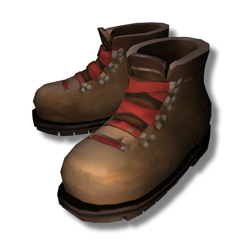
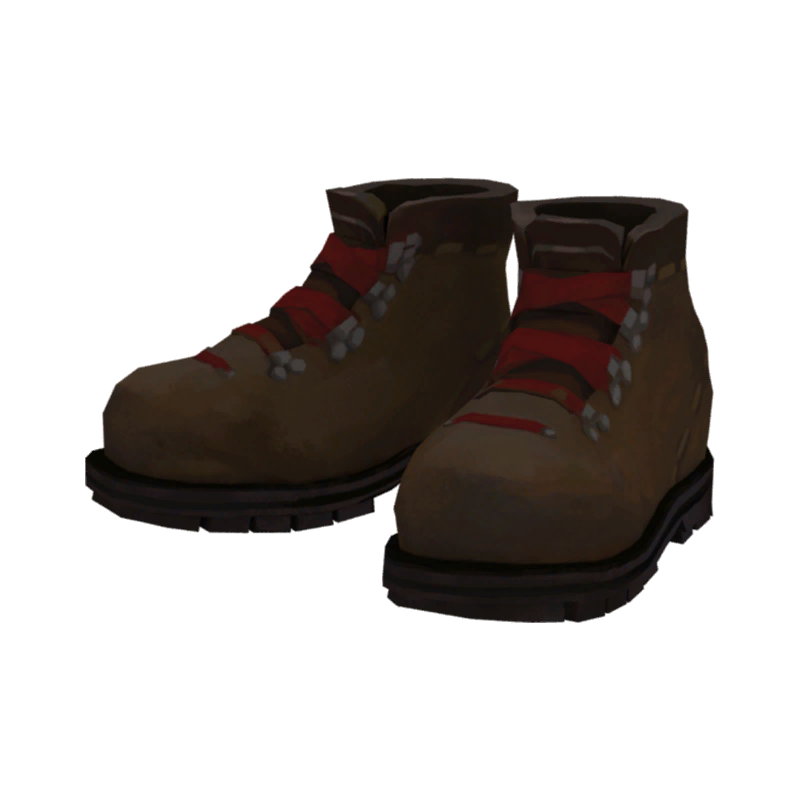
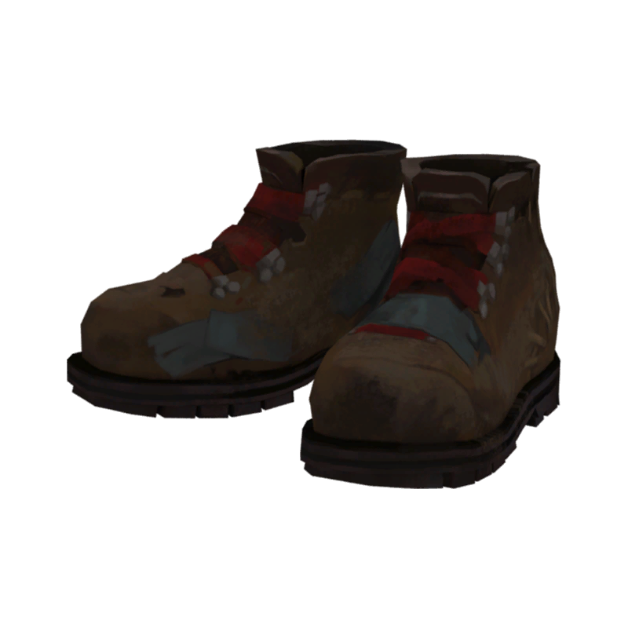

# Trail Boots

<table class="infobox">
<caption>Trail Boots</caption>
<colgroup>
<col style="width: 50%" />
<col style="width: 50%" />
</colgroup>
<tbody>
<tr>
<td colspan="2"><figure>

<figcaption>Trail_Boots_icon.png</figcaption>
</figure></td>
</tr>
<tr>
<td colspan="2" class="section">
<strong>General</strong>
</td>
</tr>
<tr>
<td>
Item Type
</td>
<td>
Clothing|-
</td>
</tr>
<tr>
<td>
Clothing Slot
</td>
<td>
Outer feet
</td>
</tr>
<tr>
<td colspan="2" class="section">
<strong>Statistics</strong>
</td>
</tr>
<tr>
<td>
Weight
</td>
<td>
1.00 kg(2.2 lbs)
</td>
</tr>
<tr>
<td>
Warmth bonus
</td>
<td>
1.0 °C(1.8 °F)
</td>
</tr>
<tr>
<td>
Windproof bonus
</td>
<td>
1.0 °C(1.8 °F)
</td>
</tr>
<tr>
<td>
Waterproof bonus
</td>
<td>
30%
</td>
</tr>
<tr>
<td>
Protection
</td>
<td>
5%
</td>
</tr>
<tr>
<td>
Mobility
</td>
<td>
-3%
</td>
</tr>
<tr>
<td>
Harvest
</td>
<td>
1 × <a href="./Cured%20Leather.md" class="wikilink" title="Cured leather">Cured leather</a> 
90 minutes
</td>
</tr>
<tr>
<td>
Repair
</td>
<td>
1 × <a href="./Cured%20Leather.md" class="wikilink" title="Cured leather">Cured leather</a> 
30 minutes 
25% condition
</td>
</tr>
</tbody>
</table>

<table>
<colgroup>
<col style="width: 33%" />
<col style="width: 33%" />
<col style="width: 33%" />
</colgroup>
<tbody>
<tr>
<td style="vertical-align: top; font-size: 3em; color: #5d5980; padding-right: 10px">
“
</td>
<td>
Rugged leather hiking boot. Designed to last for long-distance journeys on rocky terrain. Leather upper and heavy rubber sole.

&#10;

In-game description

</td>
<td style="vertical-align: bottom; font-size: 3em; color: #5d5980; padding-left: 10px">
”
</td>
</tr>
</tbody>
</table>

**Trail Boots** are a type of <a href="./Clothing.md" class="wikilink" title="footwear">footwear</a> in *The Long Dark*.

## Usefulness

Trail Boots are low-tier footwear and provide very little warmth for their weight, but decent protection against struggles and water. They are relatively easy to find, and are a common early game upgrade when clothing weight and mobility is less important but protection against predators is pivotal.

From a warmth perspective they are not much better than <a href="./Leather%20Shoes.md" class="wikilink" title="Leather Shoes">Leather Shoes</a> and <a href="./Running%20Shoes.md" class="wikilink" title="Running Shoes">Running Shoes</a>. Trail Boots weigh twice as much and only give a very small extra <a href="./Survival%20Overlay.md" class="wikilink" title="windproofing">windproofing</a> compared to them.

Counterintuitively, while bulkier and heavier than similar footwear they only require 1 <a href="./Cured%20Leather.md" class="wikilink" title="cured leather">cured leather</a> to repair, but also only yield 1 cured leather when harvested.

## Gallery

<table class="gallery">
<colgroup>
<col style="width: 33%" />
<col style="width: 33%" />
<col style="width: 33%" />
</colgroup>
<tbody>
<tr>
<td><figure>
[Missing image: Basic_boots_(historical).png]
<figcaption>Trail Boots old model</figcaption>
</figure></td>
<td><figure>

<figcaption>Clothing model icon</figcaption>
</figure></td>
<td><figure>

<figcaption>Clothing model icon damaged</figcaption>
</figure></td>
</tr>
</tbody>
</table>

## Update history

- UPDATE **19 December 2016 (<a href="./The%20Long%20Dark%20%E2%80%94%20Early%20Access%20Changelog.md#0.386" class="wikilink" title="Update">Update</a>):**
  - Renamed from *Leather Boots* to *Trail Boots*

**Lua execution error in Module:Navbox function navbox** <a href="ru:%D0%9F%D0%BE%D1%85%D0%BE%D0%B4%D0%BD%D1%8B%D0%B5_%D0%B1%D0%BE%D1%82%D0%B8%D0%BD%D0%BA%D0%B8" class="wikilink" title="ru:Походные ботинки">ru:Походные ботинки</a>

