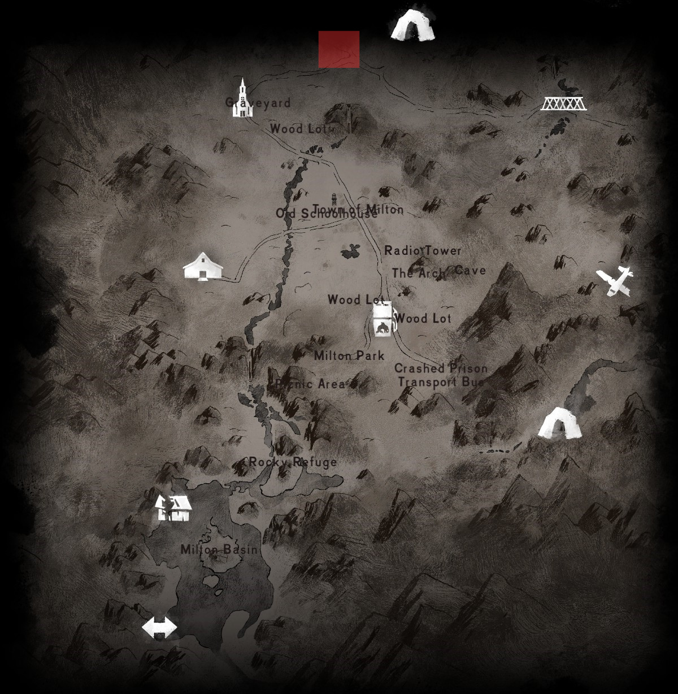
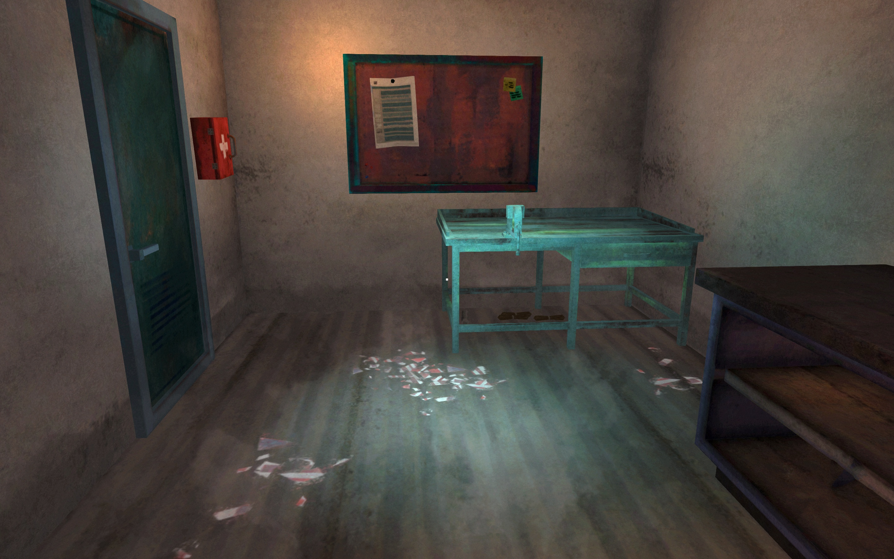

# Trailer \(Mountain Town Region\)

**Categories:** Indoor locations, Locations, Locations in Mountain Town, Locations with a workbench · **Source:** [Fandom](https://thelongdark.fandom.com/wiki/Trailer_%28Mountain_Town_Region%29)

**Trailer**

\[\[File: /  / _Exterior_ /  / _Interior_

250px\]\]

**Location**

_Trailer\_MT\_Location.png_

Region

[Mountain Town](./Mountain%20Town.md)

Location

**General**

**Firebox:** [Fire Barrel](./Fire%20Barrel.md)

_bed\_icon.png_

Has a bed

_workbench\_icon\_green.png_

Has a workbench

## Overview

It is a safe place to hunt the [Moose](./Moose.md) nearby and the [Bear](./Bear.md) of [Spruce Falls Bridge](./Spruce%20Falls%20Bridge.md). There is a lot of wood to make fire in front of the building, and a [Deer](./Deer.md) may also venture near the mobile home, and [Ptarmigan](./Ptarmigan.md) nest in the field nearby. The area is also free of [Wolves](./Wolf.md), making it a decent option for a base camp. Inside, there's also a [Work Bench](./Work%20Bench.md), and out back, there's a [Fire Barrel](./Fire%20Barrel.md).

It is the last human-made structure before entering [Hushed River Valley](./Hushed%20River%20Valley.md), as well as the closest workbench to said region.

## Gallery

_Mobile\_Home\_3.png_

_Mobile\_Home\_2.png_

_Vigilant flame new workbench in Trailer. Nearby Hushed River Valley._

_Trailer position on Mountain Town map_
