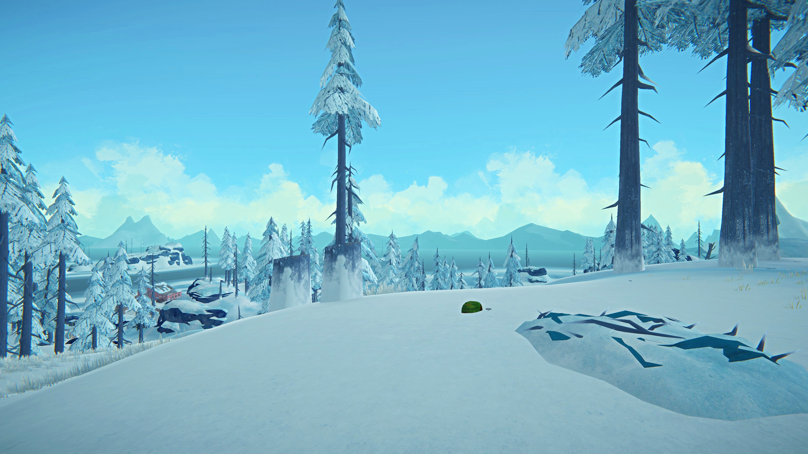

# Trailers west of the Cannery

**Categories:** Indoor locations, Locations, Locations in Bleak Inlet, Residential locations, Unofficial locations, Unofficially named content · **Source:** [Fandom](https://thelongdark.fandom.com/wiki/Trailers_west_of_the_Cannery)

**Trailers west of the Cannery**

_SS-BI-Trailer02.jpg_

**Location**

_Trailers\_west\_of\_the\_Cannery\_Location.png_

**Region:** [Bleak Inlet](./Bleak%20Inlet.md)

**Description:** This place has no official name

**General**

**Type:** Residential

_Local\_Legends\_-\_The\_Lost\_Cave\_icon.png_

**This article's name is conjectural.** / Although this article is based on information contained within [The Long Dark](./The%20Long%20Dark.md), the actual name of this subject is pure conjecture

_Trailers_

_Trailers_

_Abandoned camp site and View from the hilltop (to the north of the trailer)_
