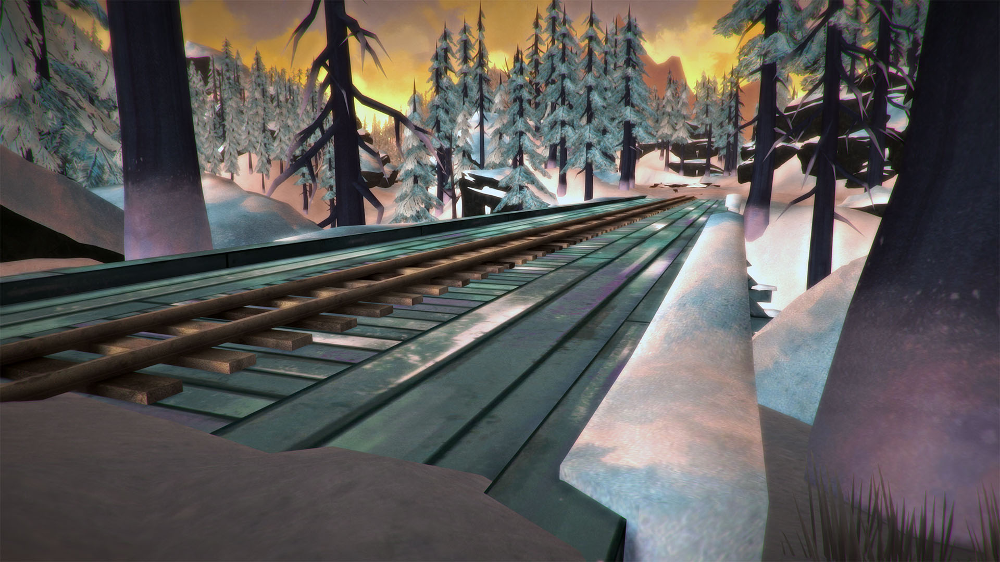

# Train Bridge

**Categories:** Landmarks, Locations, Locations in Mystery Lake, Outdoor locations · **Source:** [Fandom](https://thelongdark.fandom.com/wiki/Train_Bridge)

**Train Bridge**

**Location**

**Region:** [Mystery Lake](./Mystery%20Lake%20%28region%29.md)

**Type:** Landmark

## Overview

Train Bridge is between [Carter Hydro Dam](./Carter%20Hydro%20Dam.md) and [Train Loading Area](./Train%20Loading%20Area.md).

[Green Maple Sapling](./Green%20Maple%20Sapling.md) [cattail](./Cat%20Tail.md) plants, and [reishi mushrooms](./Reishi%20Mushroom.md) can be found by the shore below the bridge.

Under the bridge, a [frozen corpse](./Frozen%20Corpse.md) and a [rifle](./Hunting%20Rifle.md) leaning against the supports can sometimes be found, along with a burned-out campfire.

Following the tracks east will lead you to [The Ravine](./The%20Ravine.md), and west to Train Loading Area, [Derailment](./Derailment.md), and [Camp Office](./Camp%20Office.md).
