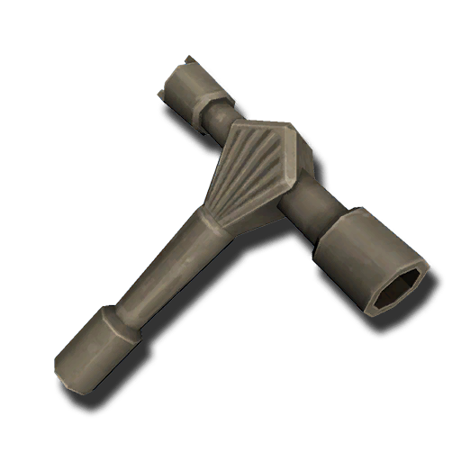

# Train Key

**Categories:** Collectibles, DLC Content · **Source:** [Fandom](https://thelongdark.fandom.com/wiki/Train_Key)

**DLC-Exclusive content.** This content requires the [Iron Road](./Iron%20Road.md) addon to be installed before it can be seen or used in regular gameplay.

 **Train Key**  **Release:** [Iron Road Part 1](./The%20Long%20Dark%20%E2%80%94%20Changelog.md#2.58) **Properties** **Item type:** [Collectibles](./Collectibles.md)\\|- **Stackable:** No **Examine:** A mechanical key to unlock a Train. **Values** **Weight:** 0.00 kg (0 lbs) **Actions** **Backpack:** Examine **On ground:** Take It, Read Text, Leave It **Train Key** is a [Collectible](./Collectibles.md) in [Survival Mode](./Survival%20Mode.md) as part of the [Iron Road](./Iron%20Road.md) expansion. It is found in [Anna Island -- Track Section 6](./Anna%20Island%20--%20Track%20Section%206.md) at the [Train Shelter](./Train%20Shelter.md). The key is used to permanently unlock the doors to the nearby [Prototype Train](./Prototype%20Train.md).

## Game history
