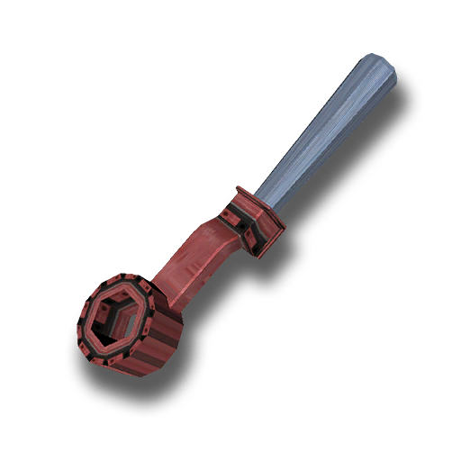

# Train Lever

**Categories:** Collectibles, Pages with update history · **Source:** [Fandom](https://thelongdark.fandom.com/wiki/Train_Lever)

**Train Lever**

_Train\_Lever\_icon.png_

**Release:** [31 March 2026](./The%20Long%20Dark%20%E2%80%94%20Changelog.md#2.52)

**Wintermute:** [Episode 5: The Light At The End Of All Things](./Episode%205%20-%20The%20Light%20At%20The%20End%20Of%20All%20Things.md)

**Properties**

**Item type:** [Collectibles](./Collectibles.md)

**Stackable:** No

**Examine:** A steam engine throttle Lever. Old, worn, but sturdy looking. Belongs in a train, not on a shelf.

**Values**

**Weight:** 0.25 kg (0.55 lbs)

**Actions**

**Backpack:** Examine

**On ground:** Take It, Read Text, Leave It

**Train Lever** is a [Collectibles](./Collectibles.md) found in [Episode 5](./Episode%205%20-%20The%20Light%20At%20The%20End%20Of%20All%20Things.md) of the [Wintermute](./Wintermute.md) story. It is found inside the maintenance shed on a display board during the mission [To SAR And Back](./To%20SAR%20And%20Back.md). It is used to change the [Steam Locomotive](./Steam%20Train.md) throttle and must be recovered to make it operational again.

## Update history

\* UPDATE **31 March 2026 ([Update](./The%20Long%20Dark%20%E2%80%94%20Changelog.md#2.52)):**

  - Added to game.
