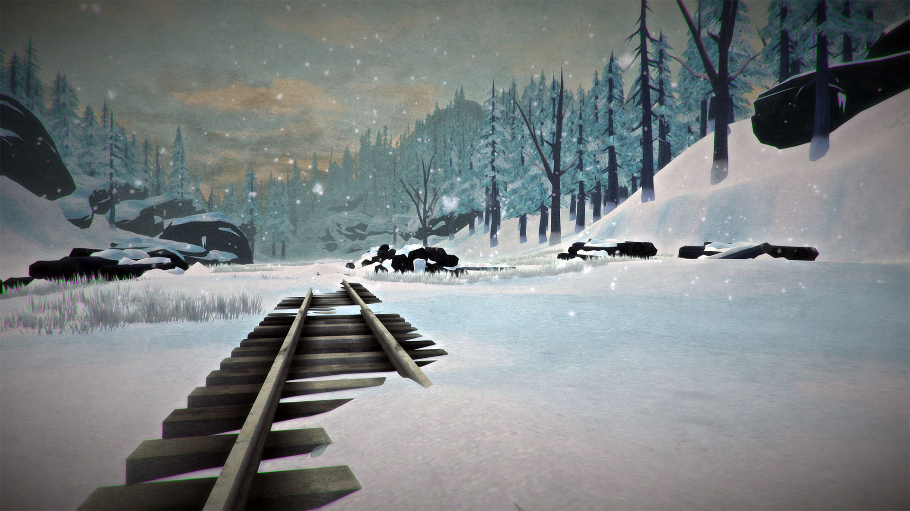
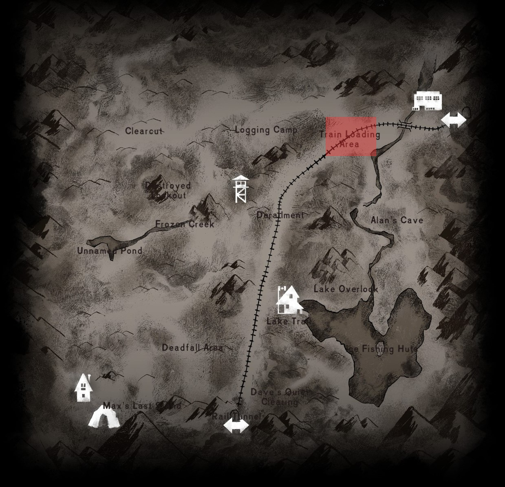
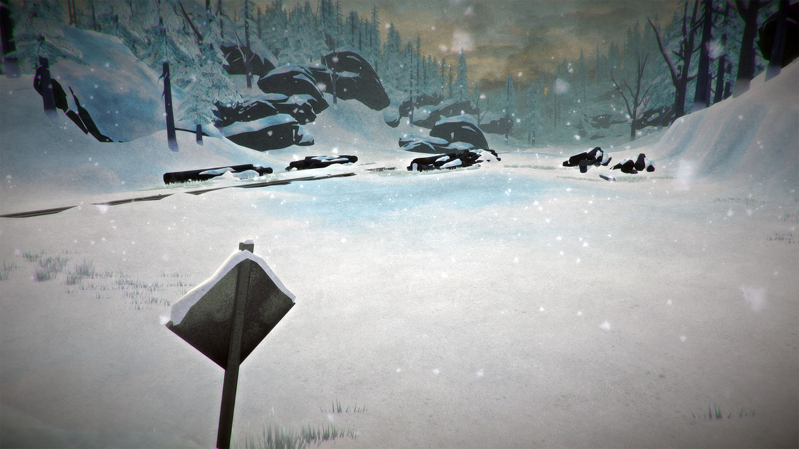

# Train Loading Area

**Categories:** Landmarks, Locations, Locations in Mystery Lake, Outdoor locations · **Source:** [Fandom](https://thelongdark.fandom.com/wiki/Train_Loading_Area)

**Train Loading Area**

_Train\_Loading\_Area\_1.jpg_

**Location**

_Train\_Loading\_Area\_Location.png_

**Region:** [Mystery Lake](./Mystery%20Lake%20%28region%29.md)

**Type:** Landmark

## Overview

The Train Loading Area is where lumber was once loaded onto trains to be transported elsewhere. It is located just west of [Train Bridge](./Train%20Bridge.md) and north-east of [Derailment](./Derailment.md).

The only loot is a corpse, and a deer carcass that can be found sometimes lying in the snow by the side of the railroad, other than that it only serves as a landmark.

A [Train Shuttle](./Train%20Shuttle.md) can be entered to escape wolves, and often contains loot.

## Gallery

_An alternative view of Train Loading Area._
