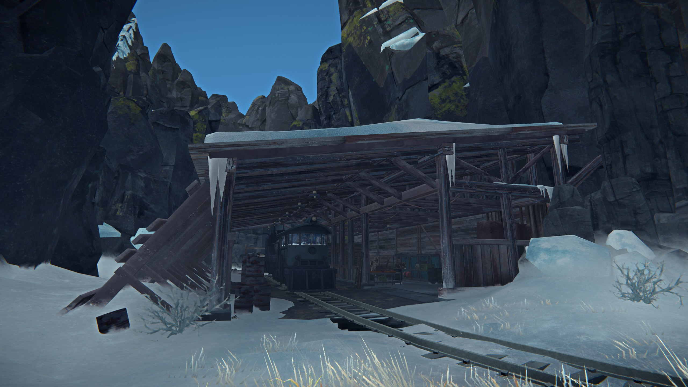
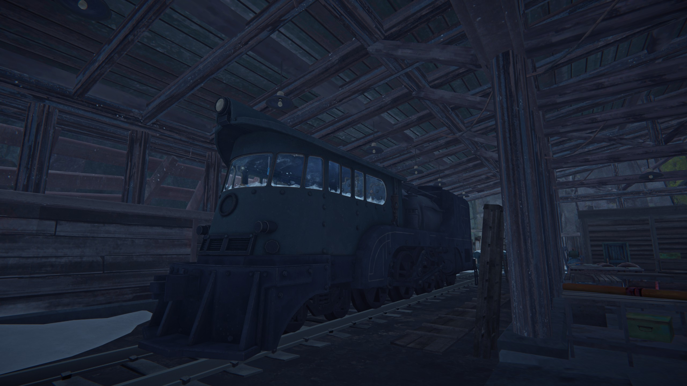

# Train Shelter

| Column 1 | Column 2 | Column 3 | Column 4 |
| --- | --- | --- | --- |
|  / *Seal\_icon.png* | **DLC-Exclusive content.** / This content requires the [Iron Road](./Iron%20Road.md) addon to be installed before it can be seen or used in regular gameplay. | \|} / **Train Shelter** / \| Property \| Details \| / \| --- \| --- \| / \|  \|  / *Train\_Shelter.jpg* \| / \| **Location** \|  \| / \|  \|  / *Train\_Shelter\_Location.png* \| / \| Region \| [Anna Island -- Track Section 6](./Anna%20Island%20--%20Track%20Section%206.md)\\|- \| / \| Description \| A Train repair station hidden in the mountains. \| / \| **General** \|  \| / \| Firebox \| [Pot Belly Stove](./Pot%20Belly%20Stove.md) [Fire Barrel](./Fire%20Barrel.md) \| / \|  / *bed\_icon.png* \| Has a bed \| / \|  \| Has an interior\\|} **Train Shelter** is the sole named location in [Anna Island -- Track Section 6](./Anna%20Island%20--%20Track%20Section%206.md). / ## Overview / An isolated shelter that was used by Alice McLeod to hide the [Prototype Train](./Prototype%20Train.md). This location is the only marked location on the entire map. / The Train Shelter itself has very few resources that can be picked up or harvested. Items of note include: / - A [Fire Barrel](./Fire%20Barrel.md) can be found along with 2 [Metal Containers](./Metal%20Container.md) in the middle area, along with some [Scrap Metal](./Scrap%20Metal.md). / - A small shelter at the back of the Train Shelter. / - There is a single bed, [Pot Belly Stove](./Pot%20Belly%20Stove.md), and [Bed](./Bed.md) at the shelter at the Train Shelter. 3 [Carrots](./Carrot.md) and a [Heavy Hammer](./Heavy%20Hammer.md) can also be found inside. / - Several Clothes and some [Drawers](./Drawer.md). / - A [Wax Cylinder 7](./Wax%20Cylinder%207.md), [Train Key](./Train%20Key.md), and [Alice McLeod's Journal 01](./Alice%20McLeod%27s%20Journal%2001.md) can all be found on the same table. / The Train Shelter's home cannot be used for [Safehouse Customization](./Safehouse%20Customization.md). / ## Gallery / \\| Column 1 \\| Column 2 \\| Column 3 \\| Column 4 \\| / \\| --- \\| --- \\| --- \\| --- \\| / \\|  / *The Train Shelter upon first approach* \\|  / *The Train Shelter* \\|  / *Finding the Prototype Train in the Shelter* \\|  / *The small house inside the Train Shelter* \\| / \\|  / *Train Shelter interior* \\|  \\|  \\|  \\| / **Lua execution error in Module:Navbox function navbox** \| / \|  / *The Train Shelter upon first approach* \|  / *The Train Shelter* /  / *Finding the Prototype Train in the Shelter* /  / *The small house inside the Train Shelter* \| / \|  / *Train Shelter interior* \|  \| |  |
|  / *Train\_Shelter.jpg* |  |  |  |
| **Location** |  |  |  |
|  / *Train\_Shelter\_Location.png* |  |  |  |
| Region | [Anna Island -- Track Section 6](./Anna%20Island%20--%20Track%20Section%206.md)\|- |  |  |
| Description | A Train repair station hidden in the mountains. |  |  |
| **General** |  |  |  |
| Firebox | [Pot Belly Stove](./Pot%20Belly%20Stove.md) [Fire Barrel](./Fire%20Barrel.md) |  |  |
|  / *bed\_icon.png* | Has a bed |  |  |
|  | Has an interior\|} **Train Shelter** is the sole named location in [Anna Island -- Track Section 6](./Anna%20Island%20--%20Track%20Section%206.md). / ## Overview / An isolated shelter that was used by Alice McLeod to hide the [Prototype Train](./Prototype%20Train.md). This location is the only marked location on the entire map. / The Train Shelter itself has very few resources that can be picked up or harvested. Items of note include: / - A [Fire Barrel](./Fire%20Barrel.md) can be found along with 2 [Metal Containers](./Metal%20Container.md) in the middle area, along with some [Scrap Metal](./Scrap%20Metal.md). / - A small shelter at the back of the Train Shelter. / - There is a single bed, [Pot Belly Stove](./Pot%20Belly%20Stove.md), and [Bed](./Bed.md) at the shelter at the Train Shelter. 3 [Carrots](./Carrot.md) and a [Heavy Hammer](./Heavy%20Hammer.md) can also be found inside. / - Several Clothes and some [Drawers](./Drawer.md). / - A [Wax Cylinder 7](./Wax%20Cylinder%207.md), [Train Key](./Train%20Key.md), and [Alice McLeod's Journal 01](./Alice%20McLeod%27s%20Journal%2001.md) can all be found on the same table. / The Train Shelter's home cannot be used for [Safehouse Customization](./Safehouse%20Customization.md). / ## Gallery / \| Column 1 \| Column 2 \| Column 3 \| Column 4 \| / \| --- \| --- \| --- \| --- \| / \|  / *The Train Shelter upon first approach* \|  / *The Train Shelter* \|  / *Finding the Prototype Train in the Shelter* \|  / *The small house inside the Train Shelter* \| / \|  / *Train Shelter interior* \|  \|  \|  \| / **Lua execution error in Module:Navbox function navbox** |  |  |
|  / *The Train Shelter upon first approach* |  / *The Train Shelter* |  / *Finding the Prototype Train in the Shelter* |  / *The small house inside the Train Shelter* |
|  / *Train Shelter interior* |  |  |  |
