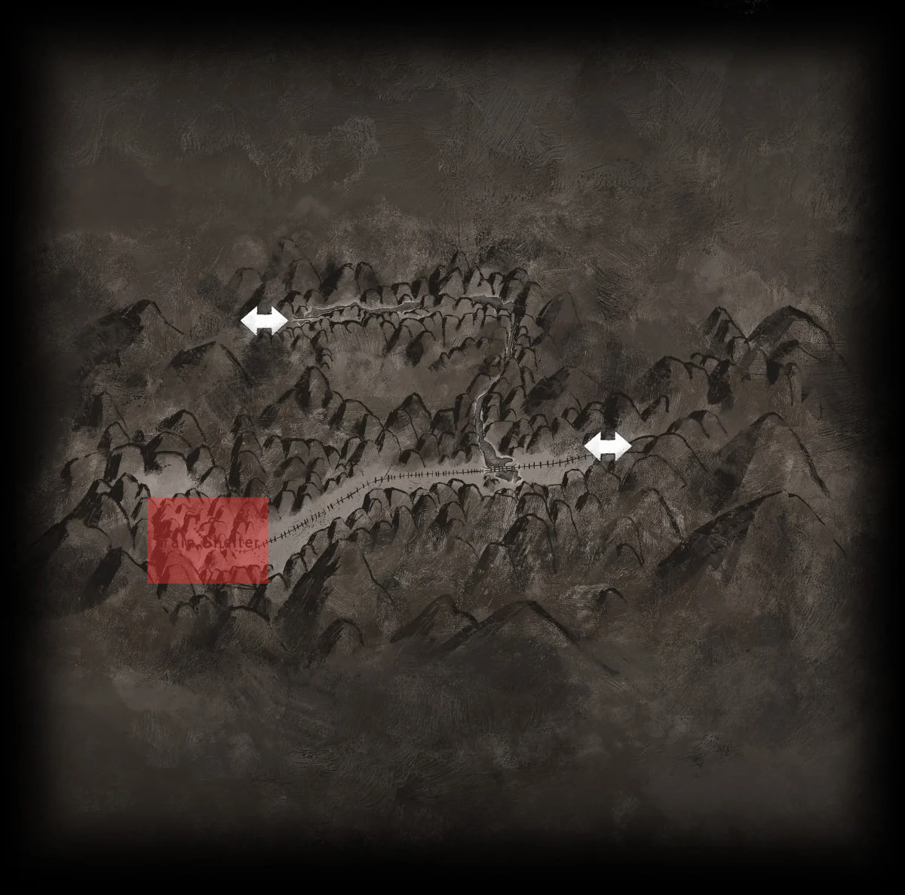
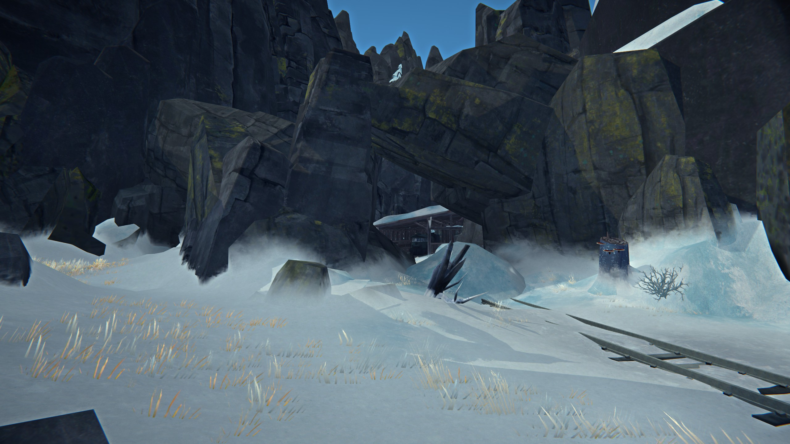
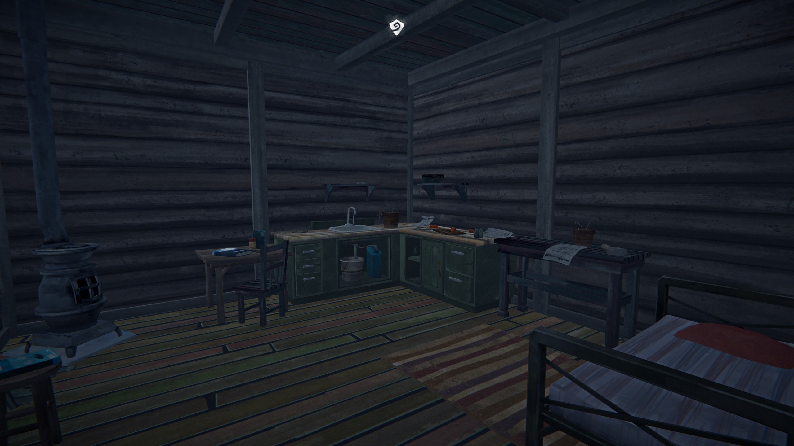
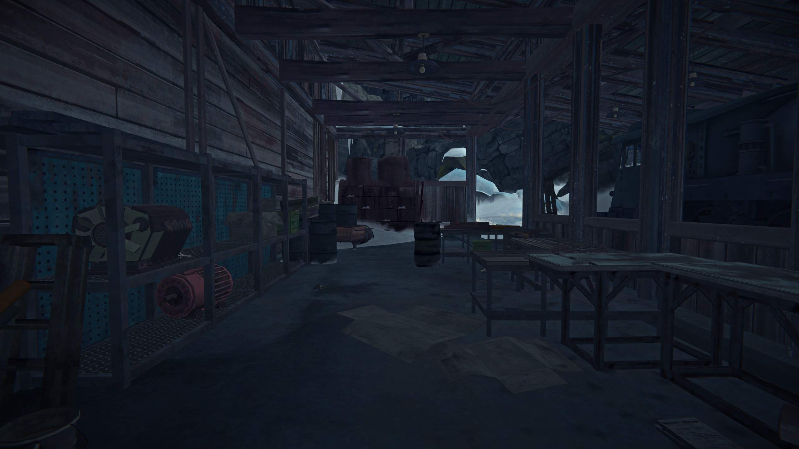

# Train Shelter

**Categories:** DLC Content, Indoor locations, Locations, Locations in Anna Island -- Track Section 6 · **Source:** [Fandom](https://thelongdark.fandom.com/wiki/Train_Shelter)

_Seal\_icon.png_

**DLC-Exclusive content.** / This content requires the [Iron Road](./Iron%20Road.md) addon to be installed before it can be seen or used in regular gameplay.

_Train\_Shelter.jpg_

**Location**

_Train\_Shelter\_Location.png_

**Region:** [Anna Island -- Track Section 6](./Anna%20Island%20--%20Track%20Section%206.md)\|-

**Description:** A Train repair station hidden in the mountains.

**General**

**Firebox:** [Pot Belly Stove](./Pot%20Belly%20Stove.md) [Fire Barrel](./Fire%20Barrel.md)

_bed\_icon.png_

Has a bed

_The Train Shelter upon first approach_

_The Train Shelter_

_Finding the Prototype Train in the Shelter_

_The small house inside the Train Shelter_

_Train Shelter interior_
