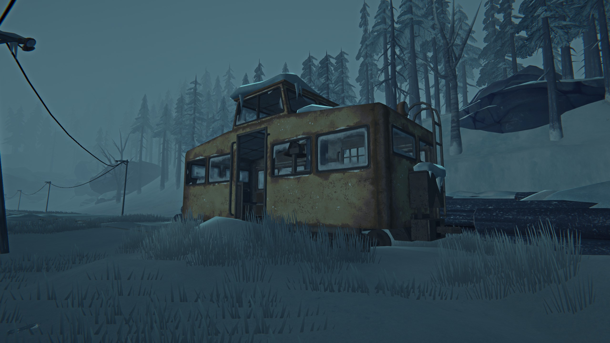
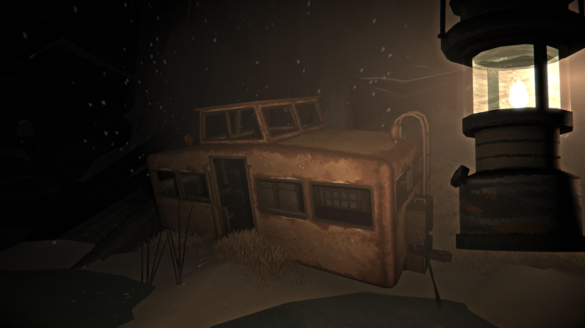

# Train Shuttle

**Categories:** Interactable Objects · **Source:** [Fandom](https://thelongdark.fandom.com/wiki/Train_Shuttle)

 **Train Shuttles** are a stationary [Vehicle](./Vehicle.md) found at various points along the [Trans-Island Railway Line](./Trans-Island%20Railway%20Line.md). Train Shuttle Cars provide temporary shelter and possible loot spawns. They contain a single door that can be opened and closed. While the inside lacks a warmth bonus compared to caves or buildings, they do provide a windshield bonus if stepped inside. They make for poor shelters, but they can often be used to prevent hostile Wolves from attacking the player by simply walking inside and closing the door on them as they approach.

Shuttle Cars can serve as temporary outdoor shelters to sleep in if a player has a Bedroll, though their lack of warmth must be taken into consideration before they are slept in, in order to prevent freezing to death of a player sleeps for long periods of time.

Shuttles often contain [Clothing](./Clothing.md), [Research Books](./Research%20Book.md), [Leather](./Cured%20Leather.md), [Cloth](./Cloth.md), [Sodas](./Soda%20%28disambiguation%29.md), [Flares](./Flare.md), First Aid supplies, and very rarely a [Distress Pistol](./Distress%20Pistol.md) box (only at Ravine Basin).

5 can be found in the following locations:

- At the bottom of [Ravine Basin](./Ravine%20Basin.md) in [The Ravine](./The%20Ravine.md)
- [Train Unloading](./Train%20Unloading.md) ([Mystery Lake (region)](./Mystery%20Lake%20%28region%29.md))
- Near the [Broken Bridge (Broken Railroad location)](./Broken%20Bridge%20%28Broken%20Railroad%20location%29.md)
- At the end of [Surfeit Trestle](./Surfeit%20Trestle.md) ([Far Range Branch Line](./Far%20Range%20Branch%20Line.md))
- Near [Idle Camp](./Idle%20Camp.md) ([Zone of Contamination](./Zone%20of%20Contamination.md))

## Trivia

[Will Mackenzie](./Will%20Mackenzie.md) hides inside one in [Episode 2: Luminance Fugue](./Episode%202%20-%20Luminance%20Fugue.md) to escape the [Old Bear](./Old%20Bear.md) while in [Broken Railroad](./Broken%20Railroad.md).

