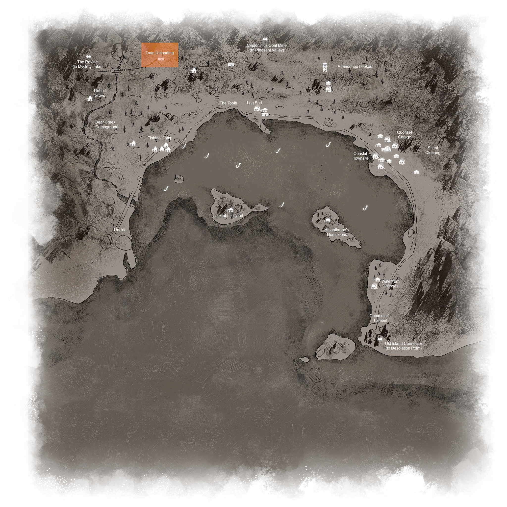

# Train Unloading

**Categories:** Indoor locations, Locations, Locations in Coastal Highway, Outdoor locations · **Source:** [Fandom](https://thelongdark.fandom.com/wiki/Train_Unloading)

**Train Unloading**

\[\[File: /  / _Train\_Unloading.jpg_

250px\]\]

**Location**

_Train\_Unloading\_map.png_

Region

[Coastal Highway](./Coastal%20Highway.md)

Location

**General**

Type

Outdoors

_bed\_icon.png_

Has an interior **Train Unloading** is a location in [Coastal Highway](./Coastal%20Highway.md).

## Overview

Train Unloading is located in the northernmost area of the region and to the east of the train tracks leading from [The Ravine](./The%20Ravine.md).

Train Unloading's only building is a simple trailer with modest supplies. A [frozen corpse](./Frozen%20Corpse.md) and possibly a [pry bar](./Prybar.md) may be found on the ground nearby.
