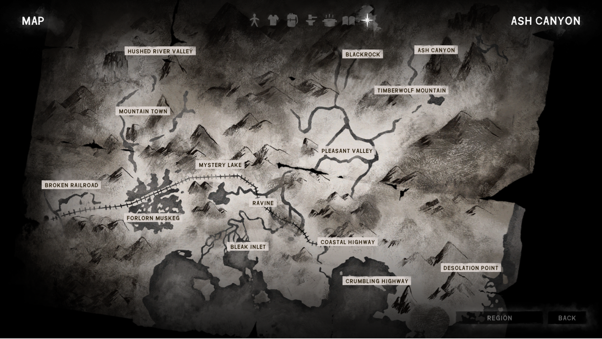

# Trans\-Island Railway Line

**Contents**

- [Overview](#Overview)
- [History](#History)
- [Features](#Features)
- [Zone of Contamination](#Zone_of_Contamination)
- [Transfer Pass](#Transfer_Pass)
- [Far Range Branch Line](#Far_Range_Branch_Line)
- [Broken Railroad](#Broken_Railroad)
- [Forlorn Muskeg](#Forlorn_Muskeg)
- [Mystery Lake](#Mystery_Lake)
- [The Ravine](#The_Ravine)
- [Coastal Highway](#Coastal_Highway)
- [Gallery](#Gallery)

The **Trans-Island Railway Line**, known officially as the **Far Range Branch Line** (not to be confused with the <a href="./Far%20Range%20Branch%20Line.md" class="wikilink" title="region of the same name">region of the same name</a>), is a major landmark located in multiple regions across <a href="./Great%20Bear%20Island.md" class="wikilink" title="Great Bear Island">Great Bear Island</a>.

## Overview

The Trans-Island Railway Line can be found in 6 regions and 2 Transition Zones. They are (in order from one end of the line to the other):

- <a href="./Zone%20of%20Contamination.md" class="wikilink" title="Zone of Contamination">Zone of Contamination</a>
- <a href="./Transfer%20Pass.md" class="wikilink" title="Transfer Pass">Transfer Pass</a>
- <a href="./Far%20Range%20Branch%20Line.md" class="wikilink" title="Far Range Branch Line">Far Range Branch Line</a>
- <a href="./Broken%20Railroad.md" class="wikilink" title="Broken Railroad">Broken Railroad</a>
- <a href="./Forlorn%20Muskeg.md" class="wikilink" title="Forlorn Muskeg">Forlorn Muskeg</a>
- <a href="./Mystery%20Lake%20%28region%29.md" class="wikilink" title="Mystery Lake">Mystery Lake</a>
- <a href="./The%20Ravine.md" class="wikilink" title="The Ravine">The Ravine</a>
- <a href="./Coastal%20Highway.md" class="wikilink" title="Coastal Highway">Coastal Highway</a>

## History

The **Trans-Island Railway Line** is a logging and light freight railway line which runs across the majority of Great Bear Island. It was likely built during the early 20th century, but fell into disrepair and was abandoned following the seismic activity which occurred before <a href="./The%20Collapse.md" class="wikilink" title="The Collapse">The Collapse</a>.

It was constructed to provide a quick and efficient way to transport both supplies from deep within the Far Territory to the coast, as well as to provide a land route to ferry passengers via <a href="./Train%20Shuttle.md" class="wikilink" title="Train Shuttles">Train Shuttles</a>. Though not mentioned anywhere specifically in-game, abandoned rail cars suggest the line was used to transport resources such as timber, coal, ore, and the occasional workforce passengers.

Most of the railway line lies in ruins and is entirely unfit for even a basic push railcar, as can be seen first hand if the player walks the line from region to region in <a href="./Survival%20Mode.md" class="wikilink" title="Survival Mode">Survival Mode</a>. The railroad is plagued with an incredible amount of disrepair, including but not limited to:

1.  Large landslides burying the rails in rock.
2.  Cliffside rail lines having collapsed into a ravine.
3.  Partially or even fully collapsed train tunnels.
4.  Sinkholes having swallowed the line (One section in Forlorn Muskeg)
5.  Partially or severely damaged bridge trestles.
6.  Various abandoned boxcars/logging cars/flatbed cars/passenger rail cars/rail mounted trucks already present on or derailed near the line.
7.  Various sections of rail buried in heavy snow.
8.  Bent or broken train track.
9.  Toxic Chemical Spills (in the Zone of Contamination only)

## Features

<figure>
[Missing image: Trans-Island_Line_Engine.jpg]
<figcaption>XTHUMB A train engine bearing the Trans-Island Line logo.</figcaption>
</figure>

### Zone of Contamination

The rail line begins in the local <a href="./Langston%20Mine.md" class="wikilink" title="Langston Mine">Langston Mine</a> complex, starting at a train station near <a href="./Indolent%20Hoppers.md" class="wikilink" title="Indolent Hoppers">Indolent Hoppers</a> and heading towards Lower Great Bear. Several spilled chemicals and landslides make navigating the tracks hazardous in this region.

### Transfer Pass

Extending deep into the inner territory of Great Bear, the explorable portion of the Trans-Island Railway begins at massive <a href="./Immutable%20Hesitation.md" class="wikilink" title="landslide">landslide</a>. Following from here, the railroad passes through a <a href="./Vacant%20Depot.md" class="wikilink" title="passenger train station and loading depot">passenger train station and loading depot</a>, before heading into a <a href="./Distempered%20Flatcars.md" class="wikilink" title="large derailment">large derailment</a> of timber rail cars and eventually passing through another rockslide. A nearby cave must be explored to reach the next region.

### Far Range Branch Line

Continuing passed the landslide, the line passes over an <a href="./Surfeit%20Trestle.md" class="wikilink" title="intact trestle">intact trestle</a> and through a pitch dark train tunnel filled with collapsed tunnels and derelict boxcars. The tunnel transitions to the Broken Railroad Region. This region contains the most undamaged section of railroad of any region.

### Broken Railroad

The railway line is seen prominently in Broken Railroad, beginning at the previous train tunnel and passing over a <a href="./Broken%20Bridge%20%28Broken%20Railroad%20location%29.md" class="wikilink" title="Destroyed Bridge">Destroyed Bridge</a>, and stretching across the region. The line here is interrupted at multiple points by <a href="./Landslide.md" class="wikilink" title="Landslides">Landslides</a>, a passenger rail car, and a truck that has been deployed onto the line. A <a href="./Locomotive%20Engine.md" class="wikilink" title="Locomotive Engine">Locomotive Engine</a> is also found here, being the only one currently in the game. The railroad terminates at a tunnel which transitions to Forlorn Muskeg.

### Forlorn Muskeg

In Forlorn Muskeg the railway line can be seen bisecting the region, running between two tunnels leading to Broken Railroad and Mystery Lake. The line is damaged in multiple places, having collapsed into the marsh in one section. Two major derailments can be found, the first of which is primarily logging cars which can be found near the transition to Broken Railroad. The second is a mostly freight derailment found near the center of the region. This derailment includes the <a href="./Poacher%27s%20Camp.md" class="wikilink" title="Poacher&#39;s Camp">Poacher's Camp</a>. The line in this region terminates in at another region transition train tunnel leading to Mystery Lake.

### Mystery Lake

The Mystery Lake railway runs from Forlorn Muskeg to The Ravine and is in remarkable shape than that of most regions. The line features a boxcar blocking the beginning region transition train tunnel. There is one <a href="./Derailment.md" class="wikilink" title="Derailment">Derailment</a> near the center of the region, consisting of a few cargo boxcars (one of which is accessible.) Further along a small passenger transportation rail vehicle can be found, near the <a href="./Train%20Loading%20Area.md" class="wikilink" title="Train Loading Area">Train Loading Area</a>. The railway also crosses a <a href="./Train%20Bridge.md" class="wikilink" title="Bridge">Bridge</a> near the <a href="./Carter%20Hydro%20Dam.md" class="wikilink" title="Carter Hydro Dam">Carter Hydro Dam</a> (with another rail deployed truck close to the gate) before transitioning to The Ravine via a canyon.

### The Ravine

One of the grandest displays of the railway, The Ravine is home to the <a href="./Raven%20Falls%20Trestle.md" class="wikilink" title="Raven Falls Trestle">Raven Falls Trestle</a> and the <a href="./The%20Ravine.md" class="wikilink" title="Raven Falls Railway Line">Raven Falls Railway Line</a>. The Ravine is notable for featuring a large cliffside derailment, with multiple cars and a small passenger vehicle having fallen into the <a href="./Ravine%20Basin.md" class="wikilink" title="Ravine Basin">Ravine Basin</a>. The Raven Falls Trestle can be found towards the end of the line and is in a slight state of disrepair, having a partially collapsed line in the middle. The line terminates with a tunnel to Coastal Highway, which suffers from a partial ceiling collapse halfway through.

### Coastal Highway

Coastal highway features the terminus of the railway line and is the smallest portion of any region. The line exists only as a small trestle that leads to an <a href="./Train%20Unloading.md" class="wikilink" title="Unloading Area">Unloading Area</a> in the northwest of the region. The line ends with a few timber railcars on the rails and a collapsed tunnel which is completely impassable, and presumably leads to other portions of the island.

## Gallery

<table class="gallery">
<colgroup>
<col style="width: 50%" />
<col style="width: 50%" />
</colgroup>
<tbody>
<tr>
<td><figure>

<figcaption>The railroad in Lower Great Bear</figcaption>
</figure></td>
<td><figure>
[Missing image: Far_Territory_Part_5_Map.jpg]
<figcaption>The railroad in the Far Territory</figcaption>
</figure></td>
</tr>
</tbody>
</table>

**Lua execution error in Module:Navbox function navbox**

