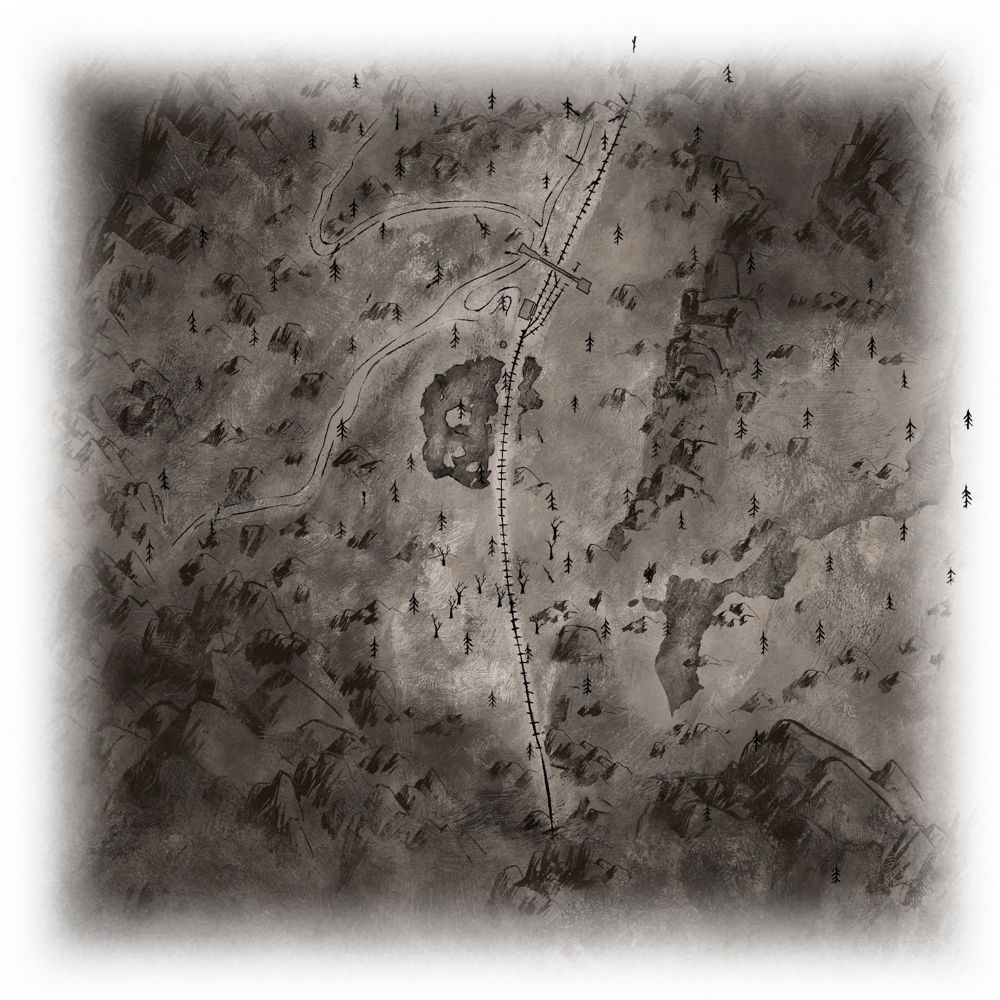

# Transfer Pass

**Categories:** DLC Content, Regions · **Source:** [Fandom](https://thelongdark.fandom.com/wiki/Transfer_Pass)

**Contents**

- [Overview](#overview)
- [Wildlife Availability](#wildlife-availability)
- [Locations](#locations)
- [Trivia](#trivia)
- [Gallery](#gallery)

**Transfer Pass**

_Transfer\_Pass\_Main\_Menu.jpg_

**Location on [Great Bear Island](./Great%20Bear%20Island.md)**

_Transfer\_Pass\_Location.png_

_TransferPass.png_

**Details**

**Description:** An abandoned train depot near the edge of the Far Territory

**Connecting Regions:** [Far Range Branch Line](./Far%20Range%20Branch%20Line.md) (Leads to [Broken Railroad](./Broken%20Railroad.md)) [Forsaken Airfield](./Forsaken%20Airfield.md) / [Zone of Contamination](./Zone%20of%20Contamination.md) / [Sundered Pass](./Sundered%20Pass.md)

**TFTFT paid content:** Yes

**Characters:** None

**Difficulty:** Intermediate

**Interloper Region Spawn:** No

**Locations:** 11

**Date Added:** Dec 5, 2022

_Ptarmigan\_icon.png_

**DLC-Exclusive content.** / This content requires the [Tales from the Far Territory](./Tales%20from%20the%20Far%20Territory.md) addon to be installed before it can be seen or used in regular gameplay.
