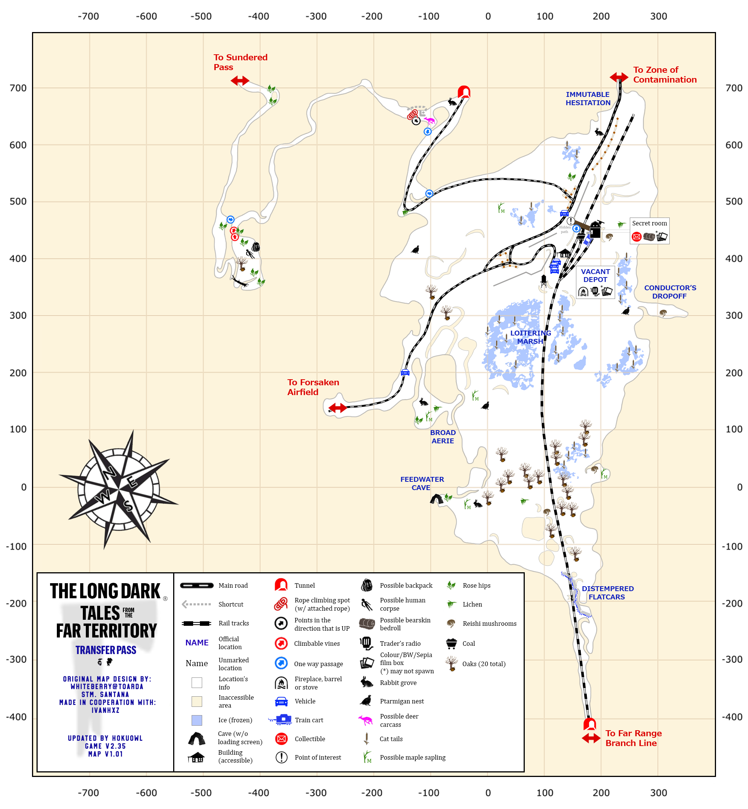
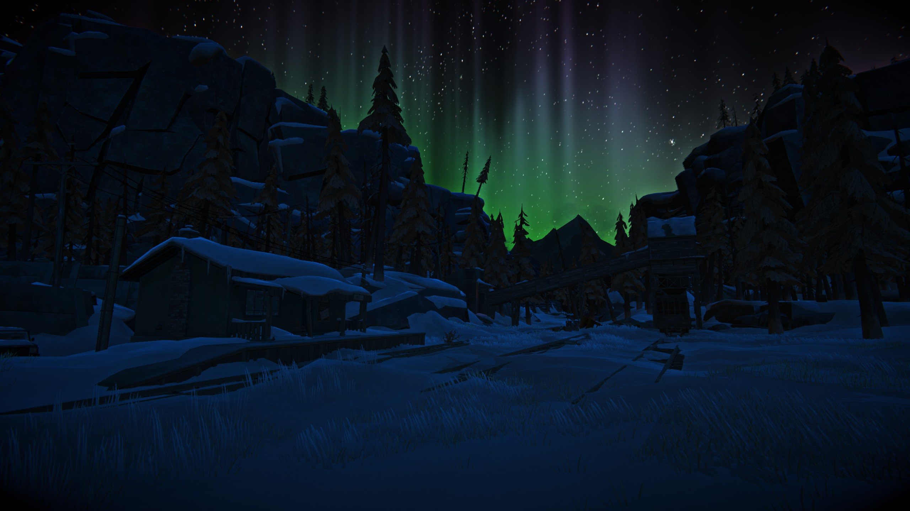
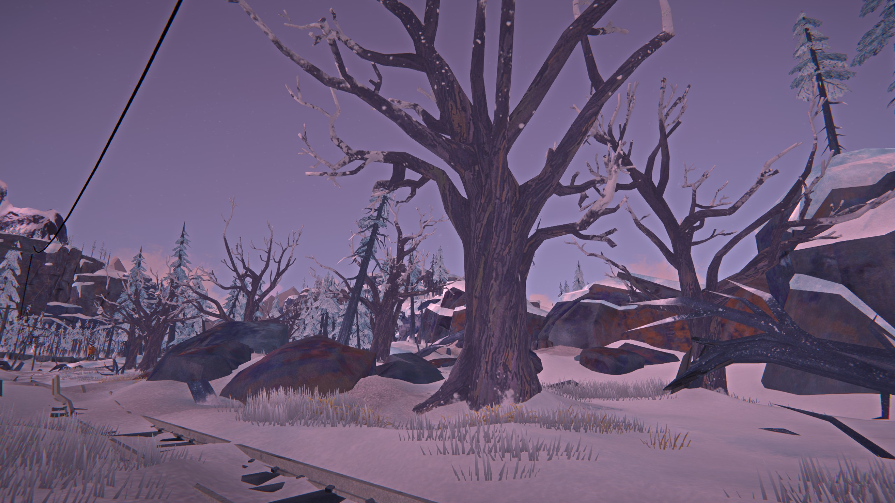
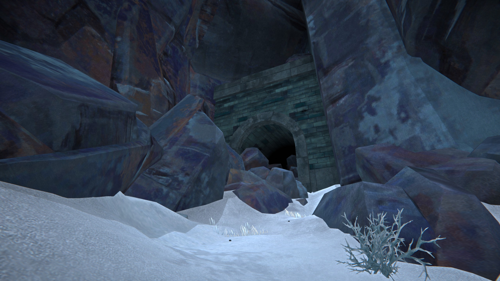

# Transfer Pass

**Categories:** DLC Content, Regions · **Source:** [Fandom](https://thelongdark.fandom.com/wiki/Transfer_Pass)

**Contents**

- [Overview](#overview)
- [Wildlife Availability](#wildlife-availability)
- [Locations](#locations)
- [Trivia](#trivia)
- [Gallery](#gallery)

**Transfer Pass**

| Property | Details |
| --- | --- |
|  | [Transfer Pass Main Menu](../assets/Transfer_Pass_Main_Menu.jpg) |
| **Location on [Great Bear Island](./Great%20Bear%20Island.md)** |  |
|  | [Transfer Pass Location](../assets/Transfer_Pass_Location.png) |
|  | [TransferPass](../assets/TransferPass.png) |
| **Details** |  |
| Description | An abandoned train depot near the edge of the Far Territory |
| Connecting Regions | [Far Range Branch Line](./Far%20Range%20Branch%20Line.md) (Leads to [Broken Railroad](./Broken%20Railroad.md)) [Forsaken Airfield](./Forsaken%20Airfield.md) / [Zone of Contamination](./Zone%20of%20Contamination.md) / [Sundered Pass](./Sundered%20Pass.md) |
| TFTFT paid content | Yes |
| Characters | None |
| Difficulty | Intermediate |
| Interloper Region Spawn | No |
| Locations | 11 |
| Date Added | Dec 5, 2022 |

**DLC-Exclusive content.**

This content requires the [Tales from the Far Territory](./Tales%20from%20the%20Far%20Territory.md) addon to be installed before it can be seen or used in regular gameplay.

> “__For intermediate players. A crossroads dug out of the looming mountains, Transfer Pass is quiet since the trains stopped. But it remains a critical junction for anyone wishing to access the Far Territory.  
   
 Connects to Broken Railroad, Forsaken Airfield, Zone of Contamination, and Sundered Pass.__”
>
> — In-game description

**Transfer Pass** is the 13th [Region](./Region.md) in [_The Long Dark_](./The%20Long%20Dark.md) released for [Survival Mode](./Survival%20Mode.md), and is available for players who purchased the [Tales from the Far Territory](./Tales%20from%20the%20Far%20Territory.md) expansion pack released on December 5, 2022.

Transfer Pass is set-up as a ''hub'' region, connecting to all other regions in the Far Territory. It connects to [Broken Railroad](./Broken%20Railroad.md) via the [Far Range Branch Line](./Far%20Range%20Branch%20Line.md), to [Forsaken Airfield](./Forsaken%20Airfield.md) via a mountain road, to the [Zone of Contamination](./Zone%20of%20Contamination.md) further along the railroad at [Immutable Hesitation](./Immutable%20Hesitation.md), and to [Sundered Pass](./Sundered%20Pass.md) up north on the road after bypassing a collapsed tunnel.

## Overview

Getting its name for originally being a hub for miners flown in from [Field 31](./Field%2031.md) waiting to be shipped to the [Zone of Contamination](./Zone%20of%20Contamination.md), Transfer Pass is a relatively small yet linear region located within the Far Territory of [Great Bear](./Great%20Bear%20Island.md). It serves as the "starting hub" for the deeper regions of the Far Territory. The region features a variety of terrains and is centered around the heavily damaged and decaying [Trans-Island Railway Line](./Trans-Island%20Railway%20Line.md), with an abandoned train station, coal tipple, and water tower near the center.

The railway is littered with dozens of dormant [Oak Trees](./Oak%20Tree.md) and frozen ponds, providing an ample but limited supply of [Acorns](./Acorns.md) (approximately 24 total) and [Cat Tails](./Cat%20Tail.md) (approximately 30 total) to forage, as well as hunting opportunities for [Rabbits](./Rabbit.md) to the North/South, and [Ptarmigan](./Ptarmigan.md) near the East/West edges of the zone, on the in the hills close to the Conductor's Dropoff or Feedwater Cave. A few scattered [Deer](./Deer.md) that roam the nearby mountain roads to the northwest (except on Interloper and above). This region is notable for containing no predators (thus never having to worry about Scent), a unique feature shared only with the [The Ravine](./The%20Ravine.md) region.

The [Weather](./Weather.md) is comparable to other Far Territory areas, with potential storms happening frequently, but [Vacant Depot](./Vacant%20Depot.md) offers a reasonable [safehouse](./Safehouse.md) location.

Given the region's small size and lack of resources, most players will likely use it as a temporary stopover before heading to or from the larger regions of the Far Territory.

## Wildlife Availability

Transfer Pass is one of 2 unique regions that contains no [predators](./Wolf.md) of any type (the second being [The Ravine](./The%20Ravine.md)). Only 3 animals are found in this region.

- [Rabbit](./Rabbit.md) can occasionally be found in the section of the map containing the Ravine's Basin, above and below it.
- [Deer](./Deer.md) can be found to the west section of the map, along with the occasional [Deer Carcass](./Deer%20Carcass.md).
- [Ptarmigan](./Ptarmigan.md) can be found in the field throughout the region.

## Locations

There are a number of locations in Transfer Pass, including:

- [Broad Aerie](./Broad%20Aerie.md)
- [Conductor's Dropoff](./Conductor%27s%20Dropoff.md)
- [Distempered Flatcars](./Distempered%20Flatcars.md)
- [Feedwater Cave](./Feedwater%20Cave.md)
- [Immutable Hesitation](./Immutable%20Hesitation.md)
- [Loitering Marsh](./Loitering%20Marsh.md)
- [Vacant Depot](./Vacant%20Depot.md)
- To Far Range Branch Line (Region Transition to [Far Range Branch Line](./Far%20Range%20Branch%20Line.md))
- To Forsaken Airfield (Region Transition to [Forsaken Airfield](./Forsaken%20Airfield.md))
- To Zone of Contamination (Region Transition to [Zone of Contamination](./Zone%20of%20Contamination.md))
- To Sundered Pass (Region Transition to [Sundered Pass](./Sundered%20Pass.md))

## Trivia

- Despite its small size classifying it as a Transition Region, the player can choose Transfer Pass as a starting Region.

## Gallery

_[Oak Trees](./Oak%20Tree.md) are plentiful in the Pass_

_Photo frames inside the Depot showing the [Langston Mine](./Langston%20Mine.md)_

