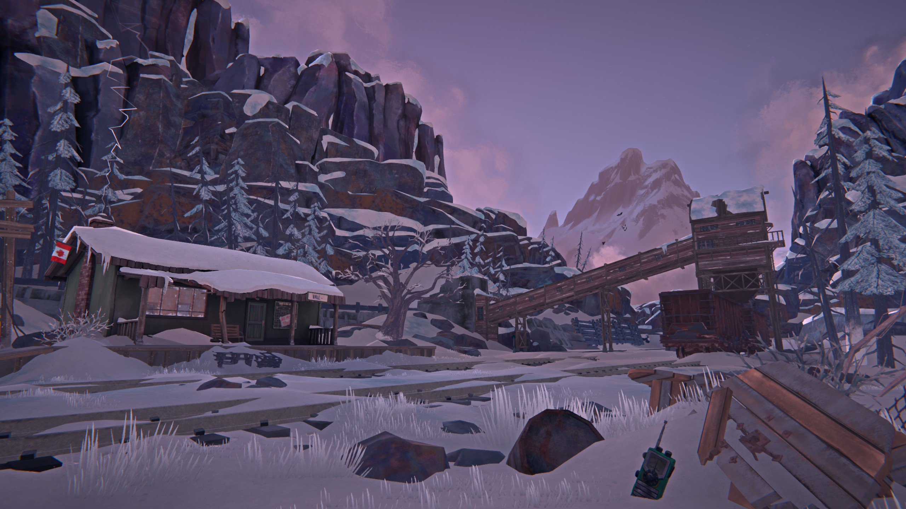
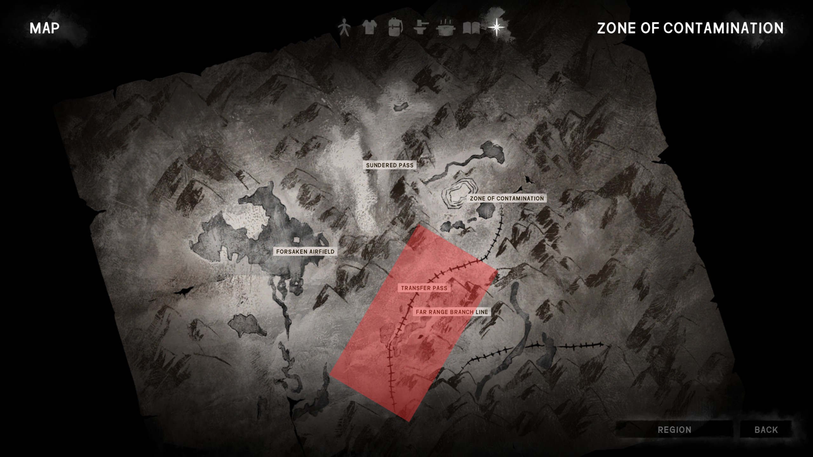
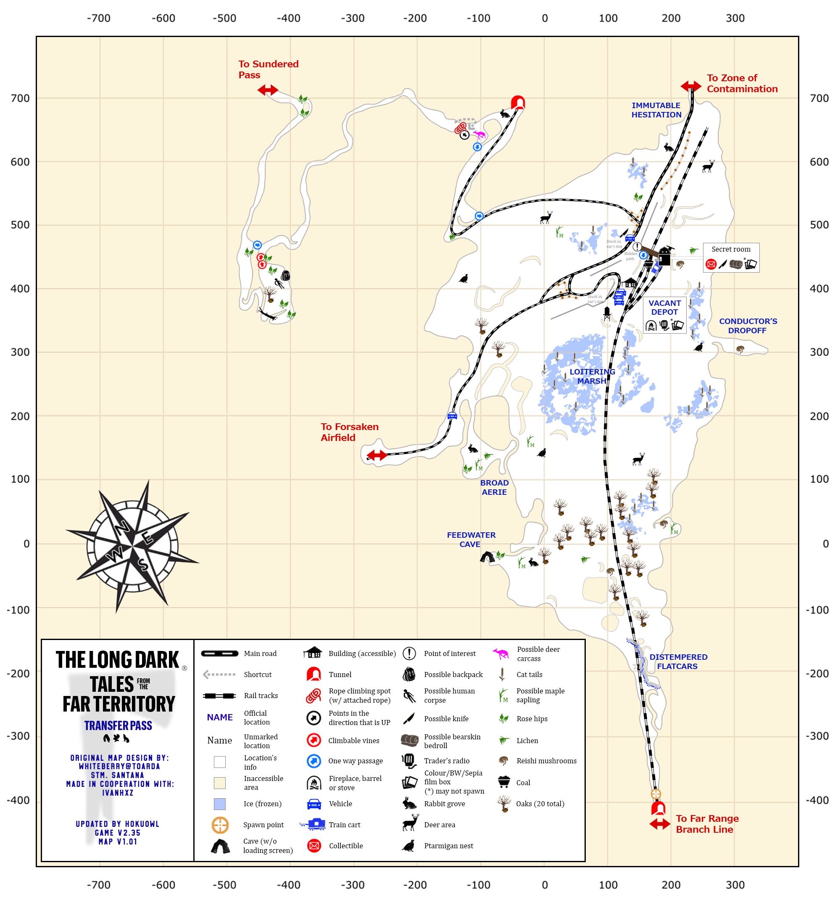
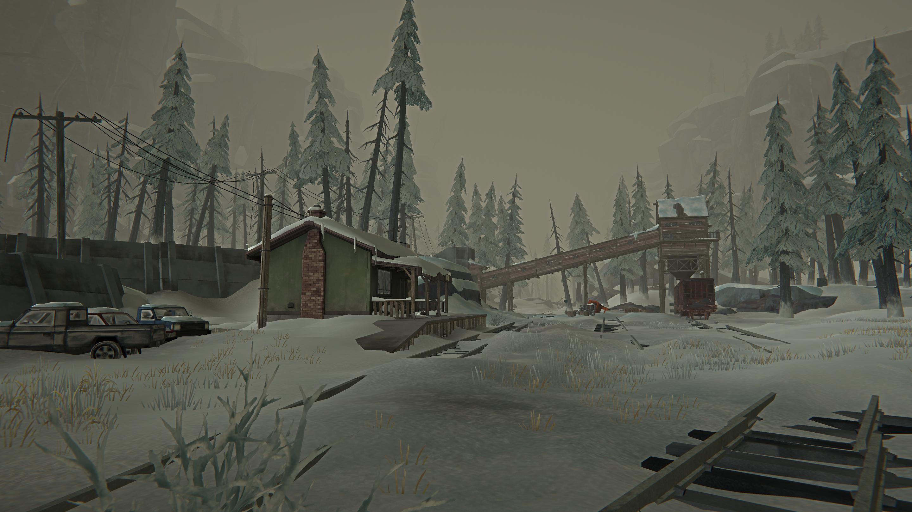
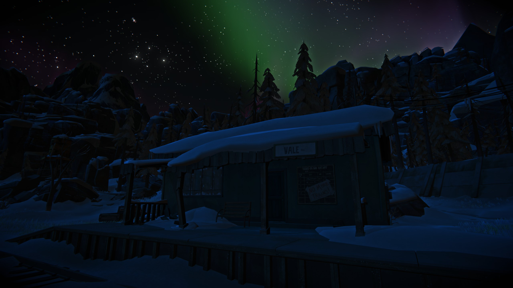

# Transfer Pass

**Categories:** DLC Content, Regions · **Source:** [Fandom](https://thelongdark.fandom.com/wiki/Transfer_Pass)

**Contents**

- [Overview](#overview)
- [Wildlife Availability](#wildlife-availability)
- [Locations](#locations)
- [Trivia](#trivia)
- [Gallery](#gallery)

**Transfer Pass**

_Transfer\_Pass\_Main\_Menu.jpg_

**Location on [Great Bear Island](./Great%20Bear%20Island.md)**

_Transfer\_Pass\_Location.png_

_TransferPass.png_

**Details**

**Description:** An abandoned train depot near the edge of the Far Territory

**Connecting Regions:** [Far Range Branch Line](./Far%20Range%20Branch%20Line.md) (Leads to [Broken Railroad](./Broken%20Railroad.md)) [Forsaken Airfield](./Forsaken%20Airfield.md) / [Zone of Contamination](./Zone%20of%20Contamination.md) / [Sundered Pass](./Sundered%20Pass.md)

**TFTFT paid content:** Yes

**Characters:** None

**Difficulty:** Intermediate

**Interloper Region Spawn:** No

**Locations:** 11

**Date Added:** Dec 5, 2022

_Ptarmigan\_icon.png_

**DLC-Exclusive content.** / This content requires the [Tales from the Far Territory](./Tales%20from%20the%20Far%20Territory.md) addon to be installed before it can be seen or used in regular gameplay.

> “__For intermediate players. A crossroads dug out of the looming mountains, Transfer Pass is quiet since the trains stopped. But it remains a critical junction for anyone wishing to access the Far Territory.  
   
 Connects to Broken Railroad, Forsaken Airfield, Zone of Contamination, and Sundered Pass.__”
>
> — In-game description

_A detailed map of Transfer Pass v2.35 (contains spoilers)_

_A detailed map of Transfer Pass v2.35 (Interloper/Misery edition, contains spoilers)_

_Vacant Depot_

_The Vacant Depot during an Aurora_

_Ditto_

_[Oak Trees](./Oak%20Tree.md) are plentiful in the Pass_

_Photo frames inside the Depot showing the [Langston Mine](./Langston%20Mine.md)_

_Photos of miners inside the Depot_

_The collapsed tunnel leading to Sundered Pass_

_The other side of the tunnel in Sundered Pass_
