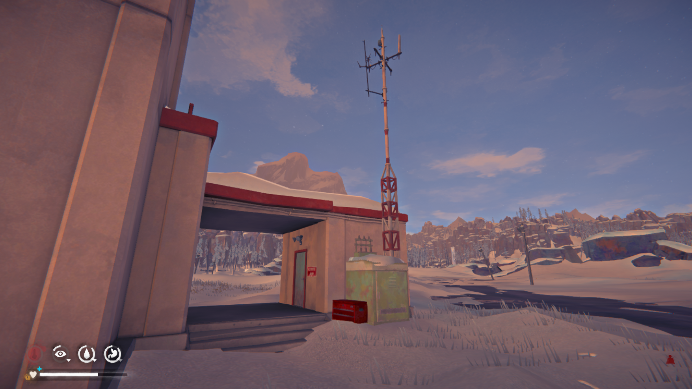
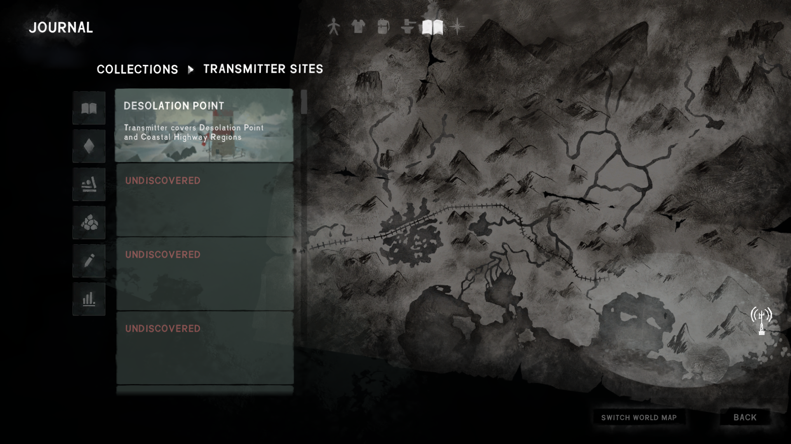

# Transmitters

**Categories:** DLC Content, Gameplay · **Source:** [Fandom](https://thelongdark.fandom.com/wiki/Transmitters)

_A Transmitter box in Forsaken Airfield, repaired with a car battery, scrap metal, fuses, and wires._{| class="messagebox" | width="40px" |  |**DLC-Exclusive content.**

This content requires the [Tales from the Far Territory](./Tales%20from%20the%20Far%20Territory.md) addon to be installed before it can be seen or used in regular gameplay.

| A **Transmitter** is a radio tower that is used in conjunction with the [Handheld Shortwave Radio](./Handheld%20Shortwave%20Radio.md) to find items in the [Tale](./Tales.md) [Signal Void](./Signal%20Void.md) in the [Tales from the Far Territory](./Tales%20from%20the%20Far%20Territory.md) DLC. They are added to the [Collectibles](./Collectibles.md) menu in the [Journal](./Journal.md) once the door is opened, and the Journal can be used to keep track of inactive or active Transmitters, as well as their broadcast range.

## Overview

As detailed in the [Field 31 Operation Memo](./Field%2031%20Operation%20Memo.md), the Search And Rescue (SAR) **Transmitter Towers** need to be repaired to find Transponder Caches and Tale Bunkers using the Handheld Shortwave Radio.

Repairing a Transmitter will require:

- 1 [Car Battery](./Car%20Battery.md)
- 2 [Wire Bundles](./Wires.md)
- 3 [Replacement Fuses](./Replacement%20Fuse.md)
- 5 [Scrap Metals](./Scrap%20Metal.md)
- Once repaired the Transmitter must be **TURNED ON** using the switch located in the box

These materials are not always located close to each tower (Except the one in [Forsaken Airfield](./Forsaken%20Airfield.md) which has all materials on hand). Car batteries are commonly located close to each Transmitter, or in nearby Cars/Trucks:

- In the supply bin next to the tower at [Muskeg Overlook](./Muskeg%20Overlook.md)
- On the shelf to the right when entering the radio hut at [Signal Hill](./Signal%20Hill.md)
- In the corner of a control room in [Old Substation](./Old%20Substation.md)
- [Mountain town](./Mountain%20Town.md) has a many cars close to the tower.

There are a total of 6 Transmitter Towers scattered across Great Bear:

1. The [Control Tower](./Control%20Tower.md) in [Forsaken Airfield](./Forsaken%20Airfield.md)
2. The Shortwave Radio Tower at [Muskeg Overlook](./Muskeg%20Overlook.md) in Southeastern [Forlorn Muskeg](./Forlorn%20Muskeg.md)
3. The [Shortwave Radio Tower](./Radio%20Tower.md) in [Mountain Town](./Mountain%20Town.md)
4. The Shortwave Radio Tower at [Signal Hill](./Signal%20Hill.md) in [Pleasant Valley](./Pleasant%20Valley.md)
5. At [Hibernia Processing](./Hibernia%20Processing.md) in [Desolation Point](./Desolation%20Point.md), assigned to a group of conjoined trailers
6. The [Old Substation](./Old%20Substation.md) in [Blackrock](./Blackrock.md)

Transmitters have a broad transmission array, and can broadcast to other regions besides the one in which they are located. For example, repairing the transmitter in [Pleasant Valley](./Pleasant%20Valley.md) allows locating [Supply Caches](./Supply%20Cache.md) in [Mystery Lake](./Mystery%20Lake%20%28region%29.md). The range of each tower is shown in the Journal once the Transmitter door opened, even before picking up the Handheld Shortwave Radio.

- Forsaken Airfield covers the entire Far Territory
- Forlorn Muskeg covers Bleak Inlet and Broken Railroad
- Pleasant Valley covers Mystery Lake
- Mountain Town covers Hushed River Valley
- Blackrock covers Ash Canyon and Timberwolf mountain
- Desolation Point covers Coastal Highway

Transmitter Towers CAN be repaired before starting the Tale Signal Void by picking up the radio - no need to trek back and forth too much if you start your run in Lower Great Bear.

**Note:** the transmitters in [Desolation Point](./Desolation%20Point.md) and [Blackrock](./Blackrock.md) are not required for the [Tale](./Tales.md) [Signal Void](./Signal%20Void.md), although they do enable hidden [Supply Caches](./Supply%20Cache.md).

## Gallery

_The icon displayed when a Transmitter is repaired in the Collections menu_

_The symbol for a broken Transmitter needing repairs in the Collections menu_

_The Journal Menu showing all discovered Transmitters_
