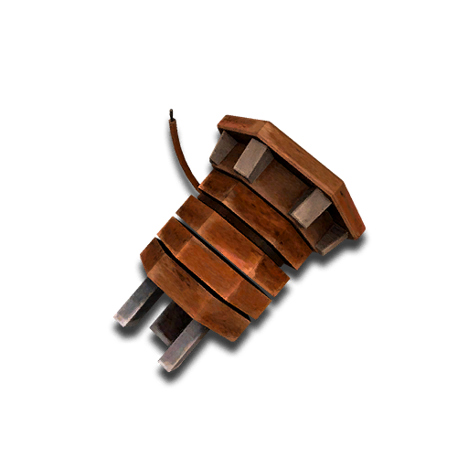

# Transponder Parts

**Categories:** Collectibles, Pages with update history · **Source:** [Fandom](https://thelongdark.fandom.com/wiki/Transponder_Parts)

**Transponder Parts**

| Property | Details |
| --- | --- |
|  | [Transponder Parts icon](../assets/Transponder_Parts_icon.png) |
| Wintermute | [Episode 2](./Episode%202%20-%20Luminance%20Fugue.md) - [Signal to Noise](./Signal%20to%20Noise.md) |
| **Properties** |  |
| Item type | [Collectibles](./Collectibles.md) |
| Equipable | No |
| Stackable | No |
| Examine | Parts scavenged from old radios. Might be used to boost a shortwave signal. |
| **Values** |  |
| Weight | 0.20 kg (0.44 lbs) |
| **Actions** |  |
| Backpack | Examine |

**Transponder Parts** are a [Collectible](./Collectibles.md) found in [Episode 2](./Episode%202%20-%20Luminance%20Fugue.md) of [Wintermute](./Wintermute.md). [Will Mackenzie](./Will%20Mackenzie.md) is tasked with recovering 3 of these during the mission [Signal to Noise](./Signal%20to%20Noise.md). They are recovered at the radio towers at [Shortwave Tower West](./Shortwave%20Tower%20West.md), [Muskeg Overlook](./Muskeg%20Overlook.md), and [Shortwave Tower](./Shortwave%20Tower.md). They are one of the few Collectibles to have weight.

## Update history

\* UPDATE **17 December 2018 ([Update](./The%20Long%20Dark%20%E2%80%94%20Changelog%20%E2%80%94%20Archive%201.md#1.41)):**

- Added to game.
