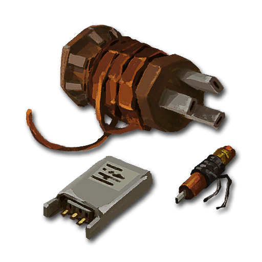

# Transponder Parts

<table class="infobox">
<caption>Transponder Parts</caption>
<colgroup>
<col style="width: 50%" />
<col style="width: 50%" />
</colgroup>
<tbody>
<tr>
<td colspan="2"><figure>

<figcaption>Transponder_Parts_icon.png</figcaption>
</figure></td>
</tr>
<tr>
<td>
Wintermute
</td>
<td>
<a href="./Episode%202%20-%20Luminance%20Fugue.md" class="wikilink" title="Episode 2">Episode 2</a> - <a href="./Signal%20to%20Noise.md" class="wikilink" title="Signal to Noise">Signal to Noise</a>
</td>
</tr>
<tr>
<td colspan="2" class="section">
<strong>Properties</strong>
</td>
</tr>
<tr>
<td>
Item type
</td>
<td>
<a href="./Collectibles.md" class="wikilink" title="Collectibles">Collectibles</a>|-
</td>
</tr>
<tr>
<td>
Stackable
</td>
<td>
No
</td>
</tr>
<tr>
<td>
Examine
</td>
<td>
Parts scavenged from old radios. Might be used to boost a shortwave signal.
</td>
</tr>
<tr>
<td colspan="2" class="section">
<strong>Values</strong>
</td>
</tr>
<tr>
<td>
Weight
</td>
<td>
0.20 kg (0.44 lbs)
</td>
</tr>
<tr>
<td colspan="2" class="section">
<strong>Actions</strong>
</td>
</tr>
<tr>
<td>
Backpack
</td>
<td>
Examine
</td>
</tr>
</tbody>
</table>

**Transponder Parts** are a <a href="./Collectibles.md" class="wikilink" title="Collectible">Collectible</a> found in <a href="./Episode%202%20-%20Luminance%20Fugue.md" class="wikilink" title="Episode 2">Episode 2</a> of <a href="./Wintermute.md" class="wikilink" title="Wintermute">Wintermute</a>. <a href="./Will%20Mackenzie.md" class="wikilink" title="Will Mackenzie">Will Mackenzie</a> is tasked with recovering 3 of these during the mission <a href="./Signal%20to%20Noise.md" class="wikilink" title="Signal to Noise">Signal to Noise</a>. They are recovered at the radio towers at <a href="./Shortwave%20Tower%20West.md" class="wikilink" title="Shortwave Tower West">Shortwave Tower West</a>, <a href="./Muskeg%20Overlook.md" class="wikilink" title="Muskeg Overlook">Muskeg Overlook</a>, and <a href="./Shortwave%20Tower.md" class="wikilink" title="Shortwave Tower">Shortwave Tower</a>. They are one of the few Collectibles to have weight.

<table class="gallery">
<colgroup>
<col style="width: 100%" />
</colgroup>
<tbody>
<tr>
<td><figure>

<figcaption>alt icon</figcaption>
</figure></td>
</tr>
</tbody>
</table>

## Update history

\* UPDATE **17 December 2018 (<a href="./The%20Long%20Dark%20%E2%80%94%20Changelog.md#1.41" class="wikilink" title="Update">Update</a>):**

- - Added to game.

**Lua execution error in Module:Navbox function navbox**

