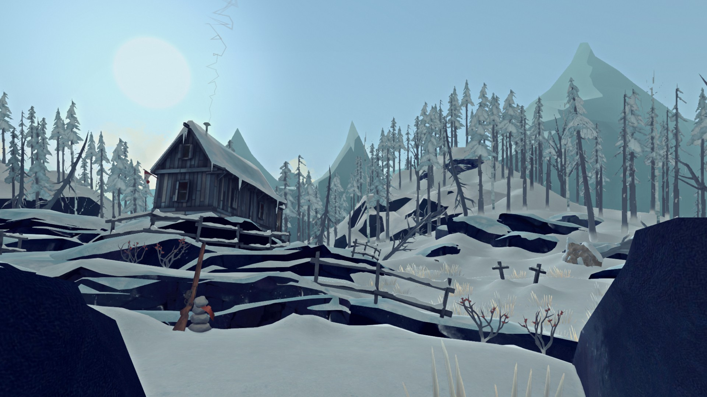
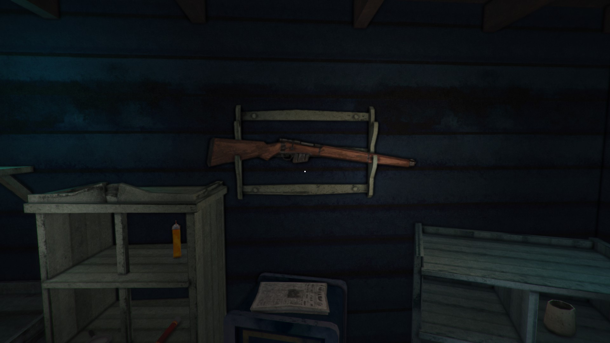
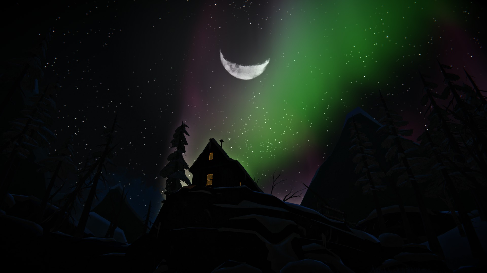
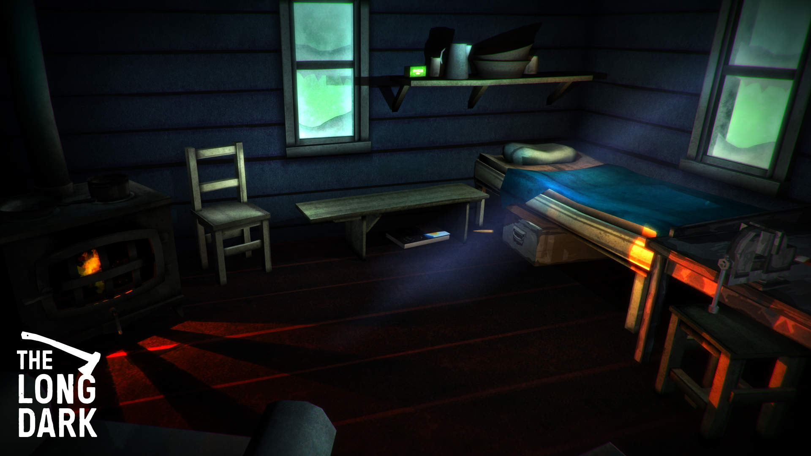
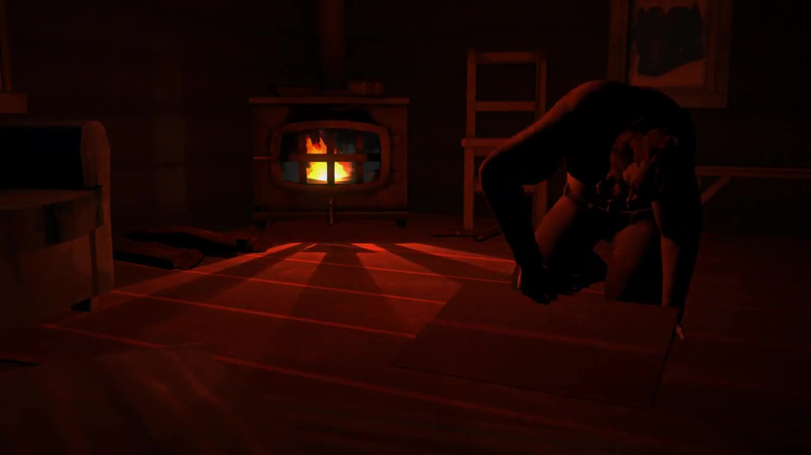
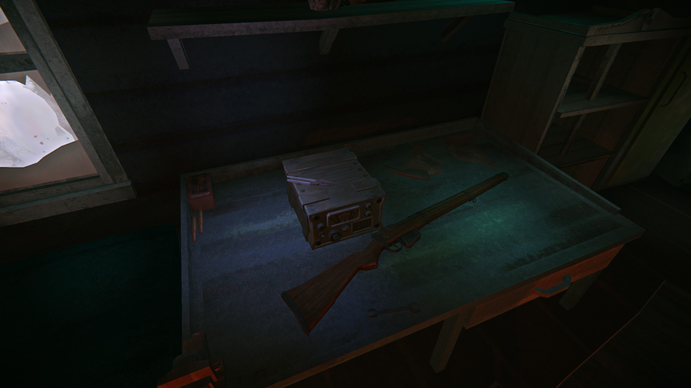
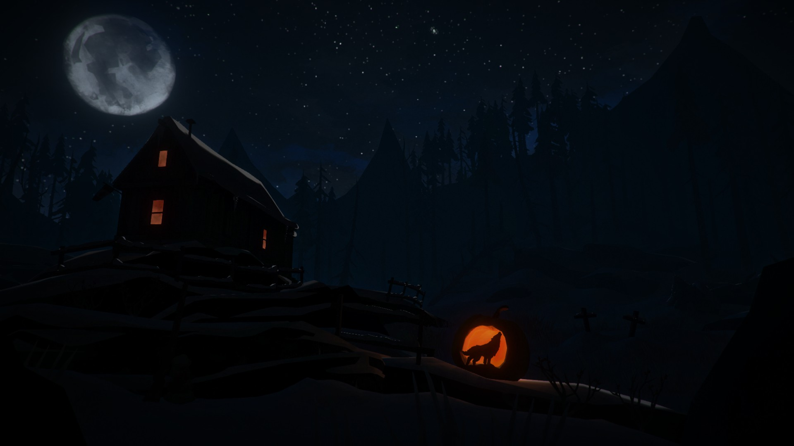

# Trapper's Homestead

**Categories:** Indoor locations, Locations, Locations in Mystery Lake, Locations with a workbench, Military/Sporting locations, Safe Houses · **Source:** [Fandom](https://thelongdark.fandom.com/wiki/Trapper's_Homestead)

**Contents**

- [Overview](#overview)
- [Safehouse](#safehouse)
- [Story mode](#story-mode)
- [Containers](#containers)
- [Trivia](#trivia)
- [Gallery](#gallery)

**Trapper's Homestead**

\[\[File: /  / _Exterior_ /  / _Interior_

250px\]\]

**Location**

_Trapper's\_Homestead\_Location.png_

Region

[Mystery Lake](./Mystery%20Lake%20%28region%29.md)

Location

**Description:** A trapper's home.

**General**

Type

Military/Sporting

Firebox

_bed\_icon.png_

Has a bed

_workbench\_icon\_green.png_

Has a workbench

## Overview

Trapper's Homestead is accessible from a path to the east and a difficult path to the north-east. Depending on the game's difficulty setting, valuable supplies may be scavenged from the Trapper's Homestead, including a [Hunting Rifle](./Hunting%20Rifle.md) along with [Rifle Ammunition](./Rifle%20Ammunition.md).

An open patch of ice and snow surrounds Trapper's Homestead. The surrounding area is abundant with [deer](./Deer.md) and [rabbits](./Rabbit.md), and there is a chance for a moose to roam right in front of the cabin. Immediately south of the Trapper's Homestead is a small abandoned barn and, a little further south, is [Max's Last Stand](./Max%27s%20Last%20Stand.md). A few [Green Birch Saplings](./Green%20Birch%20Sapling.md) may also grow in the area.

The interior of Trapper's Homestead usually contains several valuable supplies. It always contains a [bed](./Bed.md), a [Wood Stove](./Wood%20Stove.md), a [Work Bench](./Work%20Bench.md), and many containers, including a [Safe](./Safe.md). The Trapper's Homestead also contains a [note.](https://thelongdark.fandom.com/wiki/A_Note_Left_Behind)

## Safehouse

The Trapper's Homestead can serve as a great [Safe House](./Safehouse.md) due to it having lots of storage space, a bed, a workbench and secure surroundings with lots of hunting opportunities. The cabin is a very warm building, and most of the time a fire won't be required to warm you up. The main downside is its remote location, as it lies far away from many of the other buildings in Mystery Lake. The area around the cabin has very few wolves, and if one is stalking you when returning, the raised path to the door can give you some time to either shoot the approaching wolf or return indoors. The rabbit grove right behind the cabin is a good and sustainable food source, as are the deer that often spawn in the valley in front of the cabin. If [Intestinal Parasites](./Intestinal%20Parasites.md) are not a concern, the [bear](./Bear.md) that often spawns nearby can also provide a boost to the player's food supply.

## Story mode

_Cave from the Mountain Town (center), as seen from the Trapper's Homestead._

In [Episode 2](./Episode%202%20-%20Luminance%20Fugue.md) of [Wintermute](./Wintermute.md), the cabin is home to the trapper [Jeremiah](./Jeremiah.md), who occupies the bed at all times. You cannot sleep inside Jeremiah's home without a bedroll. The fire inside is always lit, allowing players to use the location to cook food and boil water without expending matches, tinder or firewood.

In story mode, the items and containers in the cabin are owned by Jeremiah and cannot be searched or looted.

A [cave to the southeast of the cabin](./Cave%20%28Transition%20Zone%29.md#Mountain_town_to_Mystery_Lake) connects Mystery Lake to the [Mountain Town](./Mountain%20Town.md) region. Players are initially blocked from entering the cave, but are later able to travel through to the lower area of the Mountain Town region. However, they cannot return to [Milton](./Milton.md) due to the absence of a climbing rope up to [Milton Park](./Milton%20Park.md).

## Containers

- 1 × First aid Box
- 1 × Drawer
- 1 × Locker (may require [Prybar](./Prybar.md))
- 2 × Metal Containers (removed as v2.39)
- 1 × Plastic Container
- 1 × Safe
- 1 x bag

## Trivia

There is a wooden hatch located in the floorboards in front of the workbench that contained a ham radio, as part of the original story of [Episode 2: Luminance Fugue](./Episode%202%20-%20Luminance%20Fugue.md). Despite the radio being reworked into the mission [Signal to Noise](./Signal%20to%20Noise.md), the panel still remains as a leftover asset, and can still be seen under good lighting in Survival Mode. In the current Episode 2, it contains a more noticeable outline, but cannot be opened.

For many years, Trapper's Homestead was featured on the Title Screen.

## Gallery

_A [hunting rifle](./Hunting%20Rifle.md) on a rack in the Trapper's Homestead_

_Trapper's\_Homestead\_Work\_Bench.png_

_The trapper's homestead during the Aurora._

_The\_Long\_Dark\_-\_Home\_Stead.jpg_

_The Cut hidden radio in the floorboard_

_Jeremiah opening the hidden floorboard_

_The panel in the redux version, but it cannot be opened_

_The radio now moved to the table in Redux Episode 2_

_Halloween 2018 [4 Days of Night Event](./4%20Days%20of%20Night%20Event.md)_
