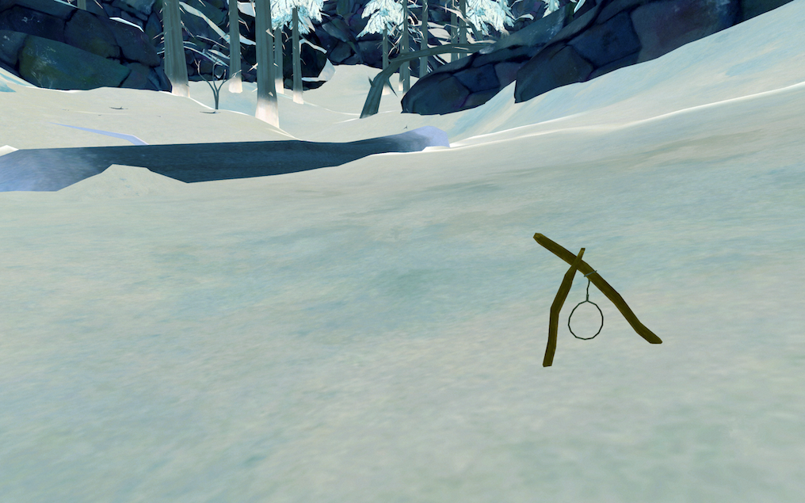
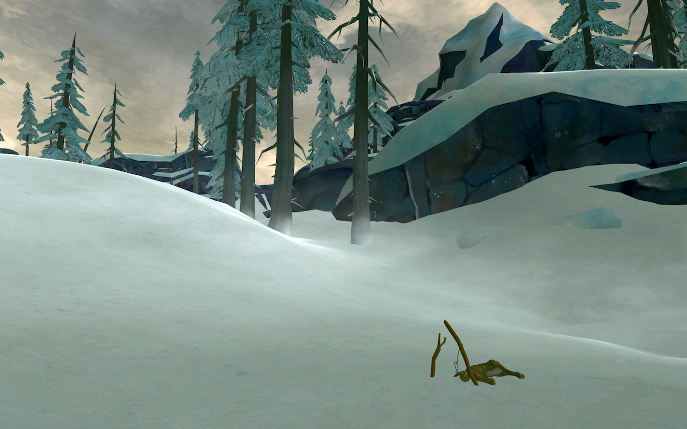
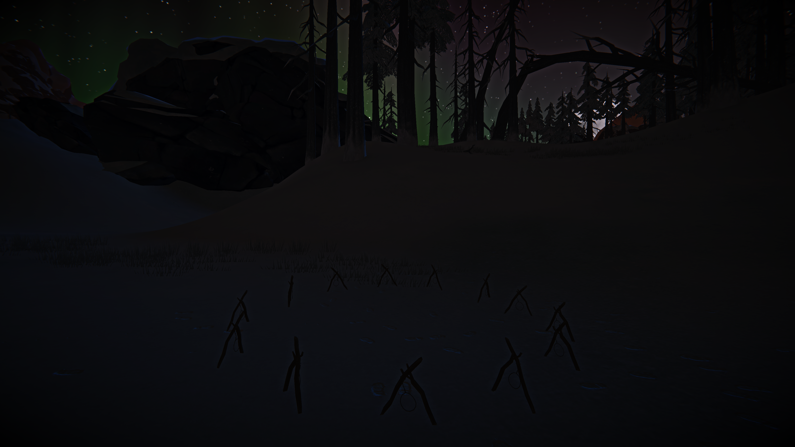
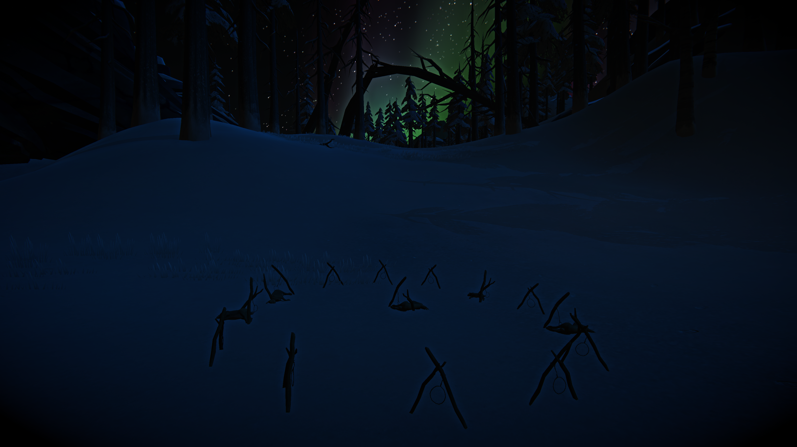
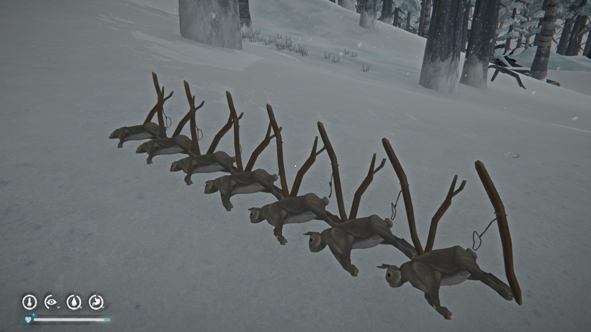

# Trapping

**Categories:** Gameplay, Wildlife · **Source:** [Fandom](https://thelongdark.fandom.com/wiki/Trapping)

**Contents**

- [The Snare](#the-snare)
- [Placement](#placement)
- [Setting Runs](#setting-runs)
- [The Catch](#the-catch)
- [Broken Snares](#broken-snares)
- [Fishing Tip-Ups](#fishing-tip-ups)
- [Placement](#placement-1)
- [Setting Runs](#setting-runs-1)
- [The Catch](#the-catch-1)
- [Broken Tip-Ups](#broken-tip-ups)
- [Additional Tips](#additional-tips)

"_You can use your energy chasing Rabbits and trying to stun them with stones, or you can use a more long-term strategy, Snares. Look for areas of high Rabbit activity, and place a Snare nearby. Check on it daily. You may get lucky and catch a Rabbit. You can set up multiple snares to increase your chances. A well maintained Trapline can be an excellent long-term source of food. Just remember, it may attract other wildlife!_"

— In-game description

Trapping is a safe and efficient method exclusively for killing rabbits in The Long Dark. Traps hold quarry in place so you don't have to track, and animals are dead of exposure before you return. All that is required is good trap placement, time, and the attentiveness and determination to find and harvest traps before their contents are eaten by scavengers.

<!-- #the_snare -->
​

<!-- #The_Snare -->
​

<!-- #The_snare -->
​

<!-- #the-snare -->
## The Snare

[Snares](./Snare.md) only work against [Rabbits](./Rabbit.md), specifically only working in special Rabbit Grove locations. Their slip-knotted loops close swiftly when pulled and refuse to release, only becoming tighter while struggled against. Rabbits are always killed when caught in a snare.

<!-- #Placement -->
​

<!-- #placement -->
### Placement

 Snares are set individually by "placing" them from either the radial menu or inventory. Selecting a trap from the radial menu allows the player to immediately see the outline of a placeable snare, centered on the screen. Alternatively, a "place" button uniquely appears under the snare description in the inventory screen. Similarly, selecting "Place" from the inventory screen immediately returns the view to the main screen with the outlined view of a placeable snare. The outline will be red when placement is not possible, green when it is. Move as desired to a good spot. Left click to release. Right click to cancel. Left click on a placed snare to pick it up again as you would any loose item in the game.

<!-- #setting_runs -->
​

<!-- #Setting_Runs -->
​

<!-- #Setting_runs -->
​

<!-- #setting-runs -->
### Setting Runs

 Location of traps is critical; they must be set where the rabbits are able to spawn or they will catch nothing. Spotting a specimen is the best sign of a valid area. But individuals wander, so it is possible it has left the bounds of its spawn point, especially if something has startled it. Estimate the center of animal activity by observing the area carefully. Set your traps there. Setting multiple traps along a line or even in a grid can greatly assist learning exactly where the rabbiting area is. Traps set outside a rabbiting area will never catch anything. Choosing a convenient location is also important because you will have to come back later to remove the catch.

<!-- #the_catch -->
​

<!-- #The_Catch -->
​

<!-- #The_catch -->
​

<!-- #the-catch -->
### The Catch

 You will never see a trap activated. Chasing rabbits into snares has no effect, and there is no relevant bait. What catches rabbits is time and absence. Twelve hours after a trap is set, it begins checking to see if a rabbit has been caught. Trapped animals immediately begin freezing. Their carcasses appear identical to rabbits killed by other means. Snares that have made a catch will need to be reset. It is also possible that snares may have been damaged and must be rebuilt.

<!-- #broken_snares -->
​

<!-- #Broken_Snares -->
​

<!-- #Broken_snares -->
​

<!-- #broken-snares -->
### Broken Snares

Occasionally snares will be found "broken", their condition reduced to 0%. This irreparable damage may represent multiple possibilities. The animal may have struggled loose, perhaps a predator stole the prize for its own, or the snare became damaged in severe weather. Broken snares cannot be reset or repaired, however, they can be harvested to get 1 [Reclaimed Wood](./Reclaimed%20Wood.md), which can again be crafted into a snare by combining it with [Cured Gut](./Cured%20Gut.md) at a [Work Bench](./Work%20Bench.md).

- In previous versions a glitch allowed broken snares to continue to be set and used by placing them with the right click placement function while they are on the ground.

<!-- #fishing_tip_ups -->
​

<!-- #Fishing_Tip-Ups -->
​

<!-- #fishing_tip-ups -->
​

<!-- #Fishing_tip-ups -->
​

<!-- #Fishing_Tip-ups -->
​

<!-- #fishing-tip-ups -->
## Fishing Tip-Ups

 A [Fishing Tip-Up](./Fishing%20Tip-Up.md) can be placed in any [Ice Fishing](./Ice%20Fishing.md) hole that has been broken open. The player can use them to fish on their behalf or as they fish in their own separate hole.

<!-- #placement_1 -->
​

<!-- #placement-1 -->
### Placement

The player can place them in cleared Ice Fishing ice holes or produce a hole via Free From ice holes (See [Ice Fishing](./Ice%20Fishing.md#Fishing_Holes) for a list of suitable locations). Tip-Ups can be fitted with [Fishing Bait](./Fishing%20Bait.md) or a [Fishing Lure](./Fishing%20Lure%20%28disambiguation%29.md) to increase the odds that the catch fish.

<!-- #setting_runs_1 -->
​

<!-- #setting-runs-1 -->
### Setting Runs

Placing too many Fishing Tip-Ups (4-5 Tip-Ups) in one location will quickly result in diminishing returns, but will otherwise produce a large amount of fish if the player tends to them. Tip-Ups do not gain any benefits from the player's Ice Fishing Skill, and become useless if the hole starts to freeze over, requiring the player keep an eye on them and perform regular maintenance on the ice holes. A great strategy involves using the Fishing Hut as a shelter and fishing alongside Tip-Ups, regularly keeping an eye on them.

<!-- #the_catch_1 -->
​

<!-- #the-catch-1 -->
### The Catch

Unlike Snares, Tip-Ups will actually tip up and produce a metal clang when they catch a fish. They will continue to hold said fish until they are reclaimed from the ice hole. Haver reclaimed, they will need to be placed back into a cleared ice hole to continue catching fish.

<!-- #broken_tip_ups -->
​

<!-- #Broken_Tip-Ups -->
​

<!-- #broken_tip-ups -->
​

<!-- #Broken_tip-ups -->
​

<!-- #Broken_Tip-ups -->
​

<!-- #broken-tip-ups -->
### Broken Tip-Ups

Blizzards and general use will decay the Condition of a Tip-Up, and they can be broken down for parts (harvesting yields 1 [Scrap Metal](./Scrap%20Metal.md) and 1 [Stick](./Stick.md)) and any Fishing Lures/Bait attached to them.

<!-- #additional_tips -->
​

<!-- #Additional_Tips -->
​

<!-- #Additional_tips -->
​

<!-- #additional-tips -->
## Additional Tips

- Any location where rabbits spawn has a chance of snaring rabbits, even if the area isn't marked as a "rabbit grove" proper on the [map](./Map.md), and even if the area currently has no rabbits in it (if the player has killed all the rabbits using [stones](./Stone.md), for example).
- However, if there are as many or more snared rabbits in the area than the spawn point can normally produce, this will greatly diminish the chances of snaring more rabbits. Clearing out traps regularly increases the odds of success.
- The density of snares placed in an area seems to have no deleterious effect on trapping (i.e. crowding an area with snares does not reduce the chances of each snare getting a rabbit). Thus, it is beneficial to use as many snares as possible for the best chance of getting a high yield. A particularly high volume of snares (a dozen or more) can even offset the lower chance of trapping in a depleted spawn point.
- Actively observing a trap when the snare is ready to check for rabbits will prevent them from appearing. However, this is easily remedied by briefly breaking line of sight and allowing the trap to check for rabbits. It is not necessary to leave the area, pass time, or sleep for traps to work. However, it can still be useful to transition between areas. If the player is not in the area when snares are ready to check for rabbits, they will wait until the player enters the area. This will force all snares to check simultaneously, potentially resulting in larger yields (remember, traps that have already caught rabbits reduce the chances of further catches).
- When trapping in an area with few interior spaces (e.g. Timberwolf Mountain), it may help to set up traps with a delay between each setting and check multiple times during the course of a day for very high yields.
- Moving a trap before it has caught a rabbit will reset the timer. It is best to leave set traps alone, provided you are confident they are placed accurately within a spawn point. Traps seem to check for rabbits once every 12 hours after being set (provided the player is in the area, otherwise they will wait to check until the player returns).
- The Expert Trapper [feat](./Feats.md) will significantly increase the chances of any given snare producing a rabbit. (The mechanics for this are unclear, but may involve each snare checking for rabbits twice and taking the better result. The feat does _not_ ensure that every placed trap will snare a rabbit)
- The sheer quantity of rabbits that a dense cluster of well-placed traps will produce can make it difficult to fully harvest their carcasses. It may become a more efficient use of time to harvest only the meat, a modest number guts to replace broken traps, and hides strictly as needed for crafting/repairs. Allowing some hides/guts to go to waste can also save resources, since meat can be harvested by hand reasonably quickly, sparing use of a knife/whetstone.
- When selecting an area for trapping, it's a good idea to consider how easy it is to find the area again to claim your catch, distance to your preferred shelter, and proximity of hostile wildlife that might smell your freshly caught rabbits. Transporting rabbits one at a time can reduce the risk of wolf encounters, as can cooking and eating them on the spot (only rabbits/meat/fresh guts in your inventory count for stinkiness).

