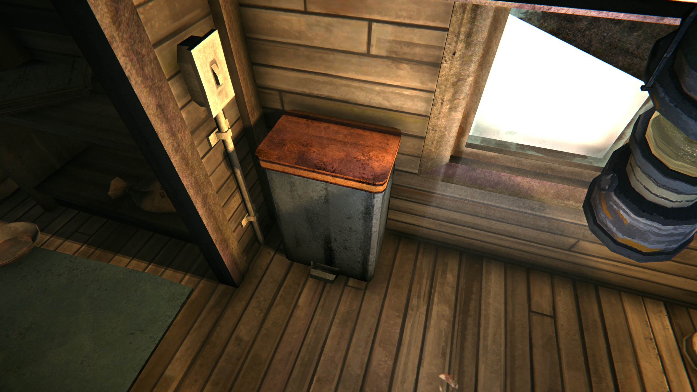

# Trash Can

**Trash Can**

| Property | Details |
| --- | --- |
| \[\[File: / \|  / *Regular* \|  / *Rusty* \| / \| --- \| --- \| | 250px\]\] |
|  / *Regular* |  / *Rusty* |
| Release | TBD |
| Update | [0.00](./The%20Long%20Dark%20%E2%80%94%20Changelog.md#0.00) |
| Story item | Yes |
| **Container** |  |
| Capacity | 15.00 kg(33 lbs) |

A **Trash Can** is an interactable storage container found in many industrial buildings across the Island. They often contain a single [Rose Hip](./Rose%20Hip.md), [Old Man's Beard Lichen](./Old%20Man%27s%20Beard%20Lichen.md), and a few other items, but usually yield nothing of real value. **Lua execution error in Module:Navbox function navbox**
