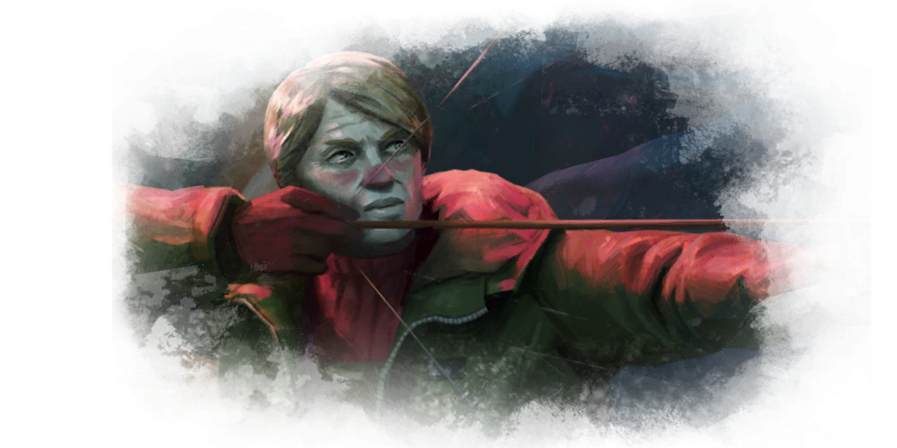

# Trauma/Transcript

**Contents**

- [Transcript](#Transcript)
- [Molly](#Molly)
- [Molly's Farmhouse.](#Molly%27s_Farmhouse.)
- [Molly has phoned from her barn, and she needs your help.](#Molly_has_phoned_from_her_barn%2C_and_she_needs_your_help.)
- [Find someone who can help guide you out of Pleasant Valley.](#Find_someone_who_can_help_guide_you_out_of_Pleasant_Valley.)

<table class="infobox">
<caption>Trauma/Transcript</caption>
<colgroup>
<col style="width: 50%" />
<col style="width: 50%" />
</colgroup>
<tbody>
<tr>
<td colspan="2"><figure>

<figcaption>Missions_story_ep3_Trauma.png</figcaption>
</figure></td>
</tr>
<tr>
<td>
Episode
</td>
<td>
<a href="./Episode%203%20-%20Crossroads%20Elegy.md" class="wikilink" title="Episode 3">Episode 3</a>|-
</td>
</tr>
<tr>
<td>
Previous
</td>
<td>
<a href="./Renewed%20Hope%20%E2%80%94%20Transcript.md" class="wikilink" title="Renewed Hope/Transcript">Renewed Hope/Transcript</a>
</td>
</tr>
<tr>
<td>
Current
</td>
<td>
Trauma/Transcript
</td>
</tr>
<tr>
<td>
Next
</td>
<td>
<a href="./Fallen%20Star%20%E2%80%94%20Transcript.md" class="wikilink" title="Fallen Star/Transcript">Fallen Star/Transcript</a>
</td>
</tr>
<tr>
<td>
Region
</td>
<td>
<a href="./Pleasant%20Valley.md" class="wikilink" title="Pleasant Valley">Pleasant Valley</a> <a href="./Keeper%27s%20Pass%20South.md" class="wikilink" title="Keeper&#39;s Pass South">Keeper's Pass South</a>-(Opening cutscene)
</td>
</tr>
<tr>
<td>
Characters
</td>
<td>
<a href="./Astrid%20Greenwood.md" class="wikilink" title="Astrid Greenwood">Astrid Greenwood</a> <a href="./Molly.md" class="wikilink" title="Molly">Molly</a> 
<a href="./Grey%20Mother.md" class="wikilink" title="Grey Mother">Grey Mother</a> (opening cutscene) 
<a href="./Hobbs.md" class="wikilink" title="Hobbs">Hobbs</a> (opening cutscene) 
<a href="./Mathis.md" class="wikilink" title="Mathis">Mathis</a> (opening cutscene) 
<a href="./Will%20Mackenzie.md" class="wikilink" title="Will Mackenzie">Will Mackenzie</a> (opening cutscene) 
<a href="./Jeremiah.md" class="wikilink" title="Jeremiah">Jeremiah</a> (opening cutscene) 
<a href="./Characters.md#Radio_Voice_Man" class="wikilink" title="Radio Voice Man">Radio Voice Man</a> (opening cutscene)
</td>
</tr>
</tbody>
</table>

This is the mission transcript for mission 1 <a href="./Trauma.md" class="wikilink" title="Trauma">Trauma</a> of <a href="./Episode%203%20-%20Crossroads%20Elegy.md" class="wikilink" title="Episode 3: Crossroads Elegy">Episode 3: Crossroads Elegy</a>.

## Transcript

*A story recap is present when starting Episode 3*

PREVIOUSLY ON THE LONG DARK

*Panning shot of a wilderness on <a href="./Great%20Bear%20Island.md" class="wikilink" title="Great Bear Island">Great Bear Island</a> during snowy weather, followed by the prerendered cutscene from Episode 1.*

<a href="./Astrid%20Greenwood.md" class="wikilink" title="Astrid Greenwood">Astrid Greenwood</a>: "I need your help. There's an isolated community in the Northern part of Great Bear. Someone there is very sick and..."

<a href="./Will%20Mackenzie.md" class="wikilink" title="Will Mackenzie">Will Mackenzie</a>: "Great Bear? There's nothing there anymore. Not since..."

Astrid: "I know...but, I have to get there."

*Scene shifts to show Mackenzie's Plane falling out of the sky during the First Flare. Scene shifts to show Grey Mother.*

<a href="./Grey%20Mother.md" class="wikilink" title="Grey Mother">Grey Mother</a>: "I seem to recall...a town somewhere up north. Far. What was it called... That's it - - Perseverance Mills.

*Scene shows Mackenzie wiping the frost off of the <a href="./Crashed%20Prison%20Transport%20Bus.md" class="wikilink" title="Crashed Prison Transport Bus">Crashed Prison Transport Bus</a> and peering inside, seeing the word PERSERVERANCE. Scene shifts to show Hobbs.*

<a href="./Hobbs.md" class="wikilink" title="Hobbs">Hobbs</a>: "...it was like sparks everywhere and then fire.

*Scene shifts to show Mackenzie with a Torch walking up to the burned down <a href="./Old%20Schoolhouse.md" class="wikilink" title="Old Schoolhouse">Old Schoolhouse</a> at night.*

Hobbs: "She fought like hell trying to get them out."

*Scene shifts back to Hobbs*

Hobbs: "We tried to stop her but she ended up on the bus...somehow, she was small enough to crawl through the crushed part."

*Scene shifts to show the Aurora humming in the night sky*

<a href="./Jeremiah.md" class="wikilink" title="Jeremiah">Jeremiah</a>: "Did you see the lights in the night sky, the aurora? Well, when that flared up, the radio came to life. It just lit up, and started spitting out noise, but it was all gibberish."

*Scene shifts to show Jeremiah, then to Mackenzie turning on the shortwave radio*

<a href="./Characters.md#Radio_Voice_Man" class="wikilink" title="Radio Voice Man">Radio Voice Man</a>: "...\[static\]... This is...Mills...come in..."

Mackenzie: "Hello? Is this the radio station at Perseverance Mills? Is there a doctor with you?"

Radio Voice Man: "We need help...Some kind of...quarantine...We need a...doctor... or medical assistance. Anything."

*Scene shifts to inside the Carter Hydro Dam, at the end of Episode 2. Mackenzie is assaulted by Mathis*

<a href="./Mathis.md" class="wikilink" title="Mathis">Mathis</a>: "What's in the case?"

Mackenzie: "I have no idea."

Mathis: "Don't worry, pilot. You'll be with her soon."

*Mathis knocks Mackenzie out with the Hatchet and the scene fades to black, ending the story recap*

## Molly

*The scene opens with an unknown figure walking through the woods in first person view, with a Hunting Rifle in hand and looking around. A crow can be heard cawing as they walk. The person finds a road and starts walking on it, with her breath getting more labored.*

EPISODE THREE

CROSSROADS ELEGY

*The woman sees a car, with a collapsed tunnel in the background. She clears the frost off the window, with a body of a dead man slumped over inside behind the wheel. She decides to move on, with the cries of the crow getting louder and spot it sitting on a birch tree stump. The woman walks over to it and a body materializes from behind the snowy bank. The crow flies off as the woman with the rifle gets closer, and the individual looks over the body slumped in the snow. The woman moves the body's shoulder and the head turns to the camera. It is Astrid Greenwood, passed out and starting to turn purple from the cold. The scene fades to black.*

*A single crow can be heard cawing, as machines that sound like ICU units operate and pump air. Heartbeat monitors beep, before the cawing and machinery stop as two blurry artificial lights appear in the ceiling before the player. Astrid has just woken up, finding herself inside a cabin and she shields her eyes from the brightness of a nearby fire. She sees that her left hand and right wrist has a bandage on it and studies it, before turning her gaze to the fire. A woman, presumably the one that saved her, is sitting in a coach and casually smokes a ciggerete as the house is in the dead of night. Astrid tries to get out of bed and stumbles, alerting the woman, who comes over.*

<a href="./Molly.md" class="wikilink" title="Molly">Molly</a>: "So...she lives."

Astrid: "...wh..where am I?"

Molly: "And...she speaks. You're in my house. Found you out in the snow...few days ago..."

Astrid: "A...a few days?"

Molly: "...almost dead. You were half-frozen and then...feverish. Judging by those cuts, you've been dealing with more than just the bad weather."

Astrid: "I...I ran into some trouble. On the other side of that tunnel."

Molly: "By the looks of it...I'd say the trouble ran into you."

*The woman takes a long drag on her ciggerete before putting it down and exhaling*

Astrid: "Where am I?"

Molly: "I told you. My house."

*Astrid begins to blink, as though she is about to lose consciousness*

Molly: "You're still weak. Rest up and we'll talk more later."

Astrid: "No no... I'm uh... I'll be okay."

Molly: "Suit yourself. Then let's talk."

*Dialogue options appear*

**Blue Dialogue**

- HOUSE

Astrid: "You said we're in your house. But how did I get here?"

Molly: "I was out..." *Molly straightens her hair* "...hunting. Came across you in the snow. Buried. You'd been out there for hours...maybe even days? Nearly dead."

Astrid: "Well uh...thank you for finding me."

Molly: "Name's Molly. And don't thank me. Thank the crow."

Astrid: "Crow?"

Molly: "Yeah. Crow, or maybe a raven. Damn bird wouldn't shut up. Lead me straight to you. Almost like it was guiding me."

- CARRIED

Astrid: "You carried me here?"

Molly: "Dragged more like...but yeah. You were pretty far gone. Wasn't sure you'd make it, to be honest."

Astrid: "All I remember is the tunnel, and wolves...being chased. And then wandering...forever. Like the world had no end."

Molly: "Yeah. In the woods. In the dark. You can wander for days until you get so hopelessly lost...there's just no way to get back to where you were."

Astrid: "I was in a small town. Milton."

Molly: "Other side of the mountains. Old town. Bad shape since the Collapse. Haven't been there in ages. You must have wandered a ways, for me to find you where I did. But you're not from there..."

Astrid: "No. The whole town. Milton. It's...gone. I mean, the people are gone. Or most of them are. There was a fire, and..."

Molly: "Woah...it's ok. You're alright now. Don't get too worked up. You nearly died out there. That does funny things to people."

- KITCHEN

Astrid: "Is this...your kitchen?"

Molly: "By the time I got you here, there was no way I was carrying you upstairs."

Astrid: "So you set up a bed in here?"

Molly: "Power's out. This is the warmest room in the house." *Points to Stove "*This cook stove is probably keeping us alive."

- POWER

Astrid: "So...the power's been out for a while?"

Molly: "Yup."

Astrid: "Think it'll come back?"

Molly: "Well...we're used to the power going on and off out here in Pleasant Valley. So we're usually prepared for it." *Straightens hair* "Feels like we run this farm on generators for better part of the year. Problem is...now the generators won't start. Or the cars. Tractor. The TV's dead. Radio won't work. Basically...the only thing that works is the old land line and rotary phone."

Astrid: "How is that possible?"

Molly: "I guess it's because it's pre-electronics? The old party line from when this farm was originally put in...maybe sixty, seventy years ago. I'm not exactly sure how or why it still works, but it does."

Astrid: "Well, that's great. Can you call for help? Find out what's going on out there?"

Molly: "There's nobody to call."

Astrid: "Nobody else lives around here?"

Molly: "Hmph. Nobody who'd help if you asked for it."

*After the first 3 dialogue options are chosen, a new one appears*

- MACKENZIE

Astrid: "I was in a plane crash. In the mountains. That's how I ended up in Milton. I got separated from...from a friend."

Molly: "They were in the crash too?"

Astrid: "Yes."

Molly: "They make it out alive?"

Astrid: "There was a storm. Wolves. I got disoriented. We got separated. I couldn't see him."

Molly: "Him. So you left him out there?"

Astrid: "And then I ran into trouble. Wolves and...worse. I'm sure he made it out fine."

Molly: "Yeah? How are you so sure?"

Astrid: "Nothing can break that stubborn skull."

Molly: "But you're worried about him."

Astrid: "Yes. And there's something I need from the plane."

Molly: "What is it?"

Astrid: "Something important. I need to find him. I need to get it back. You haven't seen a man pass through here?"

Molly: "Nobody that sounds like your guy."

Astrid: "But you've seen a man?"

Molly: "Like I said. Nobody that sounds like your guy. Freezer's empty. You're gonna need energy to heal...which means we need meat. I'll be heading out early to hunt."

Astrid: "Ok."

Molly: "You...should stay here. Rest up some more."

*Molly puts a hand on Astrid to reassure her*

Molly: "You don't look too good."

Astrid: "Thank you. I will."

Molly: "And...it's not safe out there so just stay in the house."

Astrid: "Right."

Molly: "I mean it." *Firmly points at Astrid* "Stay in the house."

*Molly gets up and walks away and takes another drag on her ciggerete, as Astrid begins falling back asleep. A door is heard opening and closing as Molly leaves.*

*Time passes as day turns to night, and the sound of steam escaping a tea kettle wakes Astrid up. She turns to see Molly entering the house placing her rifle and a bag filled with meat on the floor near the door. Molly turns and sees Astrid*

Molly: "Ah! You're awake. Thought you were resting."

*Molly cleans her bloody hands with a rag and puts it on the counter*

Molly: "Managed to bag a stag not far from the farm. This'll keep us fed for a bit."

Astrid: "I heard a...kettle whistling."

*Molly sits down besides Astrid*

Molly: "I put it on for tea. So we can have tea and...meat."

Astrid: "I must be starting to feel better because that actually sounds good."

Molly: "It's amazing what hunger does to the mind. If you're feeling better, you can start answering some questions. Like what the hell are you really doing out here?"

*Astrid shakes her head*

Astrid: "It's a long story."

Molly: "Well...power's been out for...I've lost track of how long." *Molly begins counting on her fingers* "We've got the cold. We got deadly blizzards. We got hungry wolves. We got some tea and...meat. We aren't going anywhere...so to be honest a bit of storytelling's be a nice distraction right about now."

- DOCTOR

Astrid: "I'm a doctor. Dr. Astrid Greenwood."

Molly: "Nice to meet you, Dr. Astrid. Like, a head colds and babies doctor?"

Astrid: "More like lab coats and test tubes. A researcher."

Molly: "Ok ok, so not the useful kind."

Astrid: "I need to get to a town, up north. Perseverance Mills. You know where that is?"

Molly: "I don't get out much, but yeah I've heard of it."

Astrid: "Ok, well there's some sick people there. And they need my help. And that thing I lost in the plane crash...the thing my friend might have. I need it if I'm going to help those people."

Molly: "The thing the stubborn guy you left in the plane crash might have?"

Astrid: "Right."

Molly: "So what you're saying is the thing you need is on the other side of that collapsed tunnel in the mountains? In the place where you ran into trouble?"

Astrid: "That's right."

Molly: "Know what? You coming here. To Great Bear..."

Astrid: "Yeah?"

Molly: *she shakes her head* "Not your best plan."

- SICKNESS

Molly: "So the people up north. In Perseverance Mills. Why are they sick?"

Astrid: "I'm not entirely sure. That's why I need to get there."

Molly: "You must have some ideas, or...why travel all this way?"

Astrid: "I have some ideas, yes."

Molly: "But you aren't going to tell me what they are."

Astrid: "No...I'm not."

Molly: "And the thing your friend in the plane crash has...the thing you need to help them. You aren't going to tell me what it is either, are you?"

Astrid: "Right."

Molly: "Well. You are a lady with a lot of secrets."

- LOCKED

Astrid: "So...when you came in. I heard you locking a padlock. Same thing when you went out. Am I...locked in here?"

Molly: "It's better for you to stay indoors."

Astrid: "Why?"

Molly: "Lots of wolves out there, and it's cold. You aren't strong enough to go out there yet. Trust me, it's for your own safety."

Astrid: "I appreciate everything you've done to help, but I'd like to leave. I have to find my friend and...get on with my work."

Molly: "When you're stronger."

Astrid: "So...I'm trapped in here?"

Molly: "Like I said. It's for your own good."

Astrid: "So um...is your husband around?"

*Molly has a worried expression*

Molly: "Husband?"

Astrid: *she gestures around the house* "Seems like more than one adult lives here. I assumed...a husband."

*Molly gets visibly angry and her entire demeanor changes, as if something snapped inside her. She begins pointing fingers at Astrid then gets up*

Molly: "Assumptions can be dangerous. You're a doctor. You should know that."

Astrid: "I didn't mean to..."

Molly: "You should just mind your own business."

*Molly heads to the door frustrated and grabs her gun*

Astrid: "But you just got back..."

Molly: "I...need space. Need to think."

Astrid: "I'm sorry."

Molly: "Stay out of my shit."

*Molly leaves the house and padlocks the door*

Astrid: "Looks like I'm not the only one with secrets."

## Molly's Farmhouse.

CHAPTER ONE

TRAUMA

*From this point the player can walk around the house. Astrid limps with a <a href="./Sprained%20Ankle.md" class="wikilink" title="Sprained Ankle">Sprained Ankle</a> and her vision is blurred with <a href="./Pain.md" class="wikilink" title="Pain">Pain</a> from her Plane Crash Injuries*

Astrid: "This place...am I really trapped in here?"

*All the doors are locked, including the Basement door which needs a key. Astrid walks to the living room and finds an exploded Broken Rifle. She picks it up and examines it before putting it back down.*

Astrid: "Looks like maybe the barrel exploded?"

*She moves to the office and finds Molly's Photo on the table, picking it up and examining it before putting it back. The photo is tattered, and a man is putting his arm around her shoulder. Molly does not look happy in the photo.*

Astrid: "That looks like Molly. From a while ago."

*Astrid heads upstairs and walks into the bathroom, spotting some Orange Fabric on the floor and picking it up.*

Astrid: "Torn from something..."

*A phone rings from downstairs in the kitchen, with Astrid limping downstairs to pick up the Receiver.*

*If Astrid does not answer the first call immediately, the phone will go silent and will start ringing again. This will happen over and over until picked up. Molly will give the following line if Astrid does not pick up the phone the first time.*

Molly: "What the hell took you so long?"

*If Astrid answers immediately, the last line is omitted*

Astrid: "Uhh...hello?"

Molly: "Thank God you answered."

Astrid: "Molly?"

Molly: "Yeah it's me. Listen up, doctor."

Astrid: "Ok..."

Molly: "They have me surrounded. They're smart sons of bitches..."

Astrid: "Who has you surrounded? Are you in trouble?"

Molly: "Not who -- what! It's those damn wolves! They've cornered me in the barn. It sounds like they're trying to find a way in."

Astrid: "But...but wolves don't usually bother people."

Molly: "Don't bother people... Shit lady. Haven't you been paying attention? Nevermind that."

Astrid: "Ok...ok what can I do?"

Molly: "I need you to bring me something from the house."

Astrid: "Ok, but you...locked me in here, remember?"

Molly: "Flower vase. Key to the basement's under it. Look for the gun locker. Grab the rifle rounds. Take the old revolver for protection. Might not stop a wolf but it'll slow one down. Follow the blizzard line from the house to the barn. Get here quick and we'll figure it out. Hurry!!"

Astrid: "Ok...ok I'm on my way."

Molly: "Go straight to the gun locker. Stay out of everything else. Got it?"

## Molly has phoned from her barn, and she needs your help.

*Molly hangs up, and Astrid puts the phone back on the Receiver. She goes to the living room and looks under the <a href="./Vase.md" class="wikilink" title="Vase">Vase</a>*

Astrid: "Ha. Got it!"

*Astrid unlocks the basement and goes downstairs, finding her <a href="./Astrid%27s%20Jacket.md" class="wikilink" title="Jacket">Jacket</a>, <a href="./Astrid%27s%20Gloves.md" class="wikilink" title="Gloves">Gloves</a>, and <a href="./Astrid%27s%20Toque.md" class="wikilink" title="Toque">Toque</a> on a table. She walks across the room when suddenly an earthquake rocks the house. An arm falls down from under a cloth on table.*

Astrid: "Wha...?"

*Astrid approaches the table and pulls the cloth back, revealing the bloody, purples remains of <a href="./Molly%27s%20Husband.md" class="wikilink" title="Molly&#39;s Husband">Molly's Husband</a>*

Astrid: "Holy shi..."

*Astrid leaves the body, and walks to the weapons locker, taking the Revolver*

Astrid: "Might as well bring this along. For the wolves...or worse."

*She takes rifle ammo and steps outside into a howling blizzard, following the blizzard lines to the barn.*

Astrid: "There are the blizzard lines to the barn."

*Wolves surround the barn as Astrid approaches, and scatter the second she fires the Revolver. A hole is found in between the front two doors of the barn. Astrid walks inside the side door and sees a different wolf, a larger grey Timberwolf, with 2 arrows in it. Molly is no where to be found, but soon another Receiver starts ringing inside the barn and Astrid answers it.*

Astrid: "H...hello?"

Molly: "That you?"

Astrid: "Molly?"

Molly: "Yeah. Look, sorry I bailed on you, but I couldn't take a chance and wait. One of those big bastards broke into the barn. And as luck would have it...I'd left my bow in here last summer. Completely forgot. Anyways. took care of that sonofabitch."

Astrid: "Molly...I was in your basement."

Molly: "Right. So?"

Astrid: "I, um... I found the body."

Molly: "Shit."

Astrid: "Molly, who...who was it?"

Molly: "Just...it's none of your business. I told you to stay out of my shit!"

*Molly angrily hangs up, and Astrid puts the phone back on the Receiver. She notices a piece of paper behind it and unfolds it.*

Astrid: "Hmm. An old flyer for a town meeting of some kind. Looks like the town's not too far from here. If Mackenzie did pass through, he might have ended up there."

## Find someone who can help guide you out of Pleasant Valley.

*Astrid leaves the barn, with the raging blizzard dying down into light snowfall, obscuring the horizon but still providing plenty of visibility. If the player walks back to the Farmstead, all the doors are indeed padlocked from the outside as Molly said they were. Astrid eventually makes her way across the nearby road and bridge by following the <a href="./Community%20Hall%20Flyer.md" class="wikilink" title="Community Hall Flyer">Community Hall Flyer</a> map, and sees smoke off of the horizon.*

Astrid: "Smoke. Maybe that Community Hall from the flyer?"

*Astrid walks into the town*

Astrid: "Mining town...or used to be, anyway."

*A single crow noisily caws on the sign in from of the Community Hall, and flies away as Astrid approaches. A large pyre burns near the front doors, along with lit hanging Storm Lanterns. The lights are on inside if the player approaches the building at night.*

Astrid: "That's got to be the Community Hall."

*Astrid steps inside and sees lit candles near the entrance. She opens the inner doors to the building and sees a scene of bodies all over the floor, all wrapped in blankets and sleeping on the floor. Many of them cough and moan in pain as Astrid carefully steps around them, seeing a man standing among them. As she approaches, the man turns around as he hears her approach.*

<a href="./Father%20Thomas.md" class="wikilink" title="Father Thomas">Father Thomas</a>: "Oh...hello. Did you come from the crash site, like the others? All the cots are take...but you can sit by the fire, warm up a bit."

*The man wears a clerical collar on his neck, and gestures Astrid over to the fireplace in the hall*

Astrid: "...crash site? How did you know about the..."

Father Thomas: "The crash site? Don't you remember? ...another one suffering from shock maybe?"

Astrid: "I crashed...but days ago. Far from here."

Father Thomas: "No no...you crashed yesterday. In the hills. A terrible crashing sound. I even heard it over the howling blizzard. Don't you remember?"

Astrid: "Listen, I'm sorry. You must be mistaken. I crashed but...not here."

Father Thomas: "Of course. Well, please stay and warm yourself by the fire until we can figure out where you belong."

*Dialogue options appear*

**Blue Dialogue**

- WHERE?

Astrid: "What is this place?"

Father Thomas: "This is the old community hall, in Thompson's Crossing. We gathered people here after the weather started turning bad three...or was it four days ago? The houses became too cold and it seemed better to bring everyone under one roof. Then yesterday, the crash survivors started showing up."

- SURVIVORS

Astrid: "So...these people are all survivors of a crash?"

Father Thomas: "Most of them, yes. There were maybe half a dozen people around in and around the townsite when the blizzard hit. Over the past day or so, the rest have slowly arrived. Most of them from the crash site."

Astrid: "What crashed?"

Father Thomas: "A passenger airliner, best I can tell. Most of the people who arrived were too weak to talk about it. But judging by the thundering sound and the size of the fire in the hills...whatever crashed up there, it must have been something big. Are you sure you don't remember the crash?"

- BLIZZARD?

Astrid: "How long do you think this weather will last?"

Father Thomas: "You're not from around here, are you? Whoever named this area "Pleasant Valley" had a pretty good sense of humour. We get some of the harshest weather on all of Great Bear."

Astrid: "But its worse than usual?"

Father Thomas: "Yes...another storm blew through about a week ago. The worst I've seen in years. Blocked the roads in and out. I'm afraid we're stuck here until the roads are cleared."

Astrid: "Will someone come to check on the town? Clear the roads so you can get out?"

Father Thomas: "I...don't think so. Not anymore. We'll have to wait for nature to take its course."

Astrid: "But...what will happen to all these people?"

Father Thomas: "Honestly? I'm not sure. We're down to our last food. We can melt snow for water but that will only get us so far. This time of year...there's always another blizzard around the corner. Things might be different if the power hadn't gone out. The best thing we can do is try to keep these people warm and fed and...then we'll see what the Lord has in store. You seem disoriented, but in much better shape than the others. Maybe you can help us?"

Astrid: "I'm a...doctor. I can have a look at the survivors and uh...see how to help them."

Father Thomas: "That sounds like a good place to start. Once you've had a chance to check on them, come back and we can and we can try to figure out...what can be done for them."

The story continues in <a href="./Fallen%20Star%20%E2%80%94%20Transcript.md" class="wikilink" title="Fallen Star/Transcript">Fallen Star/Transcript</a>

**Lua execution error in Module:Navbox function navbox**

