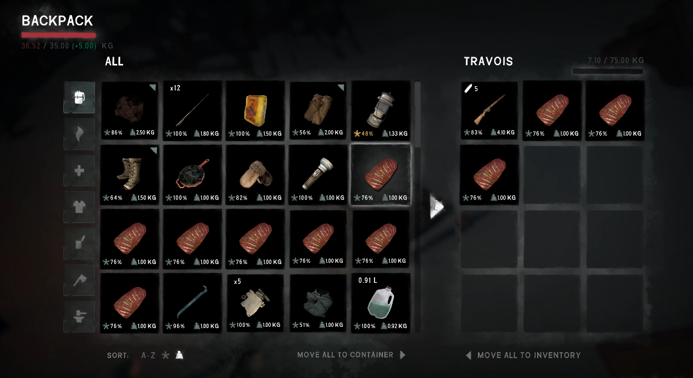

# Travois

**Categories:** DLC Content, Pages with update history, Tools · **Source:** [Fandom](https://thelongdark.fandom.com/wiki/Travois)

**Contents**

- [Overview](#overview)
- [Uses](#uses)
- [Limitations](#limitations)
- [Crafting](#crafting)
- [Repair](#repair)
- [Gallery](#gallery)
- [Update history](#update-history)

**Travois**

_Travois\_icon.png_

**Release:** [5 December 2023](./The%20Long%20Dark%20%E2%80%94%20Changelog.md#2.25)

**Wintermute:** No

**Renewable:** Yes

**Properties**

**Item type:** [Tools](./Tools.md)

**Stackable:** No

**Examine:** A timeless and efficient way to drag loads over long distances. Take care to remember there are some places a Travois can't travel. Can be collapsed for convenient carrying, when empty.

**Values**

**Weight:** 1.00 kg (2.2 lbs)

**Advanced data**

**Item key:** GAMEPLAY\_Travois

_Ptarmigan\_icon.png_

**DLC-Exclusive content.** / This content requires the [Tales from the Far Territory](./Tales%20from%20the%20Far%20Territory.md) addon to be installed before it can be seen or used in regular gameplay.

180 minutes (3 hour 0 minutes)

**Requirements**

**Facility:** 

**Tool:** 

**Materials**

**Item:** [Cured Deer Hide](./Cured%20Deer%20Hide.md)

**Quantity:** 1

[Cured Gut](./Cured%20Gut.md)

2

[Cured Maple Sapling](./Cured%20Maple%20Sapling.md)

4

_Icon used in The Far Territory marketing_

_Travois concept art_

_Travois concept art 2_

_Travois in-game screenshot_

_UI for loading and unloading the Travois_
