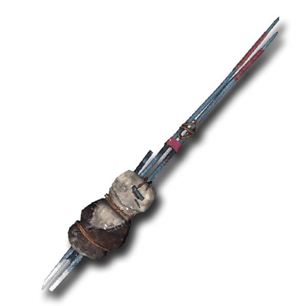
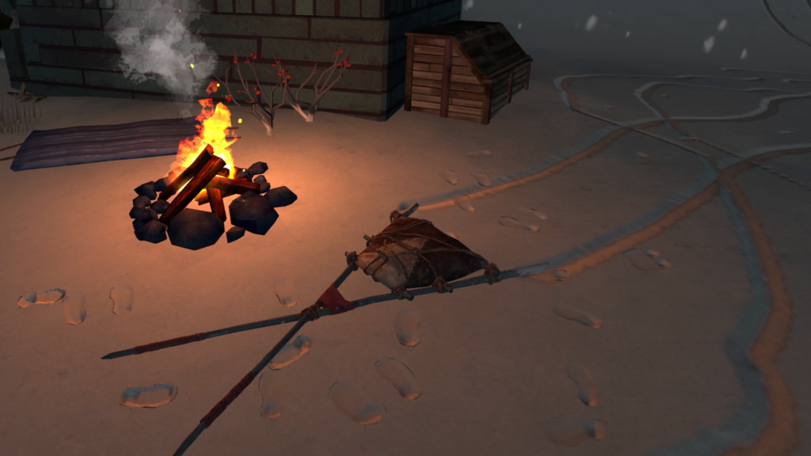

# Travois

**Categories:** DLC Content, Pages with update history, Tools · **Source:** [Fandom](https://thelongdark.fandom.com/wiki/Travois)

**Contents**

- [Overview](#overview)
- [Uses](#uses)
- [Limitations](#limitations)
- [Crafting](#crafting)
- [Repair](#repair)
- [Gallery](#gallery)
- [Update history](#update-history)

**Travois**

[Travois Icon](../assets/Travois_Icon.png)

**Release:** [5 December 2023](./The%20Long%20Dark%20%E2%80%94%20Changelog.md#2.25)

**Wintermute:** No

**Renewable:** Yes

**Properties**

**Item type:** [Tools](./Tools.md)

**Stackable:** No

**Examine:** A timeless and efficient way to drag loads over long distances. Take care to remember there are some places a Travois can't travel. Can be collapsed for convenient carrying, when empty.

**Values**

**Weight:** 1.00 kg (2.2 lbs)

**Advanced data**

**Item key:** GAMEPLAY\_Travois

[Ptarmigan icon](../assets/Ptarmigan_icon.png)

**DLC-Exclusive content.** This content requires the [Tales from the Far Territory](./Tales%20from%20the%20Far%20Territory.md) addon to be installed before it can be seen or used in regular gameplay.

 **Travois** (pronounced Trav-wah) are a crafted vehicle for item transportation and storage in _The Long Dark_. They can be loaded with large amounts of items, then manually dragged to move them. It was introduced in Part 4 "Buried Echoes" update for [Tales from the Far Territory](./Tales%20from%20the%20Far%20Territory.md). **Warning**: As of [patch 2.50](https://store.steampowered.com/news/app/305620?updates=true&emclan=103582791436288468&emgid=526487474953781659) (December, 2025) on PC, the Travois can still fall under the terrain if left outside in a loaded state before transitioning through a loading screen, forcing the player to retrieve **ALL** its contents (with the exception of [Decorations](./Decorations.md), which will all be **LOST**) from a [Lost and Found](./Lost%20and%20Found.md) box appropriate to the [region](./Region.md) it was lost in. (Note: the Lost and Found box will always be found outdoors, in a predetermined place within the region.) As an added inconvenience, the Travois may be in a Ruined state when it is found. The Travois can even fly up in the air, instead of disappearing and being placed in a Lost and Found box, if left on the ground near certain locations (such as [Mountaineer's Hut](./Mountaineer%27s%20Hut.md)), which will make the recovery of its contents impossible. To be completely safe, **NEVER** leave a loaded Travois on the ground before going through a loading screen.

<!-- #Overview -->
​

<!-- #overview -->
## Overview

Travois are a crafted [tool](./Tools.md) for storing and transporting up to 75.00kg of cargo; functionally a travois is a deerskin backpack attached to a sled, which is dragged by the survivor to new locations. When used, a travois will lose condition over time from wear and tear; they may be repaired with [Cured Gut](./Cured%20Gut.md) and a [Cured Deer Hide](./Cured%20Deer%20Hide.md) for 70% condition. Harvesting a Travois produces 3 [Cured Maple Sapling](./Cured%20Maple%20Sapling.md).

- They weigh 1.00kg in the survivor's inventory or containers, and can be "Deployed" outdoors on flat surfaces or repaired. In order to pick up and placed into the inventory again, a Travois must first be empty.
- Travois cannot be dropped like common items, only deployed (they can be placed into containers however).
- Deployed Travois have 2 states when deployed:
  - **Empty**: When first deployed onto the ground, they may be interacted with at their rear to store/remove cargo. Moving the cursor to the front of the Travois handles will give the option to "Pickup Travois" to place it into the player's inventory. Placing items in the pouch changes the state of a Travois from "Empty" to "Loaded."
  - **Loaded**: When an item is placed in the storage pouch, this changes the Travois to the Loaded state. Moving the cursor to the front of the Travois handles will give the option to "Carry Travois". The Travois can be carried around in this state, and displays a unique red icon in the bottom right of the screen when it is being carried. When hauling a Travois, all actions are disabled except for the [Radial Menu](./Radial%20Menu.md) (which only contains the Map, Drop functions), walking forward, and turning. To cancel hauling a travois: press the Radial Menu ("Space") and "Drop" the travois or by pressing the "Put Away" key.

When the survivor transitions between Regions while using a Travois, they will start on the new map still hauling it. Travois cannot be brought inside structures (through doors) or into mines. They can be brought inside interior [caves](./Cave%20%28Transition%20Zone%29.md) though not redeployed when inside. They cannot be carried up a [Rope Climbing](./Rope%20Climbing.md) section unless they are emptied and placed back into the player's inventory.

A Travois will leave 2 large lines in the snow as the player travels, similar to a player's footsteps.

<!-- #Uses -->
​

<!-- #uses -->
## Uses

The Travois are most useful in [regions](./Region.md) with large expanses of relatively flat, open ground. These include [Forsaken Airfield](./Forsaken%20Airfield.md), [Pleasant Valley](./Pleasant%20Valley.md), [Coastal Highway](./Coastal%20Highway.md), [Desolation Point](./Desolation%20Point.md), and [Forlorn Muskeg](./Forlorn%20Muskeg.md), as well as parts of [Mystery Lake](./Mystery%20Lake%20%28region%29.md), [Mountain Town](./Mountain%20Town.md), [Bleak Inlet](./Bleak%20Inlet.md), and [Blackrock](./Blackrock.md).

Some uses of Travois include:

- Moving inventory from a [Safe House](./Safehouse.md) between locations/regions. They can also be used to start up/evacuate bases.
- Moving large amount of meat, hide, and guts from hunting.
- Transporting [Quartered](./Carcass%20Harvesting.md) Bear or Moose to a safer location in one trip.
- Moving Fish from [Ice Fishing](./Ice%20Fishing.md) or [Fishing Tip-Ups](./Fishing%20Tip-Up.md), or firewood to a fishing location to stay warm during future fishing.
- Collecting and transporting large amounts of [Firewood](./Campfire.md), [Scrap Metal](./Scrap%20Metal.md), or [Coal](./Coal.md).
- Moving a [Car Battery](./Car%20Battery.md) to fix a [Transmitter](./Transmitters.md).
- They can be used as a mobile storage container when exploring/looting a new Region.
- Heavy items can be dropped inside during an emergency (such as a wildlife attack or blizzard) and can be abandoned with the Travois, then can be recovered later when it is safe.
- Moving many [Decorations](./Decorations.md).
- Moving Salt harvested from a [Salt Deposit](./Salt%20Deposit.md).
- Moving items to [Coastal Highway](./Coastal%20Highway.md) to trade with the [Trader](./Trader.md).

<!-- #Limitations -->
​

<!-- #limitations -->
## Limitations

When deployed and carried, a Travois has a number of limitations in exchange for their benefits:

- Cannot be used Indoors (cannot be deployed indoors either). The only exception is that the Travois can be brought into interior caves, which don't require clicking to be entered, but it has to be dragged in through the cave entrance; it cannot be deployed inside.
- The handles cannot be picked up if the player is crouching under an object/there is not enough room to stand up.
- Limited turning: cannot turn as quickly as on foot, and must have room to navigate obstacles. In order to turn, the player must move forward/backwards and turn the camera left/right at the same time (somewhat similar to tank controls).
- Limited vision: cannot turn the camera much (~30\* frontal arc), and must drop the Travois to look around, distract/shoot wildlife, etc.
- Limited mobility:
  - [Sprinting](./Stamina.md)/[Climbing](./Rope%20Climbing.md) is disabled.
  - The player can crouch while holding the Travois, but cannot move until they stand up again.
  - Cannot navigate over steep slopes ([Sprain Risk](./Sprain%20Risk.md) hills), cliffs, low passages which require crouching, through doors/mine transitions, or up/down [Rope Climbing](./Rope%20Climbing.md)/[Rock Climbing](./Rock%20Climb.md) spots when deployed, and must be emptied and folded up, then placed in the player's Backpack along with any other items in order to progress.
  - Getting close to objects (trees, cliffsides, etc) will produce the message "No space for Travois" and force the player to back up to go around. They cannot be used when [Mountain Goating](./Mountain%20Goating.md).
- Limited Speed:
  - Carrying a travois slows the movement speed. The heavier the travois, the slower one moves.
  - 4.72 movement speed with 0kg in Travois (Also 4.72 without travois, for reference running speed is 10.28)
  - 4.62 movement speed with 15kg in Travois
  - 4.41 movement speed with 30kg in Travois
  - 4.00 movement speed with 45kg in Travois
  - 3.81 movement speed with 50kg in Travois
  - 3.59 movement speed with 55kg in Travois
  - 3,33 movement speed with 60kg in Travois
  - 3.05 movement speed with 65kg in Travois
  - 2.71 movement speed with 70kg in Travois
  - 2,34 movement speed with 75kg in Travois
- Cannot hold items in-hand (weapons, light sources, etc) when carrying Travois.
- Ruined food items disappear when placed inside a Travois (similar to other containers).
- Travois lose Condition fairly quickly while being towed (Condition loss tends to be 1% condition/every 30 meters). When using it on rough terrain (not covered by snow or ice) the condition loss is amplified further. Railway tracks are especially hard on the Travois and it is therefore advisable not to drag the Travois on railway tracks when it can be avoided.
- A ruined Travois will force the player to an immediate halt, and cannot be harvested or removed. A ruined Travois can still serve as a stationary container with reduced capacity (40.00kg), though.
- Travois are one of the few tools to lose condition due to natural [Decay](./Decay.md), even when in storage or when carried in the player's inventory. The Travois will also take condition damage when left out (deployed) in a blizzard.

Regions difficult to use a Travois in often have narrow/winding paths, rope climbs, rock climbs, or steep hills/mountains, such as [Ash Canyon](./Ash%20Canyon.md), [Timberwolf Mountain](./Timberwolf%20Mountain.md), [Hushed River Valley](./Hushed%20River%20Valley.md), [Old Island Connector](./Crumbling%20Highway.md), [Winding River](./Winding%20River.md), or [Raven Falls Trestle](./Raven%20Falls%20Trestle.md) in [The Ravine](./The%20Ravine.md). They cannot be used at indoors areas like: [Carter Hydro Dam](./Carter%20Hydro%20Dam.md), [Cinder Hills Coal Mine](./Cinder%20Hills%20Coal%20Mine.md), or [Abandoned Mine No. 3](./No.%203%20Coal%20Mine.md).

Travois are not practical tools to use in most [Challenges](./Challenge.md) due to various time/hostile wildlife stipulations.

<!-- #Crafting -->
​

<!-- #crafting -->
## Crafting

**Travois**

180 minutes (3 hour 0 minutes)

[Cured Gut](./Cured%20Gut.md)

2

[Cured Maple Sapling](./Cured%20Maple%20Sapling.md)

4

**Requirements**

**Item:** [Cured Deer Hide](./Cured%20Deer%20Hide.md)

**Quantity:** 1

<!-- #Repair -->
​

<!-- #repair -->
## Repair

Travois lose condition over time when stored or moved and also when deployed in a blizzard. They can be repaired in 2 hours (Using no tool) from the survivor's inventory with 1 [Cured Deer Hide](./Cured%20Deer%20Hide.md) and 1 [Cured Gut](./Cured%20Gut.md) and also provide a skill point increase. Time taken will depend on [Repair](./Repair.md) skill level and the tool selected. Repairing with a [Hunting Knife](./Hunting%20Knife.md), [Hatchet](./Hatchet.md) or their improvised versions reduces repair time.

<!-- #Gallery -->
​

<!-- #gallery -->
## Gallery

<!-- #update_history -->
​

<!-- #Update_history -->
​

<!-- #Update_History -->
​

<!-- #update-history -->
## Update history

- UPDATE **5 December 2023 ([Update](./The%20Long%20Dark%20%E2%80%94%20Changelog.md#2.25)):**
  - Added to game.
