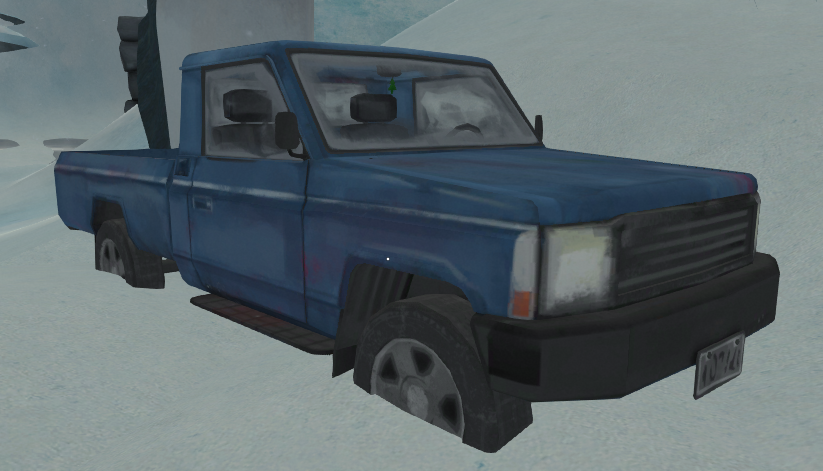
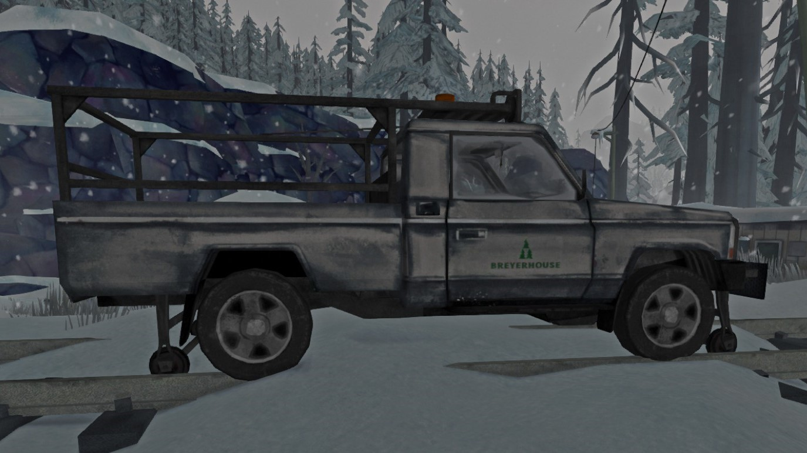
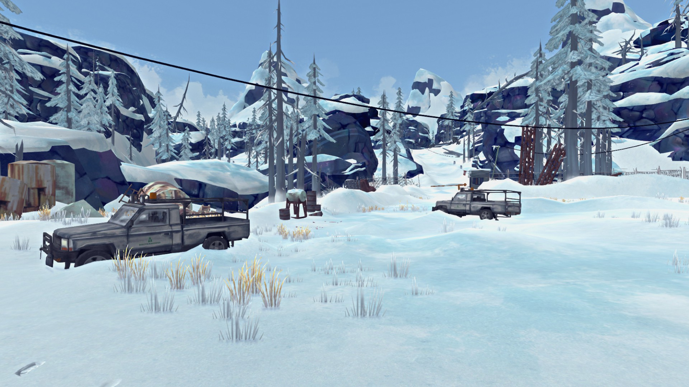

# Truck

*A standard blue truck* **Trucks** are compact, 2-door single cab utility [vehicles](./Vehicle.md) found in the game *[The Long Dark](./The%20Long%20Dark.md)*

## Overview

Much like [cars](./Car.md) and [tractors](./Tractor.md), trucks are currently undrivable, though the cab can be entered, the glove compartment searched, the hood opened, and the sun [visors](./Visor.md) tilted (possibly revealing [Mementos](./Mementos.md)).

Just like cars, the gas lid and front hood can be opened. Some trucks have [batteries](./Car%20Battery.md) inside.

There are three types of trucks found on [Great Bear Island](./Great%20Bear%20Island.md). The majority are coloured light blue, white, or brown and are for road use only, while others - found exclusively in [Mystery Lake](./Mystery%20Lake%20%28region%29.md) and [Broken Railroad](./Broken%20Railroad.md) - are light brown [road-rail vehicles](Wikipedia:Road-rail_vehicle) with [Breyerhouse](./Breyerhouse.md) branding. The latter are fitted with rail wheels, allowing them to utilize the [Trans-Island Railway Line](./Trans-Island%20Railway%20Line.md). Inside the [Blackrock](./Blackrock.md) region and the [Keepers Pass North](./Keeper%27s%20Pass%20North.md) connector region a variant of the light blue truck can be found. The Blackrock variant of the truck is noticeable for its light bar on the roof and the name Blackrock printed on the side. During an aurora, a truck's lights will flicker and their radio's become functional, playing classical music.

## Gallery

| Column 1 | Column 2 |
| --- | --- |
|  / *A Breyerhouse utility truck on the tracks.* |  / *maintenance\_yard.jpg* |

**Lua execution error in Module:Navbox function navbox** [ru:Пикап](ru:%D0%9F%D0%B8%D0%BA%D0%B0%D0%BF)
