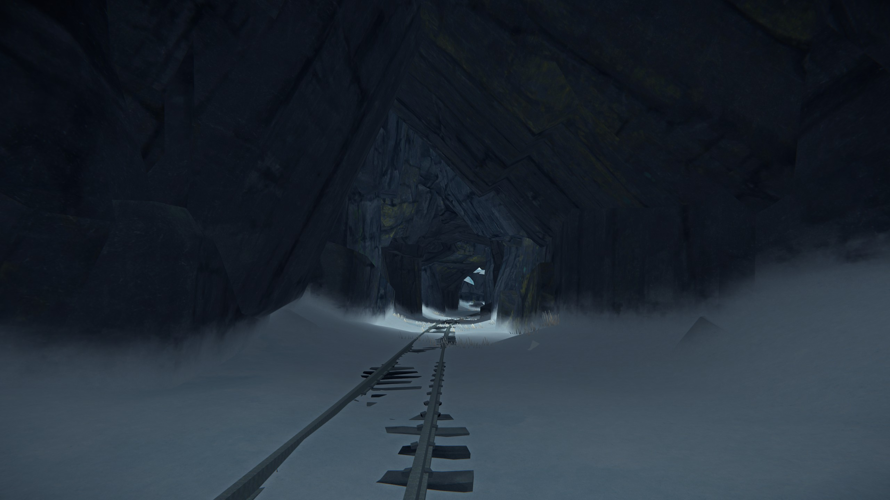
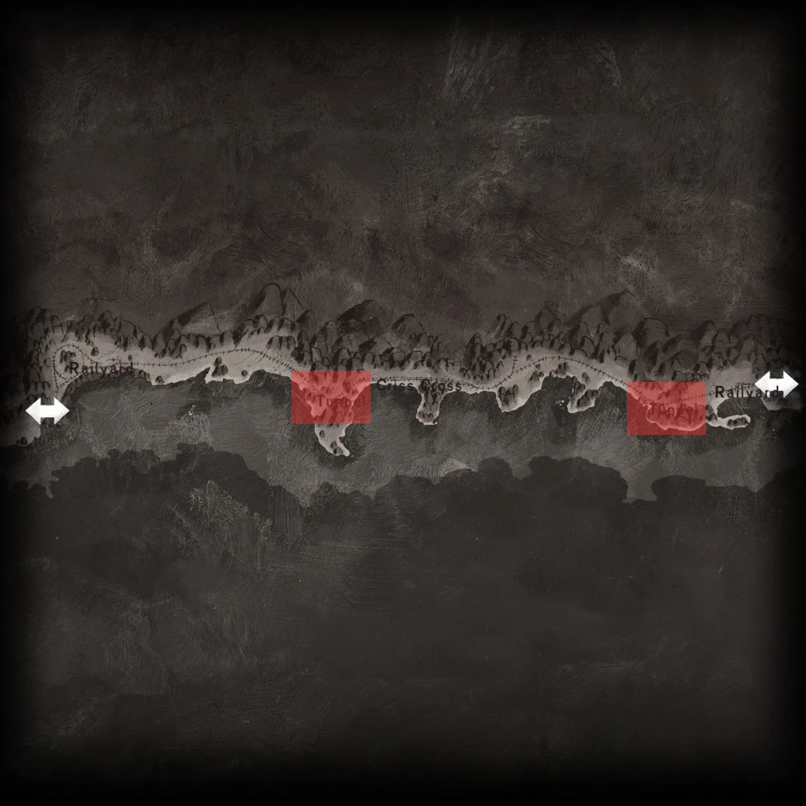

# Tunnel

**Categories:** DLC Content, Locations, Locations in Anna Island -- Track Section 2, Outdoor locations · **Source:** [Fandom](https://thelongdark.fandom.com/wiki/Tunnel)

| Column 1 | Column 2 | Column 3 |
| --- | --- | --- |

| \[\[File: /  / _West_ /  / _East_ | 250px\]\] |  |
|  / _West_ |  / _East_ |  |
| **Location** |  |  |
|  / _Tunnel\_Track\_2\_Location.png_ |  |  |
| Region | [Anna Island -- Track Section 2](./Anna%20Island%20--%20Track%20Section%202.md)\|- | Location |
| Description | 2 railway tunnels in the region |  |
| **General** |  |  |
