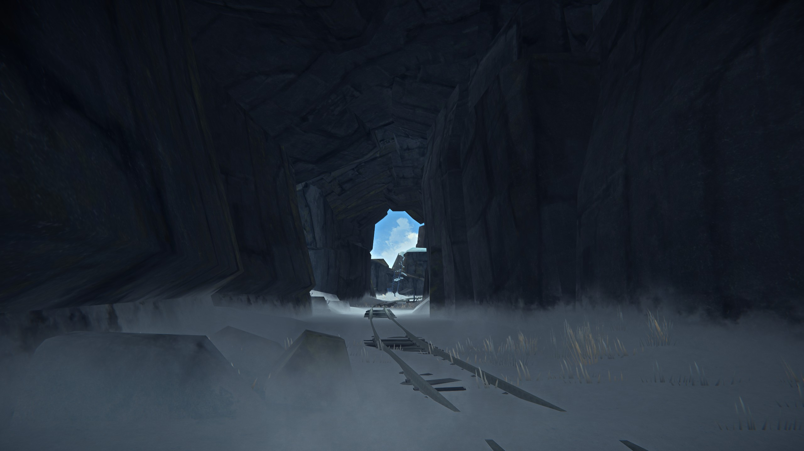

# Tunnel

| Column 1 | Column 2 | Column 3 |
| --- | --- | --- |
|  / *Seal\_icon.png* | **DLC-Exclusive content.** / This content requires the [Iron Road](./Iron%20Road.md) addon to be installed before it can be seen or used in regular gameplay. | \|} / **Tunnel** / \| Property \| Details \| / \| --- \| --- \| / \| \[\[File: / \\|  / *West* \\|  / *East* \\| / \\| --- \\| --- \\| \| 250px\]\] \| / \|  / *West* \|  / *East* \| / \| **Location** \|  \| / \|  / *Tunnel\_Track\_2\_Location.png* \|  \| / \| Region \| [Anna Island -- Track Section 2](./Anna%20Island%20--%20Track%20Section%202.md)\\|- / Location \| / \| Description \| 2 railway tunnels in the region \| / \| **General** \|  \| / \|  \| Has no shelter\\|} **Tunnel** is a set of 2 locations in [Anna Island -- Track Section 2](./Anna%20Island%20--%20Track%20Section%202.md). / ## Overview / There are two tunnels in this region that are considered named locations. One is to the semi-mid west, and the other to the semi-mid east. There is nothing remarkable about them, as they eventually converge to the [Criss Cross](./Criss%20Cross.md) location. / **Lua execution error in Module:Navbox function navbox** \| |
| \[\[File: / \|  / *West* \|  / *East* \| / \| --- \| --- \| | 250px\]\] |  |
|  / *West* |  / *East* |  |
| **Location** |  |  |
|  / *Tunnel\_Track\_2\_Location.png* |  |  |
| Region | [Anna Island -- Track Section 2](./Anna%20Island%20--%20Track%20Section%202.md)\|- | Location |
| Description | 2 railway tunnels in the region |  |
| **General** |  |  |
|  | Has no shelter\|} **Tunnel** is a set of 2 locations in [Anna Island -- Track Section 2](./Anna%20Island%20--%20Track%20Section%202.md). / ## Overview / There are two tunnels in this region that are considered named locations. One is to the semi-mid west, and the other to the semi-mid east. There is nothing remarkable about them, as they eventually converge to the [Criss Cross](./Criss%20Cross.md) location. / **Lua execution error in Module:Navbox function navbox** |  |
