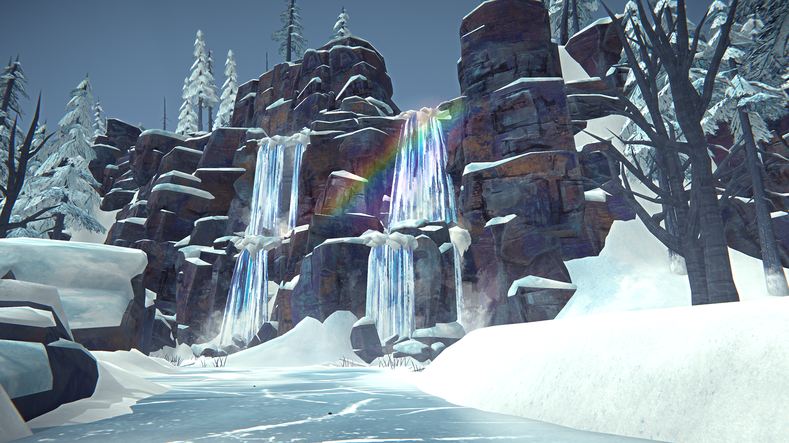
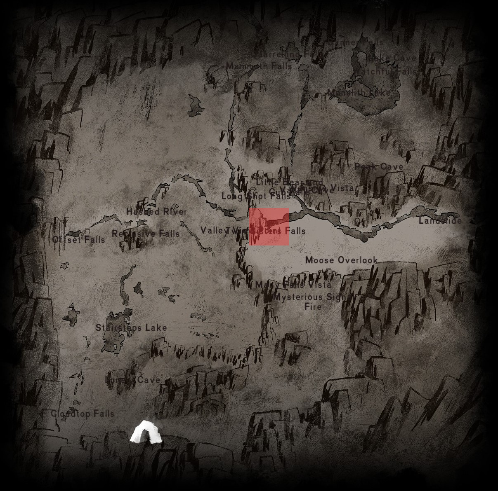
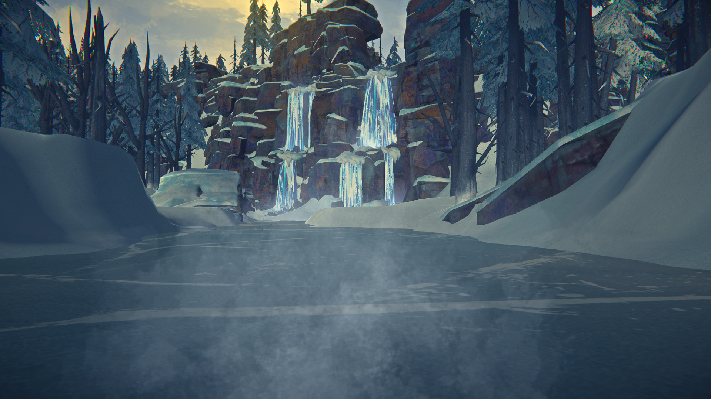
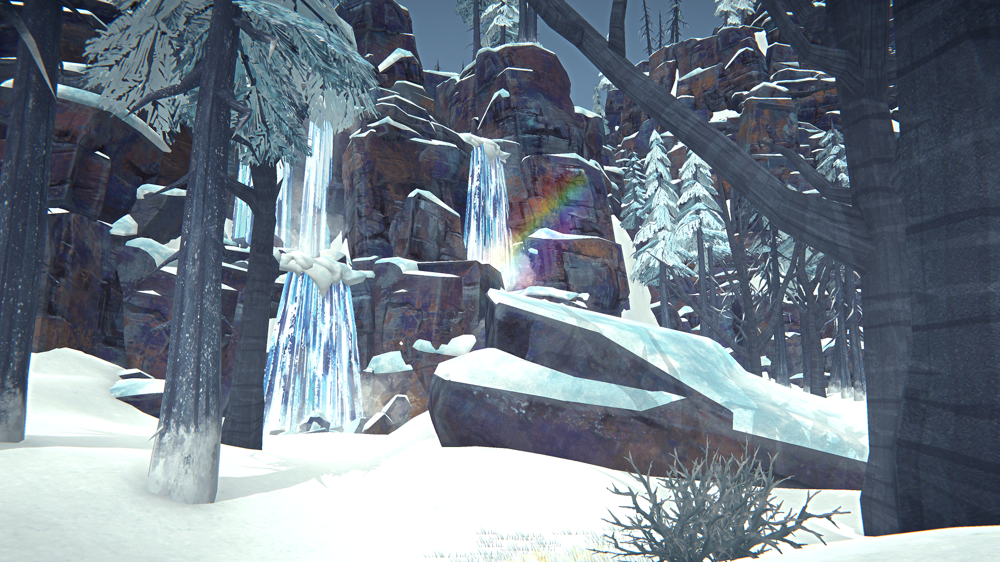

# Twin Sisters Falls

**Categories:** Landmarks, Locations, Locations in Hushed River Valley, Outdoor locations, Waterfalls · **Source:** [Fandom](https://thelongdark.fandom.com/wiki/Twin_Sisters_Falls)

**Twin Sisters Falls**

_TwinSisterFallsRainbow.png_

**Location**

_Twin\_Sisters\_Falls\_Location.png_

**Region:** [Hushed River Valley](./Hushed%20River%20Valley.md)

**Description:** Two waterfalls.

**General**

**Type:** Landmark

## Overview

Twin Sister falls features two rather tall waterfalls side-by-side. [Cat tails](./Cat%20Tail.md) can be found in the area. A [Moose](./Moose.md) may occasionally be found nearby. The nearest suitable shelter is the Valley Cave.

## Trivia

On clear days, these falls show a rainbow; this is the only location on Great Bear Island where a rainbow can be found.

## Gallery

_The view from [Many Falls Vista](./Many%20Falls%20Vista.md). Twin Sisters Falls are the two leftmost waterfalls._

_The falls at sunset._

_Another view of the rainbow seen at Twin Sisters Falls._
