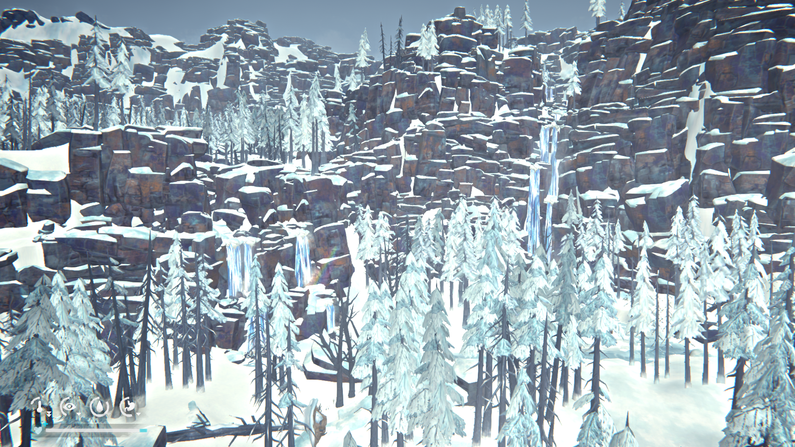

# Twin Sisters Falls

**Categories:** Landmarks, Locations, Locations in Hushed River Valley, Outdoor locations, Waterfalls · **Source:** [Fandom](https://thelongdark.fandom.com/wiki/Twin_Sisters_Falls)

**Twin Sisters Falls**

| Property | Details |
| --- | --- |
|  | [TwinSisterFallsRainbow](../assets/TwinSisterFallsRainbow.png) |
| **Location** |  |
|  | [Twin Sisters Falls Location](../assets/Twin_Sisters_Falls_Location.png) |
| Region | [Hushed River Valley](./Hushed%20River%20Valley.md) |
| Location | Just east of [Valley View Point](./Valley%20View%20Point.md). |
| Description | Two waterfalls. |
| **General** |  |
| Type | Landmark |
|  | Has no shelter |

**Twin Sisters Falls** is a waterfall located along the [Hushed River](./Hushed%20River.md), in [Hushed River Valley](./Hushed%20River%20Valley.md). It's located just east of [Valley View Point](./Valley%20View%20Point.md) and a short walk west-southwest of the [Valley Cave](./Valley%20Cave.md).

## Overview

Twin Sister falls features two rather tall waterfalls side-by-side. [Cat tails](./Cat%20Tail.md) can be found in the area. A [Moose](./Moose.md) may occasionally be found nearby. The nearest suitable shelter is the Valley Cave.

## Trivia

On clear days, these falls show a rainbow; this is the only location on Great Bear Island where a rainbow can be found.

## Gallery

_The view from [Many Falls Vista](./Many%20Falls%20Vista.md). Twin Sisters Falls are the two leftmost waterfalls._

