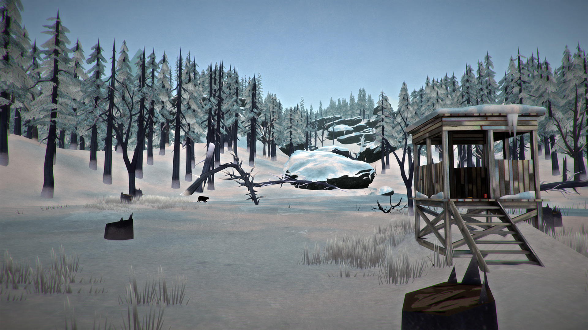
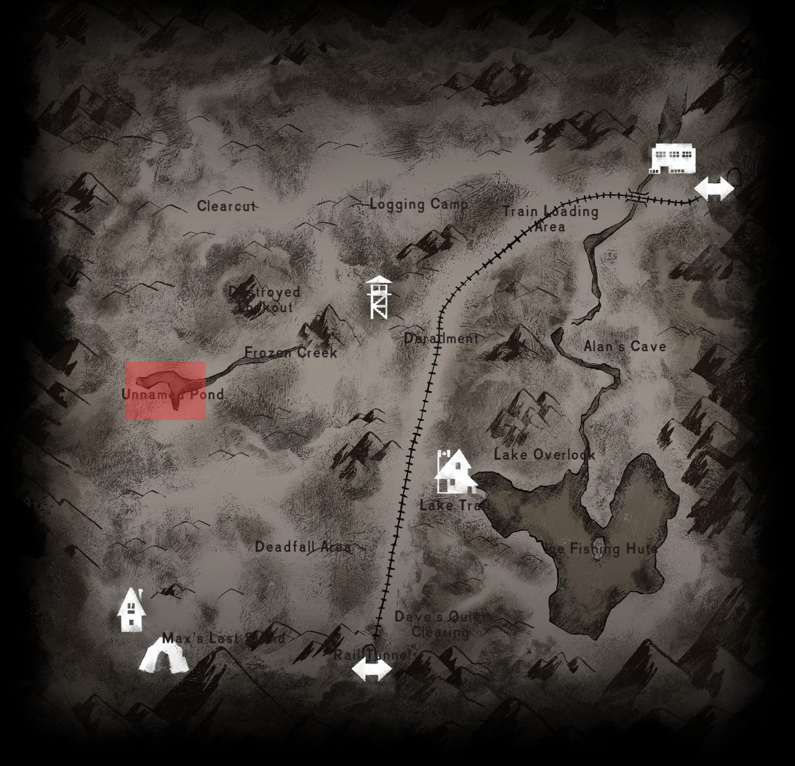

# Unnamed Pond

**Unnamed Pond**

| Property | Details |
| --- | --- |
|  |  / *Unnamed\_pond\_01.jpg* |
| **Location** |  |
|  |  / *Unnamed\_Pond\_Location.png* |
| Region | [Mystery Lake](./Mystery%20Lake%20%28region%29.md)\|- |
| Type | Outdoors\|- |
