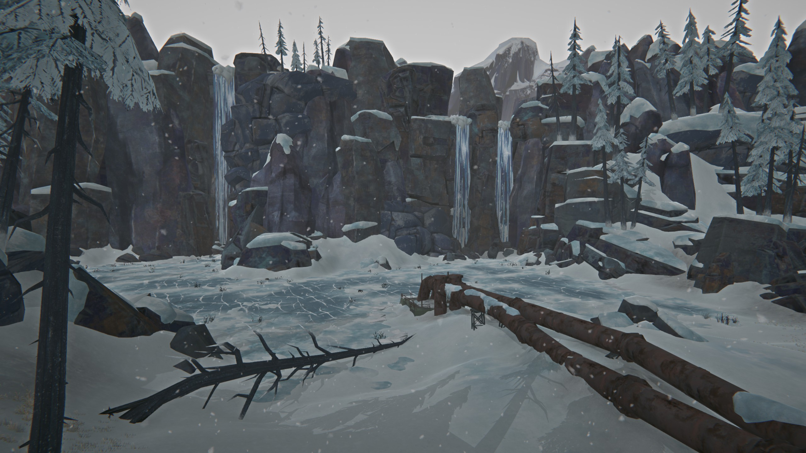
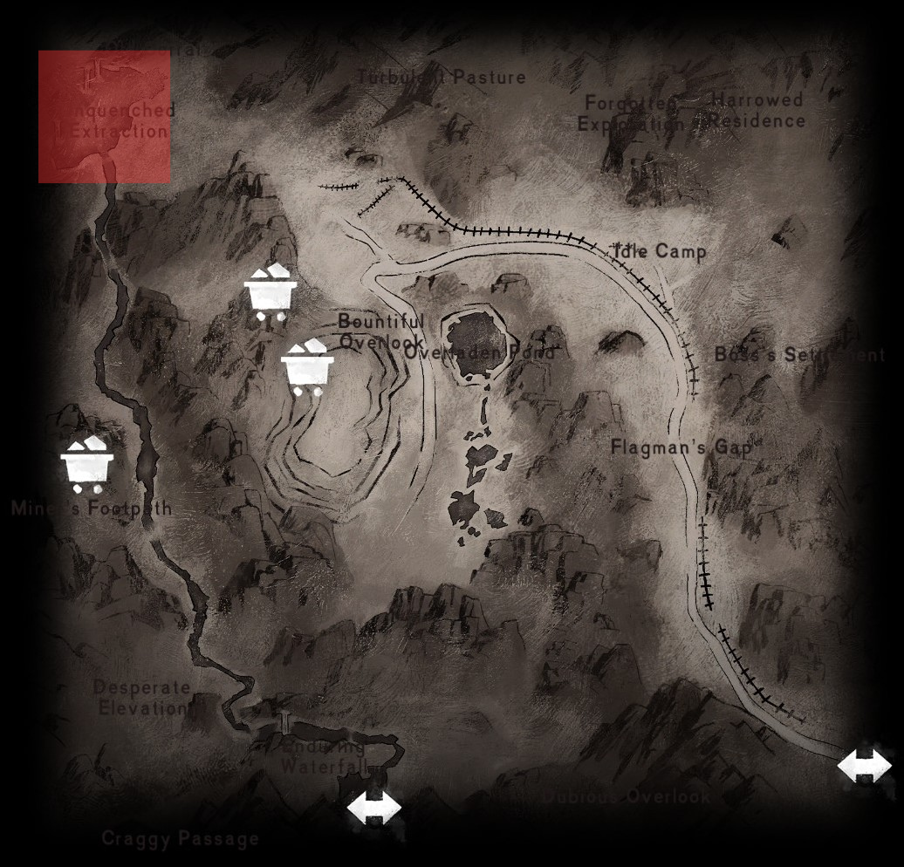

# Unquenched Extraction

**Categories:** Lakes, Locations, Locations in Zone of Contamination, Outdoor locations · **Source:** [Fandom](https://thelongdark.fandom.com/wiki/Unquenched_Extraction)

**Unquenched Extraction**

_Unquenched\_Extraction.jpg_

**Location**

_Unquenched\_Extraction\_Location.png_

**Region:** [Zone of Contamination](./Zone%20of%20Contamination.md)

**Description:** The biggest lake in the region located in the northwest corner.

**General**

Type

Has no shelter **Unquenched Extraction** is the biggest lake in the region, with two large dormant metal water extraction pumps emerging from the lake and heading towards the [Concentrator](./Concentrator.md) building of the [Langston Mine](./Langston%20Mine.md) mining complex, presumably going deeper to the mines and later the [Pump House](./Pump%20House.md).

## Overview

This unpolluted lake fed by three large waterfalls offers no shelter, however the player can hide in the nearby [Old Corral](./Old%20Corral.md) to the north or the crashed helicopter in the nearby mountains, if the weather changes for the worst. Heading south is a path heading south the Langston Mine mining complexes southwestern entrance, [Miner's Footpath](./Miner%27s%20Footpath.md), an entrance to [Langston Mine](./Langston%20Mine.md) Level 3, [Smoker's Cave](./Smoker%27s%20Cave.md) and [Desperate Elevation](./Desperate%20Elevation.md).

The lake is the only location in the region deep enough to support Free Form [Ice Fishing](./Ice%20Fishing.md), and offers plenty of [Cat Tails](./Cat%20Tail.md). A [Distress Pistol](./Distress%20Pistol.md) with two [Flare Shells](./Flare%20Shell.md) can also be found on the left side of the pipes looking from the direction of the Langston Mine complex. Be aware that several [Poisoned Wolves](./Poisoned%20Wolf.md) patrol the lake searching for food.
