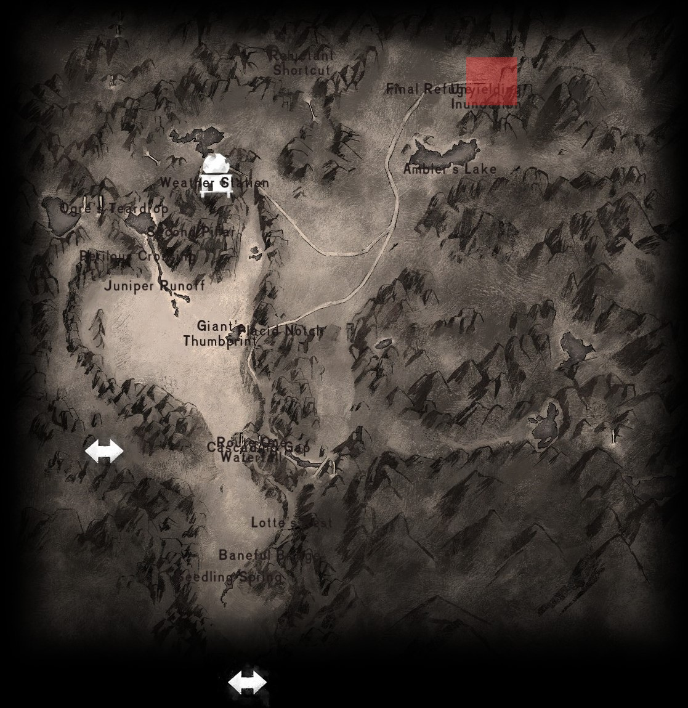

# Unyielding Inundation

**Unyielding Inundation**

| Property | Details |
| --- | --- |
|  |  / *Unyielding\_Inundation.jpg* |
| **Location** |  |
|  |  / *Unyielding\_Inundation\_Location.png* |
| Region | [Sundered Pass](./Sundered%20Pass.md)\|- |
|  | Has no shelter\|} / **Unyielding Inundation** is a location in [Sundered Pass](./Sundered%20Pass.md) just up the road from [Final Refuge](./Final%20Refuge.md). / ## Overview / It is a large avalanche, burying the mountain road and presumably preventing the player from using the road to reach the [High Peak Plateau](./High%20Peak%20Plateau.md), requiring the player to use the climbing rope past [Ambler's Lake](./Ambler%27s%20Lake.md) to reach the Peak as part of the [Last Horizon](./Last%20Horizon.md) Tale. / There is no loot or any other notable features nearby. / ## Trivia / The word Inundation can be defined as a flood, accurately describing the mass of snow on the road. / **Lua execution error in Module:Navbox function navbox** [ru:Неумолимый разлив](ru:%D0%9D%D0%B5%D1%83%D0%BC%D0%BE%D0%BB%D0%B8%D0%BC%D1%8B%D0%B9_%D1%80%D0%B0%D0%B7%D0%BB%D0%B8%D0%B2) |
