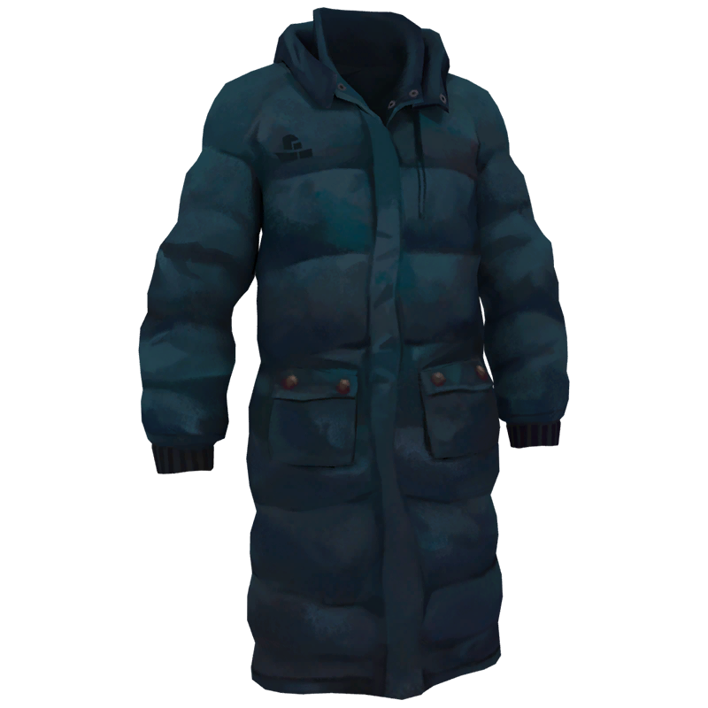

# Urban Parka

**Categories:** Clothing, Pages with update history · **Source:** [Fandom](https://thelongdark.fandom.com/wiki/Urban_Parka)

**Urban Parka**

_Urban\_Parka\_icon.png_

**General**

**Item Type:** Clothing\|-

**Clothing Slot:** Outer torso

**Statistics**

**Weight:** 1.00 kg(2.2 lbs)

**Warmth bonus:** 2.5 °C(4.5 °F)

**Windproof bonus:** 2.0 °C(3.6 °F)

**Waterproof bonus:** 10%

**Protection:** 2%

**Mobility:** -2%

**Harvest:** 3 × [Cloth](./Cloth.md) / 20 minutes

**Repair:** 3 × [Cloth](./Cloth.md) / 60 minutes / 35% condition

> “**Long, heavy down coat. More suitable to urban survivalists but the extra length might help keep your kidneys warm.**”
>
> — In-game description

The **Urban Parka** is a type of [clothing](./Clothing.md) in _[The Long Dark](./The%20Long%20Dark.md)_.

## Overview

Mid to low tier coat. Has the second best warmth to weight ratio but has terrible waterproofness and protection. Its also very expensive to repair - ideally, wear in on the inside coat slot. Pairs well with a [Flight Jacket](./Flight%20Jacket.md), [Ski Jacket](./Ski%20Jacket.md), or [Light Shell](./Light%20Shell.md).

_Clothing Model_

_Clothing model damaged_

## Update history

- UPDATE **19 December 2016 ([Update](./The%20Long%20Dark%20%E2%80%94%20Early%20Access%20Changelog.md#0.386)):**
  - Added to game
