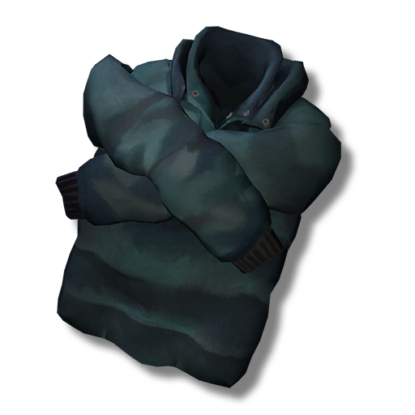
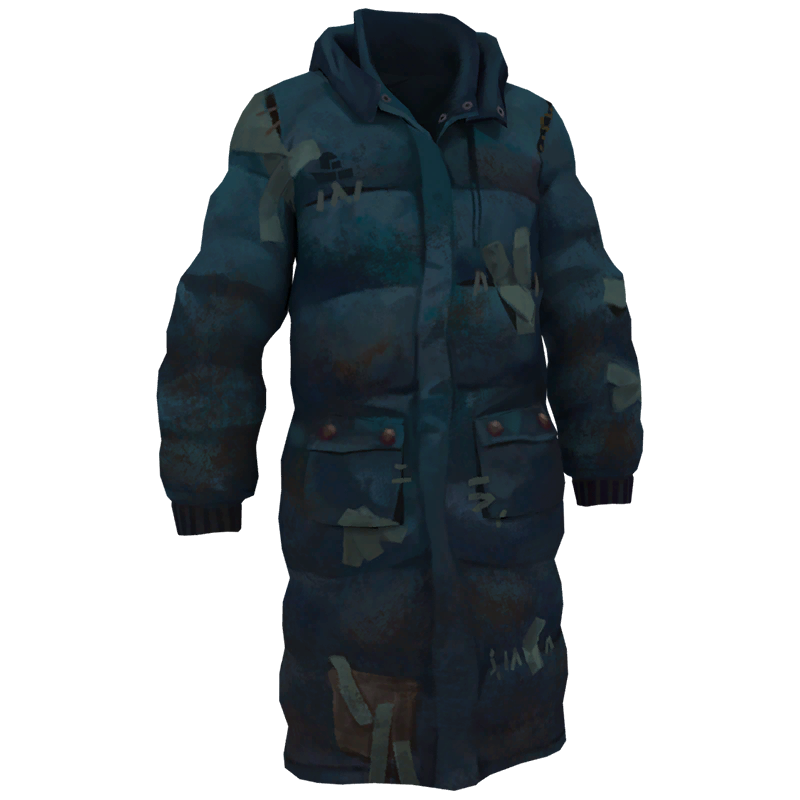

# Urban Parka

**Urban Parka**

| Property | Details |
| --- | --- |
|  |  / *Urban\_Parka\_icon.png* |
| **General** |  |
| Item Type | Clothing\|- |
| Clothing Slot | Outer torso |
| **Statistics** |  |
| Weight | 1.00 kg(2.2 lbs) |
| Warmth bonus | 2.5 °C(4.5 °F) |
| Windproof bonus | 2.0 °C(3.6 °F) |
| Waterproof bonus | 10% |
| Protection | 2% |
| Mobility | -2% |
| Harvest | 3 × [Cloth](./Cloth.md) / 20 minutes |
| Repair | 3 × [Cloth](./Cloth.md) / 60 minutes / 35% condition |

> “**Long, heavy down coat. More suitable to urban survivalists but the extra length might help keep your kidneys warm.**”
>
> — In-game description

The **Urban Parka** is a type of [clothing](./Clothing.md) in *[The Long Dark](./The%20Long%20Dark.md)*.

## Overview

Mid to low tier coat. Has the second best warmth to weight ratio but has terrible waterproofness and protection. Its also very expensive to repair - ideally, wear in on the inside coat slot. Pairs well with a [Flight Jacket](./Flight%20Jacket.md), [Ski Jacket](./Ski%20Jacket.md), or [Light Shell](./Light%20Shell.md).

| Column 1 | Column 2 |
| --- | --- |
|  / *Clothing Model* |  / *Clothing model damaged* |

## Update history

- UPDATE **19 December 2016 ([Update](./The%20Long%20Dark%20%E2%80%94%20Early%20Access%20Changelog.md#0.386)):**
  - Added to game

**Lua execution error in Module:Navbox function navbox** [ru:Городская парка](ru:%D0%93%D0%BE%D1%80%D0%BE%D0%B4%D1%81%D0%BA%D0%B0%D1%8F_%D0%BF%D0%B0%D1%80%D0%BA%D0%B0)
