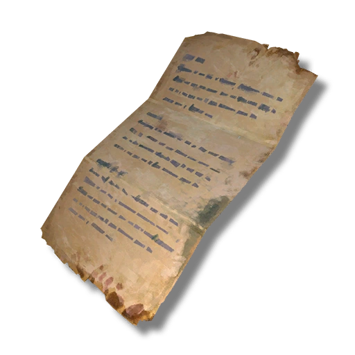

# Utilities Bill

**Categories:** Collectibles, Pages with update history · **Source:** [Fandom](https://thelongdark.fandom.com/wiki/Utilities_Bill)

**Utilities Bill**

_Utilities\_Bill\_icon.png_

**Wintermute:** [Episode 1](./Episode%201%20-%20Do%20Not%20Go%20Gentle.md)

**Properties**

**Item type:** [Collectibles](./Collectibles.md)

**Stackable:** No

**Examine:** Utilities Bill found in the Farmhouse on the outskirts of Milton.

**Values**

**Weight:** 0.00 kg (0 lbs)

**Actions**

**Backpack:** Examine

**On ground:** Take It, Read Text, Leave It

**Utilities Bill** is a [Collectible](./Collectibles.md) item found in [Episode 1](./Episode%201%20-%20Do%20Not%20Go%20Gentle.md) of [Wintermute](./Wintermute.md).

It is found on a table inside the [Paradise Meadows Farm](./Paradise%20Meadows%20Farm.md) house.

## Transcript

_The following text is transcribed from **Utilities Bill**_

**OVERDUE -- FINAL WARNING

Dear Mr. Barker,

You (sic) account with Mainland Power Corp. is now severely past due. Your account is in arrears to the tune of: $1256.45

Despite our attempts to contact you to remedy this situation, on this third and final warning we regretfully report that we are left with no choice but to interrupt service immediately. We have dispatched a recovery crew to repossess your leased SOLAR BLOCK MODEL BK1. Once your account has been brought up to date, we will be more than happy to restore your service.

Please note that all meter readings are carried out by impartial drones deployed by our Remote Monitoring station on Great Bear. If you would like to dispute the reading, please contact your local Ombudsman, which according to our records is located at \[\*\*\*MISSING DATA\*\*\*\].

Mainland Power Corp. is the primary service provider of grid 0 based power for the Southern Great Bear region. We pride ourselves in our dedication to customer service, and have been awarded the MUSK GREEN SERVICE MEDALLION for the past three years running.

If you would like to make a payment, or communicate with us about your account status, we invite you to contact us by phone, email, social media, or drone mailer according to the contact information provided below.

Thank you, and have a nice day.

MAINLAND POWER CORP.**

## Update history

- UPDATE **1 August 2017 ([Update](./The%20Long%20Dark%20%E2%80%94%20Changelog.md#1.00)):**
  - Added to game.
