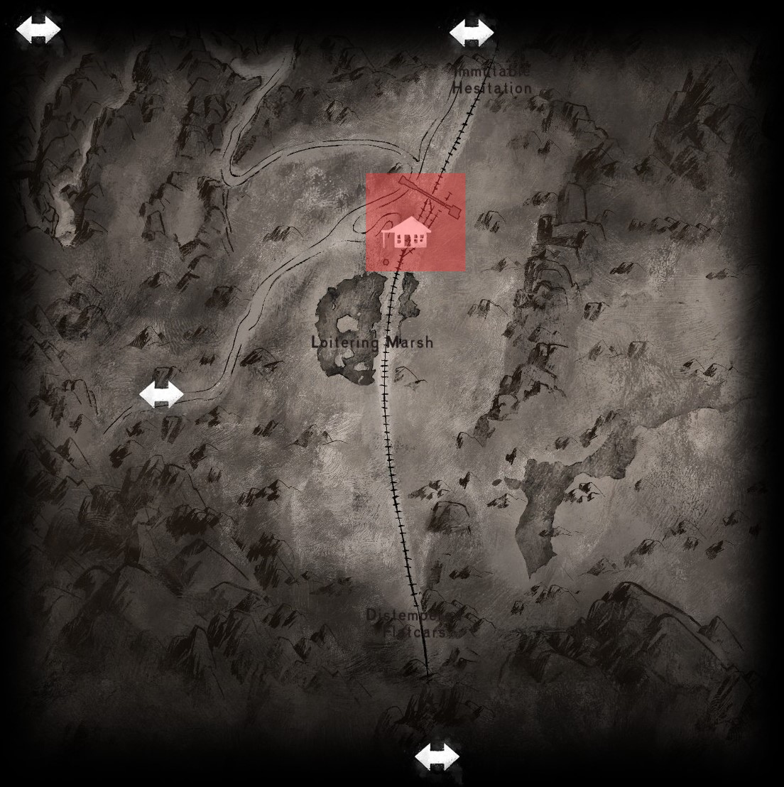
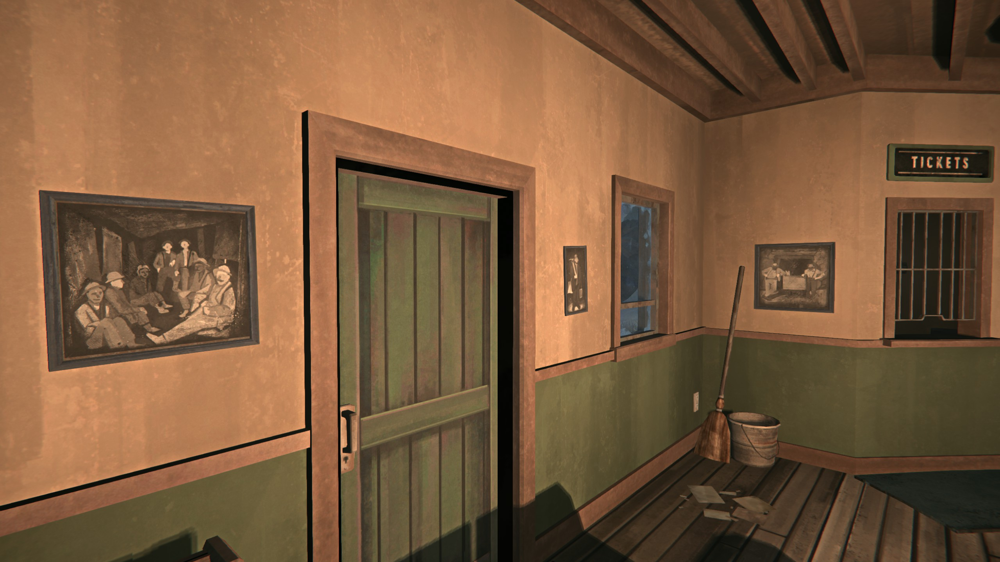

# Vacant Depot

**Vacant Depot**

| Property | Details |
| --- | --- |
|  |  / *Vacant\_Depot.png* |
| **Location** |  |
|  |  / *Vacant\_Depot\_Location.png* |
| Region | [Transfer Pass](./Transfer%20Pass.md)\|- |
| Description | An abandoned train station next to a coal tipple and water tower. |
| **General** |  |
| Type | Industrial\|- |
|  | Provides some shelter\|} / The **Vacant Depot** is a location in [Transfer Pass](./Transfer%20Pass.md), located near the center of the region. / ## Overview / The location can be spotted at a distance by its old water tower, which used to draw water from nearby [Feedwater Cave](./Feedwater%20Cave.md). There are also two sidings, one of which has a coal tipple and two coal hoppers, plus an abandoned train station named Vale station. / Inside the station can be found low to mid-grade clothing, some food and drink in lower difficulties, and 3 [suitcases](./Suitcase.md) for storage. Inside the ticket booth is one of the [Radios](./Trader.md#Radio_Locations) necessary to contact the Trader (if enabled). / The abandoned train station can make for a good shelter for weary players. However, there is no [bed](./Bed.md), so players who wish to sleep there will want to bring a [Bedroll](./Bedroll.md), or a permanent bed may be constructed with the help of [Woodworking Tools](./Woodworking%20Tools.md) as part of [Safehouse customization](./Safehouse%20Customization.md). The interior has a fixed ambient temperature of -10C (similar to Lookouts). Players may have to light the [Fireplace](./Fireplace.md) in order to keep themselves warm, at least until sufficient Warmth bonus from clothing is available. / Alternatively the nearby coal tower can be entered (and exited) through roundabout paths. The interior is much colder than the train station and gives no warmth bonus, however, the coal tipple also has chance to spawn some rarer items, such as a [Bear Skin Bedroll](./Bear%20Skin%20Bedroll.md), as well as more food and materials to break down. / While the station or tower could be used as a [Safe House](./Safehouse.md), Transfer Pass is a very small region to live in for any length of time, so resources may be depleted quickly. / ## Trivia / Several of the picture frames inside the Vacant Depot were changed with the release of the [Zone of Contamination](./Zone%20of%20Contamination.md), and now feature photographs of various coal miners and landmarks located within the Zone. / ## Gallery / \| Column 1 \| Column 2 \| Column 3 \| Column 4 \| / \| --- \| --- \| --- \| --- \| / \|  / *The timetable outside* \|  / *Vacant\_Depot\_Miner\_Photos.jpg* \|  / *Vacant\_Depot\_Langston\_Mine\_Photo.jpg* \|  / *Vacant\_Depot\_Aurora.jpg* \| / **Lua execution error in Module:Navbox function navbox** [ru:Пустая станция](ru:%D0%9F%D1%83%D1%81%D1%82%D0%B0%D1%8F_%D1%81%D1%82%D0%B0%D0%BD%D1%86%D0%B8%D1%8F) |
|  / *The timetable outside* |  / *Vacant\_Depot\_Miner\_Photos.jpg* /  / *Vacant\_Depot\_Langston\_Mine\_Photo.jpg* /  / *Vacant\_Depot\_Aurora.jpg* |
