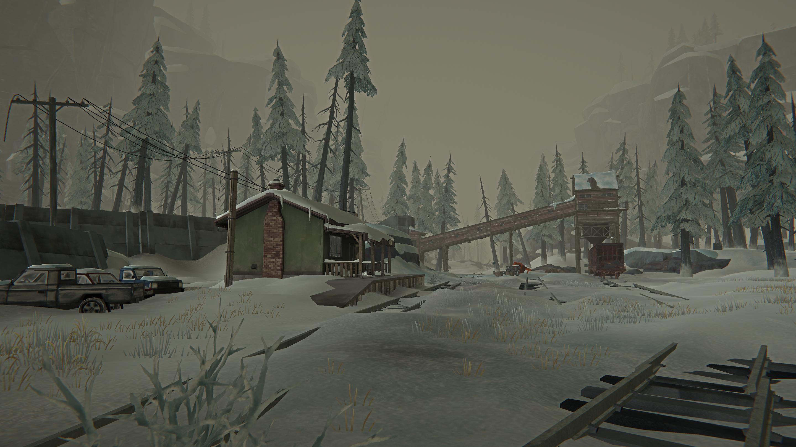
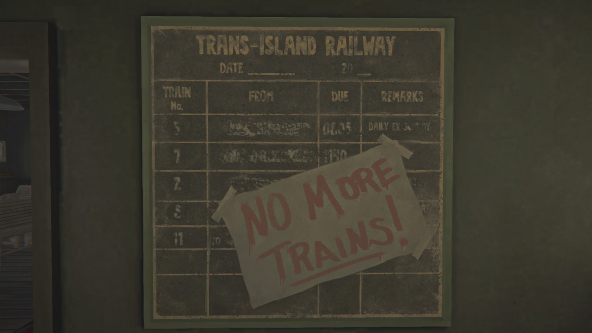
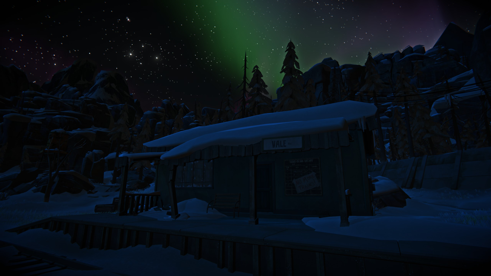

# Vacant Depot

**Categories:** Industrial locations, Locations, Locations in Transfer Pass, Sheltered locations · **Source:** [Fandom](https://thelongdark.fandom.com/wiki/Vacant_Depot)

**Vacant Depot**

_Vacant\_Depot.png_

**Location**

_Vacant\_Depot\_Location.png_

**Region:** [Transfer Pass](./Transfer%20Pass.md)\|-

**Description:** An abandoned train station next to a coal tipple and water tower.

**General**

**Type:** Industrial\|-

_The timetable outside_

_Vacant\_Depot\_Miner\_Photos.jpg_

_Vacant\_Depot\_Langston\_Mine\_Photo.jpg_

_Vacant\_Depot\_Aurora.jpg_
